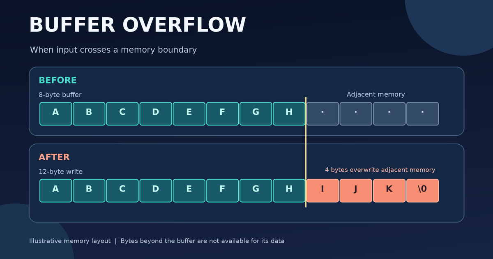

# Buffer Overflows: How a Few Extra Bytes Can Break a System

*A practical guide to memory corruption, real-world attacks, and the defenses that matter.*

Imagine a program reserving eight bytes to store a name. Now imagine that somebody gives it twelve bytes and the program copies every one of them without checking. Where do the extra four bytes go? In a memory-unsafe program, they may overwrite data that was never meant to change.

That simple mistake is the basis of a **buffer overflow**, one of the most influential classes of software vulnerabilities. The bug can be tiny; its consequences can range from a crash to compromised data or the execution of attacker-controlled instructions.

## 1. What is a buffer overflow, and why does it matter?

A **buffer** is a region of memory reserved to hold data, such as a character array, network packet, or image. A **buffer overflow** occurs when a program writes beyond that region's allocated bounds. The overflowing data can corrupt nearby memory, including variables, pointers, allocator metadata, or, in some circumstances, information used to control program execution.

The effects are often described through the three basic security goals:

| Security goal | Possible consequence |
| --- | --- |
| **Confidentiality** | An attacker may gain access to secrets through a related memory-safety flaw or by exploiting the resulting control of a program. |
| **Integrity** | Adjacent data, pointers, or program behavior may be modified without authorization. |
| **Availability** | A corrupted process may crash, hang, or become unable to provide its service. |

A buffer overflow is not automatically a successful attack. Whether it is exploitable depends on what is overwritten, the memory layout, the program's privileges, and the protections enabled on the system. Still, a single unchecked copy can turn ordinary user input into a serious security boundary failure. MITRE tracks the classic unchecked-copy weakness as [CWE-120](https://cwe.mitre.org/data/definitions/120.html).

## 2. How an overflow happens

C and C++ let programmers work close to memory, which is useful for systems programming but places responsibility for bounds checking on the code. Consider a C array declared as:

```c
char name[8];
```

It has room for eight **bytes**, not eight arbitrary-length strings. A conventional C string also needs one byte for the terminating `\0`, so this array can hold at most seven ASCII characters plus the terminator.

If a function copies twelve bytes into that eight-byte buffer, four bytes go beyond its boundary. The C language calls this **undefined behavior**: the program might appear to work, overwrite another variable, crash, or exhibit an exploitable effect. The diagram above visualizes the boundary being crossed; exact memory layout varies by compiler, architecture, and build settings.

Two common locations are:

- **Stack buffer overflow:** A local buffer inside a function is overwritten. Depending on the stack layout, other local data or control-related information may be affected.
- **Heap buffer overflow:** A dynamically allocated buffer is overwritten. Neighboring heap objects, pointers, or allocation metadata may be corrupted.

An important distinction from the previous heap-memory exercise: editing another process's memory through `/proc/<pid>/mem` is **direct process-memory modification**, not itself a buffer overflow. In a true overflow, the vulnerable program performs an out-of-bounds write because its own code fails to enforce a boundary.

## 3. A simplified vulnerable C example

Here is a deliberately unsafe example for understanding the problem:

```c
#include <stdio.h>
#include <string.h>

void greet(const char *input)
{
    char name[8];
    strcpy(name, input);  // Unsafe: no check that input fits.
    printf("Hello, %s!\n", name);
}
```

Suppose `input` is the ASCII string `ABCDEFGHIJK`. That is eleven characters, plus a null terminator, for **twelve bytes** in total. But `name` only holds eight bytes.

`strcpy` copies until it reaches the terminator and does not know how large the destination is. The copy therefore writes beyond `name`. In an ordinary test, the program might crash or seem to behave normally. Under favorable conditions for an attacker, the overwritten bytes could change a sensitive value or redirect execution. Historically, some attacks redirected execution to attacker-supplied code; modern attacks may try to reuse code already present in the process. Neither outcome is guaranteed by the example alone.

### A safer version

Check that the entire input, including its terminator, fits *before* copying:

```c
#include <stdio.h>
#include <string.h>

int greet(const char *input)
{
    char name[8];
    size_t length = strlen(input);

    if (length >= sizeof name) {
        fputs("Input is too long\n", stderr);
        return -1;
    }

    memcpy(name, input, length + 1);  // Includes the '\0'.
    printf("Hello, %s!\n", name);
    return 0;
}
```

Here, `strlen` assumes `input` is already a properly null-terminated C string, as it would be for an ordinary string argument. Network data and other byte buffers require explicit, trustworthy lengths rather than an assumption that a terminator exists. Also, swapping `strcpy` for `strncpy` is not a universal fix: `strncpy` may leave the destination without a terminator.

**The lesson:** memory safety must be designed into how lengths are tracked and checked, not merely added as an afterthought.

## 4. Two historical lessons

### The Morris Worm (1988): An overflow that helped spread a worm

On November 2, 1988, the **Morris Worm** spread across the early Internet, disrupting thousands of Unix machines. One of its entry points was a buffer overflow in the network-facing `fingerd` service, which used an unsafe input routine. The worm also exploited other weaknesses, including features of `sendmail` and weak or guessable passwords. The overflow was a significant part of its propagation mechanism, not the entire story.

Why it mattered: the incident showed how a vulnerability in a widely deployed network service could be automated and used to compromise machines at scale. It also contributed to the emergence of more coordinated computer-security incident response.

Historical sources: [RFC 1135, *The Helminthiasis of the Internet*](https://www.rfc-editor.org/rfc/rfc1135.html) and the [FBI's Morris Worm history](https://www.fbi.gov/history/cases-and-criminals/morris-worm).

### Heartbleed (2014): A different kind of out-of-bounds bug

**Heartbleed**, identified as **CVE-2014-0160**, affected OpenSSL's handling of TLS heartbeat messages. A missing bounds check allowed a crafted message to claim that its payload was longer than it really was. A vulnerable peer could then return up to about **64 KiB of process memory** in a response, potentially exposing sensitive application data.

There is an important technical correction here: **Heartbleed was a buffer over-read, not a buffer overflow write.** The vulnerable code read beyond a legitimate buffer instead of writing beyond it. It belongs in the broader family of memory-safety and bounds-checking failures, but the two bug types should not be confused.

Why it mattered: the bug demonstrated that even a bounds-checking mistake in widely trusted security infrastructure can compromise confidentiality, with serious implications for credentials and cryptographic material.

Primary sources: the [OpenSSL vulnerability entry](https://www.openssl-library.org/news/vulnerabilities/) and [CVE-2014-0160](https://www.cve.org/CVERecord?id=CVE-2014-0160).

## 5. Practical defenses against buffer overflows

No single defense catches every memory-safety bug. Strong software combines prevention, detection, and containment.

### 1. Prefer memory-safe languages where practical

Languages such as Rust and Java provide stronger memory-access guarantees in their safe subsets or managed execution models. They remove many classes of unchecked memory operations, although application-logic flaws can still occur. When low-level C or C++ is necessary, isolate risky operations behind small, reviewed interfaces.

### 2. Make size checking explicit

Treat every input length as untrusted until verified. Check destination capacity, account for the `\0` terminator when storing C strings, use correct integer types, and check for arithmetic overflow when computing allocation sizes. Prefer APIs that take a destination length and check their return values. Avoid unbounded string-copy and input routines.

### 3. Enable compiler and operating-system hardening

Build with appropriate **stack canaries**, **FORTIFY** checks, **position-independent executables (PIE)**, and linker hardening. At runtime, **address-space layout randomization (ASLR)** and **non-executable memory (NX/DEP)** can make exploitation harder. These are defense-in-depth measures; they do not correct the underlying out-of-bounds write.

### 4. Find defects before release

Use code review, static analysis, fuzz testing, and runtime sanitizers. In C/C++ development, **AddressSanitizer (ASan)** can detect many invalid memory accesses during instrumented test runs. Test boundary cases deliberately: empty input, maximum valid length, exactly full capacity, one byte too many, and very large inputs.

For the eight-byte example above, the difference between seven and eight ASCII characters is especially important: seven plus `\0` fits; eight plus `\0` does not.

### 5. Reduce the impact of a successful exploit

Keep dependencies patched, run services with minimal privileges, separate sensitive components, and use sandboxing where it fits. These measures limit what a compromised process can do, even when a memory bug survives review and testing.

MITRE's [CWE-120](https://cwe.mitre.org/data/definitions/120.html) and [CWE-121](https://cwe.mitre.org/data/definitions/121.html) entries provide further detail on prevention and mitigation.

## 6. Final thoughts

Buffer overflows are a reminder that software security is often about enforcing simple boundaries consistently. A buffer has a size. An input has a size. If code ignores the relationship between them, data can escape its intended memory region and affect a completely different part of the program.

The Morris Worm demonstrated how a real overflow could help compromise machines across a network. Heartbleed demonstrated the equally important point that *reading* beyond a boundary can expose information even without overwriting memory. Modern defensive tools have raised the bar, but the first line of defense remains correct length handling and memory-safe design.

**The most useful habit is also the simplest:** before moving data, know exactly how many bytes are available, how many will be accessed, and whether that access stays within bounds.

---

## References and further reading

1. MITRE, [CWE-120: Buffer Copy without Checking Size of Input](https://cwe.mitre.org/data/definitions/120.html).
2. MITRE, [CWE-121: Stack-based Buffer Overflow](https://cwe.mitre.org/data/definitions/121.html).
3. RFC Editor, [RFC 1135: The Helminthiasis of the Internet](https://www.rfc-editor.org/rfc/rfc1135.html), 1989.
4. Federal Bureau of Investigation, [Morris Worm](https://www.fbi.gov/history/cases-and-criminals/morris-worm).
5. OpenSSL Project, [OpenSSL Vulnerabilities](https://www.openssl-library.org/news/vulnerabilities/), CVE-2014-0160.
6. CVE Program, [CVE-2014-0160](https://www.cve.org/CVERecord?id=CVE-2014-0160).

*Illustration: original memory-boundary diagram created for this article.*
