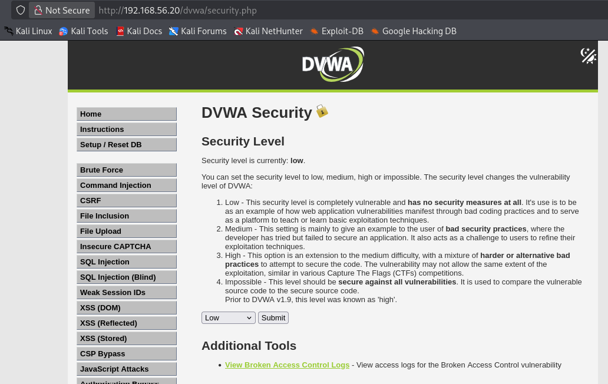
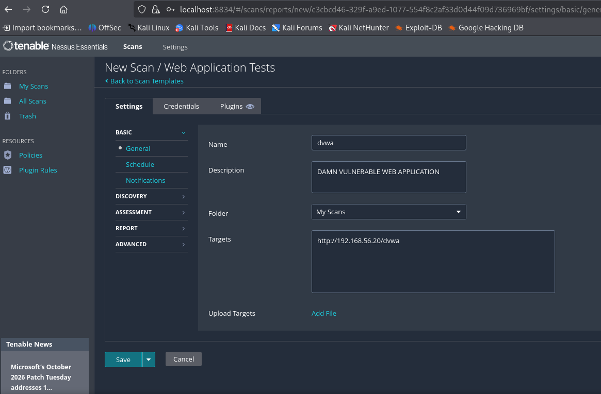
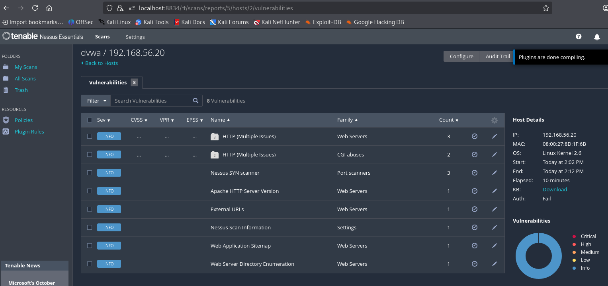

# Task 0 - Web Application Scan on DVWA

**Lab Information**

| Field           | Value |
|-------          |-------|
| Scanner         | Nessus Essentials on Kali Linux (192.168.56.10) |
| Target          | DVWA on Ubuntu Server (192.168.56.20) |
| Target URL      | b |
| Nessus Template | Web Application Tests |


## Section 1 - Preparing DVWA

**Steps**

1. Open the web browser on Kali Linux
2. Navigate to the DVWA URL
3. Log in to the application (user = admin, password = password)
4. Initialize or reset the DVWA database if required
5. Log in again after reset
6. Set DVWA security level to Low

**Screenshot required:** DVWA dashboard after login




## Section 2 - Scan Configuration

**Steps in Nessus**

0. Ensure Nessus is running on Kali Linux
```bash
sudo systemctl start nessusd
sudo systemctl status nessusd

# check expired license
sudo /opt/nessus/sbin/nessuscli fetch --check

# if error
# [error] Nessus Plugins: Did not get a 200 OK response from the server: HTTP/1.1 401 Unauthorized
# This installation is not configured to receive updates

# likely 30 days license expired, need to register for another 30 days license
# and the cleanes way is to purge the old nessus installation and reinstall it

# new license:
# https://www.tenable.com/products/nessus/nessus-essentials

# completely uninstall Nessus
sudo systemctl stop nessusd
sudo dpkg -r Nessus
sudo rm -rf /opt/nessus

# download from https://www.tenable.com/downloads/nessus?loginAttempted=true
# choose the Debian/Kali Linux 64-bit package - by curl:
curl --request GET \
  --url 'https://www.tenable.com/downloads/api/v2/pages/nessus/files/Nessus-10.12.5-debian10_amd64.deb' \
  --output 'Nessus-10.12.5-debian10_amd64.deb'

# install Nessus
sudo dpkg -i ./Nessus-*.deb

# start Nessus service
sudo systemctl enable --now nessusd

# Verify
sudo systemctl status nessusd --no-pager
# Expected status: active (running).


# Activate Nessus Essentials
# Open: https://localhost:8834/
# Follow the setup wizard:
# 1. Select Register for Nessus Essentials.
# 2. Choose the option to use an existing activation code.
# 3. Enter your fresh activation code.
# 4. Create a new administrator username and password.
# 5. Complete the setup and let the plugins download and compile.
```


```bash

# stop Nessus service
sudo systemctl stop nessusd

# register for another 30 days Nessus Essentials license
# https://www.tenable.com/products/nessus/nessus-essentials
# get new activation code on email and register it
sudo /opt/nessus/sbin/nessuscli fetch --register YOUR_NEW_ACTIVATION_CODE

# start Nessus service
sudo systemctl start nessusd
sudo systemctl status nessusd

# verify license
sudo /opt/nessus/sbin/nessuscli fetch --check
# Checking...
# Updates are configured properly


# forgotten username - list user(s)
sudo /opt/nessus/sbin/nessuscli lsuser
# forgotten password - reset password
sudo /opt/nessus/sbin/nessuscli chpasswd YOUR_USERNAME
```
1. Access Nessus web interface (https://localhost:8834) and log in with your credentials
2. Create a new scan
3. Select **Web Application Tests** template
4. Configure scan settings
5. Save the scan configuration

**Screenshot required:** Scan configuration page




## Section 3 - Scan Execution

**Steps**

1. Launch the scan
2. Monitor scan progress
3. Wait until scan completion
4. Take screenshots

**Screenshot required:** Scan completed status


