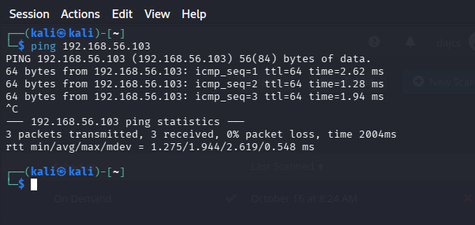
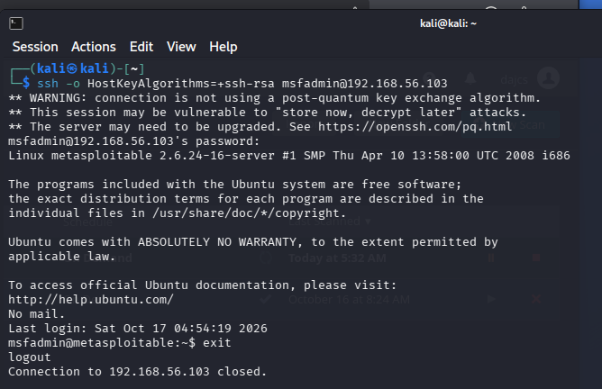
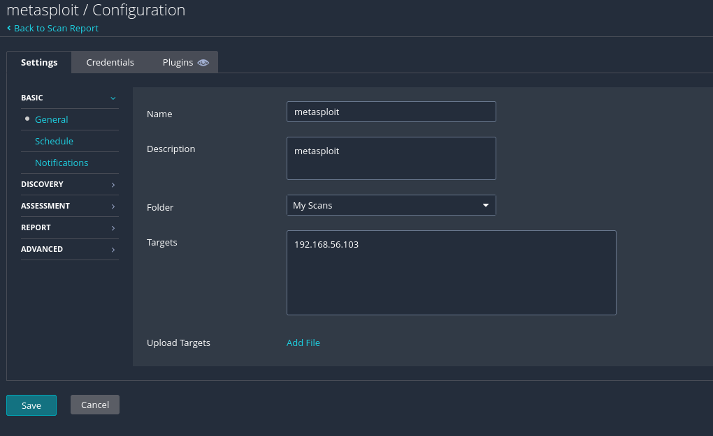
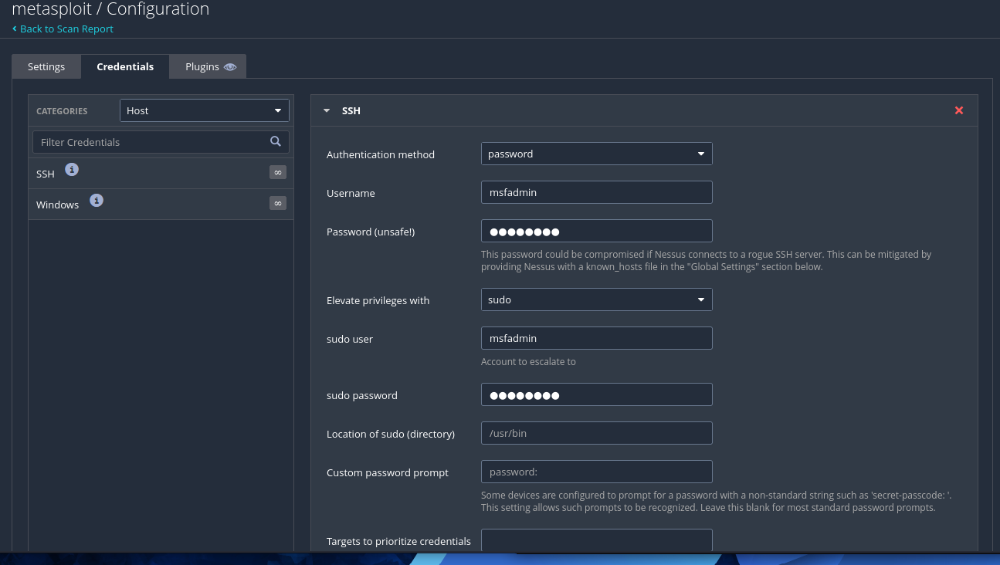
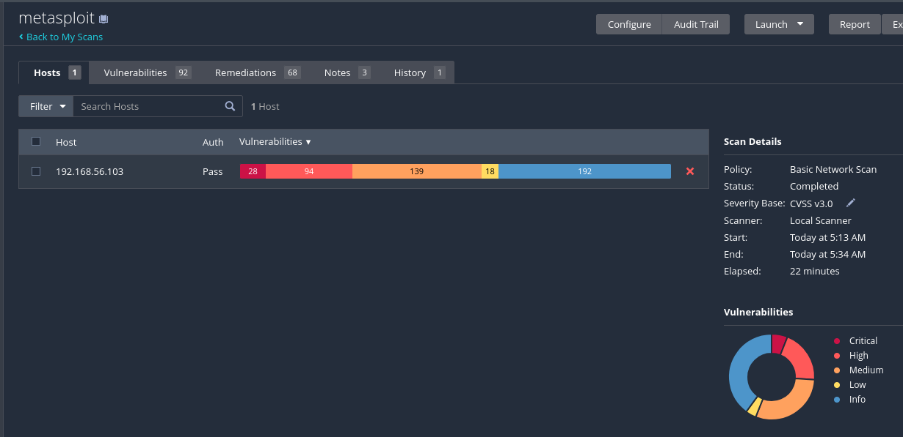
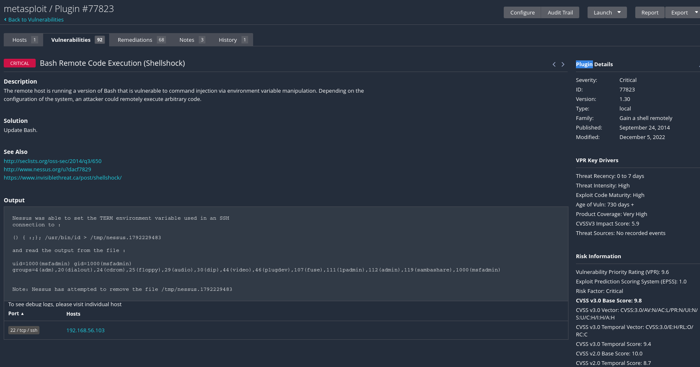

# Task 1 - Credentialed Scan & Local System Audit

Objective: Discover the vulnerabilities that a network-only scan completely misses.

Background

In Task 0, you ran an unauthenticated Web Application Tests scan against DVWA. A credentialed scan goes further - Nessus logs into the target host using valid credentials and inspects it from the inside, identifying missing patches, weak configurations, and locally installed software vulnerabilities that are invisible to a network-only scanner.

Learning Goal: By the end of this task, you will understand why credentialed scans are considered the gold standard for accurate vulnerability assessment, and you will be able to configure, execute, and interpret one end-to-end.

## 1.1 - Lab Environment Setup

Use one of the following local virtual machines as your scan target:

| Option | OS | IP | Credentials |
|--------|----|----|-------------|
| A      | Ubuntu Server 22.04 | 192.168.56.20 | user / user |
| B      | Metasploitable 2 | 192.168.56.103 | msfadmin / msfadmin |

**Student Details**

| Field	| Your Answer |
|-------|-------------|
| Selected Target	| Metasploitable 192.168.56.103 |
| Target IP Address	| 192.168.56.103 |

### Pre-Lab Checklist - complete before starting the scan

- Nessus Essentials is installed and activated
- Target VM is powered on and reachable (ping test passes)
- You have valid credentials for the target (username & password or SSH key)
- Nessus and the target VM are on the same network segment or host-only adapter
- You have noted the target IP address

### Screenshot required: Ping test result confirming the target VM is reachable

- ssh to metasploitable 2 target possible only with old rsa algorithm:

## 1.2 - Configuring Credentials in Nessus

Credentials allow Nessus to log in to the target and perform local checks. Follow these steps:

- In Nessus, click Settings → Credentials
- Choose credential type: SSH (both targets are Linux systems)
- Enter the username and password (or upload a private SSH key), then save
- When creating your scan, attach these credentials under the Credentials tab

### Screenshot required:

- basic config (basic network scan)

- Nessus credential configuration screen with type and username filled in

### Credential Configuration Record

| Field	| Your Entry
| -------|----------------
| Credential Type | SSH
| Username | msfadmin
| Authentication Method | Password
| Target IP	| 192.168.56.103
| Credential Verification | Did Nessus confirm authentication? **Yes** / ~~No~~

## 1.3 - Scan Configuration & Execution

Use the Basic Network Scan template with credentials attached.

### Screenshot required: Scan Result Overview

## 1.5 - Deep Dive - One Local Vulnerability

Choose one vulnerability from the credentialed scan results and complete the detail table:

| Field | Detail
| -------|----------------
| Plugin Name | Plugin #77823 - Bash Remote Code Execution (Shellshock)
| CVE ID | [  CVE-2014-6271 ]
| Severity / CVSS | [ Critical - 9.8 ]
| Plugin Family | [ Gain a shell remotely ]
| Plugin Output (summary) | `Nessus was able to set the TERM environment variable used in an SSH connection`
| Root Cause | An outdated, unpatched version of GNU Bash contains the Shellshock vulnerability (CVE-2014-6271). Bash incorrectly interprets specially crafted environment variables as executable commands. In this case, Nessus identified the vulnerability through the TERM environment variable during an SSH connection. The root cause is **missing security patches**.
| Potential Impact | An attacker who can deliver a malicious environment variable to a vulnerable Bash process may execute arbitrary operating-system commands with that process's privileges. Potential consequences include unauthorized access, theft or modification of sensitive data, installation of malware, service disruption, and potentially full system compromise if execution occurs with root privileges.
| Remediation Steps | **1**. Update GNU Bash to a version patched against CVE-2014-6271 and related Shellshock vulnerabilities. On a supported Debian/Ubuntu system, run sudo apt-get update && sudo apt-get install --only-upgrade bash. **2**. Verify that Bash no longer executes commands injected through environment variables. **3**. For Metasploitable 2, which uses an obsolete Ubuntu release, replace or upgrade the operating system to a supported version if patched packages are unavailable. **4**. Repeat the Nessus scan to confirm remediation.

### Screenshot required: Nessus finding detail page for your chosen vulnerability

## 1.6 - Reflection Questions

**Q1**: Explain in your own words why organisations should always prioritise credentialed scanning over unauthenticated scanning for internal systems.

Organisations should prioritise credentialed scanning because it provides a more comprehensive and accurate assessment of a system's security. \
Unauthenticated scans only identify vulnerabilities visible from the network, such as open ports, exposed services and outdated software versions. In contrast, credentialed scans can inspect the operating system, installed software, patch levels, system configurations and file permissions. \
This allows organisations to identify vulnerabilities that would otherwise remain undetected, while reducing false positives and improving remediation priorities. \
For example, during my **Metasploitable 2** assessment, Nessus used SSH credentials to identify the **Shellshock vulnerability (CVE-2014-6271)** in Bash. \
However, unauthenticated scanning remains valuable because it shows what an external attacker could discover without credentials. Therefore, **both approaches should complement each other**, with credentialed scanning preferred for internal vulnerability assessments whenever feasible.

**Q2**: What security risks exist in storing scan credentials inside a vulnerability scanner? How would you mitigate these risks?

Storing credentials in a vulnerability scanner introduces security risks because the scanner becomes a valuable target for attackers. \
If the scanner is compromised, an attacker could potentially obtain stored credentials and use them to access multiple systems across the organisation. This could lead to privilege escalation, lateral movement or unauthorised access to sensitive information. \
To mitigate these risks, I would implement the following measures:
- Least privilege: Use dedicated scanning accounts with only the permissions necessary to perform vulnerability assessments.
- Secure credential storage: Encrypt credentials and, where possible, integrate the scanner with a centralised secrets management system.
- Access control: Restrict scanner administration to authorised personnel and enforce multi-factor authentication.
- Credential rotation: Regularly rotate passwords and revoke credentials that are no longer required.
- Network segmentation: Restrict access to the scanner and limit the systems that scanning accounts can reach.
- Monitoring and auditing: Log credential usage and monitor for suspicious authentication attempts.
The objective is to reduce both the likelihood of credential compromise and the potential damage if credentials are exposed.

**Q3**: How would you handle a situation where a credentialed scan is not possible on certain hosts (e.g. legacy systems, locked accounts)?

If credentialed scanning is not possible, I would first investigate the reason, such as incompatible authentication protocols, insufficient permissions, locked accounts or unsupported operating systems. \
I would then adopt an alternative assessment approach:
1. Perform an unauthenticated scan: Identify vulnerabilities through open ports, running services, software versions and exposed network interfaces.
2. Investigate authentication issues: Check account permissions, SSH compatibility, firewall rules and authentication logs. For legacy systems, evaluate whether compatible authentication settings can be used within an isolated environment.
3. Use alternative assessment methods: Where possible, review installed packages, configuration files, patch levels and system logs through local administrative tools or approved management interfaces.
4. Document limitations: Clearly identify hosts that could not be scanned with credentials and explain how this reduces the confidence and completeness of the vulnerability assessment.
5. Apply compensating controls: For systems that cannot be patched or fully assessed, recommend network segmentation, restricted access, continuous monitoring or eventual replacement.

For example, during my Metasploitable 2 assessment, Kali initially rejected the SSH connection because the server supported only legacy host-key algorithms (ssh-rsa and ssh-dss). I resolved this by enabling compatibility with ssh-rsa for that specific SSH connection. \
This demonstrates that authentication failures do not necessarily prevent credentialed scanning, but they may require targeted configuration changes.
The important principle is to avoid treating an incomplete scan as evidence that a host is secure. Any scanning limitations and remaining risks should be explicitly documented.
