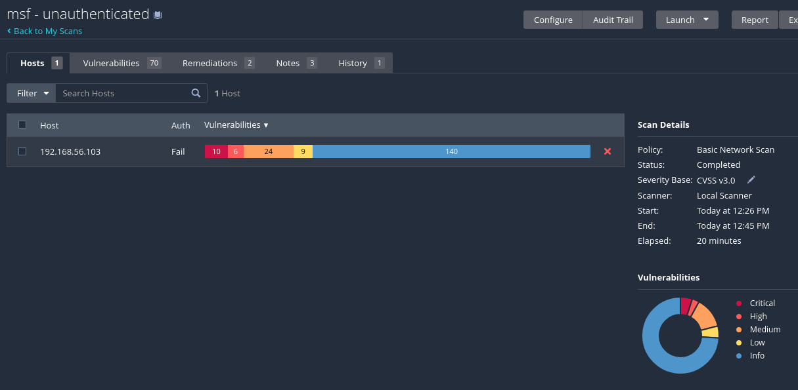
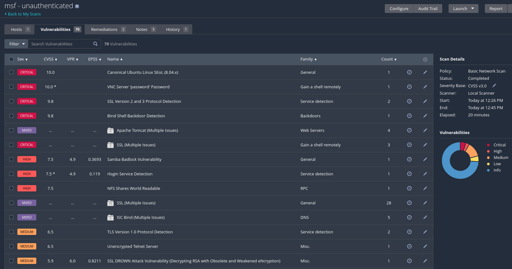
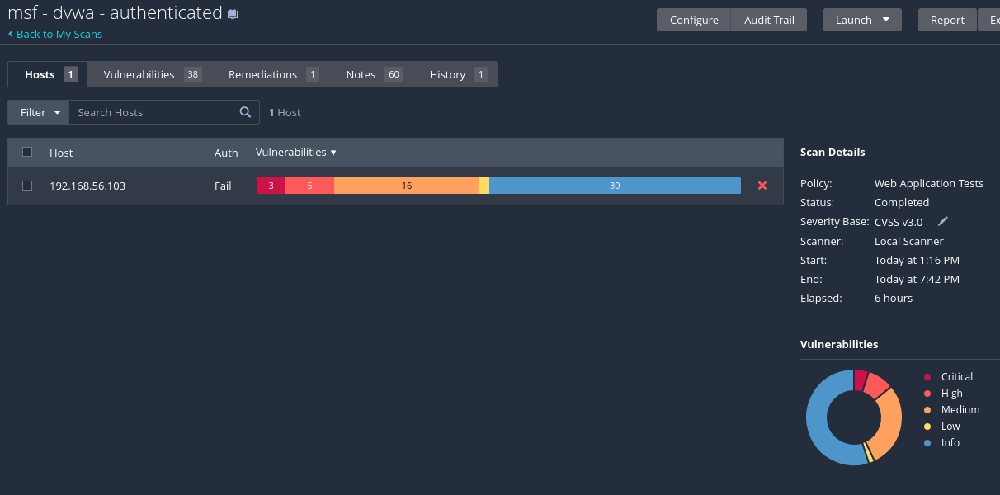
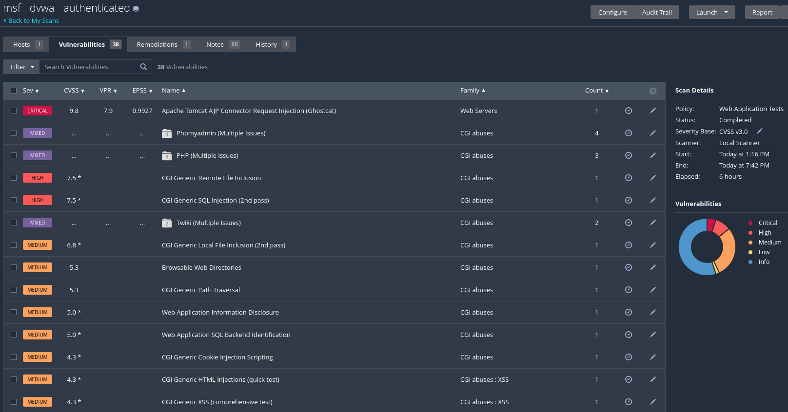

# Task 2 - Comparative Analysis - Nessus Basic vs Nessus Web Application Tests

## 3.1 Environment & Scan Configuration

Both scans use Nessus Essentials - no additional tools are required.

| Field | Your Input
| ------ | -------------
| Nessus Version | Nessus Essentials 10.12.5
| Common Target | Metasploitable 2 - 192.168.56.103
| Scan A - Template | Basic Network Scan (unauthenticated)
| Scan B - Template | DVWA Web Application Tests (authenticated)
| Port Range (both scans) | 80

### Screenshots required:

- Basic Network Scan results

- Basic Network Scan vulnerability list

- Web Application Tests results

- Web Application Tests vulnerability list

## 3.2 Side-by-Side Results Comparison

| Metric | Basic Network Scan | Web Application Tests
| ------ | ------------- | -------------
| Scan Duration | 20 min | ~6 h 26 min
| Critical Findings | 10 | 3
| High Findings | 6 | 5
| Medium Findings | 24 | 16
| Low Findings | 9 | 1
| Informational | 140 | 30
| Total Findings | 70 distinct findings (189 instances) | 38 distinct findings (55 instances)
| CVEs with CVSSv3 Scores | Not determinable without Report | Not determinable without Report
| Unique Findings | 70 distinct plugin entries; scan-exclusive count unknown | 38 distinct plugin entries; scan-exclusive count unknown
| False Positives | 0 confirmed (not validated) | 0 confirmed (not validated)

### Important clarification about the numbers

Nessus reports 70 vulnerabilities in the Basic Network Scan and 38 vulnerabilities in the Web Application Tests. \
However, the severity bars show a larger number of vulnerability instances:
- Basic Network Scan: 10 + 6 + 24 + 9 + 140 = 189 instances
- Web Application Tests: 3 + 5 + 16 + 1 + 30 = 55 instances

This happens because the same Nessus plugin finding can appear on multiple ports or services. \
For the assignment, We're using 70 and 38 as the total distinct findings, matching the Nessus Vulnerabilities tabs.

The "Unique Findings" metric is ambiguous. If it refers to distinct plugin entries within each scan, we can use 70 and 38. If it means findings detected exclusively by one scan and absent from the other, we would need to compare the complete plugin lists.

The number of CVEs with CVSSv3 scores cannot be reliably counted without the downloaded report containing the complete information of the vulnerability lists. (the report download function is not available in the Nessus Essentials)

## 3.3 Analysis of Unique Findings

List up to 3 findings detected only by each scan type.

| Template | Finding Name / CVE | Severity | Why it was missed by the other scan
| ------- | ------------- | ------------- | -------------
| Basic Network Scan only | VNC Server 'password' Password | Critical (10.0) | Web Application Tests focuses on HTTP/HTTPS vulnerabilities and does not normally assess VNC authentication or weak passwords on remote desktop services.
| Basic Network Scan only | Bind Shell Backdoor Detection | Critical (9.8) | Detecting a bind shell requires examining exposed network services and their behaviour. Web Application Tests focuses on web applications rather than identifying backdoors on arbitrary network ports.
| Basic Network Scan only | NFS Shares World Readable | High (7.5) | NFS is a network file-sharing protocol, not a web application. Web Application Tests does not normally enumerate NFS exports or assess their access permissions.
| Web Application Tests only | CGI Generic Remote File Inclusion | High (7.5)* | Identifying remote file inclusion requires testing HTTP parameters with crafted inputs. Basic Network Scan generally does not perform the same depth of application-level parameter testing.
| Web Application Tests only | CGI Generic SQL Injection (2nd pass) | High (7.5)* | SQL injection detection requires injecting test payloads into application parameters and analysing responses. Basic Network Scan prioritises network services and known vulnerabilities rather than comprehensive web parameter testing.
| Web Application Tests only | CGI Generic XSS (comprehensive test) | Medium (4.3)* | Cross-site scripting detection requires testing how applications process and reflect user-controlled input. The comprehensive XSS tests used by Web Application Tests are not normally performed by a Basic Network Scan.

## 3.4 Template Comparison

Criteria | Basic Network Scan | Web Application Tests | Notes
-------- | ------------------ | --------------------- | -----
Scan Duration | 20 min | 386 min (6 h 26 min) | Web Application Tests took considerably longer due to deeper crawling and HTTP parameter testing.
Types of Vulnerabilities | Network / Services | Web / HTTP | Network scanning identifies exposed services, insecure protocols and software vulnerabilities. Web testing focuses on SQL injection, XSS, file inclusion and other application weaknesses.
Plugins Used | Network, ports, services | HTTP, forms, cookies | Each template prioritises different Nessus plugin families and detection methods.
Credentials Required | No | No by default; session cookies supplied for authenticated testing | The Basic Network Scan was unauthenticated. The Web Application Tests scan was configured with DVWA authentication cookies, although successful authentication was not conclusively verified.
Web Analysis Depth | Low | High | Web Application Tests performs more extensive crawling, input validation and HTTP parameter testing.
Total Findings | 70 | 38 | Distinct vulnerability entries reported by Nessus. The corresponding severity-instance totals were 189 and 55.
False Positive Rate | #N/A | #N/A | Individual findings were not manually validated, so the false positive rates cannot be calculated reliably.

