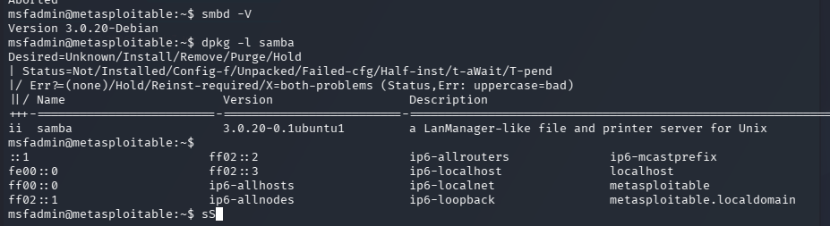
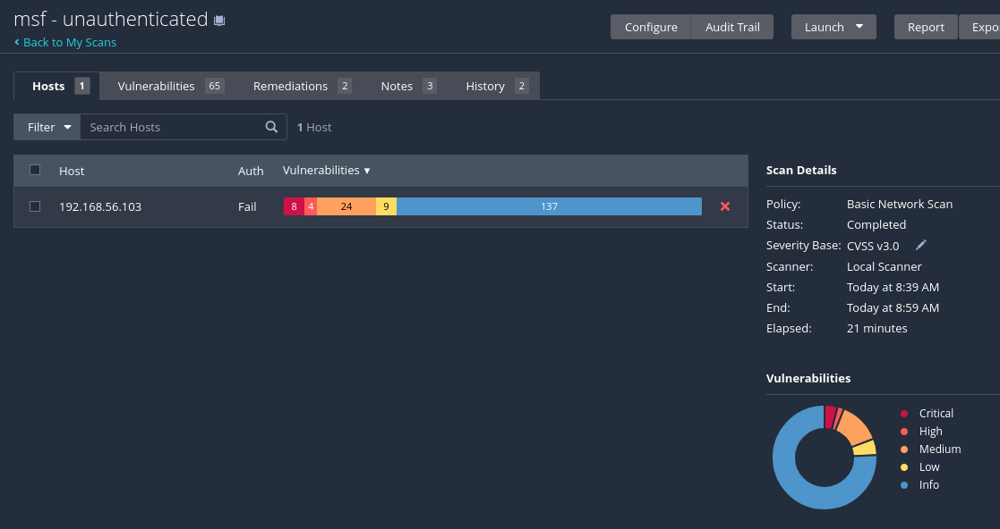
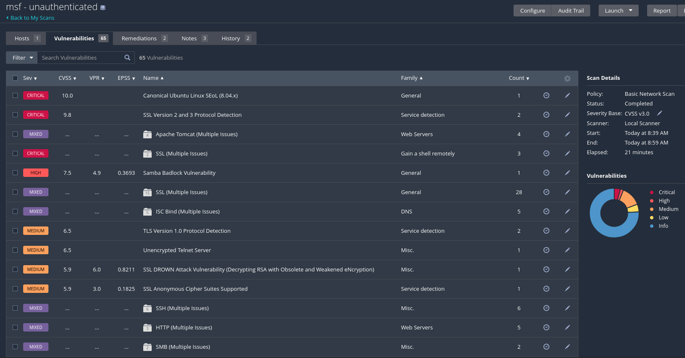

# 4. Remediation, Re-scan & Risk Reporting


Learning Goal: Understand the full vulnerability management lifecycle:

Discover → Prioritize → Remediate → Verify → Report

This workflow is fundamental for any vulnerability management analyst or security engineer.

## 4.1 Selecting Vulnerabilities to Remediate

From the previous Basic Network Scan results, select 3–5 vulnerabilities to remediate.

Choose findings that are:

- High or Critical severity (maximum impact)
- Fixable within your lab environment (no production constraints or kernel-level dependencies)
A mix of remediation types: at least one patch, one configuration change, and one service hardening

### Remediation Plan

| \# | Vulnerability / CVE | Severity | Type | Planned Fix |
| - | ------- | -------- | -------- | ---- |
| 1 | Samba Badlock Vulnerability (CVE-2016-2118) | High (7.5) |Patch | Upgrade Samba to a version containing the Badlock security fix, or apply an appropriate vendor patch. Verify the installed version before updating. |
| 2 | VNC Server 'password' Password (Plugin #61708) | Critical (10.0) | Configuration | Replace the weak VNC password password with a strong, unique password and restrict VNC access to trusted hosts. |
| 3 | NFS Shares World Readable (Plugin #42256) | High (7.5) | Configuration | Modify /etc/exports to restrict NFS shares to authorised IP addresses and remove unrestricted (*) exports. |
| 4 | rlogin Service Detection (CVE-1999-0651) | High (7.5) | Service | Disable the insecure rlogin service through inetd or xinetd and use SSH instead. |
| 5 | Bind Shell Backdoor Detection (Plugin #51988) | Critical (9.8) | Service | Identify and disable the process or service exposing an unauthenticated command shell. Remove its startup configuration and verify that the port is closed. |


## 4.2 Applying Remediations

For each vulnerability, document the exact remediation steps. Repeat the structure below for each fix.

**Snapshot Recommendation**: Take a VM snapshot before applying any changes to allow rollback if needed.

### **Remediation #1** - Samba Badlock Vulnerability (CVE-2016-2118)

```bash
# check current Samba version
msfadmin@metasploitable:~$ smbd -V
# Version 3.0.20-Debian

msfadmin@metasploitable:~$ dpkg -l samba
# Desired=Unknown/Install/Remove/Purge/Hold
# | Status=Not/Installed/Config-f/Unpacked/Failed-cfg/Half-inst/t-aWait/T-pend
# |/ Err?=(none)/Hold/Reinst-required/X=both-problems (Status,Err: uppercase=bad)
# ||/ Name                      Version                   Description
# +++-=========================-=========================-==================================================================
# ii  samba                     3.0.20-0.1ubuntu1         a LanManager-like file and printer server for Unix
msfadmin@metasploitable:~$
```

### Samba Badlock Vulnerability (Confirmed False Positive)
Finding: CVE-2016-2118 | Nessus Plugin #90509 | High (CVSS 7.5)

The investigation confirmed that Metasploitable 2 runs **Samba 3.0.20**, whereas the official Samba security advisory identifies **versions 3.6.0 through 4.4.0 as affected by CVE-2016-2118**.

This finding can be classified as a false positive based on the installed software version.

Field | Detail
-------|----------------
Vulnerability Name / CVE | Samba Badlock Vulnerability (CVE-2016-2118), Nessus Plugin #90509
Pre-Remediation State | The Nessus Basic Network Scan flagged the Samba service on 192.168.56.103 as vulnerable to CVE-2016-2118, with High severity (CVSS 7.5). This suggested a potential man-in-the-middle attack affecting Samba RPC authentication.
Actions Taken | Connected to Metasploitable 2 via SSH and executed smbd -V and dpkg -l samba to identify the installed Samba version. Compared version 3.0.20 against the official Samba advisory, which identifies affected versions as 3.6.0 through 4.4.0. No software modifications were necessary.
Post-Remediation State | Verification confirmed Version 3.0.20-Debian and installed package samba 3.0.20-0.1ubuntu1. Because this version is outside the affected range, the finding was classified as False Positive / Not Applicable. No patch was applied, and the Samba service remains unchanged.
Time to Remediate | **0 minutes** (no remediation required). Validation time was not recorded; estimated investigation time: **10 minutes**.


**Screenshot required**: Terminal output showing remediation #1




## **Remediation #2** - VNC Server 'password' Password (Plugin #61708)

- check from Kali that VNC is accessible

```bash
nmap -sV -p 5900 192.168.56.103
# Starting Nmap 7.99 ( https://nmap.org ) at 2026-10-18 02:27 -0400
# Nmap scan report for 192.168.56.103
# Host is up (0.0015s latency).
#
# PORT     STATE SERVICE VERSION
# 5900/tcp open  vnc     VNC (protocol 3.3)
# MAC Address: 08:00:27:23:1F:46 (Oracle VirtualBox virtual NIC)
```

- connect to VNC from Kali using the default password `password`

```bash
vncviewer 192.168.56.103:0
# Connected to RFB server, using protocol version 3.3
# Performing standard VNC authentication
# Password:
# Authentication successful
# Desktop name "root's X desktop (metasploitable:0)"
# VNC server default format:
#   32 bits per pixel.
#   Least significant byte first in each pixel.
#   True colour: max red 255 green 255 blue 255, shift red 16 green 8 blue 0
# Using default colormap which is TrueColor.  Pixel format:
#   32 bits per pixel.
#   Least significant byte first in each pixel.
#   True colour: max red 255 green 255 blue 255, shift red 16 green 8 blue 0
```

- connect to Metasploitable 2 from Kali via SSH and identify which VNC ports are listening and which processes own them.

```bash
ssh -o HostKeyAlgorithms=+ssh-rsa msfadmin@192.168.56.103

## on Metasploitable 2, check for listening VNC ports and associated processes
## ---------------
sudo netstat -tlnp | grep -E ':(5900|5901|5902)[[:space:]]'
# [sudo] password for msfadmin:
# tcp        0      0 0.0.0.0:5900            0.0.0.0:*               LISTEN      4620/Xtightvnc
```

This confirms the service is active and potentially accessible from other machines on the lab network.

Before changing the password, we need to identify the account running TightVNC and its startup arguments. \
This will help us locate the correct password file.

```bash
sudo ps -ww -p 4620 -o args=
# Xtightvnc :0 -desktop X -auth /root/.Xauthority -geometry 1024x768 -depth 24 -rfbwait 120000 -rfbauth /root/.vnc/passwd -rfbport 5900 -fp /usr/X11R6/lib/X11/fonts/Type1/,/usr/X11R6/lib/X11/fonts/Speedo/,/usr/X11R6/lib/X11/fonts/misc/,/usr/X11R6/lib/X11/fonts/75dpi/,/usr/X11R6/lib/X11/fonts/100dpi/,/usr/share/fonts/X11/misc/,/usr/share/fonts/X11/Type1/,/usr/share/fonts/X11/75dpi/,/usr/share/fonts/X11/100dpi/ -co /etc/X11/rgb
```

We've identified the exact password file used by your TightVNC server:

```bash
# -rfbauth /root/.vnc/passwd
```

Change password for the VNC server using the `vncpasswd` command.

```bash
sudo vncpasswd /root/.vnc/passwd
# [sudo] password for msfadmin:
# Password:
# Warning: password truncated to the length of 8.
# Verify:
# Would you like to enter a view-only password (y/n)? n
```

Restart TightVNC so it loads the updated password file.

```bash
 sudo -H vncserver -kill :0
# Killing Xtightvnc process ID 4620
```

Start TightVNC again with the same arguments as before.

```bash
sudo -H vncserver :0 -geometry 1024x768 -depth 24

# New 'X' desktop is metasploitable:0

# Starting applications specified in /root/.vnc/xstartup
# Log file is /root/.vnc/metasploitable:0.log
```

This should:
- Start TightVNC on display :0 (TCP port 5900).
- Run the server as root, as before.
- Preserve the original screen resolution and colour depth.
- Load the updated authentication password from /root/.vnc/passwd.

Check if running:

```bash
sudo netstat -tlnp | grep ':5900'
# tcp        0      0 0.0.0.0:5900            0.0.0.0:*               LISTEN      11401/Xtightvnc
```

TightVNC successfully restarted and the new process ID is 11401, replacing the previous process 4620.

### confirm that the new password is working by connecting from Kali again:

```bash
# old password attempt (should fail)
vncviewer 192.168.56.103:0
Connected to RFB server, using protocol version 3.3
Performing standard VNC authentication
Password:
Authentication failure

# new password attempt (should succeed)
vncviewer 192.168.56.103:0
Connected to RFB server, using protocol version 3.3
Performing standard VNC authentication
Password:
Authentication successful
Desktop name "root's X desktop (metasploitable:0)"
VNC server default format:
  32 bits per pixel.
  Least significant byte first in each pixel.
  True colour: max red 255 green 255 blue 255, shift red 16 green 8 blue 0
Using default colormap which is TrueColor.  Pixel format:
  32 bits per pixel.
  Least significant byte first in each pixel.
  True colour: max red 255 green 255 blue 255, shift red 16 green 8 blue 0
```

### Remediation #2 Summary Table

Field | Detail
-------|----------------
Vulnerability Name / CVE | VNC Server 'password' Password, Nessus Plugin #61708. No specific CVE assigned.
Pre-Remediation State | Nessus detected that the TightVNC server on `TCP` port `5900` accepted the weak/default password `password`, allowing unauthorised remote desktop access. The service was running as root and listening on all network interfaces (`0.0.0.0:5900`). Initial verification output: `4620/Xtightvnc`.
Actions Taken | Identified the TightVNC process and its authentication file (`/root/.vnc/passwd`). Changed the weak password using `sudo vncpasswd /root/.vnc/passwd`. Restarted TightVNC using `sudo -H vncserver -kill :0` followed by `sudo -H vncserver :0 -geometry 1024x768 -depth 24`.
Post-Remediation State | TightVNC restarted successfully (`PID 11401`) and remained accessible on `TCP 5900`. Manual authentication testing from Kali confirmed that the original password was rejected (`Authentication failure`) and the new password was accepted (`Authentication successful`). The weak-password issue is manually verified as resolved. Final confirmation through `Nessus Plugin #61708` is pending.
Time to Remediate | Estimated **15–20 minutes**, including investigation, password modification, service restart and manual verification. Actual elapsed time was not recorded.


## Remediation #3 - NFS Shares World Readable (Plugin #42256)


- **Target**: Metasploitable 2 (192.168.56.103)
- **Nessus** Plugin: #42256
- **Severity**: High (CVSS v3 7.5)
- **Remediation** type: Configuration Change

**Objective**

Nessus detected that the NFS server exports one or more directories without restricting which client IP addresses can access them. \
This could allow unauthorised users to mount shared directories and access sensitive files.

We'll restrict NFS exports to authorised clients, then verify that the access restrictions work.

Check NFS exports on Metasploitable 2:

```bash
sudo exportfs -v
# /               <world>(rw,wdelay,no_root_squash,no_subtree_check)
```

Setting | Security implication
------- | ----------------
/ | The entire root filesystem is exported.
\<world> | Any host that can reach the NFS service may attempt to mount it.
rw | Clients have read/write access, subject to filesystem permissions.
no_root_squash | Remote root users retain root privileges on the exported filesystem.
no_subtree_check | Disables subtree verification. Not the main vulnerability here.


Check configuration file `/etc/exports`:

```bash
sudo cat /etc/exports
# /etc/exports: the access control list for filesystems which may be exported
#               to NFS clients.  See exports(5).
#
# Example for NFSv2 and NFSv3:
# /srv/homes       hostname1(rw,sync) hostname2(ro,sync)
#
# Example for NFSv4:
# /srv/nfs4        gss/krb5i(rw,sync,fsid=0,crossmnt)
# /srv/nfs4/homes  gss/krb5i(rw,sync)
#

/       *(rw,sync,no_root_squash,no_subtree_check)
```


Since this is a `Metasploitable 2` lab and we don't need NFS file sharing for our exercises, better to remove the root filesystem export entirely.
This is more secure than simply restricting access to specific IP addresses, and it should eliminate the finding reported by `Nessus Plugin #42256`.

First, back up the original `/etc/exports` file:

```bash
sudo cp -p /etc/exports /etc/exports.bak
```

Then, edit `/etc/exports` to remove the root filesystem export (by commenting it out):

```bash
sudo sed -i '/^\/[[:space:]]/s/^/# /' /etc/exports && tail -n 3 /etc/exports
#

# /     *(rw,sync,no_root_squash,no_subtree_check)
```

Apply the new export configuration:

```bash
sudo exportfs -ra
# (no output)
```

Verify that the NFS export is no longer available:

```bash
sudo exportfs -v
# (no output)
```

External verification from Kali:

```bash
showmount -e 192.168.56.103
Export list for 192.168.56.103:

# (no output)
```

### Remediation #3 Summary Table

Field | Detail
-------|----------------
Vulnerability Name / CVE | NFS Shares World Readable, `Nessus Plugin #42256`. High severity. No specific CVE assigned.
Pre-Remediation State | Nessus identified an unrestricted NFS export on Metasploitable 2 (`192.168.56.103`). The root filesystem / was exported to all clients with read/write access and no_root_squash, potentially allowing unauthorised file access and modification. Original output: `/ <world>(rw,wdelay,no_root_squash,no_subtree_check)`.
Actions Taken | Backed up `/etc/exports` using `sudo cp -p /etc/exports /etc/exports.bak`. Commented out the insecure export using sudo `sed -i '/^\/[[:space:]]/s/^/# /' /etc/exports`. Applied the new configuration with `sudo exportfs -ra`.
Post-Remediation State | Local verification using `sudo exportfs -v` returned no exports. Remote verification from Kali using `showmount -e 192.168.56.103` returned an empty export list. The unrestricted NFS share has been successfully disabled. Final Nessus verification pending.
Time to Remediate | Estimated **5–10 minutes** of active work. Actual duration not recorded.


## Remediation #4 - Disable the Insecure rlogin Service (CVE-1999-0651)

- **Target**: Metasploitable 2 (192.168.56.103)
- **Vulnerability**: rlogin Service Detection
- **Remediation type**: Service Hardening
- **Status**: Not yet remediated

**Objective**

The `rlogin` service is an obsolete remote-login protocol that typically operates on **TCP port 513**. \
Unlike SSH, rlogin does not encrypt communication, potentially exposing login credentials and session data to network interception. \
Our objective is to disable rlogin without affecting SSH access.

**Steps**:

Identify the rlogin service process on Metasploitable 2:

```bash
sudo netstat -tlnp | grep ':513 '
# tcp        0      0 0.0.0.0:513             0.0.0.0:*               LISTEN      4467/xinetd
```

- **Port 513**: Accepting incoming connections.
- **0.0.0.0**: Listening on all IPv4 network interfaces.
- **xinetd**: The service manager responsible for launching rlogin connections.

Check rlogin configuration in `/etc/xinetd.d/rlogin`:

```bash
sudo cat /etc/xinetd.d/rlogin
# cat: /etc/xinetd.d/rlogin: No such file or directory
```

Try to locat the actual rlogin configuration file by searching the xinetd configuration for references to the rlogin service and displaying the filename and line number of any matches.

```bash
sudo grep -RniE 'rlogin|rlogind|service[[:space:]]+login' /etc/xinetd.conf /etc/xinetd.d/
# no output
```

Metasploitable 2 may be using xinetd in compatibility mode, which allows it to read legacy service definitions from `/etc/inetd.conf`

```bash
sudo ps -ww -p 4467 -o args=
# /usr/sbin/xinetd -pidfile /var/run/xinetd.pid -stayalive -inetd_compat
```

Parameter | Meaning
--------- | -------
ps | Display information about running processes.
-ww | Use unlimited output width, avoiding command-line truncation.
-p 4467 | Show only the process with PID 4467.
-o args | Display the command and all its startup arguments.
= | Suppress the output column header.

The `-inetd_compat` option enables compatibility with the older `inetd` configuration format.
This explains why we couldn't find rlogin in `/etc/xinetd.d/`. \
This parameter tells `xinetd` to support services configured using the legacy `/etc/inetd.conf` format, rather than relying exclusively on `/etc/xinetd.d/` configuration files.

The service is likely defined in `/etc/inetd.conf`, let's give it a look:

```bash
sudo cat /etc/inetd.conf

#<off># netbios-ssn     stream  tcp     nowait  root    /usr/sbin/tcpd  /usr/sbin/smbd
telnet          stream  tcp     nowait  telnetd /usr/sbin/tcpd  /usr/sbin/in.telnetd
#<off># ftp             stream  tcp     nowait  root    /usr/sbin/tcpd  /usr/sbin/in.ftpd
tftp            dgram   udp     wait    nobody  /usr/sbin/tcpd  /usr/sbin/in.tftpd /srv/tftp
shell           stream  tcp     nowait  root    /usr/sbin/tcpd  /usr/sbin/in.rshd
login           stream  tcp     nowait  root    /usr/sbin/tcpd  /usr/sbin/in.rlogind
exec            stream  tcp     nowait  root    /usr/sbin/tcpd  /usr/sbin/in.rexecd
ingreslock stream tcp nowait root /bin/bash bash -i
```

The line
```
login stream tcp nowait root /usr/sbin/tcpd /usr/sbin/in.rlogind
```

indicates:

Field | Meaning
------ | -------
login | Service name, mapped to `TCP port 513` through `/etc/services`.
stream | TCP connection-oriented service.
tcp | Transport protocol.
nowait | The service can handle concurrent connections.
root | The daemon runs with root privileges.
`/usr/sbin/tcpd` | TCP Wrappers, which can implement host-based access controls.
`/usr/sbin/in.rlogind` | The actual rlogin server executable.


**Observations**:

- The line `ingreslock stream tcp nowait root /bin/bash bash -i` contains several other insecure legacy services, including `Telnet`, `rsh` and `rexec`, plus the `ingreslock` service, which is a backdoor that allows remote shell access.
- The final entry `/bin/bash bash -i` appears to be the bind-shell backdoor we'll address in Remediation #5.
- For now, we'll only disable `rlogin`.

Create a backup of `/etc/inetd.conf` before making changes:

```bash
sudo cp -p /etc/inetd.conf /etc/inetd.conf.bak
```

Edit the config file by commenting out the line which begins with `login`:

```bash
sudo sed -i '/^[[:space:]]*login[[:space:]]/s/^/# /' /etc/inetd.conf
```

Check the change:

```bash
sudo diff /etc/inetd.conf.bak /etc/inetd.conf
6c6
< login         stream  tcp     nowait  root    /usr/sbin/tcpd  /usr/sbin/in.rlogind
---
> # login               stream  tcp     nowait  root    /usr/sbin/tcpd  /usr/sbin/in.rlogind
```

`xinetd` must reload its configuration for the change to take effect:

```bash
sudo kill -HUP "$(cat /var/run/xinetd.pid)"
```

- `cat /var/run/xinetd.pid` retrieves the running xinetd process ID.
- `kill -HUP` sends the SIGHUP signal to that process.
- `xinetd` responds by reloading its configuration, including `/etc/inetd.conf`.

**SIGHUP (Signal Hang Up)** is a Unix/Linux signal traditionally used to notify a process that its controlling terminal has disconnected. \
Today, many background services (daemons) also interpret SIGHUP as a request to **reload their configuration without terminating the process**.

This allows us to apply the configuration change without restarting the entire service manager.


Verify that the rlogin service is no longer listening on TCP port 513:

```bash
sudo netstat -tlnp | grep ':513 ' || echo "PASS: rlogin TCP port 513 is not listening"
# PASS: rlogin TCP port 513 is not listening
```

Remote verification from Kali:

```bash
nmap -sT -p 513 --reason 192.168.56.103
# Starting Nmap 7.99 ( https://nmap.org ) at 2026-10-18 06:17 -0400
# Nmap scan report for 192.168.56.103
# Host is up, received arp-response (0.00091s latency).
#
# PORT    STATE  SERVICE REASON
# 513/tcp closed login   conn-refused
# MAC Address: 08:00:27:23:1F:46 (Oracle VirtualBox virtual NIC)
#
# Nmap done: 1 IP address (1 host up) scanned in 0.61 seconds
```


### Remediation #4 Summary Table


Field | Detail
-------|----------------
Vulnerability Name / CVE | `rlogin` Service Detection, insecure remote-login protocol, `TCP port 513`.
Pre-Remediation State | Nessus identified the insecure `rlogin` service on `192.168.56.103`. Local verification confirmed `xinetd` listening on `0.0.0.0:513` (PID 4467). The service was enabled through `/etc/inetd.conf`, allowing unencrypted remote-login connections.
Actions Taken | Backed up `/etc/inetd.conf` using `sudo cp -p /etc/inetd.conf /etc/inetd.conf.bak`. Commented out the login service entry using `sudo sed -i '/^[[:space:]]*login[[:space:]]/s/^/# /' /etc/inetd.conf`. Reloaded `xinetd` using `sudo kill -HUP "$(cat /var/run/xinetd.pid)"`.
Post-Remediation State | Local verification confirmed that `TCP 513` was no longer listening. Remote verification from Kali using `nmap -sT -p 513 --reason 192.168.56.103` returned `513/tcp closed login conn-refused`. The insecure rlogin service has been successfully disabled. Final Nessus verification pending.
Time to Remediate | Estimated **10–15 minutes** of active work. Actual duration not recorded.


## Remediation #5 - Bind Shell Backdoor Detection (Plugin #51988)


We already discovered the likely cause of the bind shell backdoor while inspecting `/etc/inetd.conf`:

```bash
ingreslock stream tcp nowait root /bin/bash bash -i
```

This configuration exposes an interactive Bash shell through the `ingreslock` service, typically on **TCP port 1524**, running with root privileges.

Verify the bind shell is listening on **Metasploitable 2**:

```bash
sudo netstat -tlnp | grep ':1524 '
# tcp        0      0 0.0.0.0:1524            0.0.0.0:*               LISTEN      4467/xinetd
```

The line `tcp  0  0 0.0.0.0:1524  0.0.0.0:*  LISTEN  4467/xinetd` confirm:

- **Port**: TCP 1524 (ingreslock)
- **Service manager**: xinetd, PID 4467
- **Network exposure**: All IPv4 interfaces
- **Risk**: Unauthenticated remote shell access with root privileges

We previously identified the responsible entry in /etc/inetd.conf:

```bash
ingreslock stream tcp nowait root /bin/bash bash -i
```

This configuration exposes an interactive Bash shell running as root, without requiring authentication.

Backup current `/etc/inetd.conf` before making changes:

```bash
sudo cp -p /etc/inetd.conf /etc/inetd.conf.bind
```


Comment out the `ingreslock` line in `/etc/inetd.conf` to disable the bind shell:

```bash
sudo sed -i '/^[[:space:]]*ingreslock[[:space:]]/s/^/# /' /etc/inetd.conf
```

Check the change:

```bash
sudo diff /etc/inetd.conf.bind /etc/inetd.conf
8c8
< ingreslock stream tcp nowait root /bin/bash bash -i
---
> # ingreslock stream tcp nowait root /bin/bash bash -i
```

The vulnerable service is now disabled in `/etc/inetd.conf`, but `xinetd` must reload its configuration for the change to take effect.

```bash
sudo kill -HUP "$(cat /var/run/xinetd.pid)"
```

Verify that **TCP port 1524** is no longer listening on **Metasploitable 2**:

```bash
sudo netstat -tlnp | grep ':1524 ' || echo "PASS: Bind shell TCP port 1524 is not listening"
PASS: Bind shell TCP port 1524 is not listening
```

Remote verification from Kali:

```bash
nmap -sT -p 1524 --reason 192.168.56.103
# Starting Nmap 7.99 ( https://nmap.org ) at 2026-10-18 08:33 -0400
# Nmap scan report for 192.168.56.103
# Host is up, received arp-response (0.0012s latency).
#
# PORT     STATE  SERVICE    REASON
# 1524/tcp closed ingreslock conn-refused
# MAC Address: 08:00:27:23:1F:46 (Oracle VirtualBox virtual NIC)
#
# Nmap done: 1 IP address (1 host up) scanned in 0.64 seconds
```

### Remediation #5 Summary Table

Field | Detail
-------|----------------
Vulnerability Name / CVE | Bind Shell Backdoor Detection, Nessus `Plugin #51988`, Critical (CVSS 9.8). No specific CVE assigned.
Pre-Remediation State | Nessus detected an unauthenticated bind shell on `Metasploitable 2` (`192.168.56.103`). The service was managed by `xinetd` and listening on `0.0.0.0:1524`. The configuration entry `ingreslock stream tcp nowait root /bin/bash bash -i` exposed an interactive Bash shell running with `root` privileges, potentially allowing complete system compromise.
Actions Taken | Backed up `/etc/inetd.conf`. Commented out the vulnerable `ingreslock` entry using `sudo sed -i '/^[[:space:]]*ingreslock[[:space:]]/s/^/# /' /etc/inetd.conf`. Reloaded `xinetd` using `sudo kill -HUP "$(cat /var/run/xinetd.pid)"`.
Post-Remediation State | Local verification confirmed **TCP port 1524** was no longer listening. Remote verification using `nmap -sT -p 1524 --reason 192.168.56.103` returned `1524/tcp closed ingreslock conn-refused`. The bind shell has been successfully disabled. Final Nessus verification pending.
Time to Remediate | Estimated **5–10 minutes** of active work. Actual duration not recorded.


## 4.3 Validation Re-scan

After applying all fixes, we run a new Nessus scan using identical configuration settings as the original scan.

Field | Value
-------|----------------
Re-scan Start Time | 8:39 AM
Re-scan End Time | 8:59 AM
Scan Template | Same as original
Credentials | Same as original

**Screenshot required**:

- Re-scan results overview



- Rescan vulnerability list




## 4.4 Risk Reduction Measurement


**Target:** `192.168.56.103` \
**Scan template:** Nessus Basic Network Scan

Based on the original Nessus Basic Network Scan and the post-remediation rescan, the results show a measurable reduction in detected vulnerabilities.

## Before vs. After Remediation

| Severity | Before | After | Change | Status |
|---|---:|---:|---:|---|
| **Critical** | 10 | 8 | -2 (20.0%) | Partial |
| **High** | 6 | 4 | -2 (33.3%) | Partial |
| **Medium** | 24 | 24 | 0 | Open |
| **Low** | 9 | 9 | 0 | Open |
| **Informational** | 140 | 137 | -3 (2.1%) | Partial |
| **Total** | **189** | **182** | **-7** | **3.70% reduction** |

These counts represent **finding instances**, as displayed in the Nessus severity bars. The rescan also reports a decrease in **distinct vulnerability entries from 70 to 65**, which is a different metric.

### Overall Risk Reduction

Using the total finding instances from the severity table:

$$
\text{Reduction} = \frac{\text{Before} - \text{After}}{\text{Before}} \times 100
$$

$$
= \frac{189 - 182}{189} \times 100 = \boxed{3.70\%}
$$

| Metric | Before | After | Reduction |
|---|---:|---:|---:|
| All finding instances | 189 | 182 | **3.70%** |
| Distinct vulnerability entries | 70 | 65 | **7.14%** |

The reduction in distinct vulnerability entries is:

$$
\frac{70 - 65}{70} \times 100 = \boxed{7.14\%}
$$

### Additional Security Insight

The reduction in **Critical and High severity finding instances** is more significant than the overall numerical reduction:

$$
\frac{(10 + 6) - (8 + 4)}{10 + 6} \times 100 = \boxed{25\%}
$$

That means the combined number of Critical and High finding instances decreased by **25%**, even though the overall count decreased by only **3.70%**.


## 4.5 - Executive Risk Report

**Assessment target:** Metasploitable 2 training server (`192.168.56.103`) \
**Assessment method:** Nessus Basic Network Scan, with manual remediation checks and a follow-up scan \
**Assessment status:** Remediation completed for four confirmed weaknesses; follow-up scan completed

### 4.5.1. Purpose

This assessment evaluated the security of a deliberately vulnerable Linux training server to identify weaknesses that could allow unauthorised access, information exposure or disruption. The objective was to prioritise significant findings, implement practical fixes, and measure the improvement through a repeat security scan.

### 4.5.2. Key Findings - Before Remediation

The initial assessment found **70 distinct findings**, representing **189 reported instances** across services and components. These included **10 Critical**, **6 High** and **24 Medium** severity instances, alongside lower-severity and informational results.

| **Risk Level** | **Description** | **Potential Business Impact** |
| :--- | :--- | :--- |
| **Critical** | Weak remote-access protection and an exposed backdoor could allow an unauthorised person to take control of the server. | Complete system compromise, operational disruption and unauthorised changes to information. |
| **High** | Excessively permissive file sharing and outdated remote-access services exposed the system to misuse. | Sensitive information exposure, unauthorised file modification and increased opportunity for further attacks. |
| **Medium** | Older communication protocols and insecure service settings weakened protection of information in transit. | Possible interception of information and avoidable service-security weaknesses. |

These impacts describe what **could** happen if similar weaknesses existed in a real business environment; no actual business data loss or attack was established in this lab.

### 4.5.3. Actions Taken

Four confirmed weaknesses were addressed and checked manually:

1. **Strengthened remote desktop access:** Replaced a known weak password; confirmed the old password was rejected and the new one worked.
2. **Removed unsafe file sharing:** Disabled a configuration that exposed the server's entire filesystem to other machines; confirmed no file shares were advertised.
3. **Disabled an outdated remote-login service:** Removed an unnecessary insecure way to access the server; confirmed it was no longer reachable.
4. **Closed an exposed backdoor:** Disabled a service that provided direct access to the system; confirmed it was no longer reachable.

A fifth reported issue, **Samba Badlock**, was investigated and classified as **not applicable to the installed software version**, rather than patched. This demonstrates the value of validating scanner findings before making changes.


### 4.5.4. Current Risk Status

The follow-up scan found **65 distinct findings**, down from **70**, a **7.14% reduction**. Counting every reported finding instance, results fell from **189 to 182**, a **3.70% reduction**.

More importantly, the number of **Critical and High instances fell from 16 to 12**, a **25% reduction** in these highest-priority categories. Critical instances decreased from **10 to 8**, and High instances from **6 to 4**.

| **Measure** | **Before** | **After** | **Change** |
| :--- | ---: | ---: | ---: |
| Critical instances | 10 | 8 | -2 |
| High instances | 6 | 4 | -2 |
| Medium instances | 24 | 24 | No change |
| Low instances | 9 | 9 | No change |
| Informational instances | 140 | 137 | -3 |
| **All finding instances** | **189** | **182** | **-3.70%** |
| **Distinct findings** | **70** | **65** | **-7.14%** |

**Overall status: Improved, but still high risk.** The reduction figures measure changes in Nessus findings, **not** a precise reduction in the probability or financial cost of an attack. The screenshots also do not by themselves establish that every individual finding was cleared; the manual checks confirm the four specific service fixes.

### 4.5.5. Remaining Risks & Recommendations

The follow-up scan still reported **8 Critical and 4 High severity instances**. The server also runs a long-obsolete operating system and contains intentionally insecure services, so it should **not** be used for real business operations or exposed to untrusted networks.

| **Priority / Timeline** | **Recommended Action** | **Business Benefit** |
| :--- | :--- | :--- |
| **Immediate (0–7 days)** | Keep the training server isolated from production and the internet; allow access only from authorised lab machines. | Limits the chance that remaining weaknesses can be exploited. |
| **High (within 2 weeks)** | Review the remaining Critical and High findings and address unnecessary exposed services and weak encryption first. | Reduces the most serious remaining routes to system compromise. |
| **High (within 30 days)** | Replace the obsolete operating system with a supported platform for any non-training use; apply supported software updates. | Removes dependence on software that no longer receives normal security fixes. |
| **Ongoing (monthly and after major changes)** | Repeat vulnerability scans, confirm specific fixes, and track unresolved findings and any false positives. | Prevents known weaknesses from being overlooked or reintroduced. |

**Executive conclusion:** The exercise demonstrated that targeted changes can eliminate serious access weaknesses and improve scan results. However, the remaining Critical and High findings mean the host should remain confined to the controlled training environment until further remediation or replacement is completed.
